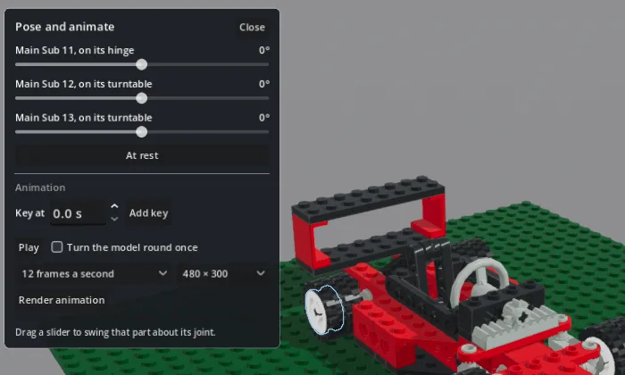
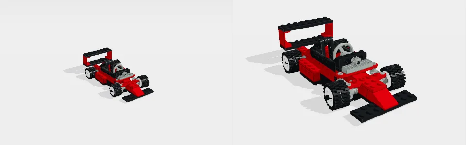
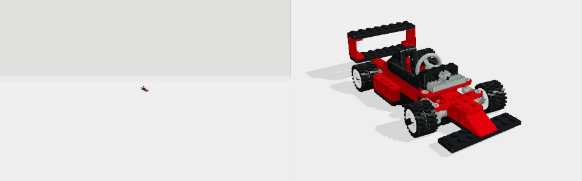
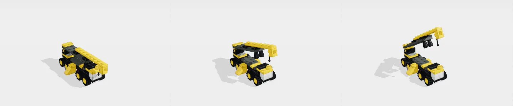
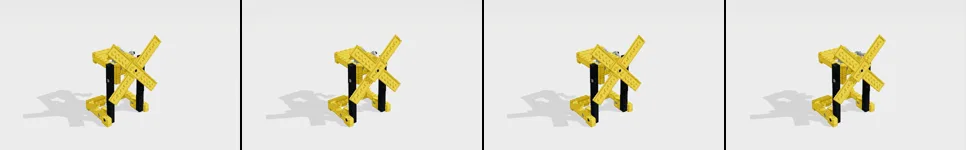

# Recording what moves

The owner asked whether recording an animation of a build's moving parts is
one cohesive, well-built feature. It is not yet. The pieces that move parts
are good, Grab best of all, but Brickworks has four notions of what moves,
and a person can record only two: Simulate's gear trains, and Pose's, the
weakest, which on real sets misses what moves. This is
the audit of 2026-10-20 (unit `animaudit`, on m106): what exists, what was
measured on five real sets, what was fixed, and a design for the owner to
decide on.

Evidence: `src/dev/anim_walk_probe.gd` walks every path on each set, prints
every answer and keeps every file. Its runs before and after the fixes are in
`bench/results/animaudit-2026-10-20/before/` and `after/` (`walk.log`, a
folder a set, the WebP, MP4 and frames of each render, `*_sheet.png` contact
sheets). Three real Claude Code sessions on the subscription, seeing only
Brickworks' tools, were asked what a person asks; their transcripts and
files are in `sessions/`. `src/dev/animation_probe.gd` checks each fix: 15
of its 23 checks fail on 32bccfcc, and all 23 pass after.

## What exists

| Path | What moves, by whose notion | How it is recorded |
|---|---|---|
| Build, Pose and animate… (`PosePanel`, `Poser`, `PoseAnimation`) | A slider for each sub-assembly the file names that has a shaft in a bore outside it (`Builder._joint_of`). It turns that sub-assembly's parts alone. | Key at / Add key keeps every slider's angle at a time. Play runs it in the window. Render animation draws it Quick, 480 × 300 or 720p, 12 or 24 a second, through the window's own camera, as a WebP, and on the desktop the frames and an MP4, in Downloads as `<model>_animation`. |
| Grab: a drag on a part (`GrabDrag`, `Grab`, `Bodies`) | Rigid bodies found from the real connections: hinges, pins, axles, clips, balls, studs; loops, racks, gears driven by their teeth, swinging under weight, coasting, toppling (docs/MECHANISMS.md §14-§26). | Not at all. |
| Tools, Simulate mechanism… (`SimulatePanel`, `Simulation`) | A gear train turned from its driver, by the gear reading. Where the driver's motion closes a loop the gear reading cannot turn (a pinion's rack, a crank's rod and slider), the loop as Grab moves it, through the same gear reading: racks slide, sliders stroke, rods rock (docs/MECHANISMS.md section 27). No weight: nothing swings or holds. | Record: 24, 48 or 96 frames of one turn, 24 a second, through the window's camera, as `<model>_mechanism`. |
| Play on a shared link (`ShareView`, `Playable`) | Grab's bodies, and the link card's words for them (steering, boom, doors, gears…). | Not at all. |
| File, Render… turntable (`RenderDialog`) | The model turning round once. | Quick, Good or Best, up to 4K, every lighting and lens. The only path with the full renderer. |
| MCP | `pose_model`: Pose's joints. `move_part`: Grab's bodies. `animate_model`: Pose's joints, or a part on its joint by number (`"#80"`), turned as Grab turns it. `simulate_mechanism record=true`: Simulate's. | `animate_model` and `simulate_mechanism` render as jobs, framed on the model ("hero"). |

The build playback (`BuildPlayback`) is the model going up step by step;
it moves nothing on a joint and cannot be recorded either. Only three
places write frames to a file (`RenderOutput.begin_turntable`): Pose's
Render animation, Simulate's Record and File, Render's turntable. Nothing a
drag or a played link does reaches one.

## How cohesive it is

### Four notions of what moves, and they disagree

Pose's sliders against `move_part` on the same part, each slider swung to
+90° and to -90° (`walk.log`, the "each Pose slider" lines):

| Set | Pose and animate's sliders | What `move_part` says of the same part |
|---|---|---|
| 8808-1 F1 Racer | Main Sub 11 "on its hinge" goes to +90 and not back past 0. Main Sub 12 and 13 "on its turntable" go nowhere. | Main Sub 11 is a rear axle that turns freely. 12 and 13 are the steering arms, in a loop with the rack: the steering, turned by its wheel (#80). Pose cannot steer the car. |
| 4096-1 Crane | EB Crane S04 "on its hinge" goes nowhere. | S04 is part of the body that stays (21 parts). The boom is #31's body, 11 parts on its hinge, which turns. Pose has no slider for it. |
| 31070-1 Turbo Track Racer | 8 sliders. Back Window goes to +90; Front Window 1° and -7°; Hatch 4°; Spoiler 34°. | Back Window's part is "Locked: this loop has no freedom", held at both ends: Pose tears it off what holds it. Grab finds Front Window and Hatch on their hinges. Spoiler turns freely on an axle and drives 18 parts of a gear train, which Pose leaves standing. Door Left and Door Right are not sliders. |
| 8020-1 Windmill | None. | Its sails on gears, which Simulate drives. |
| 6061-1 Siege Tower | Wall Left "on its turntable" goes to +90 (37 parts); Wall Right to -90. | Wall Left's part is one in a loop of six stud joints; Wall Right stands on the baseplate's studs. A minifigure's arm turns 15° before its shield meets its hips. |

So on real sets Pose's sliders are the file's build-step groupings, not the
parts that move. They miss the steering, the boom and the doors, offer joints
that cannot move, and swing what the real connections hold. Grab's bodies
are right in every case above, and Play on a link, `move_part` and the
link card all use them.

The zeros disagree as well. `move_part` and a key on `"#N"` count degrees
from where the part was built (`Grab.from_built`). Pose's 0 is where the
parts stood when the panel first read them. On 31070-1, after `move_part`
turned the spoiler (it swung down to 107° from where it was built),
`pose_model` listed "Spoiler, on its hinge, at 0°", though its description
says degrees are from where it was built.

### As Claude would, over MCP

- "Show me the steering turning" on 8808-1 (`s1_steering`): the session
  asked `move_part` what moves, tried the steering wheel (#80) at 90° and
  undid it, then keyed it 0, 90, 0, -90, 0 over 4 s. 24 s, 8 turns, and the
  front wheels steer both ways in the file. It said it had not watched the
  result, and read the answer's "— 3 s" (how long drawing took) as an MP4
  cut short of its 4 s. Fixed (fix 7).
- "Record the crane lifting its boom" on 4096-1 (`s2_crane`): it tried
  `pose_model`'s only joint at +45° and -45°, both "stops at 0°", before
  `move_part` found the boom (#31). The sheet of frames the answer now
  carried was too small to judge at half size, so it posed the boom again
  to look, and undid it. 69 s, 16 turns.
- The same again with full-size frames (`s3_crane`): it judged the
  animation from the picture ("down at 0 s, up at 2 s and 4 s, down again at
  6 s"), 43 s, 11 turns. It still spent two calls on `pose_model`'s dead
  joint first, and read the four frames, then drawn edge to edge, as the
  crane moving about the frame; they are drawn apart now. It found the
  crane small in the frame: framing what the boom sweeps leaves the truck a
  quarter of the picture wide.

### Can a motion made one way be recorded?

- Posed: yes, by Pose's keys.
- Grabbed: not by a person. A session can, by keys on the part (`"#80"`).
- Simulated: yes, by Simulate's own Record, into its own file at its own
  rate. `animate_model` on the windmill's gear turned the same sails by
  Grab's gearing: two ways to the same picture.
- Played on a link: no.

### Keys, timing, easing

- A key keeps every slider's angle. A joint cannot be keyed alone from the
  panel (a session's keys can name one joint).
- Each joint eases out of its first key and into its last (a monotone
  cubic, never past a key). Nothing can turn steadily: a wheel or a gear
  speeds up and slows down at every key.
- A key's time is set before Add key and cannot be moved after; a key can
  only be taken out.
- Turn the model round once with no keys turns it in a second, 12 frames.

### Camera, framing, size

- A person's render is drawn through their own camera, exactly as the
  window shows it. A part that swings out of view leaves the picture: the
  sweep is framed only for a named view.
- A session's render was drawn through the window's camera too, which it
  cannot see: on 8808-1 the car spanned 30% × 37% of the picture, and 2% × 3%
  once the window had been zoomed out. Fixed (below): 60% × 73% either way.
- 480 × 300 or 720p, Quick only. File, Render offers Good and Best up to 4K
  for a still or a turntable, but not for an animation.

### Length, cancel, where the file goes

- Cancel works: the panel's button (checked: stopped part way, nothing
  moved), Escape, and a session's job cancel.
- The file is `<model>_animation` in Downloads, written over by the next
  render of the same model. Every set from the Official Model Repository
  opened here is named after its main file, so 4096-1, 31070-1, 8020-1 and
  6061-1 all wrote `main_animation.webp`, each over the last.
- The MP4 came out at 25 frames a second whatever was asked, and after a
  longer run of the same name it held that run's frames past its own. Fixed.

### Does the render match what was seen?

For Pose's joints, yes: `pose_probe` reads every frame off the renderer's own
copy. For a session's keys on a part, no: Play showed them standing still,
and Render animation from the panel drew them still. Fixed.

### Scores

| Path | Score | Why |
|---|---|---|
| Pose and animate, by a person | 3/10 | Smooth keys and a true render, on a model whose sub-assemblies are its moving parts (pose_probe's crane, 31070-1's back window). On four of five real sets it cannot move what moves. |
| Grab, by a person | 9/10 moving, 0/10 recording | The best thing here, and nothing it does can be kept. |
| Simulate mechanism | 7/10 | Gear trains only, recorded well, framed for a session. Since section 27 of docs/MECHANISMS.md, racks and loops too, as Grab moves them. |
| Play on a shared link | 8/10 moving, 0/10 recording | |
| MCP | 4/10 before, 7/10 after | Steering, a boom and gears animate by part; framed now, playable by the person, says where a part stops, shows its frames, and marks `pose_model`'s joints that cannot turn. Still two joint namespaces. |
| The whole | 4/10 | Well-built parts, not one feature. |

## What was fixed

None of these changes the panel's layout, controls or wording. Each has a
check in `src/dev/animation_probe.gd` that fails on 32bccfcc.

1. **A posed joint comes back to where it was built.** 31070-1's back window,
   swung to 70° and back to 0°, stopped 6.17 LDU and about 4° short: the room
   test met what the window was built against. What a part overlaps at rest
   is no longer in its way (`Poser.rest_cells`), as Grab already forgave what
   a part touched as built (`Grab._built_touching`). Now 0 parts off.
2. **Play changes nothing.** `Poser.transforms_for` squared up every part it
   placed, so Play of keys on 31070-1's eight joints rewrote 73 parts'
   matrices (up to 0.0006 on 8808-1's) with no step to undo. Each part is
   turned from its rest and never drifts, so nothing is squared. Now 0.
3. **A session's animation is framed on the model and what it sweeps**
   (`render_animation(view = "hero")`), as `simulate_mechanism`'s recording
   already was. With the window zoomed far out the car spans 59% × 73% of
   the frame, from 2% × 3%.
4. **A session's keys on a part play and render from the panel.** The part
   was turned for one render (`PosePanel.carried`) and then dropped, so the
   person's Play and Render animation drew the steering still, and keys
   alone (render=false) were refused. The panel now takes each `"#N"` key
   afresh as Grab turns it (`PosePanel.turning_for`, `GrabDrag.Turning`):
   Play turns both steering arms and puts every part back; Render animation
   draws it turning (1,618 pixels change at 1 s, from 0).
5. **animate_model says where a part stopped.** 31070-1's windscreen meets
   the model at once; its animation was 13 identical frames, and the answer
   said only how many. It now says "#143 stops at 0° of the 30° asked: the
   Slope Brick Curved 2 x 2 x 0.667 (#566) meets the Bracket 5 x 2 x 1.333
   with Understud in Centre (#42)". A click hinge's clicks are not counted
   as stopping short.
6. **The MP4 is what was asked.** It is made at the frames' own rate (12 or
   24, not 25), and the last run's frames are cleared first, so 6 frames
   after 12 of the same name make an MP4 of 6 (it was 23, at 25 a second).
   This is every MP4 the app writes: Pose, Simulate and File, Render's
   turntable.
7. **A session sees what it rendered.** `animate_model`'s answer carries its
   frames at its keys (four spread out when there are more or none) as one
   picture, full size and drawn apart (`PosePanel.sheet`), and says "37
   frames, 12 a second, drawn in 2 s" rather than the panel's line, whose
   closing "— 3 s" a session read as the film's length. The panel's own
   words are unchanged.
8. **pose_model says which joints cannot turn.** Both crane sessions swung
   `pose_model`'s one joint +45° and -45° before `move_part` found the boom.
   Its list now marks a joint with no room to turn 10° or 90° either way
   (`Poser.has_room_to`, changing nothing) and points to `move_part`: on
   8808-1 the two steering arms, on 4096-1 its one joint, on 31070-1 the
   front window and the hatch.

Also checked after the fixes: `pose_probe`, `simulate_probe`, `render_probe`
(windowed), `mcp_walk_probe` and `app_tools_probe` (headless) all pass.

## A coherent design, for the owner to decide

One model of what moves: Grab's bodies. One way to record any motion:
keys on those bodies' joints, made by posing, by dragging or by running a
mechanism, and played and rendered the same way. Smallest valuable step
first.

1. **Pose's sliders are the joints `move_part` lists.** A slider for each body
   on a joint (Playable's words first: steering, boom, doors, turntable),
   named by its sub-assembly where the file gives one, each turned as a drag
   turns it: its stops, its loop, the gears it drives, from where it was
   built. The keys and the renderer are unchanged; `"#N"` keys already play
   this way (fix 4). The steering, the crane's boom and the doors become
   sliders, and nothing is torn off what holds it. This changes which sliders
   the panel shows, so it is the owner's call. No new control.
2. **Record a drag.** A Record button in the panel: while it is on, each drag
   (or a run of Simulate, or Play on a link) is kept as keys at the times it
   happened, a take that then plays and renders like any keys. This is the
   feature a builder would reach for first, and one a keyframe tool cannot
   offer: animating by moving the real mechanism by hand. One new control.
3. **Render animation through File, Render.** Its quality, size, lighting and
   lens for an animation as for a turntable: the render dialog gains
   "Animation" beside Turntable, and Pose's own size and rate choices go
   there. A camera choice, "as I see it" or "framed on what moves" (the
   session's), so a boom swung out of view stays in the picture; and framed
   on the parts as they sweep rather than on their box, which leaves a
   crane's truck a quarter of the picture wide.
4. **A timeline of keys per joint.** A row per joint with its keys on it,
   dragged to retime, each key eased, linear or held, so a wheel or a gear
   can turn steadily, as keys work on Blender's timeline. It replaces Key
   at / Add key.
5. **Names that keep every render.** `<model> <what moved>.webp`, numbered
   when one is there already, and a set's own name for its title rather
   than "Main".

Steps 1 and 2 together make one feature: everything that moves is a joint
you can pose, drag, record and render, by hand or by Claude.
