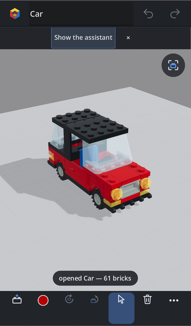

# The app against the best tools, round eleven

Written 2026-11-20 by uxplan11 against `pre261` at `0009db19e`. The web was
measured on live brickworks.diy, rel-m316 (`7f25aa4bf`). [APP_UX.md](APP_UX.md)
to [APP_UX10.md](APP_UX10.md) planned rounds one to ten.

The owner asked on 20 November: "Are you still effectively building to
reach our goals of having the absolute best app (and site) of this type?"

## The answer, short

- **For the app, mostly yes, and the gaps are now named and counted.** The
  scorecard at the top of [COMPETITIVE.md](COMPETITIVE.md) puts Brickworks
  against six tools in fourteen rows: **ahead in 78 of 98 cells, level in
  11, behind in 9.** The 9 behinds are this round's first measure, and the
  plan below works on 7 of them.
- **Two behinds are big, and one is new this week.** On phones a first
  visit takes 20 s and a return 15 s on an iPhone's engine, where the native
  phone builders open at once. And Kinebrick Studio 0.3.0 (20 November)
  added gravity, contact, pneumatics, wired electrics and Pybricks:
  Simulate and Technic are behind it, and Kinebrick works 701 real sets'
  functions to Simulate's 391.
- **For the AI design track, no: the last eight rounds did not move it.**
  design20 to design27 each ended NO-GO. The measure is right as a goal but
  cannot see a step forward from where the designs are. No further lever
  round should run before the measure can see one (**designmeasure**,
  first).

## Where round ten's units stand

Ten of APP_UX10's fourteen rows are done: eight live, and two on `pre261`
riding rel-m317. Two are in review. The design track's two each ended
NO-GO, as did design27 after them. The lead added smalls9, smalls10 and
kbkeep3 during the round. Read from `queue.md`, `git log pre261` and each
unit's own record:

| # | unit | where | its bar, as it ended |
|---|---|---|---|
| 1 | design25 | **NO-GO**, record merged (`cf381e434`) | a real set's form parts at the close look won head to head 69% (surface 72%), reach 9 of 8, build check 14 of 16. **Not met:** SNOT 3.8% (bar 10%), steps named in 60% of surface losses (bar a third). Only 299 parts in 71 spots were kept; the stepped outlines came from the first build |
| 2 | webstart12 | live, rel-m315 (19 Nov 23:09Z) | an iPhone's first screen compiled in layers: WebKit as an iPhone working 19.4 to 17.3 s, Wasm at its height 432 to 360 MB in its own runs. **Not met:** 300 MB, 15 s, and a 12 s compile at a quarter speed (the floor: a 124-script cycle). **Today on live, Wasm at its height reads 432 MB on both engines** (open question 1) |
| 3 | mcpreach3 (and m3fix) | live, rel-m315 | met: a save always written for a person; a set added by number in 1 call; a click hinge posed; the mount said; `edit_steps` says why. The walk's r5 took 1 call, r1 15, t9 3, and g1 done |
| 4 | setcheck | live, rel-m315 | met: on 10 sets, 90 changes found, 0 missed, 0 false; g1 in 3 calls; nothing written. The longest frame on 42100-1 was 100 to 199 ms (accepted) |
| 5 | ownswap (and osfix) | live, rel-m316 (20 Nov 07:38Z) | met: Use what I own, one finish rule shared with rareswap (735 to 718 picks); its worst frame at parity with live's Find and Replace. The 16 ms target is KNOWN, and is smalls12's |
| 6 | jointlock (and jlfix) | live, rel-m316 | met: a joint locked in Pose holds in Together, through a breakout and through both swaps; a Motion's joint saved where it is (a live fault fixed); `jointlock_probe` 134 passed, 0 failed |
| 7 | swoosh | `pre261` `a624d46ba`, rides rel-m317 | met: Stress › Swing; hand sums within 0.06%; the first to let go named on 10 of 10 gallery models. **KNOWN:** on vintage_tractor and sports_car Strengthen finds "no fix of up to 3 parts with room". Orthanc's swing frame takes 91 to 289 ms (Lift's copy cost; Lift itself 323 to 628 ms), which is smalls11's |
| 8 | phonefingers | live, rel-m316 | met: a two-finger tap undoes, a three-finger tap redoes, a double tap turns 90° in Select; 0 false fires in 100; walks 54 of 54 and 27 of 27 |
| 9 | finishpass | READY `b236ab7d9`, **in review** (fpreview) | its own bar met: counts, ghosts and ticks shown first; Lay in one undo, byte for byte back; 10 of 10 models. The Lay frame takes 121 to 205 ms (KNOWN). **fpreview's High (13:13Z):** closed mid-read and opened again, the pass runs whole on the main thread (a 9.6 s frame on Orthanc) |
| 10 | blockauthor | live, rel-m316 | met: a person blocked silently; their models, comments, remixes and lists leave your pages; follows end; 8 acts refused both ways in neutral words; Unblock in Settings; a count in /admin › People |
| 11 | idleframes | `pre261` `773fdbe33`, rides rel-m317 | better, **not met**: at a quarter speed, turning the car x0.70, Orthanc x0.83 and the car still x0.84, against bars of 2, 20 and 30 ms; nothing drawn at rest by the change. **idlesleep** (nodes asleep at rest) is next, queued |
| 12 | smalls8 | live, rel-m315 | Lift was fine on live (the walk's fault); the first pick's 15 programs drawn out of sight after load (807 ms late click to 193 to 442 ms). **Not met:** a cold first pick in 600 ms. smalls9 found why: a 1.4 s SwiftShader GPU wait, not fixable here |
| 13 | camerakeys | READY `f864b1f16`, **camreview said FIX FIRST**; camfix running | its own bar met: a MOTION_CAMERA line; 3 keys to 0.000 LDU and 0.000°; a turntable; bytes twice; picked keys in one undo; 1 call over MCP. camreview's High: re-keying a turntable's last key collapses the full turn. Mediums: `render_motion camera=` replaces unmarked; a picked drag overwrites a key; the view held after an open |
| 14 | design26 | **NO-GO**, record merged (`54de335f0`) | told is not laid: head to head 38%, technique 0 against 0, the seen surface on 3 of 8; sessions dropped panels after 39 refusals (base 11) |
| — | design27 | **NO-GO**, record merged (`0009db19e`) | the app laid a Technic face (a course of Technic bricks, a beam on edge, panels on pins): it laid on 4 of 12 bodies; screen head to head 38%, technique 0 against 0, the set's seen surface on 2 of 8, refusals 19 against 14. It names its next lever: the working part (a boom, a bucket on lift arms) built in liftarms on pins |
| — | smalls9 | `pre261` `b13cdf5c8`, rides rel-m317 | met: parts lists in 100 ms or less (Orthanc 70.6, 10179 55.4); frames after a change 79.6 ms; the bench refuses a tree missing a class in 0.4 s. **Not met:** 10179's first working-out 961 to 131-174 ms (KNOWN at 300) |
| — | smalls10 | `pre261` `24f2dbb62` | met: a seated part swaps for a newer mould or print (2780 to 4459, 3815 to 3815b and 6 more, one undo); the view never ends under the floor (0 of 200). Items 2 and 3 went to **smalls12** |
| — | kbkeep3 | READY `91b229b98`, **in review** (kbk3review) | an unedited save writes the opened file by one fast path: 185 of 185 twice, 126 of 126, an edited save as `pre261`'s; an unedited save x0.25 to x0.5 |

rel-m317 (idleframes, smalls9, swoosh) was held on rsreview at 12:55Z and
reshipped. It was reshipping and deploying while these runs ran.

## How it was made

- **The tasks over MCP, through the connector, as the owner's Claude goes.**
  This is APP_UX9's runner, `run.sh`, run from a locked snapshot of `pre261`
  at `0009db19e`, imported first (`uxplan11-snap`).
  - The app runs as a signed-in tab of a throwaway account, opened through
    the relay (`relay_account.mjs`) and closed at the end.
  - Claude Code reaches it as an http MCP server at the relay's `/api/mcp`.
  - It runs `claude -p` on the subscription: the Brickworks server alone,
    `--tools ""`, `--restricted`, no API key. It needs a slot of the live
    database's lock, and **today it got none inside the bound** (see "Over
    MCP" below). The latest walk, mcpreach3's of 19 November, stands in.

  The order it was to run in, the new tasks first:
  - **round ten's five** (h1 to h5), new: a car swapped for what I own; a
    set marked built; a motor's program; a click hinge at 90°; 10179's lots;
  - **this round's frontier eight** (k1 to k8), new and each a gap in the
    scorecard: a photo-real render; files for Studio and for a printer; a
    gear train in Simulate; four wheels as one sub-model; a BrickLink wanted
    list; a booklet with its parts list; a mosaic; and a lighthouse at
    Creator set quality;
  - the walk's ten (t1 to t10), then round ten's frontier six (g1 to g6),
    as time allowed.
- **The web, on live brickworks.diy** (rel-m316, `7f25aa4bf`), with
  `pre261`'s flows under `heavy`:
  - **a phone's first visit and return** on Playwright's WebKit as an
    iPhone 13 and on Chromium as a phone (`phonetruth_flow --steps=load`);
  - **the walk by finger**, `phonewalk_flow`'s acts, at 390 x 844 and
    1024 x 768 on Chromium, each on its own throwaway account. The same
    walk on WebKit, and `load_check` at a laptop's size, queued behind
    rel-m317 and did not run (see "The web").
- **The walk, an eleventh time:** appux8's script as uxplan10 left it, at
  1280 x 720, from the snapshot, on the GPU.
- **Round ten's bars** were read off the merged units' own probes as the
  release trains ran them today (rel-m316 and rel-m317): `ownswap`,
  `jointlock_time`, `swoosh`, `swing_bound` and `smalls9`.
- **The field** came from each tool's own pages, release notes, commits and
  store listings, read on 20 November 2026 between 12:49 and 13:15Z. Copies
  are in `bench/results/uxplan11-2026-11-20/sources/` (82 files).
- **Not run:**
  - Studio itself: BrickLink, which serves its installer, has been offline
    since 19 November;
  - Kinebrick Studio and the phone apps;
  - the in-app assistant on a key (it spends money).
- **The box was shared** with rel-m317's reship and deploy, and with other
  projects' tests, at loads of 40 to 101. Every heavy job of the project
  waited beside the release's while it ran. Seconds are stretched by the
  load; counts are not.

## What the walk measured, eleven times

The first seven rounds' figures are in APP_UX4 to APP_UX8. The walk ran
at 1280 x 720 from the snapshot on the GPU, at loads of 46 to 70, from
13:27 to 13:31Z, and Godot quit cleanly (the leak lines at exit are the
engine's own, as before). 1400 x 900 was not run: in round ten it gave
1280's answers but where a taller window keeps the bin in sight, and the
bound went to the MCP walk. Round ten's column is its own 1280 x 720 run.

| act | round ten, 1280 x 720 | now, 1280 x 720 | from |
|---|---|---|---|
| desktop start, the first 120 frames | 8.5 s (load 23 to 39) | 9.2 s (load 55 to 70) | walk |
| bin tiles in sight on the first open | 24, every one named | the same | walk `counts` |
| keys sheet (F1), rows in sight | 32 of 162 | the same | walk `counts` |
| commands with a key | 120 of 233 | 120 of 234: setcheck's "Compare with the set" has none | walk `counts` |
| the tallest menu, rows (height) | File 24 (482) | the same; Edit 23 (442), View 22 (456) | walk `menus` |
| a wall of eight 1 x 4s from the search | 20 events, 3.1 s (3.8 s the second time) | 20 events, 4.0 s (3.2 s) | walk `wall`, `round6` |
| the ghost following the pointer, 3 frames a move | 38.1 ms, worst 74.2 (48.5, worst 111.5) | **60.0 ms, worst 85.7 (59.7, worst 177.5)** | walk `wall`, `round6` |
| R on a brick in a wall; a brick alone, 3 x R | 15.0°; 45° | the same | walk `turns`, `dialogs` |
| panels and dialogs | 22 of 24, 1.03 to 2.31 s | 22 of 24, 1.04 to 2.77 s (the minifigure maker the longest); Compare and Pattern greyed, as before | walk `dialogs` |
| search, 30 words | 27: the same three not first | the same | walk `search` |
| the car's instructions, 240 frames | 3.8 s | 4.4 s | walk `round3` |
| Cut away by a box | 1.0 s | 1.2 s | walk `round4` |
| a 2 x 4 clicked with Stress open | the bin gives way, back by its rail | the same | walk `round7` |
| a 4740 dish on a 6141 round plate by hand | 14.14 across (the walk's click) | the same | walk `round7` |
| Check stability on the car | 17 ms, "a 34° tilt tips it" | 12 ms, the same words | walk `round7` |
| Edit › Find and replace, Ctrl+Shift+H | 1 press; 16 ms; one undo to the byte | 1 press; 11 ms; the same | walk `round8` |
| the tower on one corner stud, Stress open | Strengthen offered, and it stands | the same | walk `round8` |
| Stress › Lift, the tower's top brick clicked | not lifted after 26.7 s | not lifted after 28.6 s: the walk's own click, as smalls8 found on live | walk `round8` |
| View › Reset panel layout | the bin back | the same | walk `round8` |

**Found on the way:**
- **The ghost that follows the pointer is slower:** 60 ms a move against
  38, and its worst 177.5 ms against 111.5. The load was about twice
  round ten's (55 to 70 against 23 to 39), and the dialogs and the
  instructions are slower by less (x1.1 to x1.2), so the box is the first
  suspect. idleframes, jointmarks and smalls9 all changed per-frame work
  since. It is timed again as a same-moment pair of `pre261` against
  rel-m315's commit before anything is fixed (smalls13, item 3).
- **The bin's search typed at 1280 x 720 lands in the walk's own field:**
  "plate 1 x 1", "1x1 plate" and "87087" each show the 2 x 4 first, as in
  round ten's 1280 x 720 run, where 1400 x 900 found each first. It is the
  walk's, not the bin's.
- **setcheck's command has no key.** Compare with the set is reached from
  Compare's own dialog, so it needs none.

## The web

**A phone's first visit and return** on live (rel-m316), at loads of 46 to
53 (`phonetruth`):

| | Chromium as a phone (390 x 844) | WebKit as an iPhone 13 |
|---|---|---|
| first visit, cold, to working | **19.2 s** | **20.3 s** |
| over the wire | 9 MB | 19 MB |
| return, to working | **10.8 s** | **15.3 s** |
| the browser's memory at its height (Pss) | 808 MB | 1,623 MB |
| Wasm memory at its height | **432 MB** | **432 MB** |

- PHONE.md's iPhone figure was 12 to 21 s, and APP_UX10's 19.3 s. A first
  visit on WebKit has not moved below 17 s in four rounds.
- Wasm reads 432 MB on WebKit, where webstart12 measured 360 MB in its
  own runs and rel-m315 shipped it (open question 1).
- An iPhone reliably gives a page about 300 MB (WebKit 269937, PHONE.md).
  432 MB is still over it.

**The walk by finger** on live (`phonewalk`, 12:54 to 13:37Z, each size on
its own throwaway account, deleted after):

| | acts done by finger | over twice the desktop's presses |
|---|---|---|
| Chromium, 390 x 844 | **27 of 27** | 1: Simulate's driver, 3 taps for the desktop's 1 |
| Chromium, 1024 x 768 | **27 of 27** | none |
| WebKit as an iPhone 13, 390 x 664 (phonefingers' run, 19 Nov 23:02Z, on its preview) | **27 of 27** | the same Simulate driver, 3 taps |

- Round ten's walk did 44 of 46 on Chromium, its misses in Motions. Every
  Motions and Simulate act is done now, at both sizes.
- phonefingers' three acts (a two-finger tap undoes, three redo, a double
  tap turns) are done at both sizes, and 100 two-finger turns, pinches and
  twists undid nothing.
- Simulate's driver takes 3 taps at 390 x 844 where it took 2 after
  phonepanels (`src/ui/simulate_panel.gd`, a tap's selection). It goes to
  smalls13.

**Not run inside the bound:** the walk by finger on WebKit, and
`load_check` at a laptop's size. Both queued under `heavy` at 13:37Z
behind rel-m317's solo timing checks, and at 14:22Z they had not started.
They were stopped, since neither could end by 15:45Z. The WebKit row above
is phonefingers' own walk, on a preview of `pre261` with phonefingers,
the night before; the laptop's start is webstart13's first measure.

## Over MCP: the tasks as the owner's Claude does them, through the connector

**Round eleven's own walk did not run.** It queued at 13:37Z for a slot of
the live database's lock (`tools/release/live_db.sh`). A connector walk
writes to the live database through the relay, so it never runs beside a
release. rel-m317's reship had held the lock since 12:54Z, and at 14:20Z
it still had 13 of its 18 named preview checks to run, then its live
step: hours more at the pace of its first five. The walk was stopped at
14:24Z, as it could not start and end inside the bound (15:45Z). Its
thirteen new tasks are below, word for word, and mcpreach4 runs them
first.

**The latest walk through the connector is mcpreach3's**, of 19 November,
after its fixes, on its own branch. Its record is in
`bench/results/mcpreach3-2026-11-19/walk/after/calls.txt`. 17 tasks took
117 calls in 16.3 minutes, and no task errored:

| task | APP_UX10: calls, time | mcpreach3, after | where the calls went |
|---|---|---|---|
| r5: set 31058-1 added, marked built | 2, 15 s, **not done** | **1, 10 s, done** | none |
| t9: the top row three steps later | 7, 30 s, not all of it | **3, 19 s** | none |
| g1: 7140-1 with two changes, compared with the set | 2, 24 s, **not done** | 14, 111 s, done | `undo` and `redo` to compare steps; setcheck has since made it 3 |
| r1: a SPIKE motor's program, three times to 90° and back | 30, 262 s | **15, 139 s** | `attachment_points` on the motor 3 times, one face each; the arm refused once for an overlap; the program run twice more, only to see the arm at 90° |
| y6: the SPIKE motor lifting a beam | 32, 289 s | **19, 173 s** | `attachment_points` 4 times, one face each; the motor stood on a stand it could not turn on ("that part turns on nothing"), and was built again |
| r2: a click hinge arm at 90°: will it droop? | 14, 95 s | 18, 108 s | the hinge was posed with no assembly named (mcpreach3), but `move_part` on the hinge brick was refused twice ("would turn on its click hinge in the Hinge…"); an undo |
| t7: a beam 7 standing, a pin in its second hole | 11, 147 s | 8, 86 s | the first build refused (the pin's two connections); a stand of plates found in two what-ifs |
| f3: a car from only my loose parts | 9 | 16, 137 s | it went on past the first build, as the answer asks (`fresh_eyes`, an edit, a second save). One edit named a brick number that does not exist: "No brick has number 14" |

The rest (t1 to t6, t8, s1, s2) took 0 to 7 calls each, as before.

**Where the person's Claude still needed more than the window, or
guessed** (each is mcpreach4's):
1. **A part with no studs is asked about face by face** (r1, y6:
   `attachment_points` 3 and 4 times). One answer gives every face's joints
   and how real sets mount it, as the window's connection points show them
   all at once.
2. **A click hinge's own brick refuses a move** (r2). `move_part` on the
   hinge brick moves the hinge's moving half, as a drag on it does.
3. **`submit_design`'s answer gives no numbers**, so the next edit guessed
   one (f3). It names the numbers of the bricks it laid.
4. **A program is run again only to see a pose** (r1).
   `simulate_mechanism` gives the picture at a moment asked for, with no
   second run.
5. **A what-if reads as nothing done** (g1, y6, t7): "on a copy of the
   model as it stands: nothing on the baseplate changed" is said before
   what the copy showed. It says first what the copy showed, then that the
   model itself is as it was.

**Round eleven's thirteen tasks, for mcpreach4 to run first**, each a new
session's in order (h1 to h5, then k1 to k8):
- **h1:** "Clear the baseplate. Add these to my collection as loose parts:
  twelve red 2x4 bricks, eight blue 2x2 bricks, six black 2x4 plates and
  four yellow 2x2 slopes. Then build a small car of about 30 parts from
  whatever parts look best. Swap every part you can for one I own without
  changing how it looks, in one go, and tell me what you swapped and what I
  would still have to buy."
- **h2:** "Add set 31058-1 to my collection. I have built it and it stands
  on my shelf, so its parts should not count as loose parts. Then tell me
  how many loose parts I have to build with."
- **h3:** "Clear the baseplate. Build a SPIKE Prime large motor on a stand
  turning a Technic beam 9 long as an arm. Give the motor a program: turn
  the arm up to 90 degrees at half speed, wait one second, back to 0, and do
  that three times. Play it in Simulate and tell me what the arm does."
- **h4:** "Away from the motor, build a small arm on a click hinge: a 1x2
  hinge brick on a 2x4 plate, a 1x6 plate as the arm, and a 2x4 brick on
  the arm's far end. Pose the arm straight out at 90 degrees. Will the hinge
  hold it there, or will it droop?"
- **h5:** "Open LDraw's model of set 10179-1 from the library. How many
  parts and lots does it have, and which colour has the most parts? List
  its five biggest lots."
- **k1:** "Open LDraw's model of set 7140-1 from the library. Render it as
  a photo-real picture, 1920 x 1080, on a white background with a soft
  shadow under it, then a second picture from low down and to the left.
  Tell me where the two files are."
- **k2:** "Export this model as a file I can open in BrickLink Studio, and
  as a 3D file I can open in Blender or send to a 3D printer. Tell me the
  files and what each one keeps of the model."
- **k3:** "Clear the baseplate. Build a Technic gear train in a frame of
  Technic beams: a motor turning an 8-tooth gear, meshed with a 40-tooth
  gear on its own axle. Run it in Simulate and tell me how fast the 40-tooth
  gear turns, and which way, against the motor."
- **k4:** "Clear the baseplate. Build one wheel assembly as a sub-model: a
  wheel, its tyre and an axle holder brick. Put four copies of it on a 6x10
  plate as a car's chassis. Then make the tyres white inside the sub-model,
  and tell me whether all four wheels changed."
- **k5:** "Which of the parts in this chassis do I not own? Make me a
  BrickLink wanted list for exactly those parts, and tell me where the file
  is."
- **k6:** "Make the chassis's instructions into a booklet with the parts
  each step needs shown beside it and a full parts list at the end. How
  many pages is it, and what is on the last page?"
- **k7:** "Clear the baseplate. Make a 32 x 32 mosaic of a red heart on a
  white background from plates, as a picture to hang on a wall. How many
  parts does it take, and in how many colours?"
- **k8:** "Clear the baseplate. Design a small lighthouse about 20 cm tall
  at the quality of a LEGO Creator set, with a lamp room at the top and a
  little house beside it. Tell me which parts make it read as a real set
  and where you had to guess."

Each k task is a row of the scorecard asked of the person's Claude: render,
files, Simulate, sub-models, the collection, the booklet, a mosaic, and
design at a set's quality. Until they run, the scorecard's AI row stands on
the tools' own probes and mcpreach3's walk, not on these.

## Round ten, item by item

The plan was to run round ten's probes on the snapshot while the MCP walk
waited. They queued behind rel-m317's solo timing checks for 40 minutes,
and `ownswap_probe` timed out unrun, so they were stopped at 14:19Z. The
same probes had already run in the release trains, on the trees that carry
these units: rel-m316 (`7f25aa4bf`, live) and rel-m317's reship
(`7c550cf3c`, at 12:25 to 12:28Z today). Their logs are in
`bench/results/release-out/`. These are the numbers below:

| unit | probe, train | passed | KNOWN, each a bar not yet met |
|---|---|---|---|
| ownswap | `ownswap`, rel-m316 and rel-m317 | 115 of 115 both times | 4. On 10179, Use what I own takes 943 ms over 24 frames, its longest 126.1 ms against a target of 48 (6 frames over); the swaps listed, 52.9 ms (2 over). These are **smalls12**'s |
| jointlock | `jointlock_time`, both | all | none: on Orthanc no frame does more than 16 ms of the lock's work (the whole model dragged, worst 2.08 ms). The windowed `jointlock` probe is not in a train's list; the unit's own run was 134 passed, 0 failed |
| swoosh | `swoosh` and `swing_bound`, rel-m317 | 19 and all | 5. A Swing's longest frame is 137.5 ms on Orthanc and 296.0 ms on 10179, against 100 (**smalls11**). Strengthen finds no fix of up to three parts on vintage_tractor and sports_car, so the first to let go goes later or not at all on 8 of 10 seeds, not 10 |
| smalls9 | `smalls9`, rel-m317 | 19 | 3. Find and Replace on 10179 and Orthanc: the find itself takes a 262.3 ms frame and a 165.4 ms one, against 100 (**smalls13**, item 3) |

Nothing failed. Each line not met is a queued unit's bar (smalls11,
smalls12, smalls13). phonefingers was measured above, by finger on live.

## What the field does that Brickworks does not, yet

The scorecard ([COMPETITIVE.md](COMPETITIVE.md#the-scorecard)) holds each
cell's verdict and its evidence. Here is what changed since 19 November,
and what each tool does that a builder would reach for.

**Kinebrick Studio 0.3.0** (20 November, [kb-rel]) is the largest change
this week. It is a desktop app on LDraw for Windows, Mac and Linux, with
these new parts:
- **Physics:** "every part nothing holds has weight and hangs from its
  joints"; parts that touch push and stop each other and hold by friction.
- **Mechanisms:** cams, Geneva drives, ratchets, slip clutches, CV joints,
  and worms that turn their wheels the right way round.
- **Bands, strings and chains**, as belts and springs, and **pneumatics**:
  air flows through tubes, and pumps and valves work.
- **Electrics:** PF, 9 V and Powered Up cables of fixed lengths, battery
  boxes whose switches are worked on the part, and **Pybricks programs** on
  hubs.
- **Carts** that follow a track; gears that mesh as they snap; **a camera
  track on the timeline**.
- **AI agents such as Claude Code** can look at the open model and set it
  up, each change undoable.

Kinebrick's README counts 701 of 1,226 real sets' functions working
([kb-readme]). Simulate works 391 of 1,224 ([KINEFUNCS.md](KINEFUNCS.md),
unchanged since 13 November). Brickworks is behind in two rows here:
motion and Technic. Collision while building, sub-models, booklets, the
collection, sharing, working together and the browser remain Brickworks'.

**StudWorx 2026-11-19** ([sw-rel], [sw-site]) added a joint overview, Studio's
lighting, and the joints' poses played as a GIF. Its booklet tools are the
ones Brickworks lacks:
- an element inspector that shows the space around and inside each item;
- a page locked (its items stay; it can't be removed), or frozen (it keeps
  its own settings when all pages change);
- Highlight Width, the new parts' outline from 1 to 72;
- the booklet exported as HTML.

Brickworks has the rulers and guides already.

**BrickLink Studio 2.26.10_1** (27 October, [st-dl]): nothing new. BrickLink
itself, which hosts Studio's gallery, prices and installer, has served a
maintenance page since 19 November 09:00 PST ([st-bl]). Studio's own `.io`
remains the file every other tool's user is sent. Brickworks writes `.io`,
but "not yet seen opening in Studio" (CHANGELOG).

**Mecabricks** ([mb]): no release. Its forum has "workshop is broken …
cannot save" from 9 November, and the render farm has been offline since
30 June.

**LeoCAD 26.09**, plus a test build of 19 November with stud snapping
([lc-rel]): LeoCAD takes LDraw's 2026-10 update (129 new parts, [ldraw]),
where Brickworks' catalogue stops at 2026-09.

**LDCad 1.7 Beta 2b** ([ld]): no change.

**The phone builders**, new to the scorecard:
- **Brick Creator 3D 1.1.1** (19 November, [bc3d]): an iPhone app with
  3,700 parts. A two-finger tap undoes, which Brickworks matched in
  rel-m316. It has PDF steps and a parts list with prices.
- **Tumbly Blocks** ([tumbly]): designs from the bricks a person owns. It
  reads "which bricks and colors are there" from the camera, and "a voice
  reads every step".
- **Stackable Studio 1.3.3** (11 November, [stackable]): "scan a pile once
  and get builds picked to fit those bricks", with 3D steps and a PDF.
- Each opens at once, as a native app does. Their designs are small, and
  none has collision, a load check or sub-models.

**The AI field:**
- **BrickAgent** and **BrickWright** have not changed since 18 November
  ([ba]). BrickNet added BrickFlow (photo to model, a research model) and
  BrickNet-Render on 17 November.
- **BrickBench's leaders** ([bb]): GPT-6 Astra (ELO 1297, VQA 0.954),
  GPT-6.1 Sol (1293), Claude Opus 5.5 (1249), BrickWright (1136) and Claude
  Opus 5 (1101). Brickworks is not entered: submissions are the owner's.

**Other new tools:** Pic2Bricks (a photo as a mosaic), Brick Finder App (17
November, parts found in a pile), SPIKE Lab, `fll-robot` and a browser
`ldraw-3d-viewer` ([new]). None changes a cell.

## Past parity: what no tool has

Six candidates were judged on what Brickworks has today, what the field has
(from its own pages) and what a person building would feel. Two are worth
a unit now, two wait on a measure, one is small, and one is a measure, not
a feature.

**1. "Where does this part go?"** A builder at step 40 of 10179 holds a part
and cannot find its step.
- **Brickworks today:** photo search in the bin (Brickognize) names a part
  from a photo. stepsearch finds a step by its part in 72 ms.
  Build mode walks the steps. The three are not joined.
- **The field:** none found. Tumbly reads a pile by the camera, not a part
  in hand against a booklet.
- **Judged:** worth a unit now (**partstep**). Every piece exists, and it
  turns two features into the one question a builder asks most.

**2. One booklet for two builders who meet.** A parent and child, or two
friends, build one set at one table.
- **Brickworks today:** sub-models, steps worked out, and Build together
  in the window, but one booklet in one order.
- **The field:** none found.
- **What is missing:** the steps split into two strands with even part
  counts, each a sub-model or region a builder can do alone, meeting at
  named steps. Each strand gets its own booklet and parts.
- **Judged:** worth a unit (**twobuilders**), after pagetools, in wave 3.

**3. A step checked by the camera.** A photo of the build so far, told
"step 12 is done, but the 2 x 4 plate is one stud to the left".
- **The field:** none found.
- **Judged:** measure first (**photostep**): can a photo of a build be read
  to one step, with the missing part named? As an MCP task first
  (`look_at_picture` against the step's render), then in Build mode if it
  holds.

**4. A pile scanned into what I own.** Not past parity: Stackable and
Tumbly do it, and Brick Finder finds parts in a pile. It is here because
it is the collection's behind against the phone builders.
- **Brickworks today:** a set by number, a part by photo (one at a time),
  a BrickLink or Rebrickable list.
- **Judged:** measure first (**pilescan**). Brickognize answers one part a
  photo. Whether a pile can be read at all, and how well, is the unit's
  first number, and it stops there if it falls short.

**5. Steps read aloud.** Tumbly reads every step, and no CAD tool does.
- **Judged:** small, in **smalls13**: the browser's speech and Godot's text
  to speech on desktop, in the four languages the app speaks.

**6. A ladder of the real set, made worse a step at a time.** This is a
measure, not a feature: below, under the design track (**designmeasure**).

Bag numbers by part count, a booklet for an age (agesteps) and a pile
counted from one photo in the window were judged smaller than these. They
stay in "Next".

## The design track: eight NO-GOs, and what comes first

**Plainly: another lever round is not right now.** design20 to design27
each ended NO-GO. Each cost 3 to 15 hours of the box and of the
subscription. Each won something on its own screen that did not carry to
the measure:
- design24's feature form won the screen head to head 63%, then +2 subjects
  against the set on the paired 44 (-5 to +10);
- design25's real-set form parts won 69% head to head, then failed on SNOT
  and steps named;
- design26 and design27 each lost the screen at 38%.

**Is the measure sound?** As the goal, yes. "Does the design beat the real
set, judged from pictures, on held-out subjects" is the owner's north star
and the right one. As a steering signal for a lever, no. It is floor-bound
where the designs are:
- **The subject decides the verdict, not the design.** Over 418 designs
  judged both orders, which subject explains 60% of an overall verdict's
  variance, which design 13%, and which order 27%. For technique the
  design's share is 0% ([DESIGN_SCORES.md](DESIGN_SCORES.md), "Why: the
  subject decides the verdict").
- **30 of the 44 subjects were won overall by none of four designs** (main,
  t3lay44, shapefirst44, signature44). A lever is read on about 8 subjects.
- **The judge's dimensions move together.** On a pair that differs in one
  thing, 399 of 416 verdicts (96%) on the other dimensions went to the
  better model.
- **The noise is wider than a lever's step.** The paired 44's interval is
  about ±7.5 points, and a screen of 8 to 16 subjects ±20 to 22.
- **The base's own rate wanders:** 24% (14 to 38) on 16 November. Every
  arm since design21 sits inside it.

So a lever that moves a design half a step closer to the set is invisible.
The judge still prefers the set, the same 30 subjects still lose, and the
screen's head to head gain does not carry.

**What it would take to win.** The real sets are built in a vocabulary our
designs barely use:

| | the real sets | our designs |
|---|---|---|
| parts with studs not up (SNOT) | 27% | 4% |
| open studs per 100 parts | 12.8 | 38 to 40 |
| 1 x 1 parts | 17% | 27% |

([DESIGN_SCORES.md](DESIGN_SCORES.md), lines 384 and 4581, and design24's
record.)

Every lever since design21 has decorated a studded brick body after the
session built it. Outlines, sizes, bounds, features, form parts, told
panels and laid panels were all added after the first build. design25 saw
it plainly: "the stepped outlines are the first build's". Winning takes the
session building in the set's vocabulary from its first part: SNOT
sections, curved slopes over a frame, and Technic frames for Technic. That
is a change to what the session builds first, not one more pass after it.

**Plan what should come first: designmeasure.** A graded ladder for each of
the 44 held-out sets, made offline from the set's own file and never put
within a session's reach:
1. the set as it is;
2. its SNOT taken out (sideways parts laid studs up);
3. its curves stepped (curved slopes and arches as bricks);
4. its colours flattened to the main few;
5. a naive stack of its outline in bricks.

The judge places any design on that ladder. A lever that moves designs from
rung 5 to rung 4 then shows, where today it reads as "lost to the set"
both times. The bars:
- the judge orders adjacent rungs right in at least 90% of verdicts, both
  orders, and puts the set over its naive stack in 98%;
- one design judged twice lands within one rung 95% of the time;
- design24's paired 44 (base and lever) and design25's 16 screen designs,
  placed offline on the ladder, say whether either lever moved designs up,
  with an interval. No new sessions are needed, so it costs judge calls only.

If the judge cannot order adjacent rungs, the ladder says which rungs it
cannot tell apart. The judge's prompt is then the next unit, not a lever.

**The next lever (design28) is planned only once the ladder can see it.**
design27 names it: the working part of a Technic subject (the boom, the
bucket on its lift arms) built in liftarms on pins. Its reasons are the
judge's own words in 7 of 8 Technic verdicts. But Technic levers have lost
three times (design24's studless Technic, design26, design27). The 9
Technic subjects are a fifth of the paired 44, and the screen's interval
is wider than the gain. So it cannot be shown to win on today's measure.
It is named in "Next", to start when designmeasure ends with a ladder that
orders rungs, and it is judged on the ladder's Technic rungs.

## The gaps and the features, by value to a person building

designmeasure is first, ahead of every rank. It is the measure the design
track serves, and it takes no file a unit below owns. Then:

1. **A phone's start and memory** (scorecard: phones). On WebKit as an
   iPhone 13 a first visit takes 20.3 s and a return 15.3 s, and the Wasm
   memory reaches 432 MB where an iPhone gives about 300. The browser is
   the only way in while desktop downloads are paused (**webstart13**).
2. **`.io` files that open in Studio** (scorecard: files). A person sending
   a model to anyone with Studio, the community's default, cannot be sure
   it opens (**studioio**).
3. **Where the person's Claude stalled or guessed** in the latest MCP
   walk, and round eleven's thirteen tasks run (below) (**mcpreach4**).
4. **The camera keyed on the timeline** (scorecard: render, against
   Kinebrick). Built, with camreview's fixes due (**camfix**, running).
5. **The booklet's page tools** (scorecard: steps, against StudWorx): an
   element inspector, a page locked or frozen, the outline's width, and HTML
   pages (**pagetools**).
6. **Motors run by the cable that reaches them** (scorecard: Technic,
   against Kinebrick). Battery boxes and hubs wired by real cables, the
   switch worked on the part (**wires**).
7. **"Where does this part go?"** (past parity 1) (**partstep**).
8. **LDraw's newest parts, steps read aloud, and today's small faults**
   (scorecard: parts, level with LeoCAD and StudWorx; steps, against
   Tumbly) (**smalls13**).
9. **Pybricks programs** (scorecard: Technic, against Kinebrick). The
   programs a real SPIKE or Powered Up hub runs, run in Simulate
   (**pybricks**).
10. **A pile scanned into the collection** (scorecard: collection, against
    the phone builders), measured first (**pilescan**).
11. **A step checked by the camera** (past parity 3), measured first
    (**photostep**).
12. **One booklet for two builders** (past parity 2) (**twobuilders**).

**Behinds not planned, each with its reason:**
- **Motion against Kinebrick** (gravity, friction and contact; cams,
  Geneva drives and clutches; 701 against 391 functions). This is
  kinefuncs2, which the owner parked. Of the behinds it is the one a
  Technic builder feels most. Pneumatics and chains that run are the same
  unit's.
- **The collection against Studio** (prices; a wanted list uploaded in a
  click). This needs BrickLink's API keys and their terms, which are the
  owner's, and BrickLink is offline. Brickworks' wanted list is exported as
  BrickLink's XML today.
- **Phones against native apps:** webstart13 makes the studio fit an
  iPhone's memory and halves a return. "Opens at once" needs a native app,
  which the owner has not asked for while downloads are paused.

If every unit below lands, the behinds go from 9 to 4: motion, Technic's
pneumatics and chains, the collection against Studio, and phones against
native apps.

## The units

Thirteen rows: the design track's measure, camfix (carried), and eleven to
build, in three waves. Each unit runs in its own worktree off the next
stage. The shared registries are round ten's. A unit adds its own lines in
a block of its own and changes no one else's:
- `src/ui/shell.gd`'s `_define` and `MENUS`;
- `src/ui/keymap.gd`'s `PRESET_KEYS`;
- `src/net/app_tools.gd`'s `COMMANDS`, `WINDOW_ONLY`, `GUIDE`, its tool
  list and its dispatch, and each tool's own answer function;
- `tools/mcp_tools.json`, written by `mcp_sync_probe --write`;
- `docs-site/generated/menus.json`;
- `src/ui/language.gd`'s tables and `locale/*.po`, with every new word in
  German, French and Spanish;
- `tools/suite/*.txt`, one line a new probe.

Every feature added gets its entry in `.claude/skills/verify/` in the same
commit. Every unit runs `tools/release/unit_preview.sh` on its final sha, on
the 10 to 15 checks its change drives, before it says ready, and attacks
its own work first (`briefs/self_attack.md`).

**Units that write the model file or the collection** each get one
independent review before they merge, and attack their own save path
before they say ready:
- **studioio, pagetools, wires, pybricks and twobuilders** write the model
  file (an `.io`; page lock and freeze lines; cable lines; a program; the
  two strands' steps);
- **pilescan** writes the collection;
- **camfix** writes the model file, and camreview checks its fixes again.

designmeasure, webstart13, mcpreach4, partstep, photostep and smalls13
write neither. smalls13's item 1 changes the shared catalogue: it is
rebuilt and refreshed as movedparts' was, its backup kept.

**The files the carried units own.** Nothing below touches them before
that unit merges, beyond the registries:
- camfix: Motions' panel (`src/ui/pose_panel.gd`), `src/assembly/motions.gd`,
  `render_motion`;
- finishpass's fix (after fpreview): `src/ui/finish_bar.gd` and the pass's
  reading;
- kbkeep3 (in kbk3review): `src/parts/model_store.gd`, `source_file.gd`;
- idlesleep (queued): `src/main.gd`'s `_process`, the view's redraw;
- smalls11 and smalls12 (queued): `lift_test.gd`, `swing_test.gd`,
  `own_swap.gd` and the first copy read.

| # | unit | rank | size | risk | wave, and what it waits on | files it owns | bar a probe checks |
|---|---|---|---|---|---|---|---|
| 1 | **designmeasure** | first measure | M | low | 1, at once | new `tools/design_ladder.py`; the ladder's files under `bench/ladder/`, outside every session's reach and in the leak audit; `tools/realset.py`'s judge called as it is (read only); a section of `docs/DESIGN_SCORES.md` | the ladder for the 44 held-out sets, 5 rungs each; adjacent rungs ordered right in 90% of verdicts both orders; the set over its naive stack in 98%; one design twice within one rung 95%; design24's paired 44 and design25's 16 placed, with intervals |
| 2 | **webstart13** | 1 | L | high | 1: measure first at once; code after idlesleep merges (`main.gd`) | the start: `src/boot/`, the export's Later list (`tools/export.sh`), `src/main.gd`'s loads, the catalogue's first read; `tools/web/start_phases.mjs` extended | below |
| 3 | **studioio** | 2 | M | medium | 1 | `src/parts/studio_io.gd`; LXFML out in `src/ui/exports.gd`; new `src/dev/studioio_probe.gd` and its fixtures | below; a review |
| 4 | **mcpreach4** | 3 | S to M | low | 1 | the answers of the tools the walk stalled on: `attachment_points`, the what-if's words and `submit_design`'s answer in `src/ai/assistant.gd`; `move_part` and `simulate_mechanism` in `src/net/app_tools.gd` (their own functions); new `src/dev/mcpreach4_probe.gd` | below |
| 5 | **camfix** (carried) | 4 | S | medium | running | as above | camreview's H1, M1 to M3 and L1 fixed, its probe P1 passing; camreview checks again |
| 6 | **pagetools** | 5 | M | medium | 1 | `src/ui/page_editor.gd` (the inspector); the page's lock and freeze in `src/ui/page_setup_dialog.gd` and `src/assembly/booklet_looks.gd`; the outline's width in `src/render/booklet_maker.gd`; new `src/render/booklet_html.gd` | below; a review |
| 7 | **wires** | 6 | L | high | 2 (after camfix, as Simulate's panel is near Motions; `simulation.gd` is its own) | new `src/assembly/wiring.gd`; the motor's drive in `src/assembly/simulation.gd`; cables as a kind in `src/assembly/flex.gd`; a battery box's switch and dial in Simulate's panel; new `src/dev/wires_probe.gd` | below; a review |
| 8 | **partstep** | 7 | M | medium | 2 | new `src/ui/part_step.gd`; a "Where does this go?" button in `src/ui/build_mode.gd`; `brickognize.gd` and stepsearch's find (read only); `edit_steps find` with a picture over MCP | below |
| 9 | **smalls13** | 8 | S to M | low | 3 (after partstep: `build_mode.gd`) | per item, below: the catalogue (`tools/update_parts.py`), steps read aloud in `build_mode.gd`, the walk's faults' own files | below |
| 10 | **pybricks** | 9 | M | high | 3 (after wires: `simulation.gd`) | a Pybricks reader beside `src/assembly/hub_program.gd`; the program's line kept as `PROGRAM` is; new `src/dev/pybricks_probe.gd` | below; a review |
| 11 | **pilescan** | 10 | M to L | high | 3, measured first | new `src/collection/pile_scan.gd`; a pile's row in `src/ui/collection_dialog.gd`; `collection_store.gd` called, not changed | below; a review |
| 12 | **photostep** | 11 | M | high | 3, measured first, over MCP; the window's half after smalls13 (`build_mode.gd`) | a `check_step_photo` answer in `app_tools.gd`; new `src/ui/step_photo.gd` if it holds | below |
| 13 | **twobuilders** | 12 | M | medium | 3 (after pagetools: the booklet's files) | new `src/assembly/two_strands.gd`; the booklet's two-strand print in `src/assembly/booklet.gd`; Instructions' "For two builders" | below; a review |

**Which can run at once.** At most five units run at a time. camfix, the
finishpass fix, kbkeep3's review, idlesleep, smalls11 and smalls12 are
the lead's already. Wave 1 is five: **designmeasure** first, then
**webstart13** (its measure), **studioio**, **mcpreach4** and **pagetools**,
each as a slot frees. No two share a file beyond the registries.
webstart13's code waits for idlesleep, as both touch `src/main.gd`.
- **Wave 2:** wires once camfix merges; partstep at any free slot.
- **Wave 3:**
  - smalls13 once partstep merges;
  - pybricks once wires merges;
  - pilescan and photostep, each measured first;
  - twobuilders once pagetools merges.
- design28 starts only when designmeasure ends with a ladder that orders
  its rungs (below).
None of these needs the owner to start.

**webstart13, in full.** Measure first, as same-moment pairs (`start_abba`,
WebKit as an iPhone 13 and Chromium as a phone):
- where a return's 15.3 s goes on WebKit, phase by phase: the engine's
  compile, the scripts' compile, the catalogue's read, the first frame;
- why live reads 432 MB at its height where webstart12 read 360 (open
  question 1): which build, which allocation, and whether the layered
  compile is on for an iPhone on live.

Then the bars, each in 3 same-moment pairs against live:
- WebKit as an iPhone 13: a return working in **8 s or less** (15.3), a
  first visit in **15 s or less** (20.3);
- Chromium as a phone: a return in **6 s or less** (10.8);
- Wasm at its height **300 MB or less** on both (432);
- a desktop's first visit and return no slower;
- `phonetruth`, `phonewalk` at 390 x 844 and on WebKit, `load_check`, and
  `first_steps` pass.

**studioio, in full.**
- **Measured against Studio's own files:** 20 `.io` files Studio 2.26
  wrote, from public repositories and Studio's own samples, kept as
  fixtures with their sources. Brickworks writes each back after reading
  it:
  - every zip entry Studio writes (`model.ldr`, `model2.ldr`, `.info`,
    the thumbnail), in Studio's order;
  - Studio's own header lines and its password;
  - Studio's part and colour numbers (`bl_` parts, its colour map).
- **A round trip of each** opens back here identical: parts, colours,
  steps, sub-models and hinged parts.
- **LXFML out**, for LEGO® Digital Designer's users, read back by
  Brickworks' own LXF reader the same.
- **The real proof:** 5 files Brickworks wrote, opened in Studio 2.26
  under Wine on this box, with a picture of each. If Studio cannot be had
  while BrickLink is offline, that line stays open and named. The fixtures'
  checks still ship.
- A review before it merges. `save_dialog`, `exports` and `io_import`
  pass.

**mcpreach4, in full.** First, round eleven's thirteen tasks (h1 to h5, k1 to k8, "Over
MCP" above), through the connector as APP_UX10's runner goes, with a slot of
the live database's lock taken when no release holds it. Each stall or
guess is listed by task and call. The two that cost the most calls are
fixed here if each is small; any other is named as the next unit's, with
its bar.

Then the latest walk's five, each in its tool's own answer:
1. `attachment_points` on a part with no studs (a SPIKE or Powered Up
   motor, a Technic beam) gives every face's joints in one answer, and how
   real sets mount it, as the window's connection points show them all.
2. `move_part` on a click hinge's own brick moves the hinge's moving half,
   as a drag on it does, and says which half moved.
3. `submit_design`'s answer names the numbers of the bricks it laid, as
   `edit_model`'s does.
4. `simulate_mechanism` gives the picture at a moment asked for (`at=`
   seconds) without running the program again, and nothing is written.
5. A what-if (`check_design` with `edit`) says first what the copy showed,
   then that the model itself is as it was.

Bars, every call a session's over `tools/call`, at 1280 x 720:
- y6 in **10 calls or fewer** (19); r1 and h3 in **8 or fewer** (15);
- r2 and h4 in **8 or fewer** (18), with no `move_part` refused on the
  hinge's own brick;
- f3 and h1 with **no call on a brick number that does not exist**;
- `mcpreach4_probe` checks each answer above, and `mcpreach3`,
  `mcp_lean` and `mcp_sync` still pass;
- each of the thirteen ends with an answer, and its calls are in the
  record. The stalls left are listed by task, each with its file.

**pagetools, in full.** StudWorx's four booklet tools, done as a designer
would want them:
- **The element inspector:** with Alt held, the selected item shows its
  space to the page's edges, to its margins and to its nearest neighbours,
  in the page's units. It is never printed.
- **A page locked:** its items don't move, Apply to later pages passes it
  by, and it can't be removed until unlocked. **A page frozen:** it keeps
  its own settings when the booklet's page settings change.
- **The new parts' outline from 1 to 72 px wide**, printed as shown, in
  the PDF too.
- **The booklet as HTML:** one long page or one page per step, in light or
  dark, from Instructions' Export.
- Each lock, freeze and width is one undo, kept in the model file as the
  app's own lines and byte for byte through a save, an autosave and a
  reopen (`keep_text`).
- `booklet`, `page_editor`, `instructions` and `phonepanels` pass. A
  review before it merges.

**wires, in full.**
- **Cables laid by their ends:** a PF, Powered Up or 9 V cable laid by its
  two plugs between a motor, a battery box, a hub or a receiver, in the
  real cable's fixed lengths, with its path settling as a hose's does.
- **In Simulate a motor runs only when wired** to a box that is on, the
  way its plug faces setting its direction. A box's switch and a speed
  dial are worked on the part.
- **10 sets with motors and battery boxes, from KINEFUNCS' list, wired as
  their booklets wire them:** each motor runs as KINEFUNCS reads its
  function, and a motor whose cable is pulled stops.
- Each cable is kept byte for byte through a save and reopen, and LDCad's
  own cable paths are read as cables.
- `hubprogram`, `spikemotors`, `kinefuncs` and `flex` pass. A review before
  it merges.

**partstep, in full.**
- **In Build mode, "Where does this go?"** takes a photo of the part in
  hand (or a file on desktop), names it by photo search, and goes to the
  first step not yet built that places it, with the place lit. Where it
  goes in more than one step, it says how many and where the others are.
- **Over MCP**, `edit_steps find` takes a picture and answers the same in
  1 call.
- **Measured** on 30 part photos for the car and 10179 (20 renders at a
  phone's angle and light, 10 of Brickognize's own examples):
  - the right part in the top 3 for 80% or more;
  - the right step named whenever the part was right;
  - 3 s or less from the photo to the step on broadband.
- The photo's terms are said before the first photo, as the bin says them.
- `stepsearch`, `build_mode` and the bin's photo check pass.

**smalls13, in full.**
1. **LDraw's 2026-10 update** (129 new parts, [ldraw]) into the catalogue
   by `tools/update_parts.py`, then `refresh_catalogue`. The catalogue
   then reaches 2026-10, as LeoCAD's and StudWorx's do. The shared
   catalogue's backup is kept.
2. **Steps read aloud** in Build mode: each step's new parts and where
   they go, in words, by the browser's speech or Godot's text to speech, in
   English, German, French and Spanish. Off until asked.
3. **Today's faults**, each with its file:
   - the ghost that follows the pointer, 60 ms a move at 1280 x 720
     against round ten's 38: first timed as a same-moment pair of
     `pre261` against rel-m315's commit, and fixed only if the code is
     shown on the timed path;
   - Simulate's driver by finger at 390 x 844 in 2 taps again, not 3
     (`src/ui/simulate_panel.gd`, a tap's selection);
   - Find and Replace's find on 10179 with no frame over 100 ms (262.3 ms
     today; Orthanc 165.4), in its own find, not smalls12's copy read.

Bar: each item's line read as above, and the checks each names pass.

**pybricks, in full.** A Pybricks program, the kind a real SPIKE or
Powered Up hub runs, run in Simulate:
- its motor calls (`run`, `run_angle`, `run_target`, `stop`), `wait` and
  a distance sensor's reading, from a program kept in the model file as
  `PROGRAM` lines are, byte for byte;
- the arm that hubprogram's probe drives, driven the same by its Pybricks
  version: the same 9 moves in the same 4.03 s;
- a program using what Simulate can't run is told so, by line;
- 1 call over MCP, and a review before it merges.

**pilescan, in full.** Measured first, and it stops there if it falls
short:
- 10 piles rendered from known lots (20 to 60 parts on a table, as a
  phone sees them) and 5 real photos;
- the parts found and counted by part and colour: 80% or more of a pile's
  parts, and 5% or fewer named that are not there;
- if it holds, a pile's photo becomes loose parts in the collection, each
  lot shown to confirm first, one undo, and nothing written that the person
  did not confirm.

A review before it merges.

**photostep, in full.** Measured first as an MCP task: 20 builds of the car
and 7140-1 stopped at known steps, some with a part missing or misplaced,
rendered as a phone sees them, and 5 real photos:
- the step named right in 80% or more;
- the missing or misplaced part named in 70% or more.

If it holds, Build mode's camera checks a step and says what is missing.

**twobuilders, in full.**
- **Instructions › For two builders** splits a model's steps into two
  strands, each a part of the model one person can build alone. Each
  strand's part count is within 15% of the other's, and they meet at named
  steps where one strand's sub-model joins the other's.
- Each strand gets its own booklet and parts list; a meeting step is
  printed in both.
- **Measured** on 10 sets of 300 to 1,200 parts: each strand builds alone
  by the build check, the two are within 15% in parts, and the joined model
  is the model, part for part.
- Kept byte for byte, one undo, and a review before it merges.

## The top ten

1. **designmeasure:** a ladder the judge can see a step on. Measured: the
   ladder for the 44, adjacent rungs ordered 90% right, one design twice
   within one rung 95%, and design24's and design25's levers placed on it.
2. **webstart13:** a phone's start. Measured first, as same-moment pairs;
   then an iPhone's return in 8 s or less (15.3), its first visit in 15 s
   or less (20.3), a phone's return on Chromium in 6 s or less (10.8), and
   Wasm at its height 300 MB or less (432).
3. **studioio:** an `.io` as Studio writes it. Measured: 20 Studio files
   written back entry for entry, a round trip of each identical, and 5
   opened in Studio itself.
4. **mcpreach4:** round eleven's thirteen tasks run through the
   connector, and the latest walk's five stalls fixed. Measured: y6 in 10
   calls or fewer (19), r1 and h3 in 8 (15), r2 and h4 in 8 with no move
   refused (18), and no call on a brick number that does not exist.
5. **camfix:** the camera keyed on the timeline, with camreview's fixes.
   Measured: camreview's five findings fixed, and camreview's check again.
6. **pagetools:** StudWorx's booklet tools. Measured: the inspector, a
   page's lock and freeze, the outline 1 to 72 px and HTML pages, each kept
   byte for byte.
7. **wires:** motors run by their cables. Measured: 10 sets wired as their
   booklets wire them, each motor running as KINEFUNCS reads it, and
   stopping when its cable is pulled.
8. **partstep:** "Where does this part go?". Measured: 30 part photos, the
   right part in the top 3 for 80%, its step named whenever the part was
   right, in 3 s or less.
9. **smalls13:** LDraw 2026-10's parts, steps read aloud, and the walk's
   faults.
10. **pybricks:** Pybricks programs in Simulate. Measured: hubprogram's arm
    driven the same by its Pybricks version, byte for byte kept.

Wave 1 starts with five of these: designmeasure, webstart13, studioio,
mcpreach4 and pagetools. camfix and the lead's carried units run beside
them.

**Next, once those land:**
- pilescan, photostep and twobuilders: ranked 10 to 12 above, in wave 3;
- **design28,** the working part of a Technic subject in liftarms on pins
  (design27's named lever), once designmeasure's ladder orders its rungs,
  and judged on its Technic rungs;
- from round seven and earlier, still not built: filmsound, realjoints5,
  modsteps and panelside;
- not ranked: bag numbers by part count; agesteps, after buildorder2;
  carts that follow a track (Kinebrick's), after wires; BrickFlow's photo to
  model, a research model today; BrickBench's validity measured locally
  again, with nothing submitted.
- **Parked, the owner's:**
  - payments and live prices;
  - desktop downloads ("Coming soon" until the owner says);
  - BrickBench submissions, and any MCP registry listing;
  - new languages;
  - provider API keys: all AI is the person's own;
  - kinefuncs2 and buildorder2, until the owner chooses;
  - BrickLink's keys and terms, and store prices; a real SPIKE hub;
    3Dconnexion; tests on other AIs.

  None is ranked above, and nothing above waits on any of them.
- **Out on purpose:**
  - a falling-bricks physics toy and a collision switch, for the reasons
    APP_UX8 gave. Kinebrick's contact physics is kinefuncs2's, not a toy;
  - a separate mobile app, until the owner asks (PHONE.md's judgement:
    one adaptive studio);
  - the LEGO® logo on studs ([TRADEMARKS.md](TRADEMARKS.md), 3);
  - anything for a person who is not signed in.

## Open questions, named

Measured only in part by the bound (3 hours, 20 November 12:45 to 15:45Z).
Each is a first step of the unit named, not a reason to wait:
1. **Why does live read 432 MB of Wasm on WebKit, when webstart12 shipped
   360?** (webstart13, first.) Either the layered compile is not on for
   Playwright's iPhone on live, or the height comes later than
   webstart12's runs measured.
2. **Can Studio be had while BrickLink is offline?** (studioio.) Without
   it, the `.io` is checked against Studio's own files but not opened in
   Studio.
3. **Does the judge order the ladder's rungs?** (designmeasure.) If not,
   the judge, not the design, is the next thing to fix.
4. **Can a pile be read at all?** (pilescan.) Brickognize answers one part
   a photo. A pile may need a detector Brickworks does not have, and the
   unit stops if so.
5. **Where does the person's Claude stall on the scorecard's own rows?**
   (mcpreach4, first.) Round eleven's thirteen tasks did not run: the live
   database's lock was held by rel-m317 for the rest of the bound. Until they
   run, the AI row stands on the tools' own probes and the walk of
   19 November.
6. **Is the ghost that follows the pointer slower, or was the box?**
   (smalls13, item 3.) 60 ms a move against 38, at twice round ten's load.
   A same-moment pair says which.

**Not run inside the bound, and why.** The live database's lock and
`heavy`'s queue were held by rel-m317's reship from 12:54Z, and at
14:20Z it had 13 of its 18 named checks still to run:
- the MCP walk (queued 13:37Z, stopped at 14:24Z);
- the walk by finger on WebKit and `load_check` at a laptop's size (queued
  13:37Z, stopped at 14:22Z);
- round ten's probes on the snapshot (queued 13:37Z, one timed out unrun
  at 14:17Z, stopped at 14:19Z). The trains' own runs of the same probes
  stand in.

## Sources

The scorecard's sources are listed under it in
[COMPETITIVE.md](COMPETITIVE.md#the-scorecard). Copies of every page read
this round are in `bench/results/uxplan11-2026-11-20/sources/`.

- [kb-rel] Kinebrick Studio v0.3.0, https://github.com/fhareide/kinebrick-studio-releases/releases/tag/v0.3.0
- [kb-readme] Kinebrick, https://github.com/erik-larsen/kinebrick (its
  README's table of functions)
- [sw-rel] StudWorx 2026-11-19, https://github.com/nathaneltitane/studworx/releases/tag/2026-11-19
- [sw-site] StudWorx's site, https://github.com/nathaneltitane/studworx/blob/main/SITE.md
- [st-dl] Studio's download page as of 15 November, http://web.archive.org/web/20261115160300/https://www.bricklink.com/v3/studio/download.page
- [st-bl] BrickLink's maintenance page, https://www.bricklink.com/v3/studio/download.page
- Studio's help centre, https://studiohelp.bricklink.com/hc/en-us (the
  articles listed in COMPETITIVE.md)
- [mb] https://www.mecabricks.com/ and its forum's "Workshop is broken"
  topic
- [lc-rel] https://github.com/leozide/leocad/releases and
  https://www.leocad.org/docs/history.html
- [ldraw] LDraw's library updates, https://library.ldraw.org/updates
- [ld] https://www.melkert.net/LDCad/features
- [bc3d] https://apps.apple.com/us/app/brick-creator-3d/id6818529262
- [tumbly] https://tumbly.ai/blocks/
- [stackable] https://apps.apple.com/us/app/stackable-studio-scan-build/id6770308503
- [ba] https://github.com/kulits/BrickAgent, https://github.com/kulits/BrickNet
  and https://github.com/AvaLovelace1/brickwright (their commit feeds)
- [bb] BrickBench, https://brickben.ch/ (the leaderboard in its site.js)
- [new] Pic2Bricks, Brick Finder App, SPIKE Lab, `fll-robot` and
  `ldraw-3d-viewer`: the copies in `sources/newtools/`
- This round's runs: `bench/results/uxplan11-2026-11-20/` (`web/`,
  `walk/`, `mcp/run/`, `probes/`, `times_app_chain.txt`)
