# Brickify: the field, where we stand, and the plan

Read on **2026-10-15**, against `main` at `7a55e86`. The owner forwarded a
comment:

> "If you want to make something with widespread demand that doesn't either
> encroach on or risks redundancy to what already exists, you should make
> something that takes a preexisting 3D model (generic formats) and
> serializes it into a build schematic, minimally with greedy-meshed standard
> bricks but ideally with SNOT and unique curve/'illegal' techniques (it's a
> big rabbit hole, but it'd be worth it)"

Brickworks has this already: **Brickify**
([brickify.gd](../src/assembly/brickify.gd),
[the panel](../src/ui/brickify_dialog.gd)). This file surveys every tool and
paper that does the same, measures ours against a greedy brick stack and
the best free outside tool on 14 models, and ranks the units that would make
it the best 3D-to-brick converter there is.

**How it was made.**
- Three research passes on 2026-10-15: tools and products, research papers,
  and where builders ask for this. Each kept a short quote for every claim.
  The claims the plan rests on were then read again by hand: Studio's
  Sculpture help, NiemanSculpt's pages, BrickSolvr, ObjToSchematic's README,
  legolization's README, Lambrecht's paper, Berard's slides, and three Reddit
  threads. All matched.
- *Unverified* marks a claim seen only in a search summary or on a page that
  refused us. Reddit was read through the Arctic Shift archive [arctic].
  Rebrickable was not fetched at all.
- The measurements are [brickify_bench.gd](../src/dev/brickify_bench.gd) and
  [brickify_bench.py](../tools/bench/brickify_bench.py); "Repeat it" at the end
  gives the commands. Downloaded models were only ever read as data.
- [RESEARCH.md](RESEARCH.md) (2026-10-14) covers AI design and the CAD tools at
  large; [COMPETITIVE.md](COMPETITIVE.md) is the feature matrix. Neither is
  repeated here.

## In one page

**The field.** About forty tools turn a mesh into bricks. Most give a
voxel stack of standard bricks: Studio's Sculpture, Bricker, BrickSolvr and a
dozen small repositories. Three go further. NiemanSculpt (free for
non-commercial use; Windows and macOS) lays slopes, wedges and SNOT in six
directions, with connectivity only in its paid version. legolization (GPL,
Python, August 2026) bonds bricks by the papers' methods, checks a full force
balance and writes a booklet, but lays three slopes. Research is further
behind on parts: every learned system lays rectangular bricks one brick
tall, and the one automatic SNOT method leaves loose plates. **No other
tool or paper lays slopes, curves, inverted slopes, wedges, tiles and
sideways studs together and then checks the build as a design. Brickify
does; what it lacks is reliability, colour and economy, not parts.**

**The demand.** Real but particular. People without the craft ask, one at a
time, for their model as a set "including instructions and colored bricks".
Builders reject a stack of bricks ("Isn't this just a voxelise algorithm?")
and ask for plates, slopes and SNOT, a parts list and a price, and to build
from what they own. The comment the owner forwarded is that builder's view.

**Where we stand, measured** on 14 freely licensed models at 24 and 48
studs, against a greedy stack of standard bricks and legolization:
- **It loses models.** It laid nothing for 3 of 14 at 24 studs (a fox, a
  figure, an aircraft: thin legs and gear never reach its grid, the body
  floats, and the mend takes every part out). It kept the whole model in 13
  of 28 runs; legolization kept every one it finished.
- **What it keeps holds together, mostly.** Every build it laid is one piece
  and passes the check; Balance says 4 of the 24 would tip, and the panel
  says "buildable" without weighing.
- **Its surface is the smoothest we measured:** 99% of its tops are slopes,
  curves and tiles, a third the studs of a plain build. But it is no closer
  to the model than a greedy stack (silhouette IoU 0.950 against 0.948 at 48
  studs), and only 3° better in shading.
- **Colour is its weakest point:** 1.5 to 2.5 times the palette's floor,
  worse than its own plain mode and than legolization; a cow's black patches
  come out brown.
- **It uses 2.6 times the greedy stack's parts,** 38% of them 1x1s, with
  fewer seams bridged (42% against 55%).
- **It is fast:** 4 s at 24 studs and 32 s at 48, where legolization took
  12 minutes on average at 24 and ran out of time on 5 of 14.

**The plan**, ranked (section 4):
1. **Keep the whole model**: join or support what it now drops; never place
   nothing. *Done 2026-10-15, section 5: whole in 25 of 28 from 13.*
2. **Colour that reads right**: a hue-keeping match, faces voted by what is
   seen, only colours the part is made in. *2026-10-16, section 6: 1.28 times
   the floor at 48 studs from 1.54, every part with an element number. Unit
   2b, section 7: whole again, smooth in 28 of 28 and plain in 27, colour
   kept, the forty-stud bunny 0.82 times `main`'s time; a figure's hair
   top and smooth against plain at 48 not there yet.*
3. **Bond like a builder**: fewer, longer parts and staggered seams in the
   hidden core. *2026-10-16, section 8: the hidden core in 39% fewer parts,
   the builds 2.42 times the greedy stack's at 48 studs from 2.74, seams
   bridged 45% from 42%; three quarters of the parts show, so 1.6 times
   needs unit 4's surface.*
4. **Fit the surface by distance**, with the slope angles it lacks.
   *2026-10-17, section 9: each slope chosen by how near it lays the
   model, a quarter fewer of them, every one in a colour it is sold in;
   smooth 4.6% nearer the model than plain at 48 studs and turned 3.8%
   less, short of 20% and 30%: half of what is seen faces out, where only
   SNOT reaches.*
5. **SNOT that holds**: Lambrecht's turned cubes, tied to the core.
   *2026-10-17, section 10: steep sides laid on their sides on side studs,
   every build still whole and one piece in 8% more parts; where turned, a
   side turns from the model 10° less, but that is 30% of the steep faces,
   and over them all 4.1% less, short of 30%. 2026-10-21, its fourth round:
   the cubes cut again at every plate's phase and a thin cap held by the
   core, 42% of the steep faces turned on three models at 48 studs from
   27%, in 4% more parts, still short of 80%; nothing faces down yet. Its
   fifth round: a side two cubes deep where it leans out, 44%; from 60
   degrees and the bands between phases 58%, but those leave the model out
   and are not in. Its sixth round found why: the core beside a shell, cut
   off before the stitch could join it. Joined, and turned from 65 degrees,
   46% and 7.2% nearer the model than studs up, every run 98% or more in a
   part, in 8% more parts and m137's time.*
6. **Show it**: the homepage, /compare with the bench, and a first run with
   CC0 samples and a staged panel.
7. **Buy it, or build it from what you own**: booklet, wanted list, price,
   collection. *Done 2026-10-17, section 11: every Brickify build goes down
   with steps of its own, a course a step, its side panels built on the
   side, and every partial build stands on all 28 bench runs; Booklet,
   BrickLink and Rebrickable from the panel, a press each; laid from set
   10698's parts, the grey Stanford bunny draws 15.8% of its parts from it
   at 0.18 ΔE2000 where it shows (26.9% at 5.7 taking any colour). No price:
   BrickLink's price guide needs a seller's keys.*
8. **Model and sculpture modes**, to 128 studs, the second tier of
   techniques behind an option.
9. **Every file people have**: PLY, 3MF, VOX, FBX. *Done 2026-10-20,
   section 12: all four read from bytes in the desktop app and the
   browser, and an OBJ chosen with its picture coloured by it; the bench's
   PLY originals and Spot lay cell for cell as their converted copies; 26
   bad files refused, each saying why, in under a millisecond but one.*

What makes it clearly the best is a public bench on which it is the only
tool that lays every model whole, in one piece, standing, closer to the
model than a voxel stack, in colours within 1.3 times the palette's floor,
with a price and a booklet attached (section 4, "The target").

## 1. The field

### Tools that turn a mesh into bricks

**Parts** means real LEGO® parts a person can buy (LDraw or Studio files);
**voxels** means brick-shaped blocks for a picture. Every row was read
2026-10-15; *unverified* marks a claim seen only in a search summary.

| Tool | Price, platform, last release | Makes | Slopes, curves | SNOT | Stability, bond | Colour | Instructions, parts, price | Out |
|---|---|---|---|---|---|---|---|---|
| **BrickLink Studio, Sculpture** [st-sculpture] | Free; Windows and macOS | Parts: bricks, "1x1 only" or the bricks you pick, walls and base a set thickness [st-sculpture] | None mentioned | No | Suggests its Connectivity Check when it fails [st-sculpture]; ResemBrick measured its output 75.0% stable [resem] | From the OBJ's `.mtl` or by layer; "can use bricks in colors that are not available" [st-sculpture] | One step a layer; Studio's own instruction maker and BrickLink cart | `.io`, LDraw. In: OBJ, STL only [st-sculpture] |
| **NiemanSculpt** [nieman] [nieman-guide] | Free for non-commercial use, Pro paid; Windows, macOS, v2.4.3 Sept 2026 [nieman-dl] | Parts, "elements in 160+ shapes"; OBJ and STL in [nieman] [nieman-guide] | Styles "Standard slopes", "All slopes", "Wedge plates" [nieman-guide] | "100% collision-free SNOT generation in all six directions", SNOT bricks inside to hold them [nieman] [nieman-guide] | Pro only: connectivity "99.5% to 100%" studs up, "98.5% to 99.7%" with SNOT; no force check [nieman-guide] | Textures and material colours; Pro: only colours LEGO® parts are made in, and price limits per part [nieman] [nieman-guide] | — | LDraw |
| **Bricker** (Blender) [bricker] | $65, GPL, no public repository; Blender 2.93–5.0, v3.2.1 Jan 2026 [bricker] | Bricks and plates, plus studs, cylinders, cones or custom objects as "bricks" [bricker] | One brick at a time, by hand ("Change Brick Type") [bricker-docs] | No | Merge "Random" or "Greedy" ("fewest amount of bricks possible") [bricker-docs] | From UV textures; LEGO® colours need a second paid add-on [bricker] | Brick count and weight; no instructions or list [bricker-docs] | LDraw since 1.3 [bricker-docs] |
| **Mecalizer** (Blender) [mecalizer] | $35 on Mecabricks' shop; Blender 3.4 and later [mecalizer] | Parts, as presets: "bricks, plates, slopes, and angles", or any part you add [mecalizer] | Presets | — | — | Texture or vertex colour to Mecabricks' palette [mecalizer] | — | Blender scene |
| **legolization** (Python) [lz] | Free, GPL-3.0, PyPI 0.5.0 Aug 2026; one maintainer, 9 stars [lz] | Parts: bricks, plates, tiles [lz] | Three slopes (45° 2x1, 2x2; 33° 3x1), placed only where cells match exactly [lz] | `--snot`: sideways 1x1 tiles on brackets, free-standing wall columns only [lz] | Seven layout strategies from the papers (Luo, Kollsker, Bao, Lee, Min); a rigid-block force check as a linear program; repair [lz] | Nearest vertex colour, to the LDraw palette [lz] | Steps, a bill of materials, an HTML or PDF booklet (with LeoCAD) [lz] | `.ldr`, `.mpd`. In: OBJ, STL, PLY, VOX |
| **BrickSolvr** (web) [bricksolvr] | Free, in the browser, no upload [bricksolvr] | Bricks, from STL, OBJ, GLB or PLY [bricksolvr] | No | No | "nothing is left floating, and weak spots are reinforced" [bricksolvr] | A colour cap, or only colours you own [bricksolvr] | A layer-by-layer guide; a CSV of sizes, colours and counts [bricksolvr] | CSV |
| **drububu Legolizer** [drububu] | A paid service; the software "not available for download" [drububu] | Bricks and plates | — | — | — | 16 colours | Layer instructions, a parts list with cost [drububu] | OBJ, STL, LXF, IO, LDR and more |
| **LSculpt** [lsculpt] [lambrecht] | Free, about 2008, Windows | 1x1 plates turned to face out: "oriented in any of the principle Cartesian directions" [lambrecht] | No | Yes: the whole surface | "may be poorly connected" (the builder adds the core) [lambrecht] | No | No | LDraw |
| **Brick My World** (iOS) [bmw] | Free with in-app purchases; 2.3 stars from 12 ratings [bmw] | Bricks or plates from a phone scan or OBJ, USDZ, glTF [bmw] | ? | ? | ? | Recolour by hand | PDF, brick list, BrickOwl wishlist [bmw] | LDraw |
| **HPI Brickify / faBrickation** [fabrickation] (our feature's name, taken first) | Research, no licence | LEGO® bricks for the bulk, 3D-printed parts for the detail [fabrickation] | Printed | — | — | — | Building instructions and an OpenSCAD file [hpi] | STL, SCAD |
| **Blender voxel add-ons** (a free brick generator, Legolizer, LegoIT) [lego-gen] | Free or paid | Voxels for a render | No | No | No | Texture | No | Mesh |
| **AI stylisers** (Tripo "Stylize", Neural4D) [tripo-node] | Paid | A mesh styled as bricks, voxels or Minecraft blocks [tripo-node] | No | No | No | Texture | No | GLB |
| **Small open repositories** [img2lego] [brickalize] [brickr-qt] [cv2ldr] | Mostly no licence, 0–48 stars | Bricks (img2lego claims slopes, wedges, curved slopes) | Rarely | No | Connectivity at most | Some | Some write a BrickLink wanted list | LDraw or images |
| **Brickworks Brickify** ([brickify.gd](../src/assembly/brickify.gd)) | Free, browser and desktop | Parts on the plate grid: bricks inside, plates at the surface | Straight, curved and inverted slopes, wedges, corner rounds, tiles | In four directions: steep sides laid as plates, slopes and tiles on their sides, every one held by a side stud (87087, 11211, 30414) and checked; 46% of the steep faces of Bob, the Stanford bunny and 3DBenchy at 48 studs, from 65 degrees, each 98% or more of it in a part (section 10's sixth round); none facing down | Checked as a design is (overlaps, support, one piece; not weighed), then mended: what fails is taken out | Oklab match to 41 current solid colours | The booklet; a BrickLink wanted list and Rebrickable CSV of any model | LDraw, `.io`, glTF, OBJ, STL. In: OBJ, STL, glTF, GLB, PLY, 3MF, VOX, FBX |

Not found anywhere: a mesh converter inside Mecabricks, LeoCAD, LDCad or
Bricksmith; the LEGO Group's own is a photo mosaic of 1x1 plates [mosaic40179].

### ObjToSchematic, the Minecraft tool whose flow is admired

ObjToSchematic (BSD-3-Clause, 527 stars) turns an OBJ into Minecraft blocks
[o2s]. Its 1.0 code "will no longer receive any updates or bug fixes"; 2.0 is a
web app that converts "on your machine" [o2s] [o2s2]. What is worth copying is
the flow: five steps in order, each with its own button, so a later step runs
again without the earlier ones [o2s]:

1. **Import**: the file and its rotation.
2. **Materials**: each material Solid or Textured, its filtering and wrap.
3. **Voxelise**: the axis the size is set along, the size, multisampling, how
   overlapping voxels share colour; ambient occlusion as a "purely visual"
   preview.
4. **Assign**: the block palette, dithering (off, ordered, random), colour
   accuracy, "smart averaging" (colour from visible faces only), lighting.
5. **Export**: four game formats and OBJ.

### Research

| Work | Input to output | Parts | Slopes | SNOT | Colour | Stability | Measured, and result | Code |
|---|---|---|---|---|---|---|---|---|
| Gower et al. 1998 [gower] | Voxels to bricks, one height | Bricks | No | No | No | Penalties: bricks not crossing the joints below | Penalty only | — |
| Testuz, Schwartzburg, Pauly 2013 [testuz] | Mesh to 1x1s, merged | Bricks | No | No | Nearest texture point, then LEGO® colour | A brick joining two parts of the graph is a "weak articulation point", split and merged again | One piece; weak points; 2–27 s; a 1,315-brick bust built | GPL ([brickr][brickr-qt]) |
| **Legolization**, Luo et al. 2015 [luo] [luo-slides] | Voxels to bricks | 11 bricks, 1x1 to 2x8 | No | No | Colour constraints | Force balance per brick; refine around the weakest brick by splitting and merging its neighbours | 1,642 bricks in 19 s, built in 8 h; 8,277 in 22 min [luo-slides]. Built, 76.5% stable by ResemBrick's solver [resem] | None public |
| Kollsker, Malaguti, Stidsen 2021 [kollsker] | Voxels to bricks | Bricks (plates in the thesis) | No | No | — | Integer programming with a static-equilibrium QP | Up to 77,000 brick positions; part-funded by the LEGO Group [kollsker] | Data only |
| Zhou, Chen, Xu 2019, "Vivid LEGO® Architectural Sculptures" [zhou] | Mesh to bricks | 11 bricks, 13 slopes, 5 round | **Yes**, four yaw turns | No: "Bricks aligned in multiple orientations… are not supported" [zhou] | — | Re-layout, then plate support layers | Qualitative; four built | — |
| Ljubič, Bohak 2025 [ljubic] | Car meshes to bricks | Bricks, plates, slopes, tiles | On top surfaces only | No | — | — | Time only, 8–31 s [ljubic] | — |
| **Lambrecht** 2006 [lambrecht] | Mesh to oriented 1x1 plates | 1x1 plates | No | **Yes**: cubes of 20 plates each turned to the surface | No | None | The full bunny (69,451 triangles) in under 0.5 s [lambrecht] | A free program ([LSculpt][lsculpt]) |
| Image2Lego 2021 [image2lego] | Image to voxels to bricks | Bricks | No | No | Nearest RGB, k-means | Not measured; hollow faces "collapsed" when built [image2lego] | IoU 0.700 at 16³ | — |
| StableLego 2024 [stablelego] | A layout to its stability | 1xN, 2xN bricks | No | No | No | Force balance (Gurobi) | 99.56% right on 225 built [stablelego] | MIT |
| BrickGPT 2025 [bgpt] | Text to bricks, 20³ | 8 bricks | No | No | Optional | StableLego, roll back | 98.8% stable [bgpt] | MIT |
| LegoACE 2025 [legoace] | Text or normals to LDraw | 28 parts incl. slopes, curves, 87087 | Yes | Yes, learned | — | None | CLIP | MIT |
| STABLE 2026 [stable] | Point cloud to bricks | 8 bricks | No | No | No | Rewards + StableLego | IoU 0.907 [stable] | MIT |
| **BrickAnything** 2026 [banything] | Mesh or points to bricks | 8 bricks | No | No | No | StableLego, roll back to the parent | Stable set: IoU 0.788, Chamfer 0.128, 100% stable; hard set 0.586, 0.130, 83.4% [banything] | MIT |
| **ResemBrick** 2026 [resem] | Photos to mesh to bricks | Rectangles | No | No | CIELAB palette | Gurobi + a learned surrogate | 198 objects at R=24: MS-SSIM 0.955, LPIPS 0.075, 100% stable; **Studio 0.733, 0.204, 75.0%** [resem] | None |
| LEGO®-Maker 2025 [legomaker] | Image to LDraw | "&gt;100 unique brick types" | ? | ? | Yes | Collision rollback | User study | None found |

**What the field has not done** (each a gap Brickworks can lead in):
- **SNOT that holds.** The one automatic studs-out method lays loose 1x1
  plates and leaves the core to the builder [lambrecht]. "There is no fully
  automated solution available for generating studs-out sculptures" [bbh].
  No stability solver models side studs: StableLego "only considers cubic
  blocks" [stablelego].
- **Every surface part at once.** Zhou fits slopes and rounds with yaw turns
  only [zhou]; Ljubič slopes the top only [ljubic]; no paper fits inverted
  slopes or wedges. Brickify already lays all of these.
- **Plate-height rows.** Every learned system works in one-brick-tall cells
  [bgpt] [stable] [banything] [resem].
- **Scale.** Learned methods stop at 20³ or R=24; the classical ones reach
  17,755 bricks [luo-slides].
- **A measure that sees a slope.** Voxel IoU cannot reward one; nobody scores
  the surface against the parts' real geometry.
- **Built for real.** Few builds, and no study of how long a brickified model
  takes to build or how often a builder errs.

### Where the demand shows

Reddit was read through the Arctic Shift archive [arctic] (reddit.com refuses
automated readers); the links go to reddit.com. Rebrickable was not fetched
(the owner allows it once a day). Counts are lower bounds.

- **People without the craft ask for it, one at a time.** Eight r/lego
  requests in 2024–25 to turn a 3D model, a scan or a house into a build,
  0–2 upvotes each: "including instructions and colored bricks" [r-house];
  "I just need the list of parts… so that I can calculate how much the total
  thing will cost me", for a 9,648-part brick-stack figure [r-parts].
- **Builders reject filler.** On the launch of HPI's Brickify web app
  (r/DigitalLego, Jan 2026), the top comment (+20) asks where the thinking is
  in a model built of bricks alone; the next (+5): "a neat idea with really
  no audience" [r-brickify]. On BrickFormer (r/lego, 85 upvotes): "does only
  'fill' with bricks or uses smart techniques" (+6) and "Isn't this just a
  voxelise algorithm?" [r-brickformer]. On Hacker News: "Using bricks other
  than 2x2 and 2x4 blocks creatively… is really important" [hn-legogpt-c].
- **They name what is missing.** Plates: "I can only use bricks, not plates,
  so all the vertical detail is lost" [r-plates]. Studio's Sculpture "won't
  use plates, tiles, curves, slopes, hinges, just basic bricks" [r-legofy].
  Size: "maybe I don't want to build a duck that is 100 bricks tall"
  [r-brickformer]. Seams: a September 2026 converter's author cut badly
  aligned seams "from 38% to 3%" [r-seams].
- **Research and "build from what you own" draw far more than converters.**
  BrickGPT's launch on Hacker News: 596 points [hn-legogpt]; Image2Lego 98
  [hn-image2lego]; Brickit, which reads your pile, 646 and 659 [hn-brickit1]
  [hn-brickit2]. Brick converters posted there drew 1–5 points [hn-conv].
  Under an AI generator's launch in October 2026: "It would be useful to be
  able to create designs using only parts which are on hand" [hn-onhand].
- **People pay.** Bricker sells at $65 with "1000+" sales [bricker-ratings];
  sculpture kits sell for $90–$1,600 [bricker-builds]. The LEGO Group's own
  model builders use internal "LEGOizer software" [vice-legoizer].
- **The legality question is the biggest of all.** r/lego's "is this
  illegal?" posts reach 824 to 4,076 upvotes [r-illegal] [r-illegal2], far
  above any converter post.

**What follows.** The market is not "a converter": BrickSolvr, Studio and a
dozen repositories give away bricks-only stacks, and builders call them
ugly. It is a converter whose output an experienced builder would not be
ashamed of, that holds together, that comes with a booklet and a price, and
that can be built from what you own. That is a narrow target. Brickworks has more of
its pieces than any other tool (the parts, a check, a booklet, wanted lists,
a collection); section 3 measures what is missing.

## 2. What "illegal" means, and what Brickify should do with it

**The meaning.** The LEGO Group has internal design rules for how parts
may connect, "for stability and to avoid unnecessary stress" [lego-illegal].
The source builders cite is a 2006 talk by Jamie Berard, a designer at the
LEGO Group, *Stressing the Elements* [berard]. Its tests:

- whether a part is under stress that could damage it over time;
- whether a child can still take the parts apart;
- "Can it be built and played with by a 7 year old?";
- "Can one brick replace the need for 5?", which "Reduces Tolerance
  Accumulation";
- "Support Everything!" [berard].

Berard now says the word "was never meant to be official" [bn-illegal]. In
LEGO® Ideas challenges "all building techniques are allowed" unless that
challenge says otherwise [lego-illegal]. So "illegal" means *out of the
system*: it may hold on a shelf, but it depends on a part flexing, on a
tolerance, or on friction.

**Three tiers for a converter.**

| Tier | Techniques | Why |
|---|---|---|
| **Use by default** | Plates and bricks with staggered seams; slopes, curved and inverted slopes, wedge plates, tiles; SNOT on the 5-plates-to-2-studs rule with brackets, bricks with studs on the side (87087, 11211, 4733, 32952) and the headlight brick [ba-snot] [ward]; jumper and headlight offsets; click hinges on a click, "in multiples of 22.5 degrees" [berard]; walls angled on Pythagorean triples (set 10297) [bn-math]; turntables; bars, clips and hands as designed; one stud in a Technic hole, as decoration [berard] | Each snaps into place, stays in the system, and appears in official sets |
| **Behind an option**, each use named in the check | A tile between studs (not illegal: "a tiny bit thinner than a plate" [bn-illegal]); a plate wedged between studs, legal in old sets and illegal now (Berard's frigate: "1x2 plates wedged between two studs" [berard]); friction hinges carrying load; a side stud in a Technic hole ("technically legal… not recommended" [berard]); parts held only by gravity | They hold for display, but depend on tolerance or friction, cannot be checked by snapping, and change from part to part |
| **Never** | A plate forced into a tile's, slope's or open brick's underside; a pin half seated or pushed into a round brick; more than one stud in Technic holes; a cone on an underside pin; a sideways brick sitting directly on a stud (the logo adds 0.14 mm); interlocked headlight bricks; a click hinge between clicks; bent rigid parts; glue, cutting or paint [berard] [bn-illegal] [stonewars-t] | They deform or break parts, or cannot be taken apart |

**For Brickify.**
- Everything Brickify lays is meant to be first tier: plates, bricks,
  slopes, tiles and studs-sideways bricks on the grid. Its check refuses an
  overlap on a 2 LDU lattice, which catches a part forced into another by
  more than that, but not a 0.14 mm interference such as a sideways brick on
  a stud's logo.
- The SNOT the comment asks for is legal, and is what official sets do. The
  "unique curve and illegal techniques" a sculptor would add are mostly the
  second tier. They belong in a *sculpture* mode, off by default, each use
  named, because Brickify's promise is that what it lays can be built and
  will hold.
- Builders want the check itself. A 23,000-piece model drew 1,001 upvotes
  after its builder found that BrickLink's Studio "didn't flag the illegal
  technique" [r-illegal]. A check that names a tier-two or
  tier-three connection, in any model and not only a brickified one, is
  something no CAD offers.

## 3. Our standing, measured

### The models

Fourteen models, chosen to span what people bring: scans, sculpts, low-poly
game models, textured vehicles, a figure, a print-test boat and a whole
scene. Each was downloaded from its primary source on 2026-10-15 and kept
outside the repository; `LICENCE.json` beside each records its source, its
licence word for word, and its file. Pictures in this file are of the
CC0 and CC-BY models only.

| Model | What it tests | Source | Licence | Triangles, format |
|---|---|---|---|---|
| Stanford bunny [m-stanford] | the classic scan; PLY | Stanford 3D Scanning Repository | Research use; no commercial use without permission. Not pictured, not committed | 69,451, PLY |
| Armadillo [m-stanford] | a dense scan, thin limbs | the same | the same | 345,944, PLY |
| Utah teapot [m-teapot] | thin handle and spout | Newell, 1975, as hosted in common-3d-test-models | No licence documented. Not pictured | 6,320, OBJ |
| Spot [m-crane] | texture colours on an animal | Keenan Crane | CC0 | 5,856, OBJ and PNG, no `.mtl` |
| Bob [m-crane] | a textured blob | Keenan Crane | CC0 | 10,688, OBJ, MTL, PNG |
| Fox [m-fox] | a low-poly animal on thin legs | PixelMannen; rig by tomkranis; glTF by AsoboStudio and scurest | CC0 model, CC-BY 4.0 rig | 576, GLB |
| Milk truck [m-truck] | a textured vehicle | Cesium | CC-BY 4.0 | 3,624, GLB |
| Toy car [m-toycar] | a detailed vehicle (its display cloth left out) | Guido Odendahl, Eric Chadwick | CC0 | 108,936, GLB |
| Avocado [m-avocado] | a textured organic shape | Microsoft, via Khronos | CC0 | 682, GLB |
| Figure [m-kenney] | a game character | Kenney, Mini Characters | CC0 | 876, OBJ, MTL, PNG |
| Hayes bust [m-hayes] | a scanned sculpture | Smithsonian, NPG.76.27 | CC0 | 150,000, GLB |
| Bell X-1 [m-x1] | thin wings, landing gear | Smithsonian, NASM A19510007000 | CC0 | 99,586, OBJ, MTL, JPG |
| 3DBenchy [m-benchy] | the 3D-printing test boat | Creative Tools | CC0 | 225,706, STL |
| Greek tholos [m-tholos] | a whole scene: temple, ground, trees | nicolioos, via Objaverse and Sketchfab | CC-BY 4.0 | 38,122, GLB |

Brickify reads OBJ, STL, glTF and GLB. The two PLY scans were written as OBJ
for it, Spot was given a three-line `.mtl` naming its picture, and the toy
car's display cloth was left out; [brickify_bench.py](../tools/bench/brickify_bench.py)
`prepare` does all three.

### How it was measured

Each model was laid at two sizes, 24 and 48 studs along its longest side
(about 19 and 38 cm), four ways:

- **smooth**: Brickify as the panel lays it by default (Surface smooth,
  the model's own colours, not hollow), checked and mended.
- **plain**: Brickify with Surface set to plain bricks and plates.
- **greedy**: the baseline the comment asks for at the least: the same
  measured model cut into whole-brick cells (a stud across, a brick tall),
  each course covered by the largest of the 11 standard bricks (1x1 to 2x8)
  of one colour that fits, studs up, the long way turned on alternate
  courses. It shares Brickify's measuring and colours, so what differs is the
  layout alone. Nothing mended.
- **outside**: legolization 0.5.0 [lz], at 24 studs only, at the same scale
  (its `--pitch` set to Brickify's), with every finishing pass it has on:
  `--slopes --tiles --snot --mesh-colour-mode sampled
  --largest-component-only`, one seed, and a step a layer
  (`--steps layer --no-subassemblies`: its default smart steps more than
  doubled its time on the avocado, 1,151 s against 501 s, for the same 917
  parts; the avocado and the fox kept their first, default runs). Each run
  had 30 minutes. Its build is moved onto the model by its box and nudged
  (translation only) toward the surface, which can only help it. At 48
  studs it was not run: at 24 it took 12 minutes on average.

The measures ([brickify_bench.py](../tools/bench/brickify_bench.py)):

- **Likeness.** Model and build are ray cast from 14 directions (6 faces, 8
  corners), orthographic, 320 x 320. *Silhouette IoU* is the mean over the
  views. The hit points are each one's visible surface: *Chamfer* is the mean
  of the two mean nearest-point distances, *Hausdorff95* the larger of the two
  95th percentiles, *F@0.5* the F-score of points within half a stud of the
  other surface. Distances in studs, and the build's real part geometry is
  used, studs and all.
- **Parts.** Count, distinct part-and-colour lots, the share that are shaped
  (slopes, curves, wedges, tiles), the share of the plan whose top part is
  shaped, studs left showing, the share of 1x1s, and parts in a colour no element
  of theirs comes in (by Rebrickable's element list, `elements.json`).
- **Validity and stability.** Our check as `check_design` runs it (overlaps,
  floating, pieces), weighed by Balance (bridge stud joints past their
  working load, tipping margin). *Seams bridged*: of the pairs of parts side
  by side in a course, the share a third part joins from above or below.
  *Weak points*: parts whose removal splits the model (Testuz's weak
  articulation points [testuz]).
- **Colour.** For the 10 models with colours of their own: each visible point
  of the model against the nearest visible point of the build, mean
  CIEDE2000, and the *floor*: the model's colour against the nearest colour
  in the palette, which no layout can beat.
- **Time.** Measure, lay and check (legolization: its whole run, for the
  runs that finished), on a box shared with other jobs (load 20 to 60 on
  24 threads), so read as an upper bound.

### What it found

**Did it lay the model, and all of it?**

Of the models, at each size: laid at all; whole (95% of the model's visible surface within a stud of the build's); in one piece with the check passing; that, and standing by Balance with no stud joint past its working load; parts the mend took out (mean).

| Studs | Arm | Laid | Whole | One piece, check passes | And stands, no joint past its load | Mended (mean) | Seconds (mean) | Seconds (most) |
|---|---|---|---|---|---|---|---|---|
| 24 | smooth | 11/14 | 4/14 | 11/14 | 8/14 | 53 | 4.0 | 8 |
| 24 | plain | 11/14 | 7/14 | 11/14 | 6/14 | 32 | 2.3 | 6 |
| 24 | greedy | 14/14 | 9/14 | 0/14 | 0/14 | 0 | 0.0 | 0 |
| 24 | outside | 9/14 | 9/14 | 7/14 | 5/14 | 0 | 706.0 | 1536 |
| 48 | smooth | 13/14 | 9/14 | 13/14 | 11/14 | 160 | 32.1 | 159 |
| 48 | plain | 13/14 | 9/14 | 13/14 | 11/14 | 136 | 23.1 | 127 |
| 48 | greedy | 14/14 | 10/14 | 0/14 | 0/14 | 0 | 0.1 | 0 |

**The layout, where all three of ours kept the model whole.**

At 24 studs, 4 models: avocado, bob, milk-truck, spot.
At 48 studs, 9 models: armadillo, avocado, benchy, bob, milk-truck, smithsonian-1, spot, stanford-bunny, utah-teapot.

| Studs | Arm | Parts | Lots | Shaped parts | Tops shaped | Bare studs | IoU | Chamfer (studs) | Lost95 (studs) | Added95 (studs) | F@0.5 stud | Normal error (°) | ΔE2000 (coloured) | Seams bridged | Weak points | 1x1 share | Not a real element |
|---|---|---|---|---|---|---|---|---|---|---|---|---|---|---|---|---|---|
| 24 | smooth | 878 | 110 | 21% | 99% | 38 | 0.916 | 0.23 | 0.60 | 0.52 | 0.950 | 35.5 | 17.4 | 37% | 23.7% | 41% | 1.9% |
| 24 | plain | 722 | 74 | 0% | 0% | 210 | 0.911 | 0.24 | 0.50 | 0.50 | 0.958 | 35.7 | 16.3 | 39% | 23.6% | 39% | 0.2% |
| 24 | greedy | 312 | 45 | 0% | 0% | 219 | 0.905 | 0.26 | 0.45 | 0.63 | 0.902 | 36.6 | 19.3 | 56% | 20.9% | 22% | 0.6% |
| 24 | palette floor |  |  |  |  |  |  |  |  |  |  |  | 7.0 |  |  |  |  |
| 48 | smooth | 4,330 | 149 | 24% | 99% | 338 | 0.950 | 0.23 | 0.46 | 0.56 | 0.943 | 37.8 | 10.1 | 42% | 23.5% | 38% | 1.7% |
| 48 | plain | 3,452 | 87 | 0% | 0% | 1,016 | 0.953 | 0.21 | 0.38 | 0.48 | 0.973 | 38.9 | 8.8 | 49% | 26.7% | 39% | 0.2% |
| 48 | greedy | 1,664 | 49 | 0% | 0% | 1,019 | 0.948 | 0.23 | 0.40 | 0.62 | 0.932 | 41.0 | 9.3 | 55% | 16.2% | 16% | 0.6% |
| 48 | palette floor |  |  |  |  |  |  |  |  |  |  |  | 6.8 |  |  |  |  |

**Against the outside tool, on the models it laid.**

At 24 studs, 7 models both Brickify and it laid: avocado, benchy, bob, spot, stanford-bunny, toy-car, utah-teapot.

| Studs | Arm | Parts | Lots | Shaped parts | Tops shaped | Bare studs | IoU | Chamfer (studs) | Lost95 (studs) | Added95 (studs) | F@0.5 stud | Normal error (°) | ΔE2000 (coloured) | Seams bridged | Weak points | 1x1 share | Not a real element |
|---|---|---|---|---|---|---|---|---|---|---|---|---|---|---|---|---|---|
| 24 | smooth | 750 | 70 | 27% | 98% | 37 | 0.871 | 0.35 | 1.48 | 0.85 | 0.884 | 42.0 | 16.9 | 41% | 29.6% | 44% | 1.5% |
| 24 | plain | 580 | 43 | 0% | 0% | 222 | 0.896 | 0.27 | 0.78 | 0.79 | 0.917 | 43.2 | 15.4 | 46% | 33.3% | 44% | 0.1% |
| 24 | greedy | 272 | 27 | 0% | 0% | 235 | 0.893 | 0.28 | 0.68 | 0.88 | 0.898 | 43.7 | 15.6 | 53% | 26.7% | 24% | 0.2% |
| 24 | outside | 1,108 | 61 | 19% | 31% | 335 | 0.806 | 0.48 | 0.70 | 1.14 | 0.518 | 39.1 | 13.3 | 42% | 23.2% | 41% | 7.9% |
| 24 | palette floor |  |  |  |  |  |  |  |  |  |  |  | 6.5 |  |  |  |  |

**What the numbers say.**
1. **It drops what it cannot hold, and sometimes all of it.** Brickify
   laid nothing for the fox, the figure and the Bell X-1 at 24 studs, and 2
   parts for the fox at 48. It kept the whole model (95% of the model's
   surface within a stud of the build) for 4 of 14 at 24 studs and 9 of 14
   at 48. The Hayes bust kept 37% of itself at 24 studs (plain kept 75%),
   the toy car 73%, the tholos 67% at 48 (its temple and trees went), and
   the teapot lost its spout and handle at both sizes, which Brickify's own
   coverage figure (98%) hides. legolization kept every model it finished,
   the fox's legs included; the greedy stack kept 9 and 10, but every one of
   its 28 builds has parts floating.
2. **What it keeps is one piece, but does not always stand.** All 24 builds
   it laid pass the check in one piece. Weighed by Balance, 3 of the 11 at
   24 studs (the armadillo, the avocado, the milk truck) and 1 of the 13 at
   48 (the avocado) would tip, and the milk truck has two stud joints past
   their working load at both sizes. The panel's status line says
   "buildable in one piece" for all of them: it checks but does not weigh,
   and it does not say what it left out. For the fox it would say "0 parts
   in 0 colours — no bricks", and not why
   ([brickify_dialog.gd](../src/ui/brickify_dialog.gd)).
3. **The surface is what it promises, and shading shows a little of it.**
   99% of the top of every model it kept is a slope, curve or tile,
   against none for plain and greedy, and the studs left showing fall from
   about 1,016 to 338 at 48 studs (from 210 to 38 at 24). The surface's
   normal error, what shading shows, is 37.8° against plain's 38.9° and the
   greedy stack's 41.0° at 48 studs: better, by little.
4. **But it is no closer to the model.** Where all three of ours kept the
   model, they are within 0.005 of each other in silhouette IoU (0.950,
   0.953 and 0.948 at 48 studs) and 0.02 studs in Chamfer (0.23, 0.21,
   0.23). The slopes are chosen per stud by a flat-or-curved flag, and the
   side faces are one-stud staircases in every arm.
5. **Colour is 1.5 to 2.5 times the floor, and smooth is worse than
   plain.** CIEDE2000 averages 10.1 for smooth at 48 studs, 8.8 for plain
   and 9.3 for greedy, against a floor of 6.8 (the model's colours matched
   to the nearest in the palette); at 24 studs, 17.4, 16.3 and 19.3 against
   7.0. Spot's black patches came out Reddish Brown and the figure's black
   hair dark blue: in Oklab a 25% grey is nearer Reddish Brown (8.3) than
   Black (9.8). 1.7% of smooth's parts are in a colour no element of that
   part comes in; and the commonest plate is laid as 3023, which LDraw moved
   to 3023b, so it has no element number in a parts list.
6. **It uses many small parts.** At 48 studs smooth used 2.6 times the
   greedy stack's parts (4,330 against 1,664), 38% of them 1x1s against
   16%. Of the pairs of parts side by side, 42% are bridged by a third part,
   against 55% for greedy, and 23.5% of parts are weak points whose loss
   splits the model, against 16.2%.
7. **It is slow on big scenes.** 32 s on average at 48 studs, 159 s for the
   tholos, on a box shared with other jobs; plain 23 s; the greedy stack
   under a second.
8. **The outside tool, legolization, against Brickify at 24 studs.** It
   finished 9 of 14 within 30 minutes each (125 s to 26 minutes; the
   figure, the milk truck, the armadillo, the bust and the tholos ran out of
   time), and 7 of its 9 are one piece. On the 7 models both laid:
   - **Ours is nearer the model's shape**: IoU 0.871 against 0.806, Chamfer
     0.35 against 0.48 studs. Its builds come out fat, half a stud and more
     past the model on every side (added95 1.14 studs against our 0.85).
   - **It loses less of the model**: lost95 0.70 studs against our 1.48;
     it laid the fox and the toy car's roof, where we laid nothing and an
     open shell.
   - **Its colour is better**: CIEDE2000 13.3 against our 16.9, and Spot's
     patches are black. But 7.9% of its parts are in a colour the part is
     not made in, against our 1.5%.
   - **Its shading is a little better**: normal error 39.1° against 42.0°,
     from SNOT tiles on flat walls; but 31% of its top is shaped against
     our 98%, and its slope pass laid between 0 and 53 slopes a model.
   - **It uses more parts**, 1,108 against 750 (its builds are fatter and
     hollow), and bonds them about as we do: 42% of neighbours bridged
     against our 41%, fewer weak points (23% against 30%), as many 1x1s
     (41% against 44%).
   - **It is two orders slower**: 706 s on average, against 4 s.

### Side by side

Each row is one model from the same corner, lit the same: the model, then
Brickify smooth, Brickify plain, the greedy stack and legolization, each
labelled with its part count. Drawn by `brickify_bench.py pictures` from the
parts' own geometry, studs and all.

**Where it works.** Spot, at 24 studs. Brickify's top is slopes and tiles
where the others show studs; its black patches are Reddish Brown (unit 2).

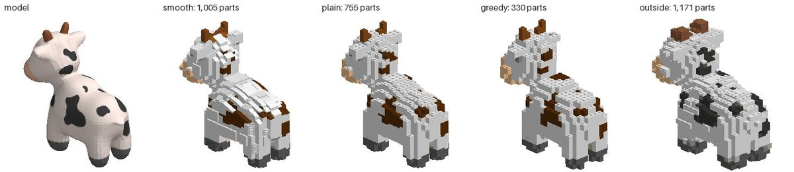

Bob, at 24 studs.

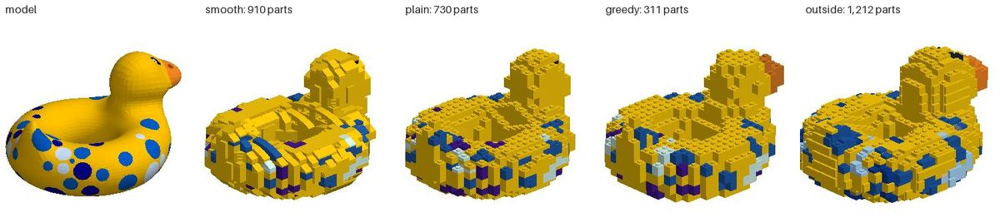

3DBenchy, at 24 studs.

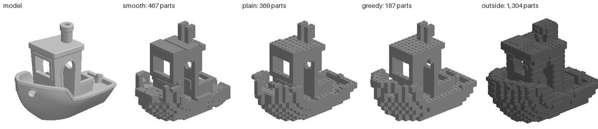

The avocado, at 24 studs.

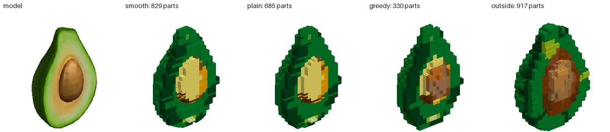

**Where it loses the model.** The fox, at 24 studs (model CC0 by
PixelMannen; rig CC-BY 4.0 by tomkranis): Brickify lays nothing (its legs
are thinner than a stud, the body floats, and the mend takes it all out);
the greedy stack keeps the body, floating; legolization keeps the legs.

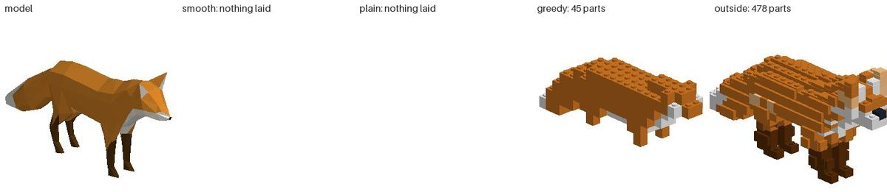

The Hayes bust, at 24 studs: smooth kept 37% of it, plain 75%; legolization
ran out of time (30 minutes).

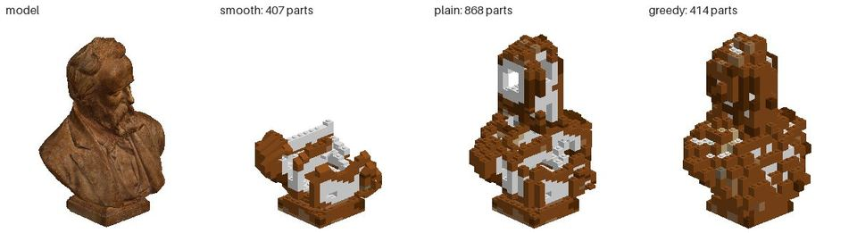

The toy car, at 24 studs: its body is an open shell; legolization closes
the roof, ours leave it open.

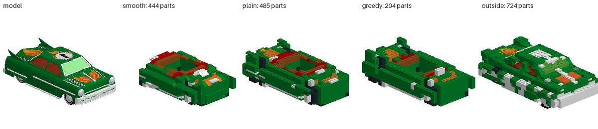

The Greek tholos, at 48 studs ("Greek Tholos" by nicolioos, CC-BY 4.0,
drawn here in bricks): the temple on its thin columns and the trees are
gone from both of Brickify's builds; the greedy stack keeps them, floating.

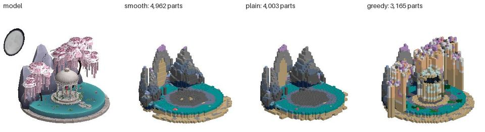

## 4. The plan

Nine units, ranked by how much each moves the measures above toward the
target below, with what builders ask for as the tie-breaker. Each is one
agent's bounded task; each ends with the bench run again
(`brickify_bench.py`, the same 14 models) and its numbers put beside today's.
Units 1 to 3 come first because the others are worth little while Brickify
drops a fox's body or paints a cow brown.

### The target: clearly the best, by measure

On the 14-model bench at 24 and 48 studs, against the greedy stack and every
outside tool that can be run:

| Measure | Today (smooth) | Target |
|---|---|---|
| Laid at all | 24 of 28 | 28 of 28 |
| Whole (95% of the model's surface within a stud of the build) | 13 of 28 | 28 of 28 |
| One piece, our check passes | 24 of 28 | 28 of 28 |
| And standing, no stud joint past its load (Balance) | 19 of 28 | 28 of 28, and passing an independent force check (StableLego's, or legolization's `analyze`) |
| Likeness, where all arms keep the model | IoU equal to the greedy stack's | Silhouette IoU and normal error better than every other arm on every model |
| Colour (ΔE2000 against the palette's floor) | 1.5 times at 48 studs, 2.5 at 24; legolization better | at most 1.3 times, and better than every other arm |
| Parts, against the greedy stack | 2.6 times as many, 38% of them 1x1 | at most 1.6 times, at most 20% 1x1 |
| Side-by-side seams bridged | 42% | at least 60% |
| Parts in a colour that exists | 98.3% | 100%, each with its element number |
| Time at 48 studs (desktop) | 32 s mean, 159 s most | 15 s mean, 60 s most |
| What it hands over | The model; any booklet or list by hand | Booklet, wanted list with a price, and what you already own subtracted, in one press |

Then say so: the bench, its models' licences and the numbers go on
/compare, so anyone can run it against us.

### 1. Keep the whole model

**Why.** The worst result of the bench. A fox, a figure and an aircraft came
out with nothing at 24 studs, and the fox as 2 parts at 48; the bust kept
37% of itself at 24 and the toy car 73%; the teapot lost its spout and
handle at both sizes, which Brickify's coverage figure (98%) hides. Whole,
it was 13 of 28. legolization kept every model it finished, the fox's legs
included, because it fills every cell the surface touches; the greedy stack
kept them too, floating. The cause, read from the runs: legs and stands
thinner than a stud never reach the grid (the fox's grid starts 9 plates
up, the figure's 12), so the largest piece kept is a body in the air; the check then finds every part floating and `mend` takes
them all out. `mend` removes what does not hold; it never joins it.

**What.** (a) Measure thin parts conservatively: a stud column is in where
any of its nine sub-columns is, and a part thinner than a plate is
thickened to one, so nothing of the mesh vanishes. (b) Join, don't drop: a
piece apart is tied to the body by the smallest legal joint that reaches
(a plate across, a bracket, a column of 1x1 rounds as a leg), and only
dropped if none does, and then named. (c) A model that would float or
tip (Balance found 4 of the 24 it laid would tip), or stands on less than a
few studs, gets what a set gives it: a stand, on by default and said; and
the status line weighs before it says "buildable". (d) Never place
nothing: say what could not be held and why.

**Measure.** Laid 28 of 28; whole 28 of 28 (lost95 at most a stud); one
piece and standing, by Balance, on all 28, the status line saying so and
naming any stand added; the teapot's spout and handle and the fox's legs
present (a probe each, with CC0 fixtures for the fox and the figure).

**Touches.** `brickify.gd` (voxelise, `_one_piece`, `mend`), `shapes.gd`
(stitch), `brickify_probe.gd`.

### 2. Colour that reads right

**Why.** ΔE2000 is 1.5 times the palette's floor at 48 studs and 2.5 times at
24, smooth is worse than plain (10.1 against 8.8 at 48), and legolization,
matching by the nearest vertex's colour, beats us (13.3 against 16.9 on the
seven both laid). Two causes, both reproduced: Oklab's straight-line
distance sends a dark neutral to a coloured neighbour (a 25%
grey is 8.3 from Reddish Brown and 9.8 from Black; CIEDE2000 picks Black),
so Spot's black patches came out brown and the figure's black hair blue;
and the smooth surface's slopes and tiles show colours sampled for the
cell, not the face they show, which is why smooth scores worse than plain.
Separately, 1.7% of smooth's parts are in a colour no element comes in,
and Shapes lays retired numbers (3023, which LDraw moved to 3023b), so
`PartLibrary.element_for` finds no element number for the commonest plate
and the parts list goes without one.

**What.** Match with a hue-keeping distance (CIEDE2000, or Oklab with
chroma weighted up for near-neutrals); vote each cell's colour by the
visible faces only (ObjToSchematic's "smart averaging" [o2s]); give a
surface part the colour of the surface it shows; choose among the colours
the part is actually made in (Rebrickable's elements), else the nearest it
is; resolve a moved number before looking up its element; offer ordered
dithering on flat panels.

**Measure.** ΔE2000 at most 1.3 times the floor at 48 studs; smooth no worse
than plain; no neutral source turned chromatic on Spot or the figure;
parts in a colour that exists 100%, each with an element number.

### 3. Bond like a builder

**Why.** Where all three of ours kept the model, smooth used 4,330 parts at
48 studs to the greedy stack's 1,664; 38% were 1x1s (greedy 16%); 42% of the
pairs side by side were bridged by a third part (greedy 55%); and 23% of
parts were weak points whose loss splits the model (greedy 16%). Builders
say "we usually don't want to stack 1x1 bricks" [r-brickformer] and judge
a converter by its seams [r-seams]. Legolization's refinement, splitting and
merging around the weakest brick, is the published method [luo-slides];
Kollsker's lookahead and staggering reward [kollsker] and legolization's
seven strategies [lz] are the open ones.

**What.** After Shapes lays the surface, refine the hidden core: merge runs
into the longest brick of one colour (the core is one colour already),
offset each course's seams from the one below, split and merge again
around each weak point, keep 1x1s to where the surface needs them, and keep
every change only if the check still passes.

**Measure.** Parts at most 1.6 times the greedy stack's; 1x1 share at most
20%; seams bridged at least 60%; weak points no more than greedy's;
Balance's bridge joints past their load still 0; likeness unchanged.

### 4. Fit the surface by distance

**Why.** Where nothing is lost, smooth is no closer to the model than plain
(Chamfer 0.23 against 0.21 studs at 48, IoU 0.950 against 0.953), and its
normal error, what shading shows, is only 1.1° better (37.8° against
38.9°). Slopes are chosen per stud from a flat or curved flag, not by how
near each puts the surface.

**What.** Score every candidate surface part (slope, curve, inverted,
wedge, tile, round) by its distance to the mesh at the third-of-a-stud
samples Brickify already takes, and by its normal, and keep the best; add
the angles it lacks: 65° and 75° slopes, double curves, round 2x2 bricks
and domes, wedge slopes, quarter tiles.

**Measure.** Chamfer 20% and normal error 30% below plain's at both sizes;
smooth no worse than plain on any model.

### 5. SNOT that holds

**Why.** It is what the comment asks for, and what no tool yet does in a way
that holds: NiemanSculpt lays SNOT in six directions but reports
connectivity "98.5% to 99.7%" [nieman-guide]; the one published method
lays loose plates [lambrecht]; no stability solver models side studs
[stablelego]. In Brickify, sideways parts are 2 to 3% of a build, on flat
flanks only; every steep face is a one-stud staircase in every arm.
legolization's SNOT tiles on flat walls give it a lower normal error than
ours (39.1° against 42.0° on the seven both laid), though 31% of its top is
shaped against our 98%: the walls are where the error is.

**What.** Lambrecht's cubes on the lattice Brickworks already has: 2 x 2
studs by 5 plates, each surface cube turned to its area-weighted normal and
laid as plates, slopes and curves facing out, each tied to the core by
bricks with studs on the side (87087, 11211, 30414), brackets or headlight
bricks, and checked by the same check. First-tier connections only.

**Measure.** Normal error on faces steeper than 60° down by 30%;
Hausdorff95 in the side views down; one piece; parts at most 15% more.

### 6. Show it: first run, the homepage, /compare

**Why.** Neither the homepage nor /compare mentions Brickify, and the tour
does not reach it ([index.html](../web/index.html),
[compare.html](../web/compare.html), [tour.gd](../src/ui/tour.gd)).
ObjToSchematic's admired flow is five steps, each re-run on its own [o2s].

**What.** After units 1 to 3, so what is shown holds up:
- **Homepage**: "Any 3D model, in parts you can buy": a model beside its
  Brickify build and a greedy stack, with the bench's numbers.
- **/compare**: a table of what each converter lays (Studio's Sculpture,
  NiemanSculpt, Bricker, legolization, BrickSolvr, Brickworks), and the
  bench, with its models and licences, for anyone to repeat.
- **First run**: a "Brickify a model" card with three CC0 samples (Spot,
  Bob, the avocado). The panel as stages, Model, Size, Colours, Lay,
  Check, Booklet and buy, each re-run alone; a preview before it is
  placed; what was lost drawn over the model, never silently.

**Measure.** `brickify_flow.mjs`: a sample placed from a cold start in 3
clicks and under 60 s on a preview; the pages pass the trademark test; the
tour has a Brickify step.

### 7. Buy it, or build it from what you own

**Why.** "I just need the list of parts… so that I can calculate how much the
total thing will cost me" [r-parts]; "create designs using only parts which
are on hand" [hn-onhand]; Brickit, which works from your pile, drew 646
and 659 points [hn-brickit1] [hn-brickit2]. Brickworks has the booklet, the BrickLink
wanted list, the Rebrickable list and the collection's shortfall, but none
is offered from Brickify, and no price is shown (BrickLink's price guide
wants a seller's keys). NiemanSculpt Pro limits parts by price
[nieman-guide].

**What.** From the placed build, in one press: the booklet by courses, with
SNOT panels as sub-assemblies and every step's partial build checked to
stand (Balance), the wanted list, and a price where the owner chooses a
source (a BrickLink key, or BrickOwl's API). "Lay from my collection": the
collection as a constraint, parts and colours on hand first, stand-ins by
colour then by size, the shortfall said.

**Measure.** Every step's partial build stands, on the bench's builds; with a
test collection (set 10698's 790 parts), the share of parts drawn from it
and what that costs in ΔE2000.

*Done 2026-10-17, section 11, all but the price.*

### 8. Model and sculpture

**Why.** A playable model and a display sculpture want different things,
and the size cap (64 studs) and the times (159 s at 48) stop sculptures.

**What.** *Model*: a solid, bonded core, first-tier connections only.
*Sculpture*: a hollow shell, SNOT, sizes to 128 studs, a stand, and, behind an option,
the second tier from section 2, each use named in the check. Both run in the
background on the web as now. And the check learns the tiers for any
model, brickified or not: it names a second- or third-tier connection where
it finds one, which builders ask of Studio and do not get (section 2).

**Measure.** 96 studs under 2 minutes on the desktop; plastic and price per
mode reported; second-tier uses counted and named; a probe model with one
connection of each tier, each named right.

### 9. Every file people have

**Why.** Scans come as PLY (2 of the 14 had to be converted; BrickSolvr and
legolization read it [bricksolvr] [lz]); Spot came as an OBJ and a picture
with no `.mtl`, and came in grey until we wrote one; 3D printing sites
default to 3MF; voxel artists save VOX; FBX is the animation tools' format;
Brick My World reads USDZ [bmw].

**What.** PLY (text and binary, either byte order), 3MF (a zip of XML, with
colours), VOX (MagicaVoxel's colours, a voxel to a stud), FBX through
Godot's `FBXDocument`, and a picture picked for an OBJ that names none.
USDZ only if Godot gains a reader: its USDC is a binary crate with none in
the engine.

**Measure.** The bench's 14 read with no conversion; a fixture of each format
in `brickify_probe`.

*Done 2026-10-20 (section 12).* PLY, 3MF, VOX and FBX are read, and an OBJ
chosen with one picture takes it; the fixtures are in a probe of their own,
`mesh_formats_probe`, beside ten real files from public sources. A voxel
is a stud when the size is the model's longest side in voxels. USDZ is
refused, saying so: Godot has no reader for it.

### What each unit moves

| Unit | Laid, whole | Likeness | Colour | Parts, bond, stability | Cost | Experience |
|---|---|---|---|---|---|---|
| 1 Keep the whole model | **28/28** | lost95 | — | one piece and standing, by joining | — | nothing silently lost |
| 2 Colour | — | — | **ΔE2000 ≤ 1.3 x floor** | — | real elements | the colours look right |
| 3 Bond | — | — | — | **−40% parts, 1x1s, seams** | fewer parts | sturdier |
| 4 Fit by distance | — | **Chamfer, normals** | — | — | — | smoother |
| 5 SNOT | — | **steep faces** | — | holds | — | the comment's ask |
| 6 Show it | — | — | — | — | — | **found, tried in 60 s** |
| 7 Buy, own | — | — | — | partial builds stand | **price, shortfall** | one press to buy |
| 8 Modes | — | — | — | per mode | plastic | sculptures to 128 studs |
| 9 Files | — | — | colour of bare OBJs | — | — | **any file opens** |

## 5. Unit 1, done: Brickify keeps the whole model (2026-10-15)

Unit 1 of the plan, and a bug. Brickify laid nothing for the fox, the
Kenney figure and the Bell X-1 at 24 studs, kept the whole model in 13 of 28
runs, called a model buildable without weighing it, and laid the commonest
plate as 3023, a number LDraw has moved to 3023b. Branch
`worktree-agent-af9a21f60d09d744a`, with `main` at `4138091` merged.

**In short.** On the same 14 models it now lays all 28 runs (from 24), keeps
25 of them whole (from 13), and all 28 are in one piece with the check
passing (from 24). None tips (4 of the 24 laid did), 8 of them standing on
a stand they were given, each said with its reason; 22 stand with no stud
joint past its working load (from 19), and 6 still have one or more (from 2:
the joins and the parts now laid carry weight on few studs). What it leaves
out it says: how much, where, and why.
The target was 26 of 28 whole; it falls one short (below, and "What is
left"). It is slower: 12 s on average at 24 studs and 72 s at 48, against
6.7 and 47 on `main` today.

**What changed** ([brickify.gd](../src/assembly/brickify.gd),
[shapes.gd](../src/ai/shapes.gd), [the panel](../src/ui/brickify_dialog.gd)):

1. **Thin parts measured conservatively** (`_touched`, `_thin`). A cell was the
   model's only where the middle of its stud was inside, so a leg a third of
   a stud across never reached the grid. Now every cell the surface passes
   through is found as well (each triangle against each cell its box
   reaches, by separating axes), and one counts where nothing measured is
   among the 26 cells round it: a part thinner than a stud or a plate, at the
   size chosen. The cells it passes through between such a part and the body
   join the two, and a part one plate thick is made two, so its plates cross
   each other's joints. A thick body comes out no fatter: its own surface
   cells always have a measured cell beside them. The columns of thin parts
   are laid plain (`plain_at`: no slope, wedge or top tile there): a wing two
   plates thick in tiles, wedges and slopes came apart into bits nothing held.
2. **Join, don't drop.** On the grid (`_join`), each piece apart is joined to
   the rest by the cheapest way, along the model's own thin surface first,
   else through the air, a plate up or down costing less than a stud across,
   so a join is a pillar more than a bridge; it starts beside the piece's
   middle and is two studs square. A largest piece standing on nothing is
   stood on the ground. In the plan, Shapes no longer prunes Brickify's pieces
   (`keep_pieces`: that prune was where the teapot's spout went), and once its
   own first ways are spent it lays the plates, then the slopes, about each
   joint again as plates crossing it (`rejoin`), each way kept only if it
   leaves fewer pieces. Once laid and
   checked, what is still apart or held by nothing (floating to the lattice,
   or not held by the parts' real shapes, which main's exact check now
   reports by index) is joined by the least that reaches (`_tie`): a 1 x 2
   plate under or over a joint where two parts stand side by side, or the
   shortest pillar of 1 x 1s onto anything held, each stud checked against
   the part's real cover. A round of joins that joins nothing is taken back.
   Only dust, a piece too far to join, or what nothing joins is taken out,
   and never the body; each is said: how much, where on the model, and why.
   What no part fills, a hundredth of the model or more, is said too.
3. **Never nothing.** A size that lays nothing says why and gives the
   smallest size that lays it whole (half again a try, to 64 studs), and the
   panel sets the size to it.
4. **A stand** (`_stance`, `lay_stand`). A model that stands only on feet of
   three studs or fewer (a fox's legs, an aircraft's wheels), comes within
   half a stud of tipping, or stands in pieces only the ground would join is
   laid on a stand under its feet and its centre of mass, a stud and a half
   round and a stud more: two plates whose joints cross (strips along x under
   strips along z), tiled where the model does not stand, black, or the one
   colour asked for, or the darkest of the colours it is cut to. Weighed with
   Balance once laid; if it would tip after all, or all but, it gets one
   then. A sphere on its twelve studs does not: feet decide, not a share of
   the plan. A stud joint past its working load is propped by a pillar under
   what it carries, kept only if fewer are past their load. A Stand choice
   on the panel (and `stand=` on the tool) turns stands off.
5. **Weighed before "buildable"** (`Brickify.said`). The panel's line and the
   tool's answer say whether it is one piece, whether it stands (Balance,
   its margin and edge), on what (its own studs, or the stand and why), what
   was joined and propped, and what was left out, where and why.
   "Buildable" only when it is one piece, passes the check, stands, and no
   stud joint is past its working load.
6. **Today's numbers** (`Shapes.current`). Shapes lays each part by the number
   LDraw gives it now, read from the catalogue's stubs: 3023 goes down as
   3023b, and so would a part LDraw moves later. Only stubs that move a part
   nowhere are followed (all but 68 of 1,161); the probe checks that none of
   the 86 parts Brickify may lay is one of the 68.
7. **Fewer checks.** Each check on a big model is seconds, more since the
   exact check; the mend takes what collides out in one round, joins in at
   most two, and takes what is still loose out in one more.

### The bench again

The research's bench, measuring what it measured: the same 14 models,
prepared the same way, at 24 and 48 studs, smooth, plain and the greedy
stack, measured by `brickify_bench.py` (legolization was not run again).
There are two befores. The research's own run on `7a55e86`. And `main` at
`4138091`, whose check now also asks every part's real shape (the exact
check), so every check costs more; that one is the fair before for time.
The box was shared with other jobs at a load of 30 to 55 on 24 threads
throughout, so read times as upper bounds.

The bench changed in three ways, all so it measures the model and not its
base: a stand's parts are left out of likeness, bond and the count of shaped
tops; the model is lowered by the stand's two plates so it lines up with the
model it came from (`stand_of`, `build_mesh`); and the pictures draw the
stand. Parts and time count the stand. The greedy stack is laid over the new
measuring's grid, so it now has the thin parts too. `report` adds a column
for runs standing on a stand.

**Smooth, the panel's default: laid, whole, one piece, standing.**

| Run | Studs | Laid | Whole | One piece, check passes | And stands, no joint past its load | On a stand | Seconds (mean) | Seconds (most) |
|---|---|---|---|---|---|---|---|---|
| research | 24 | 11/14 | 4/14 | 11/14 | 8/14 | 0 | 4.0 | 8 |
| main | 24 | 11/14 | 4/14 | 10/14 | 7/14 | 0 | 6.7 | 13 |
| after | 24 | 14/14 | 12/14 | 14/14 | 13/14 | 5 | 12.1 | 27 |
| research | 48 | 13/14 | 9/14 | 13/14 | 11/14 | 0 | 32.1 | 159 |
| main | 48 | 13/14 | 9/14 | 13/14 | 11/14 | 0 | 47.1 | 210 |
| after | 48 | 14/14 | 13/14 | 14/14 | 9/14 | 2 | 71.6 | 298 |

**Plain, Surface set to plain bricks and plates.**

| Run | Studs | Laid | Whole | One piece, check passes | And stands, no joint past its load | On a stand | Seconds (mean) | Seconds (most) |
|---|---|---|---|---|---|---|---|---|
| research | 24 | 11/14 | 7/14 | 11/14 | 6/14 | 0 | 2.3 | 6 |
| main | 24 | 11/14 | 7/14 | 11/14 | 6/14 | 0 | 3.6 | 10 |
| after | 24 | 14/14 | 14/14 | 14/14 | 9/14 | 4 | 8.0 | 26 |
| research | 48 | 13/14 | 9/14 | 13/14 | 11/14 | 0 | 23.1 | 127 |
| main | 48 | 13/14 | 9/14 | 13/14 | 11/14 | 0 | 32.1 | 170 |
| after | 48 | 14/14 | 13/14 | 14/14 | 9/14 | 2 | 54.9 | 205 |

**The layout, smooth, on the models whole in every run**, so likeness and
cost are of the same models. Parts count the stand where one was given.

At 24 studs, the 4 models whole in every run: avocado, bob, milk-truck, spot.

| Run | Parts | 1x1 share | Seams bridged | Weak points | Tops shaped | IoU | Chamfer | Lost95 | Added95 | Normal (°) | ΔE2000 | Seconds |
|---|---|---|---|---|---|---|---|---|---|---|---|---|
| research | 878 | 41% | 37% | 23.7% | 99% | 0.916 | 0.23 | 0.60 | 0.52 | 35.5 | 17.4 | 4.7 |
| main | 878 | 41% | 37% | 23.7% | 99% | 0.916 | 0.23 | 0.60 | 0.52 | 35.5 | 17.4 | 6.9 |
| after | 972 | 41% | 37% | 24.1% | 98% | 0.925 | 0.21 | 0.46 | 0.52 | 35.3 | 17.1 | 8.9 |

At 48 studs, the 9 models whole in every run: armadillo, avocado, benchy, bob, milk-truck, smithsonian-1, spot, stanford-bunny, utah-teapot.

| Run | Parts | 1x1 share | Seams bridged | Weak points | Tops shaped | IoU | Chamfer | Lost95 | Added95 | Normal (°) | ΔE2000 | Seconds |
|---|---|---|---|---|---|---|---|---|---|---|---|---|
| research | 4,330 | 38% | 42% | 23.5% | 99% | 0.950 | 0.23 | 0.46 | 0.56 | 37.8 | 10.1 | 23.7 |
| main | 4,311 | 38% | 42% | 23.6% | 99% | 0.949 | 0.23 | 0.46 | 0.56 | 37.8 | 10.1 | 37.9 |
| after | 4,359 | 39% | 42% | 24.3% | 99% | 0.950 | 0.23 | 0.44 | 0.56 | 37.8 | 10.1 | 55.1 |

**Each model, smooth**: parts, lost95 in studs (whole is at most 1), and
whether it stands (by Balance with no stud joint past its working load; "on
a stand" where it was given one).

| Model | Studs | research: parts, lost95, stands | main: parts, lost95, stands | after: parts, lost95, stands |
|---|---|---|---|---|
| armadillo | 24 | 493, 4.04, tips | 493, 4.04, tips | 603, 1.26, stands |
| armadillo | 48 | 2,686, 0.50, stands | 2,684, 0.50, stands | 2,740, 0.46, stands |
| avocado | 24 | 829, 0.73, tips | 827, 0.73, tips | 855, 0.73, on a stand |
| avocado | 48 | 4,514, 0.40, tips | 4,511, 0.40, tips | 4,561, 0.40, on a stand |
| benchy | 24 | 467, 1.13, stands | 465, 1.13, stands | 555, 0.63, stands |
| benchy | 48 | 2,782, 0.43, stands | 2,775, 0.42, stands | 2,833, 0.42, stands |
| bob | 24 | 910, 0.42, stands | 910, 0.42, stands | 1,062, 0.31, stands |
| bob | 48 | 4,029, 0.35, stands | 4,029, 0.35, stands | 4,151, 0.35, stands |
| character | 24 | nothing laid | nothing laid | 627, 0.46, stands |
| character | 48 | nothing laid | nothing laid | 2,869, 0.58, 3 joints over |
| fox | 24 | nothing laid | nothing laid | 224, 0.50, on a stand |
| fox | 48 | 2, 31.63, stands | 2, 31.63, stands | 967, 0.39, 2 joints over |
| milk-truck | 24 | 768, 0.91, 2 joints over | 768, 0.91, 2 joints over | 889, 0.45, on a stand |
| milk-truck | 48 | 4,261, 0.56, 2 joints over | 4,261, 0.56, 2 joints over | 4,314, 0.56, 2 joints over |
| objaverse | 24 | 970, 6.48, stands | 970, 6.48, stands | 2,213, 0.75, 16 joints over |
| objaverse | 48 | 4,962, 13.92, stands | 4,960, 13.92, stands | 10,986, 2.43, 57 joints over |
| smithsonian-1 | 24 | 407, 11.29, stands | 407, 11.29, stands | 1,218, 0.60, stands |
| smithsonian-1 | 48 | 7,713, 0.40, stands | 7,707, 0.40, stands | 7,782, 0.39, stands |
| smithsonian-2 | 24 | nothing laid | nothing laid | 171, 1.08, on a stand |
| smithsonian-2 | 48 | 405, 13.34, stands | 405, 13.34, stands | 650, 0.85, stands |
| spot | 24 | 1,005, 0.35, stands | 1,005, 0.35, stands | 1,081, 0.34, on a stand |
| spot | 48 | 4,787, 0.39, stands | 4,787, 0.39, stands | 4,956, 0.39, on a stand |
| stanford-bunny | 24 | 985, 1.59, stands | 985, 1.59, stands | 1,011, 0.91, stands |
| stanford-bunny | 48 | 4,887, 0.39, stands | 4,864, 0.39, stands | 4,902, 0.39, stands |
| toy-car | 24 | 444, 4.95, stands | 444, 4.95, not one piece | 756, 0.50, stands |
| toy-car | 48 | 2,745, 4.13, stands | 2,742, 4.13, stands | 3,437, 0.90, 3 joints over |
| utah-teapot | 24 | 607, 1.20, stands | 597, 1.20, stands | 668, 0.33, stands |
| utah-teapot | 48 | 3,310, 0.70, stands | 3,178, 0.70, stands | 2,996, 0.65, stands |

**What the numbers say.**
1. **Nothing is laid as nothing.** The fox, the figure and the X-1 are laid
   at both sizes. The fox at 24 studs keeps all four legs and stands on a
   4 × 12 stand, because its legs reached the ground as two pieces. The fox
   at 48 is 967 parts, where it was 2.
2. **Whole in 25 of 28, from 13.** The Hayes bust at 24 studs went from
   lost95 11.3 to 0.60, the toy car from 4.95 and 4.13 to 0.50 and 0.90,
   the teapot (spout and handle) from 1.20 to 0.33, the tholos at 24 from
   6.48 to 0.75. Plain is whole in 27 of 28.
3. **Every build is one piece and passes the check, and every one stands.**
   Eight were given a stand: the avocado at both sizes and the X-1 at 24
   would tip; the fox at 48, Spot at both sizes and the milk truck at 24
   stand on feet of three studs or fewer; the fox at 24 stood in two pieces.
   Six still have a stud joint past its working load: 2 to 3 on the figure,
   the fox and the toy car at 48, the milk truck's 2 at 48 as before, and 16
   and 57 on the tholos, whose columns and trees are now laid.
4. **Nothing else got worse on the models whole before.** IoU, Chamfer,
   normal error, colour, seams bridged and the share of 1x1s are equal or a
   little better; lost95 is lower. Parts rise by 1% at 48 studs and 11% at 24,
   mostly stands. Weak points rise by under a point.
5. **Time is the cost.** On those same models, 8.9 s against 6.9 at 24
   studs and 55 s against 38 at 48. Across all 28 runs it is 12.1 s and 72 s
   on average, 27 s and 298 s at most, against `main`'s 6.7 and 47, 13 and
   210. Joining in the plan and the mend's extra checks are most of it, and
   the models laid now (the tholos keeps its temple: 10,986 parts at 48 where
   it laid 4,960) are bigger.

### Proof

- `brickify_probe` (headless), new section "the whole model", written
  against what `main` has too so it runs there. The fox at 24 studs
  (`tests/fixtures/brickify/fox.obj`: a CC0 model, CC BY 4.0 conversion,
  credited in the file) is laid with each of its four legs there from the
  foot up, with 97% of it in a part and nothing left out, one piece, standing.
  A body with a cube floating a stud and a half over it
  (`BrickifySamples.floating`) has a part at the cube's middle. A post with
  a block past its edge (`BrickifySamples.overhang`) is given a stand and
  stands on it. Every number laid in the probe's builds is the one LDraw
  gives the part today, and none of the 86 parts Brickify may lay has a stub
  that turns it. **On `main` `4138091` it fails 7 checks** (the fox lays
  nothing, the cube is dropped, the post tips with no stand, 3023 is laid).
  On the branch it passes; the forty-stud bunny takes 12.9 s.
- `brickify_ui_probe` (windowed): the panel's line weighs now: "buildable in
  one piece; it stands on a stand 12 × 9 studs, added because it would tip,
  its centre of mass 1.4 studs past what it stands on …". `shapes`,
  `patterns`, `cabins`, `exact`, `app_tools`, `example_name` and `mcp_sync`
  pass (the tool's schema has `stand` now).
- In a browser on a preview (`https://brickworks-fkmqo20xu-xaxis-projects.vercel.app`),
  `tools/release/preview_checks.sh` runs `brickify` (the bunny) and the new
  `brickify_fox` (the fox at 24 studs, whose line must say it stands on a
  stand). Both pass. The fox read "263 parts in 9 colours, buildable in one
  piece; it stands on a stand 4 × 12 studs … nothing of it left out".

### What is left

- **Three runs not whole.** The armadillo at 24 (lost95 1.26) and the X-1 at
  24 (1.08): small surface parts on thin parts (cheese slopes on wedges,
  1x1 plates, tiles) that nothing holds, taken out and said. Plain keeps both
  whole. An experiment that lays the columns about such loose parts again
  plain made the armadillo whole (0.53) but left the X-1's wing seams worse
  until it was made to keep only the lay that keeps more; it was not benched
  at full size and is not in this branch. The tholos at 48 (2.43): a scene of
  columns and trees, 782 parts taken out, and not whole in plain either.
- **Joints past their load** on six runs. Props are tried and kept only when
  they help; on these they rarely did. Bracing such joints belongs with unit
  3 (bond).
- **A hollow model's floor**: the hollow sphere's bottom cap is a piece that
  nothing joins (on `main` too, silently); now it is said.
- **Time**, above. Faster joining in the plan, by keeping the pieces between
  rounds, is the next lever.
- **The colour of a cell** and the smooth surface's look are unit 2's; this
  unit did not touch them, and ΔE2000 is unchanged.

## 6. Unit 2: colour that reads right (2026-10-16)

Unit 2 of the plan, and the time unit 1 cost. Brickify matched each sampled
colour to the palette by Oklab's straight line, which sends a 25% grey to
Reddish Brown before Black. It gave a cell the colour of samples stepped a
fixed way into the model, so the cell that shows often took its colour from
the cells round it or from a surface nobody sees. It gave a slope the colour
of the stud above it. 1.3% of smooth's parts on `main` today are in a colour
no element of theirs comes in. Branch `worktree-agent-a9905a5be6483ab5d`,
from `main` at `2789cd0`.

**In short.** On the 10 bench models with colours of their own, ΔE2000 at 48
studs is 1.28 times the palette's floor, from 1.54 (9.5 against 11.4; floor
7.4), and at 24 studs 1.54 times, from 2.00. Spot's black patches are black:
none of its neutral surface is laid in a strong colour, from 40%. The
figure's hair is black, not Dark Blue, but 8% of its neutral surface is still
laid in a colour, from 72% (18% at 24 studs, from 70%). Every part of all 56
runs has an element number, from 98.7% of smooth's. Two targets are missed.
Smooth is still a little worse than plain at 48 studs (9.5 against 9.0; it
was 11.4 against 10.6), though level at 24 (11.5 against 11.6). And the
forty-stud bunny is slower, not faster: 17.7 s against `main`'s 15.8 in the
same batch. One more run is not whole than on `main`: 24 of 28, from 25.

**What changed** ([brickify.gd](../src/assembly/brickify.gd),
[shapes.gd](../src/ai/shapes.gd)):

1. **Matched as an eye judges** (`Brickify.de2000`, `_nearest`). Each
   sampled colour goes to the palette colour nearest by CIEDE2000, the
   measure the bench scores by, weighed among the few nearest in a straight
   line in L\*a\*b\*. A 25% grey goes to Black (11.0 away), not Reddish
   Brown (17.7); a 38% grey to Dark Bluish Grey.
2. **A cell coloured by what shows of it** (`_shown_at`): ObjToSchematic's
   "smart averaging", by visible faces only [o2s]. A sample votes for the
   cell whose face shows it: out from just inside the surface along its
   normal, the last of the model's cells before the air, or, where the grid
   stops short of the surface, the first going in. A surface buried in
   another part of the model (inside it a quarter of a stud ahead and behind:
   a figure's head under its hair) or with more than a stud and a half of the
   model in front of it (a truck's inside) votes for nothing. A face wound
   the wrong way round is read the other way.
3. **A slope in the colour of the surface it stands for** (`Plan._shown`,
   Brickify's grids only): the top plate of each stud it covers, the colour
   most of them are, a tie to the stud above. A design's shapes keep the
   colour above, as before.
4. **Every part in a colour the LEGO Group sells it in.** A slope sold in none of the
   palette's colours is not laid (`sold_in`): the inverted 2 x 2 slope laid
   under overhangs, 3660a, has no element at all. Any other part with no
   element in its colour is laid in the nearest colour, by CIEDE2000, that it
   has one in (`made_colours`, after laying and again after the mend). One
   colour asked for is kept as asked.
5. **Measured where the time goes** ([brickify_phases.gd](../src/dev/brickify_phases.gd)),
   and two cuts. The stitch maps the plan once a round, not once for each
   piece it tries, and the mend weighs a check (Balance) only once it passes
   in one piece (`weigh_whole` in `Assistant._check`): on the 48-stud scans
   weighing was 0.6 to 4.5 s of each of their three checks.
6. **The bench** measures what the plan asks: the share of the model's
   neutral surface (CIELAB chroma under 5) laid in a strong colour (chroma 20
   or more: Reddish Brown is 37, Dark Blue 27, Black 9). Each run records its
   phases, and `pictures --before RUN` draws each arm before and after.

**Tried and taken out.** Pairing every piece the stitch could in one round
halved the 48-stud scans' pairing, but changed which joins were made: the
probe's hollow sphere came out with more parts than the solid one (1,682
against 1,624). Filtering every plate, brick and edge part by the colours it
is sold in as Shapes lays it, and swapping 3660a for the mould the LEGO Group sells,
3660b, ran only together with that pairing and were taken out with it,
unmeasured alone.

### The bench again

The same 14 models at 24 and 48 studs, smooth and plain; `main` laid in its
own checkout at a load of 45 to 60, the branch in two processes at once at a
load of 10 to 45, so the seconds are not a fair ratio; the bunny below is.
The greedy stack was not laid again.

| Run | Arm | Studs | Laid | Whole | One piece, check passes | And stands, no joint past its load | On a stand | Parts | Seconds (mean) | Seconds (most) |
|---|---|---|---|---|---|---|---|---|---|---|
| main | smooth | 24 | 14/14 | 12/14 | 14/14 | 13/14 | 5 | 11,933 | 12.0 | 39 |
| after | smooth | 24 | 14/14 | 11/14 | 14/14 | 11/14 | 5 | 12,241 | 9.6 | 25 |
| main | smooth | 48 | 14/14 | 13/14 | 14/14 | 9/14 | 2 | 58,145 | 73.8 | 374 |
| after | smooth | 48 | 14/14 | 13/14 | 14/14 | 9/14 | 2 | 57,947 | 59.0 | 241 |
| main | plain | 24 | 14/14 | 14/14 | 14/14 | 9/14 | 4 | 10,056 | 8.2 | 30 |
| after | plain | 24 | 14/14 | 13/14 | 14/14 | 9/14 | 5 | 10,377 | 7.2 | 25 |
| main | plain | 48 | 14/14 | 13/14 | 14/14 | 9/14 | 2 | 48,390 | 54.8 | 248 |
| after | plain | 48 | 14/14 | 12/14 | 14/14 | 9/14 | 4 | 47,505 | 40.3 | 205 |

**Colour**, mean CIEDE2000 over the 10 models with colours of their own
(avocado, Bob, the figure, the fox, the milk truck, the tholos, both
Smithsonian models, Spot, the toy car), against the palette's floor (7.4).
Per model, the ratio to the floor at 48 studs went from a median of 1.39
(1.09 to 2.97) to 1.21 (0.93 to 2.33); at 24, from 1.81 (1.30 to 3.30) to
1.39 (1.18 to 2.89).

| Studs | Arm | ΔE2000 main | ΔE2000 after | Times the floor, main | Times the floor, after |
|---|---|---|---|---|---|
| 24 | smooth | 14.9 | 11.5 | 2.00 | 1.54 |
| 24 | plain | 14.0 | 11.6 | 1.89 | 1.56 |
| 48 | smooth | 11.4 | 9.5 | 1.54 | 1.28 |
| 48 | plain | 10.6 | 9.0 | 1.43 | 1.21 |

**Each coloured model, smooth**: ΔE2000, and the share of its neutral surface
laid in a strong colour (how much of it is neutral in brackets).

| Model | Studs | ΔE2000 main → after | Floor | Neutral laid in a colour, main → after |
|---|---|---|---|---|
| avocado | 24 | 18.2 → 11.2 | 8.2 | (none neutral) |
| avocado | 48 | 9.0 → 9.6 | 8.2 | (none neutral) |
| Bob | 24 | 12.7 → 11.0 | 3.8 | (under 1% neutral) |
| Bob | 48 | 11.4 → 8.9 | 3.8 | (under 1% neutral) |
| figure | 24 | 15.9 → 14.5 | 12.3 | 70% → 18% (of 21%) |
| figure | 48 | 14.3 → 11.5 | 12.3 | 72% → 8.0% (of 21%) |
| fox | 24 | 7.7 → 6.7 | 4.6 | 21% → 17% (of 17%) |
| fox | 48 | 6.0 → 5.9 | 4.6 | 8.7% → 8.0% (of 17%) |
| milk truck | 24 | 25.8 → 11.0 | 7.8 | 23% → 4.3% (of 80%) |
| milk truck | 48 | 12.3 → 7.9 | 7.8 | 20% → 2.0% (of 80%) |
| tholos | 24 | 16.8 → 13.6 | 10.9 | 37% → 24% (of 16%) |
| tholos | 48 | 17.8 → 12.2 | 10.9 | 37% → 16% (of 16%) |
| Hayes bust | 24 | 11.5 → 10.8 | 5.9 | (under 1% neutral) |
| Hayes bust | 48 | 7.4 → 7.4 | 5.9 | (under 1% neutral) |
| Bell X-1 | 24 | 10.2 → 9.6 | 7.0 | 80% → 52% (of 6%) |
| Bell X-1 | 48 | 10.3 → 9.6 | 7.0 | 79% → 46% (of 6%) |
| Spot | 24 | 11.6 → 9.9 | 8.1 | 33% → 0.0% (of 22%) |
| Spot | 48 | 10.2 → 9.0 | 8.1 | 40% → 0.0% (of 22%) |
| toy car | 24 | 18.3 → 16.3 | 5.7 | 48% → 38% (of 26%) |
| toy car | 48 | 15.7 → 13.1 | 5.7 | 34% → 19% (of 26%) |

**Parts with an element number**: smooth 934 of 70,078 without one on `main`
(1.3%), none of 70,188 after; plain 110 of 58,446 (0.19%), none of 57,882.
**Parts**: at 24 studs smooth uses 2.6% more (avocado 23%, fox 28%, milk truck
15% more: more colours told apart), at 48 0.3% fewer.

**Where the time goes**, the forty-stud bunny (the probe's) laid three times
by `main` and by the branch in one job, side by side (medians, seconds):

| | Total | Measure (colour) | Lay (core, stitch) | Check (checks) |
|---|---|---|---|---|
| main | 15.8 (15.6 to 18.0) | 0.9 | 10.0 | 5.3 (1) |
| branch | 17.7 (17.7 to 18.0) | 1.1 (0.8) | 8.0 (3.5, 4.2) | 8.3 (2) |

The lay is 2 s faster: the stitch's 35 rounds now map the plan once each.
Of the stitch, the rejoin (21 tries, each a piece count of the whole plan) is
2.2 s and finding the pieces each round 0.9. The check is 3 s slower: the
branch lays the bunny differently (2,069 parts against 2,249), and its mend
takes 3 parts out and checks again where `main`'s passes at once. On the 48-stud scans the stitch
runs out of its 96 rounds on `main` and on the branch alike.

**What the numbers say.**
1. **The colours read as the model's.** Spot's patches are black where they
   were Reddish Brown; the figure's hair black where it was Dark Blue; the
   milk truck's white side white, with its logo, where it was black. The
   colour target, 1.3 times the floor at 48 studs, is met: 1.28.
2. **A slope's colour helps, but smooth is not yet level with plain at 48
   studs**: 9.5 against 9.0 (0.5 apart, from 0.8). At 24 they are level.
3. **Neutral stays neutral on Spot, not yet on the figure**: 8% of its
   neutral surface at 48 studs and 18% at 24 is laid in a colour; in the
   pictures, the top of its hair is in the skin's Dark Orange.
4. **Every part is one the LEGO Group sells in that colour.** The cost shows on the
   uncoloured models: a part not sold in Light Bluish Grey (on `main` the
   commonest was the 3 x 3 brick without corner, 30505, 132 of them) is laid
   in the nearest colour it is sold in, Dark Bluish Grey, so the grey Stanford
   bunny has a few dark corners.
5. **Finer colour costs a little wholeness.** A thin part in more colours
   than one is laid in more parts that hold each other less: the Bell X-1 at
   48 studs lost its undercarriage (53 parts nothing could hold up, lost95
   10.4 studs) and stands on a stand; the tholos at 24 lost 72 parts (2.1).
   The tholos at 48 is now whole (from 2.43). Smooth whole: 24 of 28, from
   25; plain 25, from 27.
6. **Time is not back.** The lay is faster and the scans' seconds are lower,
   but the same-batch measure of the bunny is 12% slower, all of it the
   second check.

Spot at 48 studs (Keenan Crane, CC0):

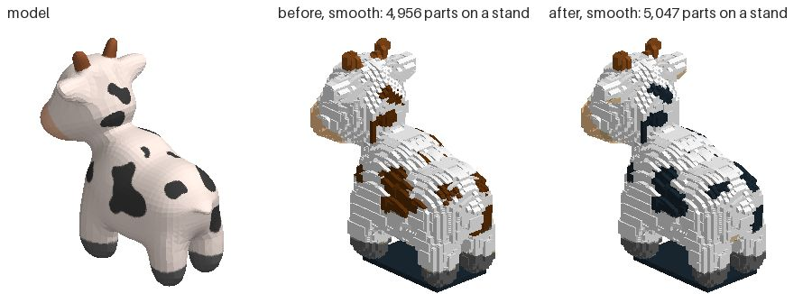

The Kenney figure at 48 studs (CC0): the hair black, its top still the
skin's colour.

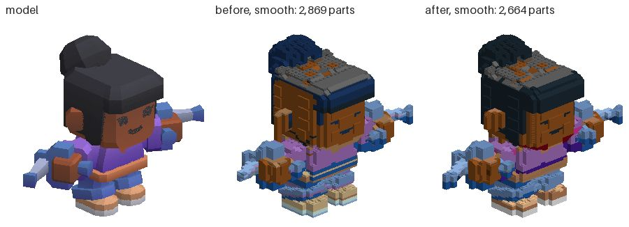

The milk truck at 24 studs (Cesium, CC-BY 4.0): its white side was black.

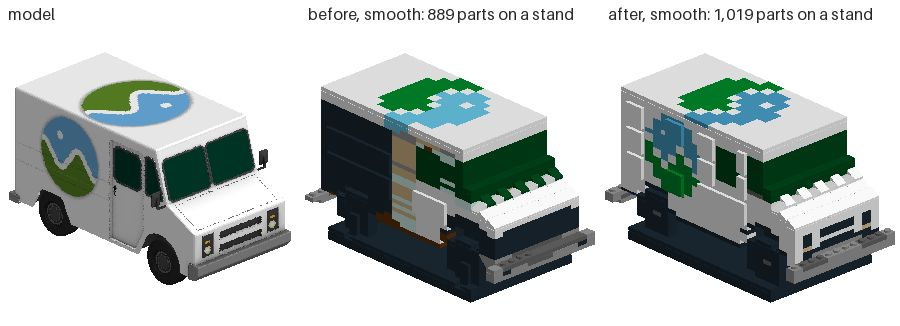

The Bell X-1 at 48 studs (Smithsonian, CC0): its undercarriage is gone.

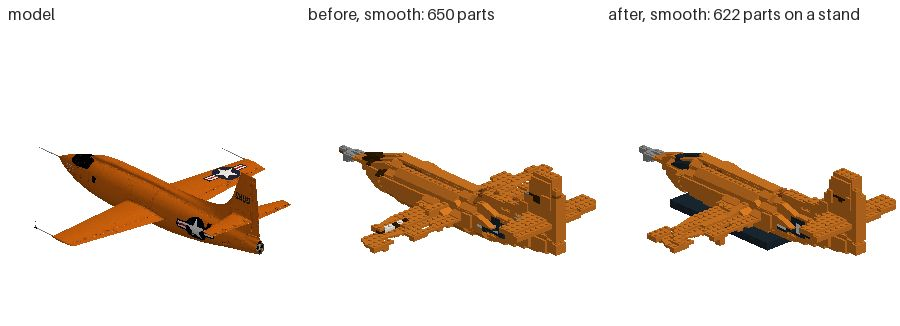

### Proof

- `brickify_probe` (headless): all 57 checks pass, with a new section,
  colour that reads right: CIEDE2000 against Sharma, Wu and Dalal's test
  pair (2.0425); the greys from black to white matched to Black, Dark Bluish
  Grey, Light Bluish Grey and White and nothing else; every part of the
  28-stud bunny with an element number. The hollow sphere is 1,599 parts
  against the solid's 1,606.
- `brickify_ui_probe` (in a window, on the GPU), `shapes_probe`,
  `exact_probe` (29 passed) and `patterns_probe`: all pass.
- `tools/web/brickify_flow.mjs` needs a preview, and was not run.

### What is left

- **The figure's hair top**, laid in the skin's colour, and the neutral
  surfaces of the Bell X-1 and the toy car still laid in a colour.
- **Wholeness with finer colour**: lay a thin part in one colour, or let a
  plate reach across a colour edge where that holds the part, before the
  mend takes it out (the X-1 at 48, the tholos at 24).
- **Smooth level with plain**: the tiles and wedges still show the colour of
  their cell, not of the face they show.
- **Time**: the bunny's second check, and the rejoin's piece counts (each
  try counts the whole plan's pieces).
- **Dithering on flat panels** was not tried.

## 7. Unit 2b: whole and fast again (2026-10-16)

Unit 2 made the colours read right and cost two things. Smooth kept the
whole model in 24 of 28 runs (from 25) and plain in 25 (from 27): the Bell
X-1 at 48 studs lost its undercarriage, the fox laid plain at 24 lost 21
parts, the temple at 24 lost 72 and its moon. And the forty-stud bunny took
1.12 times `main`'s time, where the target was 12 s. Branch
`worktree-agent-a7d8073d80103c257`, from `main` at `69a0d1d` with unit 2
(`49a4769`) merged.

**In short.** Smooth keeps the whole model in all 28 runs (from 24) and
plain in 27 (from 25); all 56 are in one piece with the check passing, as
before. The mend takes 598 parts out over the bench, from 2,569, in 124
checks, from 182, and the bench's runs take 16 to 26% less time. Colour is
kept: ΔE2000 at 48 studs is 1.27 times the floor for smooth (from 1.28) and
1.23 for plain (from 1.21); at 24, 1.49 and 1.45 (from 1.54 and 1.56).
The forty-stud bunny takes 0.82 times `main`'s time in the same batch
(12.0 s against 14.6), from 1.12: 12 s by the clock, but 12.9 s against
the 15.8 `main` took in unit 2's batch, so the target is met only just, if
at all. Parts rise 2 to 6%. The figure's hair top is still the skin's
colour, and smooth is still a little worse than plain at 48 studs (9.46
against 9.11).

**What was wrong.** Three faults, each older than unit 2; its colours
brought them out. Unit 2's lead, a thin part laid in the one colour most of
its cells are, was tried first and is not among them: it joined nothing
more (the fox still lost its 21 parts, the X-1 its gear) and cost the
temple 2 ΔE.

1. **The stitch spun.** Shapes joins a sculpt's pieces first by two cheap
   ways it keeps unchecked (two plates side by side laid again with one
   across the joint; an edge part laid again in plain parts), then by ways
   it keeps only if they leave fewer pieces (`rejoin`). On 41 of the 56
   runs the first ways laid the same pair again and again until all 96
   rounds ran out, and the rejoin was never tried. What was still apart
   went to the mend, which took it out and checked again: the fox's 21
   parts, the X-1's gear. Unit 2's colours moved the joints; the spin was
   there on `main` too.
2. **No join crossed a colour's edge.** Every way of joining lays its parts
   in one colour, so a piece that met the rest only where the colour
   changed could not be joined. With the stitch mended, the avocado, the
   milk truck and the Hayes bust at 24 studs still had 4 to 17 parts taken
   out each this way.
3. **The first check came back unweighed.** A check that finds dressing
   that gave way (a tile on a side stud) checks again without it, and that
   second check dropped unit 2's "weigh it once it is whole": the mend got
   an unweighed report and checked a third time to weigh it. And every
   check worked out its advice (a quarter of its time on the bunny), which
   nothing in Brickify reads.

**What changed** ([shapes.gd](../src/ai/shapes.gd),
[brickify.gd](../src/assembly/brickify.gd),
[assistant.gd](../src/ai/assistant.gd)):

1. **A stitch that stops spinning** (`Plan.stitch`). It keeps the plan at
   its fewest pieces. When a round's pieces apart are ones it has seen
   before, or twelve rounds in a row leave no fewer (`STALLED`), it goes
   back to that plan, and from then on tries the first ways with the
   rejoin's, each kept only if it leaves fewer pieces. The stitch now runs
   out of rounds on 6 runs (the temple and the toy car at 48, the temple at
   24), each joining a piece a round to the end.
2. **A plate across a colour's edge**, the rejoin's last way
   (`_pair_across` with colours): two plates of two colours side by side
   laid again with one across the joint, the one that lays fewest studs in
   the other side's colour first, the rest of each side in its own colour.
   A stud or two change colour where a piece would otherwise be lost.
3. **One check where there were two or three.** The check again without
   dressing asks what the first was asked (`_without_dressing`), and
   Brickify's checks skip the advice (`_check`'s `advise`; the faults are
   the same).
4. **Pieces counted in packed arrays** (`Plan.pieces`, walked in the same
   order, so the stitch makes the same joins), and what the rejoin may lay
   again mapped once a round, not once a way tried (`_replatable_at`).

**Tried and taken out.** Each thin part in its cells' commonest colour
(above), and the same with each laid part then coloured by its own cells'
vote: the same joins, so the same losses. Plates about the joint laid
again with the colour's edge turned stud by stud, plate by plate: no run
joined that the plate across did not. Going back to the unchecked first
ways after each stall: the temple at 48 stalled 13 times in its 96 rounds
and lost its moon. For the hair, a face with another just over it in its
column (the head under the cap), which changed nothing; and of the faces
colouring a cell from one side, only the one in front, which laid the top
of her hair in its own greys but cost Bob, Spot, the toy car and the
temple up to 1 ΔE, and Bob's neutral surface went 32% to 69% coloured at
48.

### The bench again

The same 14 models at 24 and 48 studs, smooth and plain, against unit 2's
own run: this branch's base lays what unit 2 laid, part for part (`main`'s
changes since do not touch Brickify). Both ran in two processes at once, at
a load of 10 to 45 then and 15 to 45 now; only the bunny below is a fair
ratio.

| Run | Arm | Studs | Whole | One piece, check passes | And stands, no joint past its load | On a stand | Parts | Taken out (mean) | Checks (mean) | Stitch out of rounds | Seconds (mean) | Seconds (most) |
|---|---|---|---|---|---|---|---|---|---|---|---|---|
| unit 2 | smooth | 24 | 11/14 | 14/14 | 11/14 | 5 | 12,241 | 39.9 | 3.0 | 9 | 9.6 | 25 |
| after | smooth | 24 | 14/14 | 14/14 | 11/14 | 5 | 12,944 | 1.9 | 2.1 | 1 | 8.1 | 26 |
| unit 2 | smooth | 48 | 13/14 | 14/14 | 9/14 | 2 | 57,947 | 68.8 | 3.6 | 11 | 59.0 | 241 |
| after | smooth | 48 | 14/14 | 14/14 | 9/14 | 2 | 59,156 | 18.9 | 2.4 | 2 | 48.6 | 224 |
| unit 2 | plain | 24 | 13/14 | 14/14 | 9/14 | 5 | 10,377 | 20.4 | 3.1 | 10 | 7.2 | 25 |
| after | plain | 24 | 14/14 | 14/14 | 10/14 | 5 | 10,807 | 1.2 | 2.0 | 1 | 5.6 | 24 |
| unit 2 | plain | 48 | 12/14 | 14/14 | 9/14 | 4 | 47,505 | 54.4 | 3.3 | 11 | 40.3 | 205 |
| after | plain | 48 | 13/14 | 14/14 | 9/14 | 3 | 48,598 | 20.8 | 2.4 | 2 | 29.9 | 147 |

Whole again: the armadillo, the temple and the X-1 at 24 smooth; the X-1
at 48 smooth and plain (lost95 10.4 and 10.7 studs to 0.68 and 0.63, and
no stand needed now); the fox at 24 plain (3.9 to 0.48). Still not whole:
the temple at 48 plain (2.24, from 2.97), which loses its moon on its
stick, as it did.

**Colour**, mean CIEDE2000 over the 10 models with colours of their own,
against the palette's floor (7.4):

| Studs | Arm | ΔE2000 unit 2 | ΔE2000 after | Times the floor, unit 2 | Times the floor, after | Per model, median (range) |
|---|---|---|---|---|---|---|
| 24 | smooth | 11.47 | 11.07 | 1.54 | 1.49 | 1.39 (1.18 to 2.89) → 1.39 (1.06 to 2.86) |
| 24 | plain | 11.58 | 10.77 | 1.56 | 1.45 | 1.44 (1.12 to 2.80) → 1.38 (1.06 to 2.76) |
| 48 | smooth | 9.51 | 9.46 | 1.28 | 1.27 | 1.21 (0.93 to 2.33) → 1.21 (0.93 to 2.34) |
| 48 | plain | 9.03 | 9.11 | 1.21 | 1.23 | 1.20 (0.91 to 2.14) → 1.21 (0.91 to 2.10) |

Every coloured run is within 0.05 of unit 2's or closer but one, the
temple at 48 plain: 14.7 from 13.3, the moon lost in both. The fox at 24
plain goes 12.0 to 6.7, the figure at 24 from 14.5 to 13.0, the temple at
24 smooth 13.6 to 12.9. Spot's patches stay
black (none of its neutral surface in a colour), the figure's hair top is
as it was (7.8% of its neutral surface in a colour at 48, from 8.0%).
Every part still has an element number.

**Where the time goes**, the forty-stud bunny laid three times by `main`
and by the branch in one job, side by side, then again the other way
round (medians of the six, seconds):

| | Total | Measure (colour) | Lay (core, stitch) | Check (checks) |
|---|---|---|---|---|
| main | 14.6 (13.6 to 18.1) | 0.9 | 9.0 | 4.8 (1) |
| branch | 12.0 (11.2 to 13.8) | 1.3 (0.9) | 7.1 (3.7, 3.0) | 3.6 (1) |

The check is one now, weighed the first time (unit 2's were two, 8.3 s in
its batch). Of the stitch, the rejoin is 2.0 s: once the first ways stall
(the bunny's do once, early), each is tried with the rejoin's and counted. A
stall of four rounds with the first ways left unchecked after it was
faster still (0.71 times `main`'s time in its own batch), but lost the
temple's moon at 48.

**What the numbers say.**
1. **The whole model again, colours kept.** Smooth 28 of 28 and plain 27
   of 28, against targets of 25 and 27, with ΔE no worse but at 48 plain
   (0.08). The mend takes out a quarter of what it did.
2. **Faster, and for the right reason.** The bunny's one check is weighed
   the first time, and the stitch's rounds join pieces rather than lay the
   same pair again. The bench's 48-stud runs take 18 to 26% less time,
   though they now do the rejoin's work.
3. **A few more parts.** 2 to 6% more: the rejoin lays bricks about a
   joint again as plates, where the mend once took the piece out. The
   hollow sphere is 1,670 parts against the solid's 1,606; it was 1,599
   only because the mend took 45 parts of it out.

The temple at 24 studs (Objaverse, CC-BY 4.0): smooth keeps its moon now.

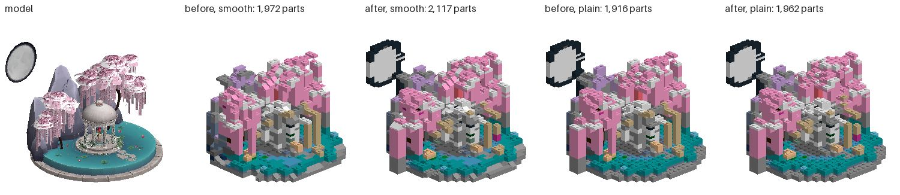

The Bell X-1 at 48 studs (Smithsonian, CC0): its undercarriage back, and no
stand needed.

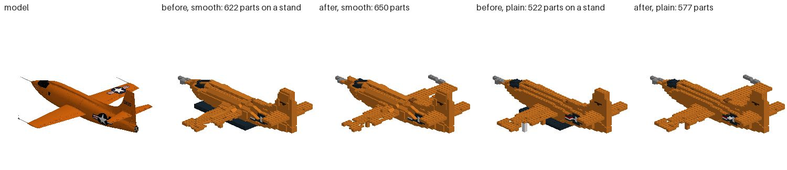

The fox at 24 studs (CC0 model, CC BY 4.0 conversion): laid plain, whole.

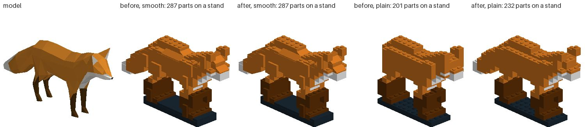

The temple at 48 studs: smooth keeps its moon; plain loses it, as it did.

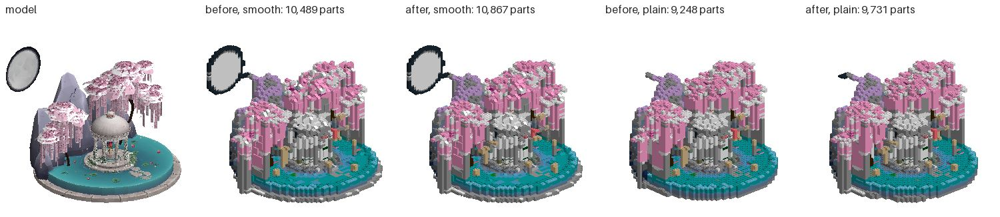

### Proof

- `brickify_probe` (headless): all 60 checks pass, three of them new: every
  stitch of the probe's nine builds ends before its 96 rounds run out (the
  hollow sphere's and the 20-stud bunny's ran all 96 before); the fox laid
  plain is whole; two plates of two colours side by side are joined by a
  plate across the edge, red keeping 4 studs and blue 2. The hollow
  sphere's check now asks for nothing taken out and at most a tenth more
  parts than the solid (1,670 against 1,606): it met "no more parts" once
  only because the mend took 45 of its parts out.
- `shapes_probe` (78), `exact_probe` (29) and `patterns_probe` (215): all
  pass, headless; `brickify_ui_probe` in a window on the GPU: all pass. For
  the check's change: `dress_probe` (dressing that gives way, 26),
  `responsive_probe` (a big check on a worker, 8) and `angled_probe` (7):
  all pass.
- On the commit, `brickify_probe` lays every build part for part as above;
  its forty-stud bunny took 22.0 s beside three other probes at a load of
  30 to 50, past the probe's 20 s; alone, at a load of 50, all 60 pass and
  the bunny takes 12.3 s.
- `tools/web/brickify_flow.mjs` (`brickify`, `brickify_fox` in the preview
  checks) needs a preview, and was not run.

### What is left

- **The figure's hair top**, in the skin's colour. The cap of her hair is
  a surface 0.44 studs over the top of her head, not a solid, so the head
  is not buried and votes for the same top cell as the hair. Neither test
  tried here was right for every model (above).
- **Smooth level with plain at 48 studs**: 9.46 against 9.11. The tiles
  and wedges show their cell's colour, not the face they stand for.
- **The temple at 48 plain**, and the stitch's budget: it joins a piece a
  round, and on the temple at 48 424 pieces are still apart when its 96
  rounds run out. The mend takes 219 parts out (smooth) and 235 (plain,
  with the moon).
- **Parts**: the rejoin's plates cost 2 to 6% more parts.
- **Time**: the core's lay (3.5 s of the bunny's) and one check (3.5 s)
  are most of what is left.

## 8. Unit 3: bond like a builder (2026-10-16)

Unit 3 of the plan. On `main` today (`a1d1998`), over all 14 models at 48
studs, smooth used 59,156 parts to the greedy stack's 21,574 (2.74 times),
37.8% of them 1 x 1s (greedy 19.5%), with 42.1% of the seams side by side
bridged (greedy 52.9%) and 25.9% of its parts weak points (greedy 18.8%).
Branch `worktree-agent-a6d1f2bc253969c28`, from `main` at `aad2371` with the
m39 release (`a1d1998`) merged.

**In short.** The hidden core is laid in 39% fewer parts, and the builds in
12% fewer at 48 studs (52,160 from 59,156) and at 24: 2.42 times the greedy
stack's at 48 (from 2.74), plain 1.84 (from 2.25). 1 x 1s are 35.1% (from
37.8%), seams bridged 44.9% (from 42.1%). Weak points rose, 27.2% of the
parts from 25.9%, though there are fewer of them. The four targets on the
bond (1.6 times the parts, 20% 1 x 1s, 60% of seams bridged, greedy's weak
points) are all missed, and measured why: three quarters of smooth's parts
are not hidden. With no hidden part at all, smooth at 48 studs would still
be 2.04 times the greedy stack's parts, 41% of them 1 x 1s. The rest holds:
smooth whole in 28 of 28 runs and plain in 27, as on `main`; likeness and
ΔE2000 unchanged (1.27 times the floor at 48 smooth); stud joints past their
working load fewer or as many on all but 4 runs (22 from 29 at 48 plain).
The bonded temple at 48 studs lost the moon on its stick, so a bonded build
that leaves a region of the model out is laid again by the colours measured
(item 5 below): the temple is `main`'s build again, and on the bench's
largest scene that doubles its time. The forty-stud bunny takes 1.03 to
1.08 times `main`'s time in three batches.

**What was wrong.** Two faults, and a limit.

1. **The hidden core was laid in colours nobody sees.** The measuring colours
   the cells two studs and plates in from the surface with the surface's
   colour, and the model's main colour beyond, so the plan took the core to
   be "one colour already". But Shapes laid a brick only where the three
   plates of a course were one colour, so wherever two colours met out of
   sight, the course was three layers of plates, cut into 1 x 1s at each
   colour's edge. The probe's forty-stud bunny, white with pink and black,
   had a hidden core of 203 bricks and 159 plates; at 48 studs, 9,059 of
   smooth's parts over the bench were hidden plates.
2. **A course of bricks was laid largest first.** The largest brick that
   fits, tried stud by stud, takes the open ground and leaves the studs
   hemmed in to 1 x 1 bricks. The plates had been laid the other way, the
   studs with the fewest free beside them first, since a bird's body showed
   why; the bricks had not.
3. **The limit: most parts show.** On `main` at 48 studs, a quarter of
   smooth's parts (14,883 of 58,916, stands left out) are plain plates and
   bricks with a part on all six sides. 37% are plates that show: the plate
   staircase under each stud's slope, rings one or two studs wide whose
   corners are 1 x 1s. 22% are the surface's own parts, a slope or tile a
   stud. Of the weak points, 54% are a part that alone holds another (29%
   a slope or tile, 25% the next plate of the staircase), which no layout of
   the core changes.

**What changed** ([shapes.gd](../src/ai/shapes.gd); Brickify's pattern asks
for it with `bond`, and a design's shapes lay as before):

1. **What shows decides a brick's colour** (`Plan.shows`, `shown_colour`,
   `full`). A plate shows where the model is not on one of its six sides. A
   course is a brick wherever its three plates are body and what shows of
   them is one colour; the brick is that colour, and a brick nothing of
   which shows is the model's main colour. A thin part's columns
   (`plain_at`) keep the old rule, so their plates still cross.
2. **A course laid fewest free studs first** (`_bonded`): each stud, those
   hemmed in first, under the first brick of the table (2 x 8 down to
   1 x 1, turned on alternate courses) that covers it in one colour where it
   shows and is sold in that colour (`_made`).
3. **Merged once stitched** (`merge`): two plain parts side by side in a
   course whose studs together are a part we lay (two 1 x 2 plates, a 2 x 2),
   and three plates of one footprint stacked (a brick), in one colour where
   they show and sold in it. A merge only joins: whatever held either part
   holds the one, so the plan is in no more pieces.
4. **A shape that is its own mirror** (a sphere, a fox) keeps its strip
   across the middle and its halves mirrored, its hidden bricks in the main
   colour: laid as the others are, a plain sphere's seams bridged fell from
   67% to 57%.
5. **A bonded build is kept only if it keeps as much of the model**
   (`Options.bond`, `build`). Where it leaves a region of the model out, it
   is laid again by the colours measured and the one that fills more of the
   model kept, the time of both counted. On the bench this lays 4 of the
   56 runs twice and keeps the unbonded build on one: the temple at 48
   studs smooth, whose moon comes back.
6. **The bench** draws a build cut in half (`pictures --cut`), its parts
   shaded apart, to see the courses inside.

**Tried and taken out.**
- *Plates laid the same way* (hidden in any colour, fewest free first): 1%
  fewer parts again, but the teapot's spout tip came apart from the spout
  and the mend took its 7 parts out.
- *Kollsker's staggering* [kollsker], each brick placed where the course
  under it bridges its joints and it bridges theirs: it changed nothing.
  With the hemmed-in studs first, only one placement of the chosen brick
  fits a stud.
- *Each course filled from the other end*, so a run's joints move: seams
  bridged moved a point either way, model by model.
- *Hidden plates in the main colour*, and *the old largest-first bricks with
  hidden bricks in the main colour*: as many parts, more 1 x 1s.
- *Laying a plan again unbonded where the stitch ran out of rounds*, keeping
  the one with fewer parts apart: on the temple at 48 studs the bonded plan
  had fewer parts apart (1,045 against 1,107) and still lost its moon to the
  mend, and the lay took twice as long.
- *Rounds that follow the work*: a round for each piece the plan began
  apart in, on top of the 96, counted in rounds, not seconds, so a model
  lays the same on a busy box and in a browser. The temple at 48 studs
  began 543 pieces apart; its stitch ran 443 rounds of the 639 and stopped
  because nothing more joined, 108 pieces still apart, in 332 s where its
  96 rounds took 30. The mend took out 143 parts, not 349, but the moon was
  among them: no way the stitch has joins it in the bonded layout.
- *What of a course holds a thin part laid as it was*, and the merge kept
  off thin parts: the moon still lost, and the toy car at 48 kept 210 more
  parts.
- *Splitting and merging about each weak point* (legolization's refinement
  [luo-slides]) was not tried: over half the weak points hold a surface
  part or the staircase's next plate alone (above).
- An avocado laid with longer bricks first came out Green where its flesh
  is Bright Green: no 1 x 8 brick is sold in Bright Green, so the colours
  pass recoloured it, and its ΔE2000 rose 0.4. Hence item 2's `_made`.

### The bench again

The same 14 models at 24 and 48 studs, smooth and plain, `main` (`a1d1998`)
laid in its own checkout and the branch in another, each in two processes;
the greedy stack laid with `main`. Both runs measured by `brickify_bench.py`.

**Bond, all 14 models.** Parts summed (stands left out of the bond figures,
counted in parts), the shares the mean of the models', as section 3 measures
them.

| Studs | Arm | Run | Parts | Times greedy's (per model, median and range) | 1x1 share | Seams bridged | Weak points |
|---|---|---|---|---|---|---|---|
| 24 | smooth | main | 12,944 | 3.26 (3.28, 2.86 to 5.27) | 43.4% | 40.2% | 33.2% |
| 24 | smooth | after | 11,353 | 2.86 (2.98, 2.16 to 4.94) | 42.4% | 44.6% | 32.8% |
| 24 | plain | main | 10,807 | 2.72 (2.73, 2.16 to 3.97) | 40.9% | 42.2% | 34.0% |
| 24 | plain | after | 9,185 | 2.31 (2.34, 1.78 to 3.70) | 39.2% | 46.4% | 35.1% |
| 24 | greedy | | 3,974 | 1.00 | 27.1% | 46.7% | 29.6% |
| 48 | smooth | main | 59,156 | 2.74 (2.87, 2.28 to 4.28) | 37.8% | 42.1% | 25.9% |
| 48 | smooth | after | 52,160 | 2.42 (2.45, 1.84 to 4.14) | 35.1% | 44.9% | 27.2% |
| 48 | plain | main | 48,598 | 2.25 (2.21, 1.63 to 3.80) | 38.0% | 47.0% | 28.3% |
| 48 | plain | after | 39,597 | 1.84 (1.89, 1.36 to 3.26) | 34.0% | 51.2% | 30.6% |
| 48 | greedy | | 21,574 | 1.00 | 19.5% | 52.9% | 18.8% |

**Each model, smooth at 48 studs.** The models with colours of their own
gain most: the Hayes bust 29% fewer parts, the avocado 25%, Bob 20%, the
milk truck 19%. The four in one colour (the armadillo, 3DBenchy, the
Stanford bunny, the teapot) change by under 4%, the armadillo by 14 parts
more: their hidden core was bricks already, and the change there is fewer
1 x 1s.

| Model | Parts, main → after (times greedy's) | 1x1 share | Seams bridged | Weak points | Joints past their load | Taken out by the mend |
|---|---|---|---|---|---|---|
| armadillo | 2,973 → 2,987 (2.86 → 2.87) | 40% → 36% | 48% → 49% | 34% → 32% | 0 → 0 | 4 → 5 |
| avocado | 4,919 → 3,671 (2.47 → 1.84) | 45% → 48% | 34% → 46% | 20% → 26% | 0 → 0 | 0 → 0 |
| 3DBenchy | 2,833 → 2,800 (2.91 → 2.88) | 33% → 30% | 49% → 48% | 25% → 24% | 0 → 0 | 0 → 0 |
| Bob | 4,329 → 3,468 (2.77 → 2.22) | 38% → 37% | 41% → 47% | 23% → 28% | 0 → 0 | 2 → 2 |
| figure | 2,695 → 2,393 (2.92 → 2.60) | 35% → 32% | 45% → 44% | 25% → 26% | 4 → 3 | 2 → 2 |
| fox | 945 → 834 (3.06 → 2.70) | 37% → 37% | 38% → 42% | 40% → 42% | 1 → 2 | 2 → 2 |
| milk truck | 4,149 → 3,348 (2.28 → 1.84) | 20% → 22% | 45% → 54% | 11% → 11% | 2 → 0 | 8 → 4 |
| temple | 10,867 → 10,867 (2.88 → 2.88), laid again unbonded | 51% → 51% | 37% → 37% | 33% → 33% | 35 → 35 | 219 → 219 |
| Hayes bust | 7,720 → 5,476 (3.19 → 2.26) | 56% → 50% | 26% → 32% | 22% → 31% | 0 → 0 | 3 → 4 |
| Bell X-1 | 650 → 630 (4.28 → 4.14) | 27% → 25% | 47% → 47% | 28% → 28% | 0 → 0 | 9 → 4 |
| Spot | 5,082 → 4,405 (2.70 → 2.34) | 37% → 34% | 47% → 49% | 21% → 24% | 0 → 0 | 0 → 0 |
| Stanford bunny | 5,122 → 5,116 (2.32 → 2.32) | 34% → 30% | 52% → 52% | 27% → 25% | 0 → 0 | 0 → 0 |
| toy car | 3,737 → 3,152 (2.87 → 2.42) | 34% → 26% | 41% → 44% | 22% → 22% | 0 → 2 | 15 → 17 |
| teapot | 3,135 → 3,013 (2.57 → 2.47) | 40% → 35% | 38% → 37% | 31% → 30% | 6 → 6 | 0 → 0 |

**Where the parts are**, smooth at 48 studs, all 14 models, stands left out:
plain plates and bricks hidden (a part on all six sides of each plate of
them) or showing, and the surface's own parts.

| | Hidden bricks | Hidden plates | Bricks that show | Plates that show | Surface parts | All |
|---|---|---|---|---|---|---|
| main | 5,824 | 9,059 | 9,387 | 21,954 | 12,692 | 58,916 |
| after | 5,513 | 3,503 | 9,490 | 20,756 | 12,658 | 51,920 |
| of them 1 x 1, main | 1,534 | 4,565 | 3,482 | 9,834 | 4,843 | 24,258 |
| of them 1 x 1, after | 1,000 | 1,539 | 2,172 | 10,431 | 4,852 | 19,994 |

**Whole, standing, and the time.**

| Run | Arm | Studs | Whole | One piece, check passes | And stands, no joint past its load | On a stand | Joints past their load | Parts | Taken out by the mend (mean) | Seconds (mean) | Seconds (most) |
|---|---|---|---|---|---|---|---|---|---|---|---|
| main | smooth | 24 | 14/14 | 14/14 | 11/14 | 5 | 8 | 12,944 | 1.9 | 6.3 | 20 |
| after | smooth | 24 | 14/14 | 14/14 | 11/14 | 5 | 3 | 11,353 | 1.7 | 6.5 | 23 |
| main | smooth | 48 | 14/14 | 14/14 | 9/14 | 2 | 48 | 59,156 | 18.9 | 36.4 | 171 |
| after | smooth | 48 | 14/14 | 14/14 | 9/14 | 2 | 48 | 52,160 | 18.5 | 48.0 | 332 |
| main | plain | 24 | 14/14 | 14/14 | 10/14 | 5 | 18 | 10,807 | 1.2 | 4.9 | 18 |
| after | plain | 24 | 14/14 | 14/14 | 10/14 | 5 | 11 | 9,185 | 1.2 | 4.9 | 21 |
| main | plain | 48 | 13/14 | 14/14 | 9/14 | 3 | 29 | 48,598 | 20.8 | 23.2 | 111 |
| after | plain | 48 | 13/14 | 14/14 | 11/14 | 3 | 22 | 39,597 | 16.4 | 36.7 | 323 |

Every run laid the model, in one piece, its check passing, in both. The
seconds are not a fair ratio: `main` and the branch were laid two hours
apart on a box shared with other jobs (a load of 25 to 40 each time); the
bunny below is. The four runs that leave a region out (the temple at 48,
smooth and plain, the X-1 at 24 smooth, the toy car at 24 plain) are laid
twice: the temple at 48 took 332 s smooth and 323 plain, from 171 and 111.
The temple, the X-1 and the toy car are counted above from the run that
laid them again, the other eleven models from the first after run. Joints past their working
load fell on 8 runs and rose on 4 (the toy car at 48 smooth 0 to 2, the fox
at 48 smooth 1 to 2, the temple at 24 plain 3 to 5, the figure at 48 plain
3 to 4).

**Likeness and colour**, the means of every model (ΔE2000 over the 10 with
colours of their own).

| Studs | Arm | Run | IoU | Chamfer (studs) | Lost95 | Added95 | F@0.5 | Normal (°) | ΔE2000 | Times the floor |
|---|---|---|---|---|---|---|---|---|---|---|
| 24 | smooth | main | 0.877 | 0.235 | 0.43 | 0.78 | 0.916 | 41.0 | 11.07 | 1.49 |
| 24 | smooth | after | 0.877 | 0.236 | 0.43 | 0.78 | 0.915 | 41.1 | 11.07 | 1.49 |
| 24 | plain | main | 0.877 | 0.235 | 0.42 | 0.74 | 0.928 | 41.8 | 10.77 | 1.45 |
| 24 | plain | after | 0.876 | 0.238 | 0.42 | 0.75 | 0.926 | 41.8 | 10.77 | 1.45 |
| 48 | smooth | main | 0.927 | 0.264 | 0.47 | 0.98 | 0.906 | 37.4 | 9.46 | 1.27 |
| 48 | smooth | after | 0.927 | 0.263 | 0.47 | 0.98 | 0.906 | 37.3 | 9.47 | 1.27 |
| 48 | plain | main | 0.926 | 0.267 | 0.54 | 0.93 | 0.928 | 38.5 | 9.11 | 1.23 |
| 48 | plain | after | 0.927 | 0.265 | 0.53 | 0.93 | 0.929 | 38.3 | 9.08 | 1.22 |

The temple at 48 smooth is `main`'s build part for part, its moon on its
stick (lost95 0.817 studs, measured again). Model by model, ΔE2000 is
within 0.1 of `main`'s on every coloured run but three: the toy car at 48
(13.19 from 12.98 smooth, 12.07 from 11.86 plain) and the avocado at 48
plain, better (8.66 from 8.96).

**Where the time goes**, the forty-stud bunny laid three times by `main`
and by the branch side by side, twice in turn (medians of the six,
seconds):

| | Total | Measure | Lay (core, stitch, merge) | Check |
|---|---|---|---|---|
| main | 9.53 (8.68 to 10.36) | 1.05 | 5.56 (3.11, 2.16, —) | 2.86 |
| branch | 9.98 (8.87 to 10.80) | 1.08 | 5.74 (3.32, 1.96, 0.07) | 3.12 |

1.05 times `main`'s time, the ranges overlapping; in an earlier batch on a
calmer box, 5.87 s against 5.70 (1.03); after the last commit, which lays
the bunny the same, three each side by side, 6.93 s against 6.40 (1.08). The core's lay is 0.2 s more (what
shows is asked of every plate), the stitch 0.2 s less, the merge 0.07 s;
the check 0.26 s more, on 35 fewer parts.

**What the numbers say.**
1. **The hidden core is bricks.** At 48 studs smooth its plates fell from
   9,059 to 3,503 and its parts from 14,883 to 9,016, 39% fewer; over the
   whole build, 12% fewer parts (6,996), 12% at 24 studs. Plain, whose core
   is a larger share, 19% and 15%. The temple at 48 smooth, laid again
   unbonded, keeps none of it.
2. **The targets were set on the core, and the parts are in the surface.**
   Parts are 2.42 times the greedy stack's at 48 studs smooth (target 1.6)
   and 1.84 plain; laid plain, three models reach it (the milk truck 1.36,
   the avocado 1.48, Spot 1.60), and none smooth (the nearest 1.84). 1 x 1s
   are 35.1% (target 20%): of the 19,994 left at 48 smooth, 10,431 are plates
   of the staircase and 4,852 slopes and tiles a stud wide. Seams bridged
   44.9% (target 60%), weak points 27.2% (target greedy's 18.8%), the share
   up because the parts fell faster than the weak points did.
3. **It stands as well or better.** Stud joints past their working load fell
   from 29 to 22 at 48 studs plain, 8 to 3 and 18 to 11 at 24, and stayed 48
   at 48 smooth (35 of them the temple's, `main`'s build); standing runs are
   as many or more (plain at 48, 11 of 14 from 9).
4. **Likeness, colour and the whole model are unchanged.** Smooth is whole
   in 28 of 28 runs and plain in 27; IoU within 0.012 of `main`'s on every
   run, Chamfer within 0.03 studs, lost95 within 0.05 (the largest each the
   temple laid plain, or the Hayes bust at 24); ΔE2000 within 0.1 but for
   the toy car at 48 (0.2 worse) and the avocado plain at 48 (0.3 better).
5. **Time**: the bunny takes 1.03 to 1.08 times `main`'s time in three
   batches. The four runs that leave a region out are laid twice; the
   temple at 48 studs, the bench's largest, takes about twice as long.

Spot at 48 studs (Keenan Crane, CC0): from outside, the same build, its
patches where they were, in 4,405 parts from 5,082 (smooth) and 3,008 from
3,910 (plain).

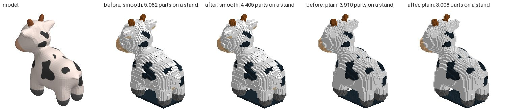

The milk truck at 48 studs (Cesium, CC-BY 4.0), cut in half across its
length and seen nearly head on, each part a shade apart (`pictures --cut`):
before, the core's courses are bands of plates; after, long bricks.

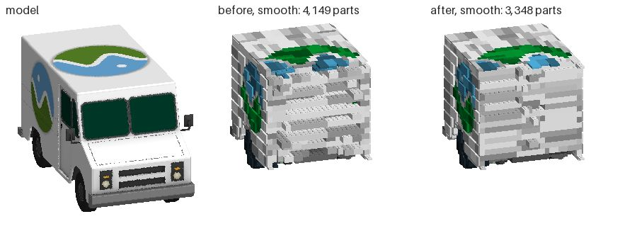

The temple at 48 studs (Objaverse, CC-BY 4.0): laid bonded, smooth lost
the moon on its stick; laid again by the colours measured, it keeps it, as
`main` does. Plain loses it before and after.

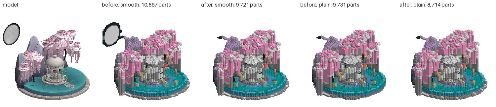

### Proof

- `brickify_probe` (headless): all 66 checks pass, six of them new, in a
  section "bonded as a builder bonds". A block four studs square and six
  plates tall, red only where nothing shows, is two courses of white bricks,
  4 parts (by the colours measured, 15). Three 2 x 4 plates stacked merge
  into a 2 x 4 brick and two 1 x 2 plates side by side into a 2 x 2. The
  forty-stud bunny's hidden core is 280 bricks and 118 plates (on `main`, 203
  and 159). And the sphere, the plain sphere and the forty-stud bunny each
  in fewer parts and fewer 1 x 1s than on `main`, seams bridged and weak
  points within two points of `main`'s: 1,548 parts from 1,606, 1,218 from
  1,266, 2,027 from 2,062; weak points 32.0% against 30.9%, 36.9% against
  36.3%, 30.2% against 31.2%. Measured as the bench measures them (`_bond`).
- `brickify_ui_probe` in a window on the GPU: all pass; the bunny lands as
  1,214 parts and the hollow sphere as 1,097 (1,177 in unit 2b's run).
- `shapes_probe` (78): all pass. A design's shapes do not ask for `bond`,
  so they lay as they did.
- `featuremap affected` over this branch's own commits names only
  `lib:brickify`.
- `tools/web/brickify_flow.mjs` (`brickify`, `brickify_fox` in the preview
  checks) needs a preview, and was not run.

### What is left

- **Parts and 1 x 1s are in the surface now.** At 48 studs smooth, 39% of
  the parts are plates that show, the staircase under each stud's slope,
  and half of them are 1 x 1s; 25% are the surface's own parts, a slope or
  tile a stud. Unit 4 (fit the surface by distance) is where they fall:
  longer slopes over a run of studs, and a slope two or three plates tall
  where the staircase now steps a plate at a time.
- **Weak points**: most hold a surface part or the staircase's next plate
  alone. A slope that stands on two parts, or a staircase plate that reaches
  under the next stud, would take them out; the core cannot.
- **The temple at 48 studs**: bonded, its stitch cannot join the moon on
  its stick, with 96 rounds or 443, and plain loses it either way. Laying
  it twice keeps the moon but doubles the time of the bench's largest
  scene; joining a piece a round is the limit (unit 2b's "what is left").
- **Seams bridged** rose 3 to 4 points, short of 60%. With the hemmed-in
  studs first, a course has one placement for each brick; a stagger needs
  the choice made over the whole course (Kollsker's lookahead), not stud by
  stud.
- **Mirror shapes** keep the old courses, and so fewer of the gains.

## 9. Unit 4: fit the surface by distance (2026-10-17)

Unit 4 of the plan. On `main` today (`d55251d`), smooth is no nearer the
model than plain (Chamfer 0.263 against 0.265 studs at 48 studs) and turns
from it about as much (normal error 37.3° against 38.3°): each stud's
slope is chosen by a flag that says whether the model is flat or curved
there, against the height of the stud's middle in whole plates. Branch
`worktree-agent-a1f62b437d9f19743`, from `main` at `5e082bd` with the m43
and m44 releases (`d55251d`) merged.

**In short.** The bar is missed by far. Smooth is now 4.6% nearer the model
than plain at 48 studs and 2.5% at 24 (the bar: 20%), and turns from it
3.8% and 2.6% less (the bar: 30%); it is further from the model or turned
more than plain on 13 of the 28 runs, from 21. Half of what the bench sees
of a model faces out, within 30 degrees of level, and there no part this
unit lays reaches: smooth and plain turn from it by the same 36°. Were
every surface facing up laid perfectly, the normal error at 48 studs would
still be about 29°, 24% under plain's. What did change: the surface parts
are chosen by how near they lay the model, a quarter fewer of them at 48
studs (3,430 from 4,492), a quarter fewer cheese slopes, every one in a
colour it is sold in, and ΔE2000 at 48 studs 1.23 times the floor from 1.27.
The rest holds: smooth whole in 28 of 28 and the temple's moon kept, every
run one piece with its check passing, standing in 24 of 28 from 20, the
bond's figures within a point and a half of unit 3's, the stops.

**Where the error is.** The model's visible points sorted by which way
their surface faces (`brickify_bench.py faces`, the means of the 14
models): normal error in degrees, and the distance from the model to the
build in studs.

| 48 studs | Up | Up and out | Out | Down and out | Down |
|---|---|---|---|---|---|
| Share of what is seen | 8% | 16% | 53% | 13% | 10% |
| Plain, normal | 27.6 | 47.9 | 35.4 | 50.2 | 35.5 |
| Smooth before, normal | 21.1 | 38.9 | 36.6 | 48.0 | 38.0 |
| Smooth after, normal | 20.5 | 38.1 | 36.4 | 48.9 | 35.2 |
| Plain, distance | 0.15 | 0.17 | 0.30 | 0.19 | 0.16 |
| Smooth before, distance | 0.16 | 0.19 | 0.24 | 0.21 | 0.17 |
| Smooth after, distance | 0.14 | 0.16 | 0.24 | 0.19 | 0.16 |

At 24 studs the shares are the same and the out faces' normal error 40.4°
after, 40.5° before, 39.8° plain. The slopes and tiles do their work on
the quarter that faces up; the sides are one-stud staircases in every arm,
and the overhangs' inverted slopes turn from the model by 48° to 51°
whichever way they are chosen.

**What changed** ([shapes.gd](../src/ai/shapes.gd),
[brickify.gd](../src/assembly/brickify.gd); a design's shapes lay as
before):

1. **The model's own surface at thirds of a stud** (`Grid.fine`). Brickify
   already casts a ray up through every third of a stud; each stud now
   hands Shapes the nine heights where those rays leave the model nearest
   its top (or enter it nearest its foot), in plates, not rounded.
2. **Each surface part read off its own mesh** (`Plan.SLOPES` and
   `Plan.INVERTED`, the last column): its top at each third of a stud along
   its fall, studs and all. The heights written by hand for the stud's
   middle were a plate out in places: the curved 4 x 1 is 2.9 plates over
   its second stud, not 2.2, and an inverted slope's deep end is hollow.
3. **Fitted by distance** (`Plan._fit_near`). At each place a slope could
   start, every slope, curved slope and inverted one, in every turn and at
   every height that stands on the shape, is laid against the model's
   surface at the thirds of a stud it covers: how far its surface is from
   the model's, in studs, and how far it turns from it, at 0.004 studs a
   degree. The nearest is kept, or the longest within 0.12 studs of it, and
   only if it is nearer than the plates it would take the place of. The flag
   is not asked.
4. **Only in a colour it is sold in** (unit 3's `_made`, asked of each
   surface part as it is fitted): a slope not made in the colour it shows
   is not laid there. It used to be laid and recoloured after, the nearest
   colour it is made in: a grey hull's inverted slopes came out Sand Green.
5. **The angles it lacked**: the 65 degree slope 2 x 1 x 2 (60481a) and
   2 x 2 x 2 (3678b), and the curved top 1 x 3 x 2 (33243), each fitted
   only this way.
6. **A build that leaves a region out** is laid again as `main` lays it,
   unbonded and its slopes by the flag (`Options.near`), and the fuller
   kept (unit 3's rule, a step further). Fitted by distance, the temple at
   48 studs lost its moon bonded and again unbonded (Chamfer 0.61 studs
   from 0.39); now it is `main`'s build, as in unit 3.

**Tried and taken out.** Measured on Spot and the Stanford bunny at 48
studs (200 x 200 views, the means of the two), and the probe's own sphere
and forty-stud bunny; the bench's figures above are the final build's.

| On Spot and the bunny at 48 | Normal (°) | Chamfer (studs) | Seams bridged | Probe's sphere: seams bridged (`main` 53.9%) |
|---|---|---|---|---|
| `main` | 40.0 | 0.229 | 50.5% | |
| Fitted by distance, longer preferred by 0.10 studs | 39.7 | 0.214 | 51.4% | 53.1% |
| And the 65 degree slopes, by 0.12 (the final build) | 39.6 | 0.213 | 51.3% | 52.9% |
| And the 75 degree slopes, by 0.10 | 39.1 | 0.211 | 48.8% | 49.3% |
| And stacked as a roof is, by 0.10 | 38.1 | 0.206 | 45.5% | 48.4% (the brick-tall slopes alone stacked) |

- *Stacked as a roof is*: a straight slope's flat top under the last stud
  of the slope above, so a flank is one face and not a stud flat and a stud
  sloped all the way down; under an overhang, the next inverted slope out
  on the last stud of the one deeper. The nearest of all, but the slope
  underneath takes the place of the core's plates that bridged its
  neighbours: the probe's sphere took 1,697 parts to `main`'s 1,606, and
  the forty-stud bunny's hidden plates rose from 98 to 145. Without
  stacking, a 65 degree slope is a stud flat and a stud at 65 degrees, and
  on a face falling five plates a stud all the way down nothing beats the
  plates; it is laid where a flank's edge steps down a plate and then falls
  (128 times at 48 studs).
- *75 degree slopes* (4460b, and 2449 inverted), three bricks tall on a
  stud: nothing beside them is bridged to them. The sphere's seams bridged
  fell to 49.3% and the forty-stud bunny's to 47.3% (`main` 49.7%). The top
  one was hardly laid unless stacked; the inverted one 50 to 75 times a
  model, and the overhangs turned from the model no less.
- *Preferring longer* by 0.04 studs: the bunny at 48 studs had 276 cheese
  slopes 1 x 1 (`main` 320); by 0.10, 201, as near. At 0.10 the probe's sphere took 5 parts
  more than `main`'s; at 0.15 and 0.20 a point fewer of its seams were
  bridged than `main`'s, and fewer of its tops curved. 0.12 holds both.
- *Twice the weight on turning* (0.008 studs a degree): within 0.2° and
  0.002 studs of 0.004.
- *A slope only where it beats the plates by 0.02 studs*: the same sphere,
  5 parts too many.
- *A straight slope's flat top flush with the stud above it* (a slope
  starting on the plateau's edge, not the first stud lower): a stud on
  top where there was a tile; Spot and the bunny turned 0.1° more.

**Not done.** Double curves (93273, 1762), round 2 x 2 bricks and domes
(3941, 30367), wedge slopes (43720, 43721, 42862) and quarter tiles were on
the list. A double curve falls both ways, so Shapes reads no fall off its
mesh and has no turn to lay it in; a round brick or a dome caps a round
column, not a fall; a wedge slope falls across the diagonal. Each needs a
fit of its own, in two directions, and none was started.

### The bench again

The same 14 models at 24 and 48 studs, smooth and plain, `main`
(`d55251d`) laid in its own checkout and the branch in this one, each in
two processes, the box calm (a load of 2 to 24), both measured by
`brickify_bench.py`.

**Likeness**, the means of every model.

| Studs | Run | Chamfer, smooth | Chamfer, plain | Smooth against plain | Normal, smooth (°) | Normal, plain (°) | Smooth against plain | IoU, smooth | F@0.5, smooth |
|---|---|---|---|---|---|---|---|---|---|
| 24 | `main` | 0.236 | 0.238 | −0.7% | 41.0 | 41.8 | −1.9% | 0.877 | 0.915 |
| 24 | after | 0.232 | 0.238 | −2.5% | 40.7 | 41.8 | −2.6% | 0.879 | 0.919 |
| 48 | `main` | 0.263 | 0.265 | −0.7% | 37.3 | 38.3 | −2.6% | 0.927 | 0.906 |
| 48 | after | 0.253 | 0.265 | −4.6% | 36.9 | 38.3 | −3.8% | 0.931 | 0.913 |
| | the bar | | | −20% | | | −30% | | |

Plain lays no surface part and is the same build before and after. Smooth
is nearer the model than before on 21 of the 28 runs and turns less on 20;
Bob at 48 turns 1.3° more. It is still further from the model, or turned
more, than plain on 13: the avocado, 3DBenchy, the fox and the milk truck
at both sizes, the figure and the teapot at 24, and the Hayes bust, Spot
and the toy car at 48 (Spot 0.203 against 0.201 studs). The most is 0.03
studs (the avocado and the milk truck at 48) and 3° (the milk truck at 24,
whose flat roof and sides plain lays as well).

**Whole, standing, the bond, colour.**

| Studs | Run | Whole | Standing, no joint past its load | Joints past their load | Parts | Times greedy's | 1x1 share | Seams bridged | Weak points | ΔE2000 | Times the floor |
|---|---|---|---|---|---|---|---|---|---|---|---|
| 24 | `main` | 14/14 | 11/14 | 3 | 11,353 | 2.86 | 42.4% | 44.6% | 32.8% | 11.07 | 1.49 |
| 24 | after | 14/14 | 14/14 | 0 | 10,975 | 2.76 | 40.7% | 43.3% | 33.0% | 11.04 | 1.49 |
| 48 | `main` | 14/14 | 9/14 | 48 | 52,160 | 2.42 | 35.1% | 44.9% | 27.2% | 9.47 | 1.27 |
| 48 | after | 14/14 | 10/14 | 42 | 51,531 | 2.39 | 34.1% | 45.4% | 27.8% | 9.17 | 1.23 |

Every run is laid, in one piece, its check passing; plain is whole in 27
of 28 as before (the temple at 48 loses its moon). The temple at 48 smooth
is `main`'s build part for part, its 35 joints past their load with it.

**The surface parts**, all 14 models at 48 studs, smooth (24 studs in
brackets).

| Part | `main` | After |
|---|---|---|
| 65° 2 x 1 x 2 and 2 x 2 x 2 (60481a, 3678b) | 0 (0) | 128 (42) |
| Curved top 1 x 3 x 2 (33243) | 0 (0) | 16 (9) |
| 45°, 33° and 18° slopes | 407 (51) | 322 (68) |
| Curved slopes, 2, 3 and 4 long | 316 (30) | 570 (95) |
| Cheese slopes 1 x 1 and 1 x 2 | 2,959 (880) | 2,174 (473) |
| Inverted slopes | 810 (111) | 220 (30) |
| All surface slopes | 4,492 (1,072) | 3,430 (717) |

The inverted slopes that went were further from the model than the plates,
or not made in the colour they show: 4287a is sold in 7 of the palette's
41 colours, none of them white, grey or black.

**Time.** The forty-stud bunny laid three times by `main` and by the
branch side by side, twice in turn (`brickify_phases.gd`, medians of the
six): 5.41 s for `main` (5.25 to 5.73) and 5.12 s for the branch (5.00 to
5.42), 0.95 times. The fit takes 0.07 s where the flag took 0.03; the
stitch is 0.2 s quicker on 84 fewer parts (1,943 from 2,027). On the
bench, smooth averaged 38 s at 48 studs from 52 and 4.2 s at 24 from 6.8,
`main` and the branch an hour apart on a box at a load of 2 to 24: read
the bunny's ratio, not these.

**Pictures.** Spot, 3DBenchy, Bob, the avocado, the milk truck and the
Stanford bunny at 48 studs, drawn on the GPU by the app's own camera
(`bench_views.gd`), `main` beside the branch (in
`bench/results/brickify5-2026-10-17/renders`, not committed). Spot's back
and Bob's tube read rounder: curved slopes two and three studs long where
cheese slopes stepped a plate a stud. The pieces in a colour the model
does not have are gone: Spot's tan at the chest and legs, the avocado's
dark red under its seed and olive under its foot, 3DBenchy's Sand Green
under its bow, each an inverted slope recoloured to one it is sold in.
Under 3DBenchy's bow there are plain plates there now, and a pillar of
1 x 1 bricks to the ground props them, where the slopes had no joint past
their load. The sides are the staircases they were. The milk truck is the
same build but for its bonnet's front edge.

Spot at 48 studs (Keenan Crane, CC0), the model, then smooth before and
after:

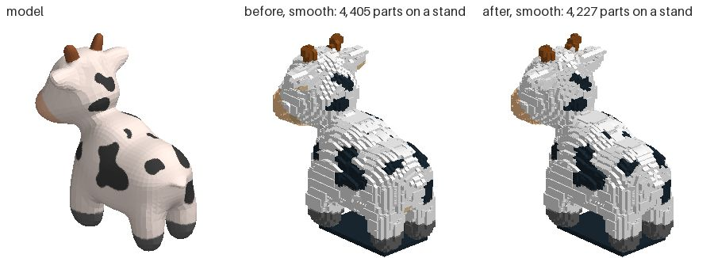

3DBenchy at 48 studs (Creative Tools, CC0): no Sand Green under the bow,
and the pillar that props it.

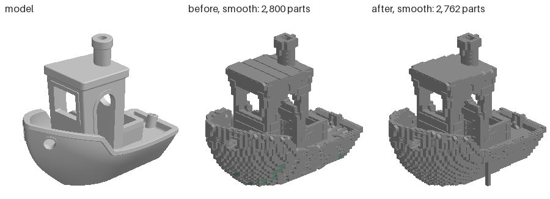

### Proof

- `brickify_probe` (headless): all 73 checks pass, seven of them new, in a
  section "the surface fitted by distance": every one of the 1,379 slopes
  laid in the probe's builds is sold in its colour; a ledge whose edge
  steps down a plate and then falls 65 degrees over a stud is laid with
  65 degree slopes; a ramp at 18 degrees in slopes three and four studs
  long (24 of them), not a cheese slope. Unit 3's bond checks hold: the
  sphere in 1,589 parts (`main` 1,606), 52.9% of its seams bridged
  (53.9%), 30.9% weak points (30.9%); the forty-stud bunny's hidden core
  242 bricks and 98 plates.
- `shapes_probe`: all pass; a design's shapes do not hand Shapes a model's
  surface, so they keep the flag and lay as they did.
- `brickify_ui_probe` in a window on the GPU: all pass; the bunny lands as
  1,214 parts and the hollow sphere as 1,058.
- `quit_probe --only=brickify`: the app gone 0.4 s after the window closed
  mid-run. The fit asks the run's stop every 256 studs.
- `featuremap affected` names `lib:brickify` and the bench
  (`brickify_bench.py faces`, run on both runs above; `pyright` clean).
- `tools/web/brickify_flow.mjs` (`brickify`, `brickify_fox` in the preview
  checks), on a local export (`tools/export.sh web`, `tools/web/serve.py`),
  not a preview: both pass, the bunny landing as 6,028 parts and the fox as
  1,926. Neither ran at the size it typed: the box took 30 and 24 as 64
  studs, so the fox stood on its own and its "stand" passed on "stands". On
  `main`'s own export the fox flow does the same (1,953 parts at 64 studs):
  the flow's typing, not this unit.

### What is left

- **The sides.** Half of what the bench sees faces out, and both arms turn
  from it by 36° at 48 studs; the bar's 30% cannot be had from the top.
  Unit 5 (SNOT) is there: a flank in plates and tiles turned to face it.
- **The overhangs** turn from the model by 48° to 51° with inverted slopes
  or without. Most inverted slopes are sold in few colours, and the 75
  degree one costs the bond.
- **Stacked slopes** were the nearest of all and are out for the bond. A
  stack whose lower slope stands on a plate reaching under its neighbours
  would keep both; the core is laid after the surface and does not know to.
- **Plan diagonals**: every slope falls along x or z. A flank facing 45
  degrees between them is laid as two staircases at right angles; corner
  and wedge slopes would follow it.

## 10. Unit 5: steep sides on their sides (2026-10-17)

Unit 5 of the plan. On `main` today (`d24d4d6`), a side steeper than 60
degrees is laid upright in every arm: a staircase a stud a step, its studs
up, with tiles on studs-sideways panels only where a flank is flat. Those
steep faces are 53% of what the bench sees, and at 48 studs smooth turns
from them by 36.4°. Branch `worktree-agent-a3af909f3f0a35703`, from `main`
at `c7ebe80` with the m52 to m54 releases (`d24d4d6`) merged.

**In short.** The bar is missed by far. Steep faces turn from the model
4.1% less at 48 studs (34.9° from 36.4°) and 3.0% less at 24 (39.2° from
40.4°); the bar was 30%. Seen from the four sides, the build is no nearer
the model: Hausdorff95 0.86 studs from 0.84 at 48 and 0.74 from 0.73 at 24,
down on 3 of the 14 models at 48, up on 5. What turning does where it
reaches: 30% of the steep faces at 48 studs are now nearest a part on its
side, and there they turn from the model by 29.0°, where the rest, upright,
turn 38.7°. Everything units 3 and 4 made true holds: every run whole (28
of 28, the temple's moon kept), every run one piece with its check
passing, standing in 24 of 28 as before, ΔE2000 within 0.06, every slope
in a colour it is sold in, the stops. Parts are 8.1% more at 48 studs and
6.5% at 24 (the bar: 15%). The forty-stud bunny takes 1.06 times `main`'s
time.

**Why a staircase on its side is no better.** A staircase's faces point
along the axes whatever the size of its steps, so a side laid as plates on
their sides, two fifths of a stud a step, turns from the model as much as
the same side in studs: on a wall leaning 20 degrees, both are, by area,
73% faces 20 degrees off and 27% faces 70 degrees off. Only parts that tilt
(slopes, curved slopes, a tile turned to face the side) take the error
down, and on its side a cube's surface is a top 0 to 45 degrees off its
face, where unit 4 found slopes leave 20° to 38°. What the smaller step
does change is the distance.

**What changed** ([brickify.gd](../src/assembly/brickify.gd),
[shapes.gd](../src/ai/shapes.gd); a design's shapes lay as before):

1. **The cubes** (`Brickify._cubes`). The model's triangles, each cut into
   pieces a stud or less across, are summed into the cubes they lie in, two
   studs by five plates by two studs (40 LDU every way, as Lambrecht's are
   [lambrecht]), by area and the way each faces, half a stud inside the
   surface. A cube faces out where the sum is within 21 degrees of level (a
   side steeper than 69 degrees), covers a square stud or more and mostly
   agrees; its way out is x or z, whichever the sum leans to more.
2. **A shell for each depth** (`Plan._cube_shells`, `_cube_shell`). The
   cubes facing one way at one depth are one shell, laid as a design's
   curved side is (`lay_shell`): a plan of its own, a stud along the side by
   a plate out by a row down, its parts then turned so their up points out.
   A cube goes in where it is the side's outermost (where the model reaches
   into the cube past it, that one is taken instead), the core is behind it
   two studs deep, it has four of the model's plates or more, and no cap or
   ledge of the core a plate or two thick stands on it or hangs from it.
3. **Held by side studs, first tier only** (`Plan._anchored`, as a design's
   shell is held). In the core's wall behind each cube's top row, a 1 x 4,
   1 x 2 or 1 x 1 brick with studs on its side (30414, 11211, 87087), its
   stud at the row's middle. Every joint is a stud in a plate's underside.
4. **Fitted by distance on its side** (`Brickify.Grid.side`). Rays are cast
   across the model along x and along z through every third of a stud, as
   they are cast up; each shell fits its slopes, curved slopes and tiles by
   how near they lay its side (unit 4's `_fit_near`), and one on the core's
   face only where a side stud grips it.
5. **Kept where held** (`CUBE_KEEPS`, `_give_back`). Each shell is tried
   before the core is laid. A cube its kept parts cover under 60% of goes
   back to the core and the shell is cut again; then what of a kept cube no
   part of the shell reaches, in that row and lane at any depth, goes back
   too, and the core lays it upright. Laid after the core where the core kept
   every side stud, the shell is the one tried, not laid again.
6. **Nothing in the way** (`Plan.cut_off`, `_stands_at`, `lay_shell`). A
   piece of the core of 16 parts or fewer that a shell cuts off is taken out
   before the check, as the mend would take it out, so the check is asked
   once; one whose every part touches a shell goes before the stitch, which
   on a bunny at 48 studs tried 86 joins for them where it had tried 27. No
   slope of the core is laid under a shell, where its studs ran into the
   plate on its side over it, and nothing of a shell over a side-stud
   brick's top studs.
7. **Laid again without** (`Options.snot`). A build with its sides turned
   that leaves a region of the model out is laid again with them upright,
   which is unit 4's build, and that lays itself again unbonded and by the
   flag where it too leaves a region out (unit 3's rule): the fuller kept,
   the time of each counted. A blue bunny, laid straight to unbonded and by
   the flag, came back with inverted slopes no one sells in blue; checking
   the colour on the flag's path instead changed the temple's fallback, and
   it lost its moon.
8. **The bench** (`faces`): the steep faces split by whether the part
   nearest each lies on its side, and the Hausdorff95 seen from the four
   sides alone.

**Tried and taken out.** Spot and the Stanford bunny at 48 studs, and in
brackets the milk truck at 24 and 48: the steep faces' normal error, the
side views' Hausdorff95, and the parts. Each row against the one it names.

| Spot, Stanford bunny at 48 (milk truck at 24, 48) | Steep faces (°) | Sides, Hausdorff95 (studs) | Parts |
|---|---|---|---|
| `main` | 38.6, 40.0 (18.3, 19.3) | 0.54, 0.55 (0.48, 0.65) | 4,227, 5,137 (805, 3,117) |
| A first build, a shell's slopes by the flag | 35.8, 39.0 | 0.56, 0.58 | 4,839, 5,968 |
| The same, its slopes fitted by distance | 34.8, 38.0 | 0.53, 0.58 | 4,811, 6,040 |
| Later rules: from 60 degrees, a cap of one plate turned, bonded on its side (A) | 35.9, 38.0 | 0.56, 0.59 | 4,783, 5,998 |
| A, but a side square to x or z left upright | 36.8, 38.6 | 0.56, 0.59 | 4,779, 6,091 |
| that, and no cube moved out to the side's outermost | 37.6, 38.6 | 0.56, 0.59 | 4,662, 6,057 |
| that, measured a quarter stud inside, not half | 37.1, 39.0 | 0.56, 0.59 | 4,788, 6,013 |
| A, a cap of one plate left upright (kept) | 34.5, 38.2 | 0.55, 0.58 | 4,845, 5,942 |
| A, not bonded or merged on its side (kept) | 35.0, 37.8 | 0.54, 0.58 | 4,761, 6,020 |
| A, from 69 degrees (kept) | 35.1, 38.1 | 0.53, 0.57 | 4,806, 6,001 |
| A, nothing cut off taken out before the check | 35.9, 37.9 | 0.55, 0.58 | 4,788, 6,006, the mend taking out 12 and 4 in 43 s and 70 s, from 9 and 2 in 23 s and 48 s |
| The kept rules together (B) | 35.1, 38.0 (13.3, 14.4) | 0.53, 0.57 (1.02, 0.63) | 4,785, 5,982 (952, 3,688) |
| B, a cube kept only where 90% covered | 35.7, 38.5 (13.2, 16.2) | 0.52, 0.55 (0.49, 0.65) | 4,701, 5,680 (982, 3,456) |
| B, what no part reaches given back (kept) | 35.2, 37.9 (11.3, 13.6) | 0.52, 0.55 (0.48, 0.52) | 4,857, 6,068 (1,003, 3,684) |
| that, and 80% covered | 35.5, 38.9 (12.5, 13.5) | 0.52, 0.54 (0.49, 0.51) | 4,762, 5,712 (1,021, 3,685) |

- *Square sides upright*: a side within 10 degrees of facing along x or z
  is flat laid upright, but Spot's flanks turned 0.9° more left so.
- *A cap of one plate turned*: the tile over the shell's edge is held by
  nothing and goes with what is cut off; Spot turned 1.4° more for it.
- *Bonded and merged on its side*, as the core is: more parts and a turn
  more, not fewer.
- *From 60 degrees*: between 60 and 69 the 65 degree slopes laid upright
  do as well (unit 4); turned, the sides stood further off.
- *What no part reaches left out*: the milk truck's flat side had holes to
  the core a stud in, and its side views' Hausdorff95 at 24 studs went from
  0.48 to 1.02. Given back first, a 1 x 4 with studs on its side ran into
  the plates given back in front of its open studs, and the bunny lost 16
  parts to the mend: the rows and lanes with a side stud are the shell's.

**Where the error is now**, the means of the 14 models (`faces`):

| Studs | Run | Steep faces (°) | Of them nearest a part on its side | There (°) | The rest (°) | Steep faces' distance (studs) |
|---|---|---|---|---|---|---|
| 24 | `main` | 40.4 | 6% | 41.1 | 40.0 | 0.220 |
| 24 | after | 39.2 | 15% | 32.6 | 41.1 | 0.225 |
| 48 | `main` | 36.4 | 13% | 36.3 | 36.5 | 0.241 |
| 48 | after | 34.9 | 30% | 29.0 | 38.7 | 0.228 |

On `main` the parts on their sides are the panels' tiles on flat flanks.
Turned, a cube's side turns from the model 10° less than the upright rest;
but 70% of the steep faces are still nearest an upright part. Some lie in
no cube that faces out (its surface mixed, or under a square stud), and
about half the cubes that do are left upright (`Shapes.last["cubes"]`: on
Spot at 48 studs 279 of 519 turned; left upright, counted each time a
shell is cut, 110 under or over a cap or ledge of the core, 56 with the
model past them, 37 with too little of it, 36 their shell did not cover,
27 no side stud held). The faces left upright are the harder ones, 38.7°
where all of them were 36.5°.

### The bench again

The same 14 models at 24 and 48 studs, smooth, `main` (`d24d4d6`) laid in
its own checkout and the branch (`ea6dc87`; the stops added since change
nothing laid) in another, each half of the models a process; the greedy
stack laid with `main`; both measured by `brickify_bench.py`. Plain lays
no part on its side and is `main`'s build.

**Likeness**, the means of every model.

| Studs | Run | Steep faces (°) | Sides, Hausdorff95 (studs) | Normal, all (°) | Hausdorff95 (studs) | Chamfer (studs) | IoU |
|---|---|---|---|---|---|---|---|
| 24 | `main` | 40.4 | 0.73 | 40.7 | 0.77 | 0.232 | 0.879 |
| 24 | after | 39.2 | 0.74 | 39.9 | 0.78 | 0.235 | 0.879 |
| 48 | `main` | 36.4 | 0.84 | 36.9 | 0.96 | 0.253 | 0.931 |
| 48 | after | 34.9 | 0.86 | 36.1 | 0.94 | 0.244 | 0.932 |
| | the bar | −30% | lower | | | | |

Model by model at 48 studs, the steep faces turn less on 11 of 14: the milk
truck 13.5° from 19.3°, the fox 31.4° from 36.1°, Spot 35.0° from 38.6°, the
Stanford bunny 37.7° from 40.0°, Bob 40.5° from 42.7°; more on the figure
(32.1° from 31.3°) and the Bell X-1 (35.1° from 34.4°); the temple is
`main`'s build. The side views are nearer on the milk truck (0.54 from 0.65
studs), Spot (0.51 from 0.54) and Bob, and further on the Bell X-1 (1.90
from 1.54: 16 parts of props to the ground where `main` had 10, each a
pillar the model does not have), the figure (0.76 from 0.71), the fox (0.54
from 0.50), and the avocado and the toy car by 0.01.

**Whole, standing, the bond, colour.**

| Studs | Run | Whole | One piece, passes | Standing, no joint past its load | Joints past their load | Parts | Times greedy's (median) | On their sides | 1x1 share | Seams bridged | Weak points | ΔE2000 | Times the floor |
|---|---|---|---|---|---|---|---|---|---|---|---|---|---|
| 24 | `main` | 14/14 | 14/14 | 14/14 | 0 | 10,975 | 2.76 (2.93) | 209 | 40.7% | 43.3% | 33.0% | 11.04 | 1.48 |
| 24 | after | 14/14 | 14/14 | 14/14 | 0 | 11,685 | 2.94 (3.09) | 1,112 | 39.2% | 40.9% | 31.3% | 11.06 | 1.49 |
| 48 | `main` | 14/14 | 14/14 | 10/14 | 42 | 51,531 | 2.39 (2.45) | 1,626 | 34.1% | 45.4% | 27.8% | 9.17 | 1.23 |
| 48 | after | 14/14 | 14/14 | 10/14 | 47 | 55,696 | 2.58 (2.71) | 5,949 | 32.9% | 38.9% | 25.4% | 9.23 | 1.24 |

Parts are 6.5% and 8.1% more (the bar: 15%); model by model up to 24%
(the milk truck at 24, 805 to 1,001), and at 48 studs the milk truck 18%,
the Stanford bunny and the fox 16%, Spot 14%. Seams
bridged and weak points read the parts' boxes on the stud grid, and a plate
on its side is two fifths of a stud thick: it falls between the grid's
cells, counts as no seam and is no one's weak point. So both fall, and
neither says the bond is better: each cube's shell hangs on the side studs
of one row, and every such brick is a joint the shell's parts all hang
from. Balance does not model side studs either ("no stability solver models
side studs" [stablelego]): stud joints past their load are 47 at 48 studs
from 42 (the toy car 6 from none, the fox 4 from 2, the figure 2 from 4,
Bob none from 1, the temple's 35 as on `main`), and the props under such
joints more (the Bell X-1 16 parts from 10).

**Time.** The forty-stud bunny laid three times by `main` and by the branch
side by side, twice in turn (`brickify_phases.gd`, medians of the six):
8.27 s for `main` (6.12 to 9.10) and 8.76 s for the branch (5.46 to 9.45),
1.06 times, in 2,146 parts from 1,943. The shells take 0.46 s, the check
0.7 s less. On the bench, the temple at 48 studs is laid three times (with
its sides turned it loses its moon; upright, by unit 4's rules, again; then
unbonded and by the flag it keeps it) and took 538 s where `main` took 267;
the bench's means, the box at a load of 10 to 35, are not a fair ratio.

**Pictures.** Spot, the Stanford bunny, the milk truck, 3DBenchy, Bob and
the avocado at 48 studs, drawn on the GPU by the app's own camera
(`bench_views.gd`), `main` beside the branch (in
`bench/results/brickify6-2026-10-17/renders`, not committed). The milk
truck's flat side is a skin of plates on their sides with its logo laid
in them, where `main` had panels of tiles standing proud of it and rows of
studs at the door; its grille is laid on its side too, and a white 1 x 1
tile on a side stud the shell left open shows on the logo. Spot's rear and
chest and the bunny's chest show curved slopes on their sides facing out,
and the dark slots in the bunny's haunch are gone. 3DBenchy's hull and
cabin read as before, a few curved slopes on their sides at the bow; Bob
and the avocado change little to the eye.

The milk truck at 48 studs (Cesium, CC-BY 4.0), `main` and the branch:

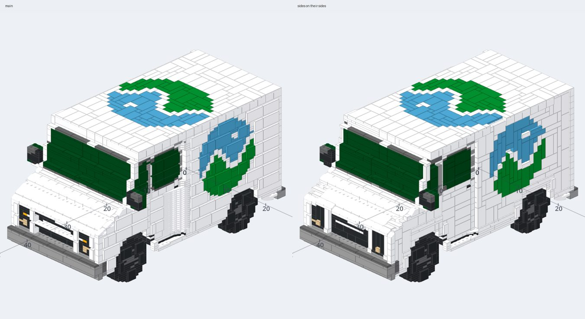

Spot at 48 studs (Keenan Crane, CC0), from behind:

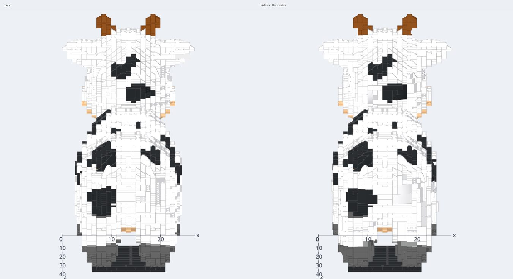

### Second round: no slower, and the joints

Asked of the first round: no stud joint past its load that `main` does not
have (42 at 48 studs, 47 after it), and no model more than 1.3 times
`main`'s time (the temple was twice it, laid three times), the forty-stud
bunny at most 1.1 times.

**What changed.**
1. **Two lays at most.** A build that leaves a region out is laid again
   unbonded and by the flag at once, as `main` lays it again, not first
   upright and bonded: the temple, which loses its moon either way it is
   bonded, was laid three times.
2. **One colour asked for keeps its slopes to that colour on every path**
   (Shapes' `sold_only`): `made_colours` does not recolour it, and laid again
   by the flag the blue bunny had inverted slopes no one sells in blue.
   Checked so for every sculpt instead, the temple's fallback changed and it
   lost its moon.
3. **The core three studs deep behind a turned cube** (`CUBE_BACK`, and not
   another shell's): the fox at 48 studs, two deep, hung its head on 4
   joints past their load, `main`'s 2; three deep, 2. Spot and the Stanford
   bunny lay as before (34.9° and 37.7°).
4. **Rays across only through a cube facing that way**: the rest were most
   of measuring the cubes (0.76 s of a 24-stud bust's 7 s). The fox lays the
   same 972 parts.

Tried and taken out: a shell beside a piece of the core that the shells
cut off (face to face) given back. On the toy car it gave back none; its
weak column has no part on its side within four studs of it.

**Joints past their load**, each run at 48 studs that has any (none at 24,
before or after), the branch at `8c627ca`:

| Model | `main` | After | Steep faces (°), `main` → after | Parts |
|---|---|---|---|---|
| Bob | 1 | 0 | 42.7 → 40.6 | 3,423 → 3,737 |
| the figure | 4 | 2 | 31.3 → 32.5 | 2,377 → 2,598 |
| the fox | 2 | 2 | 36.1 → 31.5 | 853 → 972 |
| the toy car | 0 | 6 | 35.8 → 34.9 | 3,020 → 3,090 |
| the temple (`main`'s build) | 35 | 35 | 39.8 → 39.8 | 10,867 → 10,867 |
| All | 42 | 45 | | |

The toy car's 6 are one column of 1 x 1s a stud across under a piece of
225 g, each joint of it 26 times past its load. No part on its side is
within four studs of it; laid upright (`Options.snot` false) the car has
none, and its 5 shells buy 0.9° on its steep faces. The trade is that car's
6 against the figure's and Bob's 3 fewer.

**Time**, each model laid by `main` and by the branch one after the other
(the box shared, at a load of 10 to 46): over all 28 runs 864 s for `main`
and 859 s for the branch; the temple at 48 studs 391 s and 349 s. The six
runs over 1.3 times, each laid again four times by each (two processes
each, in turn, `brickify_phases.gd`; medians, `b63bcf8`):

| Run | `main` (s) | Branch (s) | Times |
|---|---|---|---|
| the Hayes bust at 24 | 14.5 | 11.1 | 0.77 |
| the toy car at 24 | 8.0 | 8.2 | 1.02 |
| the Bell X-1 at 24 | 3.2 | 3.3 | 1.04 |
| 3DBenchy at 48 | 19.3 | 21.8 | 1.13 |
| the temple at 24 | 16.3 | 21.7 | 1.33 |
| the avocado at 48 | 20.2 | 28.7 | 1.42 |

The temple at 24 turns 5 to 13 ms of shells; the rest is its stitch, which
took 7 to 19 s run to run on the same build, the box at a load near 46. The
avocado at 48 is real: its shells take 1.5 s, its stitch 3 s more, and a
1 x 1 plate and a tile left apart at its top (on `main`, none) send its
mend to a second check, 4 to 6 s. The forty-stud bunny, six each side by
side: 5.60 s for `main` (5.44 to 6.22) and 5.59 s for the branch (4.79 to
6.44), 1.00 times, in 2,143 parts.

**The bench again, second round** (`8c627ca`, the same models and sizes):

| Studs | Run | Steep faces (°) | Nearest on its side | There (°) | Sides, Hausdorff95 | Whole | One piece | Standing | Joints past load | Parts | ΔE2000 |
|---|---|---|---|---|---|---|---|---|---|---|---|
| 24 | `main` | 40.4 | 6% | 41.1 | 0.73 | 14/14 | 14/14 | 14/14 | 0 | 10,975 | 11.04 |
| 24 | after | 39.3 | 14% | 34.2 | 0.73 | 14/14 | 14/14 | 14/14 | 0 | 11,647 | 11.04 |
| 48 | `main` | 36.4 | 13% | 36.3 | 0.84 | 14/14 | 14/14 | 10/14 | 42 | 51,531 | 9.17 |
| 48 | after | 35.0 | 29% | 29.5 | 0.87 | 14/14 | 14/14 | 10/14 | 45 | 55,460 | 9.22 |

Parts 6.1% and 7.6% more; 1 x 1s 39.4% and 33.0%, seams bridged 40.8% and
39.1%, weak points 31.4% and 25.6% (read as above).

Neither ask is met in full: the toy car's 6 joints (the trade above), and
the avocado at 48 studs at 1.42 times. What would close them: a pillar
under the heavy piece a weak column carries, at its centre of mass, where
`_prop` now props each joint of the column under the column itself; and
the pieces the shells leave apart at a model's top found before the check.

### Third round: propped where the weight is

**What changed.**
1. **A pillar under the weight** (`Brickify._prop`, `_beyond`,
   `_prop_under`). For each stud joint past its working load, worst first,
   the piece beyond it, what its studs alone hold up, is found on the graph
   of parts on parts, and the shortest pillar of 1 x 1s is laid from under
   the parts of it nearest its centre of mass, those with nothing of the
   piece under them first, down onto a stud of the rest of the model (not
   the ground: a pillar from the figure's arm to the floor held it, and its
   side views went from 0.71 to 1.84 studs); failing that, under the part
   beyond the joint, as before. Kept only if fewer joints are past their
   load, as before. It is the same for a build with its sides upright.
2. **No sliver at the core's top left for the mend** (`Plan.caps_apart`):
   with sides turned, a piece of the core of three parts or fewer apart from
   the rest, with nothing its studs could hold over it (air, a shell, or a
   tile's smooth top), goes before the check. The avocado at 48 studs is
   checked once, from twice.

**Joints past their load**, at 48 studs (none at 24, before or after),
the branch at `c7cdd00`:

| Model | `main` | Second round | Third round |
|---|---|---|---|
| Bob | 1 | 0 | 0 |
| the figure | 4 | 2 | 0 |
| the fox | 2 | 2 | 2 |
| the toy car | 0 | 6 | 0 |
| the temple (`main`'s build) | 35 | 35 | 35 |
| All | 42 | 45 | 37 |

The toy car's column now has a pillar under the fender's weight, and the
car stands with none past its load; standing with no joint past its load,
12 of 14 at 48 studs from 10.

**The bench again, third round** (`c7cdd00`):

| Studs | Run | Steep faces (°) | Nearest on its side | There (°) | Sides, Hausdorff95 | Hausdorff95 | Whole | One piece | Standing | Joints past load | Parts | ΔE2000 |
|---|---|---|---|---|---|---|---|---|---|---|---|---|
| 24 | `main` | 40.4 | 6% | 41.1 | 0.73 | 0.77 | 14/14 | 14/14 | 14/14 | 0 | 10,975 | 11.04 |
| 24 | after | 39.3 | 14% | 34.2 | 0.72 | 0.77 | 14/14 | 14/14 | 14/14 | 0 | 11,558 | 11.08 |
| 48 | `main` | 36.4 | 13% | 36.3 | 0.84 | 0.96 | 14/14 | 14/14 | 10/14 | 42 | 51,531 | 9.17 |
| 48 | after | 35.0 | 28% | 29.3 | 0.86 | 0.95 | 14/14 | 14/14 | 12/14 | 37 | 55,365 | 9.21 |

Parts 5.3% and 7.4% more; 1 x 1s 39.4% and 33.1%, seams bridged 40.7%
and 38.9%, weak points 31.2% and 25.4%.

**Time**, laid four times each side by side (`brickify_phases.gd`, two
processes each in turn, medians; `c7cdd00`):

| Run | `main` (s) | Branch (s) | Times |
|---|---|---|---|
| the avocado at 48 | 18.4 | 25.1 | 1.37 |
| the Bell X-1 at 48 | 9.5 | 14.4 | 1.51 |

The avocado is checked once now (from twice), but its shells take 1.4 to
2.6 s and its stitch 2.8 to 6.0 s where `main`'s takes 0.8 to 1.6. The X-1
at 48 is laid twice: with its sides turned it leaves a region out, and is
laid again unbonded and by the flag, where `main` lays it once. The
forty-stud bunny is 1.00 times (second round; the prop step changes nothing
of a build with no joint past its load). The bar of 1.3 times is missed on
these two. What would meet it: for the X-1, finding the region a shell
loses before the core is laid (a cube given back where its model is thinner
than the shell's rows) so it is laid once; for the avocado, the stitch told
which pieces a shell made, so it does not try to join pieces the shells
will hold.

### Fourth round: SNOT in every direction (2026-10-21)

Asked of unit 5 again, on m137 (`85bd1c4a`): every face that faces out
sideways, steeply or down laid by parts turned to face it, 80% of them
(from 30%); the steep faces 30% nearer the model than the build with its
sides studs up, measured as above; every build one piece, its turned parts
tied to the core by real connections, passing the check and Balance; its
steps buildable; in at most 1.15 times today's parts and 1.5 times its
time at 48 studs. Branch `snot82`. Proved on three of the bench's models,
one round (Bob), one sculpture (the Stanford bunny) and one with overhangs
(3DBenchy), at 24 and 48 studs; the fourteen are handed over (below).

**In short.** Not met. 42% of the steep faces at 48 studs are laid by parts
turned to face them, from 27%, and 33% at 24, from 13%; on Bob and the
bunny half and more (50% and 57% at 48), on 3DBenchy 19%. Faces that face
down are hardly turned (2%): nothing here lays studs down. The steep
faces turn from the model 5.6% less than the studs-up build's at 48 studs
(36.7° against 38.9°), from 3.9%, and 4.5% at 24, from 2.1%; the bar was
30%. The rest holds or nearly: every build one piece and passing the
check, whole (lost95 at most 0.40 studs), its steps standing; parts 1.04
times today's at 48 studs and 1.06 at 24; time 1.31 times today's at 48,
laid side by side, but the bunny 1.55 times; 3DBenchy at 48 has one stud
joint past its working load, where today's has none.

**The measure.** `faces` now says, for each face facing out within 30
degrees of level or down, whether the part nearest it has its top turned to
face it, its up within 60 degrees of the way the face looks:
`turned_out` for the steep faces, `turned_down` for those facing down
(more than 30 degrees below level), `turned` for both. Section 10's
`out_on_side` asks only whether that part lies on its side, either way
round; the two agree within two points on every run here. The build with
its sides studs up is an arm of the bench now (`upright`, `Options.snot`
false), and each smooth arm records which cubes faced out and which were
turned, at every phase, and each stud joint past its load, what on what.

**Where the steep faces were.** Each steep face's cube, half a stud inside
it, against the cubes Brickify said face out and those it turned (what each
smooth arm now records), at 48 studs, before and after:

| 48 studs | In no cube facing out | In a cube left upright | In a cube turned | Turned where the cube is |
|---|---|---|---|---|
| Bob | 31% → 10% | 41% → 38% | 27% → 52% | 85% → 87% |
| Stanford bunny | 32% → 15% | 30% → 29% | 39% → 56% | 89% → 90% |
| 3DBenchy | 75% → 59% | 19% → 28% | 6% → 13% | 84% → 78% |

Before, a third of Bob's and the bunny's steep surface lay in no cube that
faced out: a cube five plates tall at a side's top or foot holds the side
and the top or underside it turns into, which face different ways, and
summed it faces neither. Of the cubes facing out, more were left upright
for a cap a plate or two thick over them than for any other reason (91 of
287 on Bob, 115 of 571 on the bunny). 3DBenchy's hull and cabin are walls
a stud or two thick: a cube holds both their faces, and has no core three
studs deep behind it.

**What changed** ([brickify.gd](../src/assembly/brickify.gd),
[shapes.gd](../src/ai/shapes.gd)):

1. **Cut again a few plates up** (`CUBE_PHASES`, `Grid.cube_phases`,
   `Plan._phase`). The surface is summed a plate at a time, and the cubes
   cut from those sums with their courses started 0, 2, 4, 1 and 3 plates
   up, in one pass over the model. Each later cut is laid as the first is,
   in shells of its own, only where no shell before it has any plate of
   the cube or the air round it (`_cube_shelled`): half a cube on a shell's
   edge would be a cap of its own. A side's top or foot that the first cut
   mixed with the top is a cube of its own at another phase; at 48 studs
   69% of Bob's steep surface lay in a cube facing out at the first cut and
   90% at one of the five.
2. **A cap that runs on back over the core** (`_cube_shell`). A cube with a
   plate or two of the core over it, then air, was left upright unless a
   brick or more of the core stood there. Now it is turned where that cap,
   and the core under it, run on back past the cube: the core's plates
   bridge the cap to it. The same under a cube, for a ledge.
3. **A shell pruned again** (`lay_shell`). Parts of a cube's shell over
   another shell's side-stud bricks are taken out after the shell is
   pruned to what its side studs hold, so what only they held stayed,
   resting on the core and held by no stud: on the probe's bunny four such
   parts, which its steps put last as held by nothing. The shell is pruned
   again after.

**Tried and taken out**, on the three at 48 studs (the steep faces turned,
and their normal error against the studs-up build's 38.9°):

| At 48 studs | Turned | Steep faces (°) |
|---|---|---|
| m137 | 27% | 37.4 |
| A cube faced by its steep surface alone, half of it or a third | 27%, 28% | 37.4 |
| A cap's cube laid with the shell, any plate of it a row | 28% to 30% | 37.9 to 38.2 |
| A cube of one plate of the model | 28% | 37.4 |
| Cut again two plates up | 31% | 37.3 |
| At every phase (kept) | 37% | 37.2 |
| And the core two studs deep behind a cube | 37% | 37.1 |
| And a cap held where it runs on back (kept) | 42% | 36.7 |

- *Faced by its steep surface*: a cube at a side's rim is mostly top, and
  its strip of side too little; 13 cubes more on Bob.
- *A cap laid with its cube*: a cap one plate thick is two fifths of a row
  on its side, and a row laid for it stood a plate and a half proud. The
  turned faces turned from the model 2 to 5° more, the bunny's shells failed
  their cover and fell back whole, 40% turned to 35%.
- *The core two studs deep*: a point on 3DBenchy, the bunny and Bob each,
  for the joints a shallower core puts the shell's weight on; left at three.

**Where the error is**, the bunny at 48 studs, the steep faces by the part
nearest each, read off the run: half are nearest a part turned to face them, and
turn from the model by 33°, a fifth less than the 42° of the rest; but of
those, 29% are nearest the side of a part on its side, the steps of the
shell's own plan, at 66°. Where turned and nearest a part's top they turn
20°, as the top's slopes do. The bar's 30% wants nearly every steep face
turned and a shell with few steps of its own.

**The bench again** (smooth, the three models; the studs-up build is
m137's laid with `Options.snot` false; time against m137 laid beside it in
one batch, at a load near 20):

| Studs | Run | Steep faces turned | Section 10's on its side | Out and down turned | Steep faces (°) | Against studs up | Sides, Hausdorff95 | Parts | Seconds |
|---|---|---|---|---|---|---|---|---|---|
| 24 | m137 | 13% | 14% | 9% | 40.5 | −2.1% | 0.52 | 2,671 | 12.9 |
| 24 | after | 33% | 33% | 21% | 39.5 | −4.5% | 0.57 | 2,828 | 15.5 |
| 48 | m137 | 27% | 28% | 18% | 37.4 | −3.9% | 0.56 | 12,600 | 61.6 |
| 48 | after | 42% | 43% | 28% | 36.7 | −5.6% | 0.58 | 13,090 | 80.9 |
| | the bar | 80% | | | | −30% | | 1.15 times | 1.5 times at 48 |

| Model | Studs | Turned | Steep faces (°), m137 → after (studs up) | Parts | Seconds | Holds |
|---|---|---|---|---|---|---|
| Bob | 24 | 15% → 49% | 42.1 → 40.4 (43.7) | 880 → 928 | 3.2 → 3.8 | one piece, stands |
| Bob | 48 | 28% → 50% | 40.6 → 39.2 (42.7) | 3,737 → 3,850 | 18.8 → 18.6 | one piece, stands |
| Stanford bunny | 24 | 22% → 44% | 41.5 → 40.1 (42.4) | 1,183 → 1,280 | 5.8 → 5.5 | one piece, stands |
| Stanford bunny | 48 | 40% → 57% | 37.7 → 37.0 (40.0) | 5,959 → 6,228 | 23.4 → 36.3 | one piece, stands; 2 parts mended, 7 propping |
| 3DBenchy | 24 | 3% → 4% | 38.1 → 38.2 (38.1) | 608 → 620 | 3.9 → 6.2 | one piece, stands; 7 propping |
| 3DBenchy | 48 | 14% → 19% | 33.9 → 34.0 (34.1) | 2,904 → 3,012 | 19.5 → 26.0 | one piece; 1 stud joint past its load; 3 mended |

Likeness is unchanged: IoU within 0.005 and Chamfer within 0.008 studs on
every run, lost95 0.31 to 0.40 studs, and the normal error over every face
0.3° less at 48 studs. Seen from the four sides alone the builds stand a
little further off (Hausdorff95 0.02 studs more at 48, 0.04 at 24).
The bunny's time at 48 is a second check and a prop: two shell parts that
run into each other by their real shapes (a plate and the tile on it, both
on their side) are taken out and the build checked again, 8 s, and a joint
past its load is propped, 6 s more. 3DBenchy's joint at 48 is a 1 x 2
brick hung on one stud of a brick with studs on its side, 59 g past it;
the props tried did not lessen it.

**Pictures.** The three at 24 and 48 studs from every side and from under
(`pictures --views corner,front,back,left,right,under`), and each drawn
with its parts coloured by which way they face, in
`bench/results/brickify8-2026-10-21` (not committed). Bob's flank is a band
of plates on their side all round where it was patches; the bunny's chest
and haunch the same; 3DBenchy reads as before. Nothing hangs loose, and
from under, the undersides are the plates' as before.

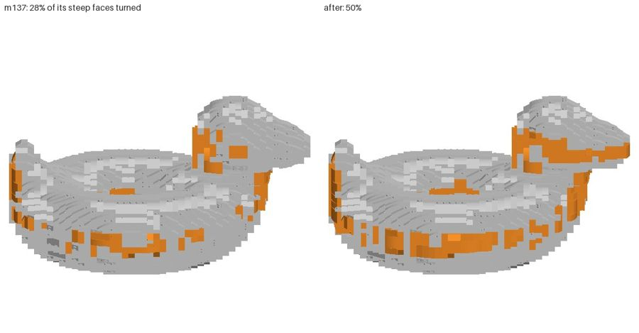

**Not done: studs down.** No part here faces down. A studs-down panel under
an overhang hangs on studs pointing down, and a core laid upright has none:
the first-tier ways turn twice from the core, a bracket on a side stud or on
a plate already on its side. Each is a new kind of shell with its own
anchor; none was started.

**The fourteen, handed over.** All fourteen models at 24 and 48 studs take
over an hour, m137 and the branch each, and are the lead's to run. The jobs
files are in `bench/results/brickify8-2026-10-21` (`R` below), each half of
the models a process; m137's lays smooth and the studs-up build, the
branch's smooth alone:

```sh
R=<the main checkout>/bench/results/brickify8-2026-10-21; PY=<a venv with numpy scipy trimesh embreex pillow>
# in a checkout of m137 (85bd1c4a), then in this branch's, OUT before and after:
XDG_DATA_HOME=$R/data-a heavy godot --headless --path . --script src/dev/brickify_bench.gd -- $R/jobs-before-a.json $R/before
XDG_DATA_HOME=$R/data-b heavy godot --headless --path . --script src/dev/brickify_bench.gd -- $R/jobs-before-b.json $R/before
#   ...and jobs-after-a.json, jobs-after-b.json into $R/after; then, for each:
heavy $PY -I tools/bench/brickify_bench.py faces $R/after; heavy $PY -I tools/bench/brickify_bench.py measure $R/after
python3 $R/bar.py $R/after $R/before    # each model and size, then the means at 24 and 48
```

`bar.py` prints, against m137: the steep faces turned (`turned_out`), all
that face out or down turned (`turned`), the steep faces' normal error
against the studs-up build's, parts and time (laid in one batch, the two
side by side, for a fair ratio), and whether each is one piece, its check
passing, with no joint past its load. The bar: 80% turned; 30% less
error than studs up; every run one piece and passing; parts at most 1.15
times m137's; time at 48 at most 1.5 times. On the three here: 42%, 5.6%,
6 of 6 (one with a joint past its load), 1.04 times and 1.31 times.

### Fifth round: a side two cubes deep (2026-10-21)

Asked again on m137, the fourth round's bar unchanged, with what that round
left: the bands one to four plates tall between shells cut at different
phases, 3DBenchy's thin walls, and faces that look down. Branch `snot84`,
from `snot82` (`401e5af2`). The three models at 24 and 48 studs.

**In short.** Not met, and nothing here is ready. Three changes turned
more of the steep faces at 48 studs than the fourth round's 42%: cubes
facing out from 60 degrees (51%), with shells two cubes deep (54%), and
with the bands between phases (58%), the steep faces 6.8% to 8.4% nearer
the model than the studs-up build's (the fourth round 5.6%; the bar 80%
and 30%). Each leaves more of the model in no part, and `brickify_probe`
fails it: its low-poly bunny at 28 studs 96.4%, 95.7% and 95.5% in a part,
held to 97%. The branch keeps the shells two deep alone, which on the three
models holds the rest of the bar (one piece, the check, Balance, no joint
past its load, 3DBenchy's at 48 gone; parts 1.06 times m137's at 48 and
1.08 at 24; time 1.27 times m137's at 48 laid side by side, the bunny's
1.42) and turns 44% at 48 studs, 6.3% nearer than studs up, 32% and
4.5% at 24; but the probe's blue bunny at 20 studs, one colour, has 4 parts
mended out and 96.6% of it in a part. Nothing here lays studs down, and
3DBenchy's walls are as they were.

**Where the steep faces were left upright**, on Bob and the Stanford bunny
at 48 studs (each smooth arm's `cubes_why`, the first cut's reasons, laid
with cubes facing out from 60 degrees): of the steep faces in a cube left upright, 38%
and 28% were in a cube with the model past it at the same height (`beyond`),
and in 137 of Bob's 143 such cubes and 223 of the bunny's 234 the cube past
it faced out too. A side that leans out down a cube's height is one cube
for its upper plates and the one past it for its lower ones; each depth was
its own shell, so the outer cube turned and the inner one, the model past
it, stayed upright. The faces between 60 and 69 degrees, which no cube
turns, were a quarter of the steep surface of each (28%, 25%), turned 11%
and 32%, and 46 degrees from the model.

**What changed** ([shapes.gd](../src/ai/shapes.gd)):

1. **A shell two cubes deep** (`CUBE_DEEP`, `Plan._cube_shells_at`,
   `_cube_shell`). A cube facing out and the one past it at the same height
   facing the same way are one shell, counted out from the innermost in
   twos. The cube past it is decided first; the inner one is no longer
   refused for the model past it where that cube is kept. The shell's own
   plan runs as deep as its cubes (`"depth"` in the shell, five plates on
   their sides a cube), and its parts stack out from the core's side studs
   as before.
2. **The probe's bound is the bench's bar** (`brickify_probe`, `_sideways`).
   The sphere and the forty-stud bunny laid with their sides turned are
   held to 1.15 times m137's parts (1,948 and 2,143), where the bunny was
   held to 15% more than itself upright when m137's turned sides were the
   first; it is now 15.8% more, 1.05 times m137's.

**Tried and taken out**, the three at 48 studs and at 24, and the probe's
low-poly bunny at 28 studs, which `brickify_probe` holds to 97% of it in a
part:

| Run | Turned at 48 | Nearer than studs up, 48 | Turned at 24 | Parts at 48 | The probe's bunny in a part |
|---|---|---|---|---|---|
| m137 | 27% | 3.9% | 13% | 1 | 98.7% |
| The fourth round (`401e5af2`) | 42% | 5.6% | 33% | 1.04 | over 97% |
| Cubes facing out from 60 degrees, not 69 (A) | 51% | 6.8% | | 1.07 | 96.4% |
| A, two deep | 54% | 8.4% | 31% | 1.10 | 95.7% |
| A, two deep, and the bands (B) | 58% | 8.3% | 43% | 1.12 | 95.5% |
| A, two deep, a cube kept only where 80% covered | | | | | 97.0% short |
| Two deep (the branch) | 44% | 6.3% | 32% | 1.06 | 98.0%; the blue bunny at 20 studs 96.6% |

- *From 60 degrees*: every cube whose surface leans up to 30 degrees from
  level faces out, every face the bench calls steep. The faces between 60
  and 69 were turned 43% and 45% on Bob and the bunny where they had been
  11% and 32%, and 3DBenchy's joint past its load went; but on the probe's
  bunny at 28 studs 3.6% of the model was in no part. More shells leave
  more out: a cube is kept where its parts cover 60% of its plates, and
  what they leave in a lane and row the shell has a part in is no one's.
  Kept only where 80% covered, the bunny was still 96.99%.
- *The bands* (`_cube_free`): a cube of a later cut that a shell before has
  some plates of was trimmed to the run of three or more plates no shell
  has, and those cubes in one band at one depth laid as a shell a row tall.
  A row on its side is two and a half plates, so a band leaves half a plate
  of the model in no part all along it: Bob and the bunny at 24 studs a
  point and a half less in a part, the side views standing 0.1 studs
  further off (Hausdorff95 0.66 against 0.56), and four inverted slopes
  4287a laid in white, which is not sold.

**The bench again** (smooth, the three; the studs-up build is m137's laid
with `Options.snot` false; time against m137 laid beside it in one batch):

| Model | Studs | Turned, m137 → after | Steep faces (°), m137 → after (studs up) | Parts | Seconds | Holds |
|---|---|---|---|---|---|---|
| Bob | 24 | 15% → 47% | 42.1 → 40.5 (43.7) | 880 → 983 | 2.1 → 2.7 | one piece, stands |
| Bob | 48 | 28% → 54% | 40.6 → 38.5 (42.7) | 3,737 → 4,052 | 12.4 → 12.8 | one piece, stands |
| Stanford bunny | 24 | 22% → 44% | 41.5 → 39.9 (42.4) | 1,183 → 1,286 | 3.7 → 3.9 | one piece, stands; 4 mended |
| Stanford bunny | 48 | 40% → 59% | 37.7 → 36.9 (40.0) | 5,959 → 6,237 | 17.9 → 25.4 | one piece, stands |
| 3DBenchy | 24 | 3% → 4% | 38.1 → 38.2 (38.1) | 608 → 620 | 3.0 → 3.7 | one piece, stands |
| 3DBenchy | 48 | 14% → 19% | 33.9 → 34.0 (34.1) | 2,904 → 3,019 | 11.9 → 15.2 | one piece, stands, no joint past its load; 3 mended |

Likeness is the fourth round's: seen from the four sides, Hausdorff95
within 0.02 studs of it on each run, and of each model 98.0% to 99.7% in a
part, within 0.3 points of it (the bunny at 24 studs 98.0%, Bob 98.1%).

**Pictures.** The three at 24 and 48 studs from every side and from under,
m137 beside the branch (`pictures --views corner,front,back,left,right,under`),
and each at 48 drawn with its parts coloured by which way they face (not
committed). Bob's flank is one band of plates on their sides where the
fourth round had it in patches; the bunny's flank the same; 3DBenchy as
before. Nothing hangs loose, and from under, the undersides are upright
plates as before: nothing faces down.

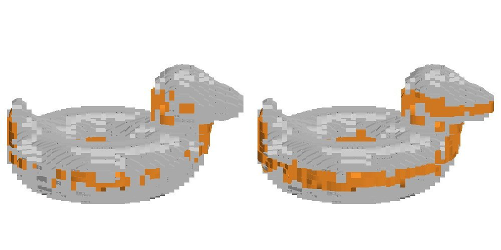

### Sixth round: what a turned side leaves out (2026-10-21)

Asked again on m137, the bar unchanged: first find why a cube turned into a
shell leaves some of the model it should cover in no part, which held back
the fifth round's cubes from 60 degrees (51% turned), its shells two deep
(54%) and its bands (58%), and fix it at the root, so a turned cube covers
at least what the upright one did; then bring those back where 97% of each
model stays in a part. Branch `snot85`, from `snot84` (`44fde7cd`). The
three models at 24 and 48 studs.

**In short.** The root is found and fixed: what a turned side lost was
mostly the core beside it, not the shell. Slivers of the side's surface past
a shell's end, and the plates of its own rows it laid nothing in, met the
core only side by side and were cut off before the stitch could join them;
and the stitch, left to join them, laid a shell's side-stud brick again as a
plain one. Joined now in one pass, with sides turned from 65 degrees (from
60 the probe's blue bunny is still under 97%): 46% of the steep faces at 48
studs are turned (the fifth round 44%, m137 27%), 7.2% nearer the model than
the studs-up build (6.3%), and at 24 studs 34% and 5.4%. Every run is one
piece, passes, stands with no joint past its load, and is 98.2% or more in
a part (the fifth round 98.0%); the armadillo at 24 studs, which the fourth
and fifth rounds left with a joint past its load that no prop could reach,
is laid again with the side about that joint upright, and has none; parts 1.08 times m137's at 48 and 1.09 at
24; time 1.01 times m137's at 48, laid side by side (1.27). The bar's 80%
and 30% are not met. The fifth round's bands, laid on this, hold 97% in a
part now and turn 51%, but no nearer the model, and Bob at 24 studs takes
1.151 times m137's parts: not in. Nothing here lays studs down or reaches
3DBenchy's walls.

**Where the model went** (`src/dev/snot_gaps.gd`, new: each model cell no
part fills with the sides turned that the build with them upright fills,
told by why). The blue bunny at 20 studs, on the fifth round's branch: 70
cells of 2,072 in no part where the upright build leaves 10.

| Why, the blue bunny at 20 studs, fifth round | Cells | Of the model |
|---|---|---|
| A piece of the core cut off beside a shell before the stitch (`cut_off`, every part beside a shell) | 43 | 2.08% |
| of them, past a shell's end, a stud on | 23 | 1.11% |
| of them, a shell's own plate given back to the core (`_give_back`) | 10 | 0.48% |
| of them, over, under or off a corner of a shell | 10 | 0.48% |
| A shell's plate no part of it fills | 9 | 0.43% |
| Taken out by the mend | 9 | 0.43% |
| The upright build misses it too | 9 | 0.43% |

Every piece cut off was face to face with the core (the core's cells beside
the shells are one region), so the core could hold it; it was a column of
1 x 1 plates, bricks and a tile or slope a stud wide beside a shell, meeting
the core only side by side, where no part crossed. The cut before the stitch
(the first round's, so the stitch would not spend its rounds on them) took
them out unjoined. Left to the stitch, two more things showed. The stitch's
first way pairs a plate of a piece with one of the rest beside it and lays
the two again across; it took a shell's brick with studs on its side for a
plain brick and laid it again plain, and that shell lost 7 of its 10 parts.
And it joins one piece a round: Bob at 48 studs stitched in 11.6 s where it
had taken 4.5, and the Stanford bunny at 48 ran out of its 96 rounds.

From 60 degrees, the shells' own plates were most of it: on the bunny at 28
studs 101 cells (1.8%), none within half a stud of a part of the shell. A
row on its side is two and a half plates and is laid only where every plate
it reaches is the shell's: a side's edge three plates tall between two rows
was laid by neither. What was left on the blue bunny from 60 was slivers
past a shell's end beside other slivers, or beside only a tile under another
shell: where two shells meet at a corner, a column a stud wide between them.

**What changed** ([shapes.gd](../src/ai/shapes.gd),
[brickify.gd](../src/assembly/brickify.gd)):

1. **The slivers joined, all at once** (`Plan.join_cut_off`). Before the cut,
   each piece of the core of 16 parts or fewer that touches a shell (what
   `cut_off` takes out) is joined to the rest where one of its plates meets
   one of the rest's side by side, the two laid again across (the stitch's
   first way, `_pair`, `_across`); where a brick of the rest stands beside a
   plate of one, that brick is laid again as three plates and paired on the
   next pass. Four passes at most, each one map of the pieces; only what is
   left is cut. Joined only where every part was beside a shell, the bunny at
   48 studs from 65 degrees left the stitch 59 pieces (12.3 s of stitching);
   any part, 22 (5.8 s).
2. **A brick with studs on its side is not plain** (`Plan._plain`): the
   stitch no longer lays a shell's side-stud brick again as a plain one.
3. **From 65 degrees** (`Brickify.STEEP`, the sine 0.42 from 0.36).
4. **What a turned side left, told** (`Shapes.last`: `shelled`,
   `given_back`, `cut_cells`, `shell_frames`), for `snot_gaps.gd`, which also
   draws the cells round one (`GAPS_AT`), says why the cubes there stayed
   upright (`GAPS_WHY`) and lays it as `Brickify.build` does (`GAPS_BUILD`).
5. **A joint the props cannot take, laid again upright about it**
   (`Brickify._past_load_by_shells`, `_upright_about`). The fourth and fifth rounds left the armadillo at 24
   studs with one stud joint past its working load, and so does this
   branch: a 1 x 2 plate (3023b) hung on one stud of another, 20.7 g, 1.24
   times its load. Laid with its sides upright it has none. Turned, it had
   five; the prop pass propped the piece round them under its centre of
   mass, took four, and was kept. The fifth was inside that piece, and the
   pass marks every part of a piece it propped as done, so it was never
   tried; tried, no pillar reaches it: it hangs 40 plates over the ground,
   and a pillar stops at 24 (to the floor, a figure's arm stood a stud and
   more off the figure). Upright, the core bonds that overhang across the
   plates the shell beside it took. Now a joint past its load left after
   the props, with a part of it beside a shell's plates, has the cubes
   turned within a stud and two plates of either part laid again upright,
   and the build with fewer joints past their load is kept.

   At first (`95d179ba`) the whole model was laid again with those cubes
   upright. The fourteen showed what that cost: the figure at 48 studs
   (`character`) took 38.4 s against m137's 17.7, 2.17 times where the bar
   is 1.5, and the armadillo at 24 studs 6.7 s from 3.1. Timed, the second
   lay cost as much as the first (the figure 18.2 s of 36.8, the armadillo
   3.5 of 6.8), and the figure had one joint past its load as well: a 1 x 4
   brick hung on two studs of a 2 x 2 plate, 189 g, 9.7 times its load.
   Now only that place is laid again (`_upright_about`), on the build
   itself, as a wall is patched: every part with a plate in those cubes, or
   within two studs of the joint's parts and up to five plates over them
   (`UPRIGHT_STUDS`, `UPRIGHT_PLATES`: what they hang from), is taken out,
   and with it whatever reaches into the plates they leave (a turned tile's
   holder, whose side stud ran into every upright plate laid there); the
   model's plates those parts filled are laid again in plates, largest
   first, a course at a time, each course the other way from the one under
   it, in the colours they had; then mended and propped as the build is.
   With the cube alone the armadillo's 1 x 2 hung again, a plate higher, on
   one stud; within a stud and three plates its patch came loose and 94.4%
   of it stayed in a part. The patch costs 0.4 s on the armadillo at 24
   studs and 3.0 s on the figure at 48, beside m137 laid at once: the figure
   21.4 s against 17.7 (1.21 times), none past its load, 98.7% in a part
   (laid whole again 98.65%), 2,689 parts (2,650), 24.3% of its steep faces
   turned (24.8%); the armadillo at 24 studs 3.8 s against 3.0, none past
   its load, 98.3% in a part (98.1%), 732 parts (733), 22.3% turned
   (23.0%). The armadillo at 48 has nothing to patch, and lays as before.

**Tried**, the probe's bunnies (held to 97% in a part) and the three at 48
studs (turned, nearer than studs up, parts and time against m137):

| Run | Blue bunny at 20 | Bunny at 28 | Bunny at 40 | The three at 48 |
|---|---|---|---|---|
| The fifth round (`44fde7cd`) | 96.6% | 98.0% | 98.6% | 44%, 6.3%, 1.06, 1.27 |
| No cut before the stitch, side-stud bricks not plain | 98.1% | 98.6% | | Bob's stitch 11.6 s from 4.5; the bunny's runs out of rounds |
| From 69, joined where every part is beside a shell | 97.3% | 98.6% | 98.8% | 43%, 6.4%, 1.07, 1.31 |
| That, a row half a plate proud | 97.2% | 98.6% | 98.9% | 42%; 3DBenchy at 48 a 1 x 2 on one stud, 8.4 times its load |
| From 60, joined | 96.2% | 97.1% | 98.4% | 52%, 8.6%, 1.12 (Bob 1.16), 1.26 |
| From 60, joined, half a plate proud | 96.3% | 98.4% | | |
| From 60, joined, a shell taking what it cuts off past its end | 96.4% | 97.1% | | |
| From 63 (sine 0.46) | 96.6% | 97.7% | | 50%, 7.9%, 1.11 |
| From 65, joined where every part is beside a shell | 97.6% | 98.1% | 98.7% | 46%, 7.2%, 1.09; the bunny's stitch 59 tries |
| From 65, joined where any part is (kept) | 97.8% | 98.3% | 98.8% | 46%, 7.2%, 1.08, 1.01 |
| That, and the fifth round's bands | 97.9% | 97.8% | 98.5% | 51%, 7.1%, 1.11 (Bob at 24 studs 1.151), 1.21 |

- *Half a plate proud*: a row's half plate at its foot or head may be the
  shell's own air. From 60 degrees it took the bunny at 28 studs from 97.1%
  to 98.4% (its shells' own plates 101 cells to 27); from 69 it moved the
  bunnies a tenth of a point, and 3DBenchy's core at 48 studs, laid round the
  new rows, hung a 1 x 2 brick on one stud of a 1 x 4, 54 g, 8.4 times its
  working load. Out.
- *A shell taking what it cuts off*: a piece left after the join whose every
  plate is in a shell's rows and depth, in its lanes or the lane past either
  end, given to that shell and the shell tried again with it. 3 cells of the
  blue bunny's 77 lost. Out.
- *From 60 and 63 degrees*: the blue bunny stays under 97%, and from 60 Bob
  at 48 studs is 1.16 times m137's parts. Out; 65 holds every check here.
  The blue bunny at 20 studs is the narrowest: 97.6% from 65, 96.6% from 63.
- *The bands*, the fifth round's (`_cube_free`), laid on this: they hold 97%
  in a part now (with the join; the fifth round's 95.5% on the bunny at 28
  studs), and turn 5 points more at 48 studs and 4 at 24; but the steep
  faces come no nearer the model (7.1%), Bob at 24 studs takes 1.151 times
  m137's parts, over the bar, and Bob at 48 is seen further off from the
  sides (Hausdorff95 0.61 studs from 0.58). A row on its side is two and a
  half plates, so a band of three or four plates is a staircase of its own.
  Out, by a part in a thousand; the first to try again.

**The bench again** (smooth, the three; the studs-up build is m137's laid
with `Options.snot` false; m137 and the branch at `f209a60a` laid side by
side in one batch, at a load of 14):

| Model | Studs | Turned, m137 → after | Steep faces (°), m137 → after (studs up) | In a part | Parts | Seconds | Holds |
|---|---|---|---|---|---|---|---|
| Bob | 24 | 15% → 49% | 42.1 → 40.1 (43.7) | 98.2% | 880 → 978 | 2.9 → 3.5 | one piece, stands |
| Bob | 48 | 28% → 56% | 40.6 → 38.4 (42.7) | 99.3% | 3,737 → 4,029 | 14.7 → 14.6 | one piece, stands |
| Stanford bunny | 24 | 22% → 48% | 41.5 → 39.2 (42.4) | 98.4% | 1,183 → 1,310 | 4.5 → 4.9 | one piece, stands; 4 mended |
| Stanford bunny | 48 | 40% → 59% | 37.7 → 36.4 (40.0) | 99.3% | 5,959 → 6,494 | 23.8 → 26.1 | one piece, stands |
| 3DBenchy | 24 | 3% → 6% | 38.1 → 38.2 (38.1) | 99.5% | 608 → 615 | 3.9 → 3.2 | one piece, stands |
| 3DBenchy | 48 | 14% → 23% | 33.9 → 33.5 (34.1) | 99.6% | 2,904 → 3,126 | 12.4 → 10.5 | one piece, stands |

| Studs | Turned | Out and down turned | Steep faces (°) | Against studs up | Parts | Time |
|---|---|---|---|---|---|---|
| 24, m137 → after | 13% → 34% | 9% → 23% | 40.5 → 39.2 | −5.4% (the fifth round −4.5%) | 1.09 times | 1.03 times |
| 48, m137 → after | 27% → 46% | 18% → 30% | 37.4 → 36.1 | −7.2% (−6.3%) | 1.08 times | 1.01 times |
| the bar | 80% | | | −30% | 1.15 times | 1.5 times at 48 |

No run has a stud joint past its working load. "In a part" is 1 less the
bench's `lost_share`; the fifth round's was 98.0% to 99.7%. The time is a
ratio of two runs side by side at a load of 14, where the fifth round's was
at 3 to 10: the bunny at 48 studs stitches 22 pieces now, from 59 with the
first join alone, which is most of what it saved. Seen from the four sides
the builds stand where the fifth round's did (Hausdorff95 0.52 to 0.58 studs,
against the studs-up build's 0.50 to 0.59).

**Pictures.** The three at 24 and 48 studs from every side and from under,
m137 beside the branch (`pictures --views corner,front,back,left,right,under`,
not committed). The bunny's flank and haunch and Bob's body are plates on
their sides further round than before, and the dark slots by m137's bunny's
eye are gone; 3DBenchy reads as m137's. From under, the undersides are
upright plates as before, and nothing hangs loose.

**Not done.** Studs down (inverted brackets 99780 and 99781, 2436 hung
under a shell, held to the core above) and 3DBenchy's walls (47905 through
the wall), both asked: the round went to the root cause and to what it let
in, and neither was started. 3DBenchy is 23% turned at 48 studs, faces
looking down 2%.

**The fourteen, handed over.** In `bench/results/brickify8-2026-10-21`
(`R` below). The studs-up build the steep faces are measured against is the
`upright` arm (`brickify_bench.gd`: smooth with `Options.snot` false), which
lays as m137's on any branch since: none of this round's or the fifth's
changes reach a build with nothing turned. The fifth round's jobs files lay
it into `$R/before` beside m137's smooth there. For a fair time, m137's
smooth is laid again in the same batch as the branch's, each half of the
models a process beside the same half:

```sh
R=<the main checkout>/bench/results/brickify8-2026-10-21; O=$R/after6; PY=<a venv with numpy scipy trimesh embreex pillow>
J=<the fifth round's scratch>/snot84    # jobs-upright-a.json and -b.json: the 14, arm "upright"
B=<a checkout of m137, 85bd1c4a>; W=<a checkout of this branch>
# the studs-up arm into $R/before, once (m137's smooth is there already):
cd $W && XDG_DATA_HOME=$R/data-g heavy godot --headless --path . --script src/dev/brickify_bench.gd -- $J/jobs-upright-a.json $R/before
cd $W && XDG_DATA_HOME=$R/data-h heavy godot --headless --path . --script src/dev/brickify_bench.gd -- $J/jobs-upright-b.json $R/before
# the branch's smooth, each half beside m137's smooth laid again for the time:
for h in a b; do
  (cd $W && XDG_DATA_HOME=$R/data-e-$h heavy godot --headless --path . --script src/dev/brickify_bench.gd -- $R/jobs-after-$h.json $O) &
  (cd $B && XDG_DATA_HOME=$R/data-t-$h heavy godot --headless --path . --script src/dev/brickify_bench.gd -- $R/jobs-after-$h.json $R/m137-timed) &
  wait
done
cd $W && heavy $PY -I tools/bench/brickify_bench.py faces $R/before && heavy $PY -I tools/bench/brickify_bench.py faces $O
heavy $PY -I tools/bench/brickify_bench.py measure $O
python3 $R/bar-timed.py $O $R/before $O $R/m137-timed    # bar.py, with parts and time from the pair laid together
```

Each half is about 40 minutes on a quiet box. Every model must hold the
guardrails: one piece, its check passing, no stud joint past its working
load (`over 0`), 97% or more in a part (`lost` at most 0.03 on `bar.py`'s
line), parts at most 1.15 times m137's, and time at 48 studs at most 1.5
times. The fourth round missed two of these, the armadillo at 24 studs (its
joint, taken above) and the bunny at 48's time (1.10 times here, beside
m137); turning from 65 degrees is new to the eleven models not run here,
which is what this run would show.

### Where SNOT stands, and the next approach (2026-10-22)

A study, not a round: each steep face of the fourteen as `main` lays them
(r7), seen from `faces`' views, followed to its cube at every phase and why
that cube was refused (`cubes_why`), against m137's studs-up build (r6). The
cube rule run again from the mesh agrees with each run's record on 94% to 99%
of its steep faces. Scripts and output in
`bench/results/brickify8-2026-10-21/study`.

**In short.** The cube approach is near its end. At 48 studs 40% of the steep
faces are turned, 5.6% nearer the model than studs up; with every refusal a
better rule could win, about 64% and 13%; with every steep face turned, 23%.
Neither 80% nor 30% is in reach, and the turned share is the wrong bar: a
surface turned to the nearest of six axes scores 100% and comes no nearer the
model. The error is in how a leaning surface is laid, whichever way its parts
face; the next approach lays that lean first.

**The seventh round on the fourteen, not shipped.** snot88 turned 37% at 48
studs and 22% at 24 (r7: 40% and 23%), 5.6% and 5.1% nearer than studs up
(5.6% and 4.6%), and missed two guardrails: the avocado at 48 studs took 1.16
times m137's parts, the Utah teapot at 48 1.55 times its time.

**Where the steep faces are** (the mean of the fourteen):

| What holds a steep face | 48 studs | 24 studs | At 48, now / studs up (°, every face alike) | |
|---|---|---|---|---|
| Turned | 39.7% | 23.0% | 24.3 / 31.1 | |
| Laid again whole, sides upright (temple, Bell X-1; fox at 24) | 13.0% | 21.0% | 39.2 / 38.8 | rule |
| In a turned cube, nearest an upright part: a shell's end | 5.2% | 4.3% | 47.3 / 38.4 | rule |
| In no cube facing out: it leans too far (rims, 60 to 65 degrees) | 4.2% | 2.3% | 43.9 / 43.5 | rule |
| Refused: the model past it (`beyond`, `moved`) | 6.4% | 4.2% | 42.0 / 42.0 | rule |
| Refused: its shell's cover or anchor, a cap, too little model | 4.7% | 4.7% | 44.1 / 43.7 | rule |
| In no cube facing out: its faces cancel (thinner than a cube) | 9.4% | 23.2% | 36.4 / 36.5 | inherent |
| In no cube facing out: under a square stud of surface | 1.6% | 1.5% | 47.8 / 46.5 | inherent |
| Refused: no core three studs behind (`backed`, thin walls) | 11.4% | 12.2% | 32.4 / 32.0 | inherent |
| Refused: a band between phases (`shelled`) | 4.5% | 3.6% | 40.3 / 40.2 | inherent |

Inherent to cubes: a cube faces one way or none, so anything under two studs
thick cancels; a shell hangs from the core behind it; a row on its side is
two and a half plates, so a band of one to four plates between two phases'
shells is laid by neither. That is 27% of the steep faces at 48 studs, 40% at
24. The largest rule loss is the fallback: a turned side that leaves a region
out throws every turned side away, where a patch about the region would do
(as `_upright_about` does for a joint). The faces by a shell's end stand 9°
further off than studs up, 0.4° over every steep face at 48 studs: the most
any cause makes the build worse.

**The ceilings.** *Turned:* 80% of the steep faces at 48 studs lie in a cube
facing out at some phase (85% from 60 degrees), and 88% of a turned cube's
faces are turned: 70% to 75% with every such cube turned, about 64% with the
inherent causes left (73% of the faces are free of them). At 24 studs, 54% to
56% and about 50%. *Error:* turned faces stand 28.8° from the model at 48
studs and a top leaning as far from its studs 26.0° (the fourteen's mean; at
24, 34.3° and 34.2°): a shell lays a side as well as the core lays a top, and
a face turned to its nearest axis keeps its lean from that axis.

| Steep faces at 48 studs, by lean from the nearest axis | 0-10° | 10-20° | 20-30° | 30-40° | 40-55° |
|---|---|---|---|---|---|
| Share of the steep faces | 32% | 17% | 23% | 16% | 11% |
| Turned now, and there (°) | 57%, 10.5 | 47%, 28.0 | 36%, 33.9 | 33%, 39.3 | 30%, 43.9 |
| Studs up (°) | 19.9 | 36.3 | 41.8 | 46.6 | 48.4 |
| A top leaning as far (°) | 13.1 | 27.9 | 32.0 | 39.2 | 42.4 |

Every rule cause won, turned as the turned are now: 12.7% nearer than studs up
at 48 studs, 14.9% at 24. Every steep face turned, as a top of its lean: 23.1%
and 16.1%. 30% is beyond any rule inside the cubes.

**The others, by our measure.** A face counts as turned when the part nearest
it has its up within 60 degrees of the face's way out, and every direction is
within 54.7 degrees of one of six axes: a surface turned to its nearest axis
scores 100%. So do Lambrecht's 1 x 1 plates, "in any of the principle
Cartesian directions", which "may be poorly connected" [lambrecht], and
NiemanSculpt's "six directions" at "98.5% to 99.7% connectivity in SNOT mode"
[nieman-guide], its torus and apple studs out every way, the apple's slopes
and curves on their sides too [nieman]; its error cannot be measured here
(Windows and macOS). legolization turns tiles on free-standing wall columns
only [lz]. A staircase turned is no nearer the model (the first round). So 80%
turned rewards what two tools do already. The bar should be the error and
distance over every face against the studs-up build, held by the side views
(which the line moved the wrong way: Hausdorff95 0.88 studs against 0.84 at
48, further on 7 of 14) and a blind look at the pictures; to say it beats
NiemanSculpt, the same look against its build of our CC0 models, which the
owner can make.

**Where the error is: the lean.** 66% of everything seen leans 10 degrees or
more from all six ways a part can face, at both sizes, and 0% to 7% of it is
within 10 degrees of the part face nearest it (studs-up tops leaning 10 to 40
degrees, 13% to 22%): there 6° off the model, elsewhere 36° to 50°. From 20
degrees on, a diagonal lean stands 3° to 10° further off than one along an
axis. Matched as well as those are, each 10 points of the matched share at 10
to 40 degrees is about 5% of the error over every face: 35% matched, 15% lower;
50%, 23%. The SNOT line moved it 2.6%.

**The next approach: lay the lean, surface first.** In every frame at once,
studs up and the four turned: the surface cut into patches by its nearest axis
and its lean from it, each laid first as runs of the slope or curved slope
whose face matches that lean, fitted to the mesh by angle as well as distance
(corner slopes where it leans diagonally), then the core and its side-stud
anchors behind them; today the core's plan decides where a slope may go. The
cubes stay as the turned frames' anchors. Expected: the matched share from
about 6% toward 35%, 15% off the error over every face. The screen: Bob, Spot
and 3DBenchy at 24 and 48 studs beside `main` (all CC0; 3DBenchy's square
walls the control), by the matched share (new in `faces`), the error and
distance over every face, the side views, a blind look, and the guardrails as
now. On to the fourteen only if Bob and Spot at 48 studs reach 20% matched
(about 9% now) and 5% lower error over every face; else stop, and write down
what held it. The rule wins left in the cubes, 7 to 10 points of steep-face
error at most, are not the next unit.

### Laying the lean first: the screen fails (2026-10-22)

**The measure.** `brickify_bench.py faces` now gives each arm a `matched`
share: of the points seen that lean 10 to 40 degrees from all six axes, the
share whose nearest part face is within 10 degrees of the model's. It also
gives `every`, the error and distance over every face. On `main` at 48 studs
Bob has 8.3% matched and Spot 9.2%, the study's "about 9%".

**Where the lean is lost.** On `main`, Bob's and Spot's leaning faces were
traced to the part nearest each (`why.py`; it, the runs and every try on the
way are in `bench/results/brickify8-2026-10-21/lean97`). Where a
slope in the right plane is nearest, 61% of them are matched: the fit is
right. But 72% of those a slope could match are nearest a flat face (a
tile, a plate, a brick's side): no slope was laid there. Bob's yellow
underside had almost none at all. Its inverted 3 x 1 and 2 x 2 were laid
as 4287a and 3660a, two moulds sold in almost no colour: 72 went down,
and 259 more places fitted one not sold in the colour there.

**What was screened** (`3bf21553`). `Shapes.Plan._fit_near` fitted a slope
only where the stud behind it stood a plate higher, so the voxels' steps
decided where a lean could go. In every frame at once (studs up, under an
overhang, and in the turned shells, which fit the same way), each slope
was also tried at the height that lays it nearest the model, wherever the
surface falls away. It had to stay within 1.5 plates of the model at every
third of a stud, with its high end no more than a plate over the stud
behind it. The angle was weighed 25 times as much (`TURN` 0.004 to 0.1)
and a longer part had to be nearer to win (`LONGER` 0.12 to 0.06). The
inverted slopes went down in the moulds sold now (4287c, 3660b). Plates
filled in under a slope that stood over its stud were tried and dropped:
they matched no more and stood out in the side views.

**The screen**, laid beside `main` at the same time, from locked
checkouts of each:

| | matched | error over every face | distance | sides95 (studs) | parts | time |
|---|---|---|---|---|---|---|
| Bob 48 | 8.3% to **22.3%** | 39.6° to 35.5° (**10.3% lower**) | 3.3% nearer | 0.58 to 0.55 | 1.02x | 1.01x |
| Spot 48 | 9.2% to **16.2%** | 36.3° to 35.3° (**2.7%**) | 0.2% | 0.52 to **0.56** | 1.00x | 1.24x |
| 3DBenchy 48 | 4.1% to 8.3% | 33.1° to 32.3° (2.3%) | 0.1% further | 0.57 to **0.61** | 1.01x | **1.60x** |
| Bob 24 | 4.8% to 13.6% | 41.1° to 37.9° (7.8%) | 1.7% | 0.53 to **0.58** | 0.96x | 0.97x |
| Spot 24 | 5.4% to 11.0% | 36.2° to 35.7° (1.4%) | 3.4% | 0.48 to **0.50** | 0.95x | 1.07x |
| 3DBenchy 24 | 0.8% to 1.1% | 37.7° to 37.2° (1.3%) | 1.6% further | 0.56 to **0.60** | 0.96x | 1.22x |

All six are one piece, pass the check, have no joint past its load and are
97.8% or more in a part. Spot at 48 had 4 parts mended out and 3DBenchy at
48 had 2 (`main` 0). **It fails.** Bob passes both bars. Spot reaches 16%
and 2.7%, short of 20% and 5%. The side views stand 0.02 to 0.05 studs
further off on five of the six, and 3DBenchy at 48 took 1.6 times `main`'s
time on a loaded box. Nothing went on to the fourteen or the probes. The
code is reverted on the branch; `3bf21553` keeps it.

**Why Spot falls short.** 74% of Spot's leaning faces are on its sides,
against Bob's 53%. Bob's tops and undersides take the new slopes well: of
the faces a part could match, 65% of its tops and 36% of its undersides are
matched (from 31% and 0.1%). On the sides Spot gets to 21%. The sides are
laid in the turned shells, each in its own frame over only the cubes it
was given, so a run of slopes stops at the shell's edge. Within a shell a
fitted slope lost to the shell's own staircase 446 times against 1,154
laid (a run before the last tuning). Of what a part could match on Spot's
sides, 59% is still nearest a flat face. And 34% of Spot's leaning faces
(43% of Bob's) lean so far between two axes that no part facing an axis
comes within 10 degrees of them. The side views worsen where the new
curved 4 x 1s and inverted curved 4 x 1s (61678, 93606, 13547) end past
the model's edge: they are now among the farthest points seen from the
side.

**Kept from it.** The inverted slopes in the moulds sold now help without
the rest. On `main` with only that change, Bob at 48 is 10.3% matched and
3.5% lower in error over every face. Spot is 9.8% and 1.4% lower. Parts are
1.01 times, the side views are no worse (0.57 and 0.52), and nothing is
mended out. Two ids in `Shapes.Plan.INVERTED` change, 4287a to 4287c and
3660a to 3660b. Read off their meshes they are the same size and turn,
but the new moulds' studs on top read over every row (4287c's over all
three), which changes what the check counts as held. It needs the probes
run before it ships.

**What next for the lean.** It cannot get further while the turned
shells' cubes decide where a run of slopes may lie. A side has to be laid
as the tops now are: cut into patches by its lean, each a run as long as
the surface holds, anchored where the core can hold it. For faces that
lean between two axes, the wedges and corner slopes that face that way
(43710 and 43711, 6564 and 6565, wedge plates on a diagonal edge) would
need their own fit. Neither is a tuning of the cubes.

### A side turned by its nearest axis: the lean passes, the guardrails fail (2026-10-22)

Lean97's change (`3bf21553`) again, with the sides it left upright turned and
the parts it pushed past their room kept in; screened beside `main`, both from
locked checkouts laid at the same time. Scripts, runs and pictures in
`bench/results/brickify8-2026-10-21/snot99`; the code screened is `cab8395e`.

**Where Spot's lean was lost.** Each of Spot's leaning faces at 48 studs
(10 to 40 degrees from every axis) on lean97's build, by whether a turned cube
holds it (`incube.py`). 74% of them are on its sides; of those:

| Spot 48, leaning side faces | share | matched | error |
|---|---|---|---|
| Leaning along one axis, in a turned cube | 39% | 35% | 25.9° |
| Leaning along one axis, in no turned cube | 23% | 1.4% | 42.8° |
| Leaning between two axes (both 10° or more), any | 37% | 0.3% | 40.5° |

Of the 23% in no cube, 43% were never asked to turn: most lean 20 to 40
degrees toward up or down, a side 50 to 70 degrees steep, under the cube
rule's 65. Upright nothing matches them: a slope stands on two studs with a
flat stud at its high end, so a side falling four or five plates a stud is a
staircase whatever is fitted. A further 36% were refused as a band between
phases (`shelled`), 10% for no core behind (`backed`).

**Between two axes, no part matches.** Every slope, curved slope and wedge
turned any of 24 ways has its faces in a plane of two axes. Read off their
meshes, the parts named for it have no face that leans 10 to 40 degrees
off those planes: 13548's corner leans 55 degrees from every axis, 43710 and
43711 have one face 12 degrees off a plane at a 44 degree lean, 6564 and 6565
lean in a plane. Only domes and curved corners (88293, 49612) turn through
those directions, and only at their own radius. That is 37% of Spot's
leaning side faces and 51% of Bob's: no part rule reaches them.

**What was screened** (`cab8395e`), on lean97's change:

1. **Sides by their nearest axis.** A cube faces out where its surface leans
   under 37 degrees from level (`Brickify.STEEP`, sine 0.6, from 0.42): a
   side steeper than 53 degrees, not only 65. At sine 0.71 (every side whose
   nearest axis is level) Bob at 48 took 1.18 times `main`'s parts and 7 were
   mended out, for no more matched.
2. **Nothing past a part's own room.** A slope fitted to the lean stood up to
   a plate over its stud, in whatever was there: on Bob at 48 a curved 4 x 1
   of a shell stood past its box into a cheese slope of the side beside it, and
   a curved 3 x 1 in free air the core then laid a cheese slope in. Now every
   plate a surface part stands in past its stud's top is free, and in a shell
   its own (`Plan.room`, `_stands_at`), and a straight slope's stud on its
   high end stands in nothing of another side's. Bob's parts mended out went
   from 3 to 0.
3. **No lean-fitted curved 4 x 1s, and held within a plate.** Their tips were
   the farthest of anything seen from the side (lean97); fitted to the lean,
   the curved four-long ones are left to the steps alone, and every part is
   held within a plate of the model at each third of a stud (`PROUD` 1.0).

**The screen**, each against `main` (7fa2c471) laid at the same time:

| | matched | error over every face | distance | sides95 (studs) | parts | time |
|---|---|---|---|---|---|---|
| Bob 48 | 8.3% to **22.2%** | 39.6° to 34.4° (**13.3% lower**) | 4.0% nearer | 0.58 to 0.57 | **1.12x** | 1.14x |
| Spot 48 | 9.2% to **20.2%** | 36.3° to 33.9° (**6.4% lower**) | 0.2% further | 0.52 to **0.56** | 1.08x | 1.23x |
| 3DBenchy 48 | 4.1% to 15.6% | 33.1° to 30.9° (6.5%) | 2.4% nearer | 0.57 to **0.59** | **1.12x** | **1.37x** |
| Bob 24 | 4.8% to 11.7% | 41.1° to 38.8° (5.6%) | **4.9% further** | 0.53 to **0.74** | 0.98x | 1.01x |
| Spot 24 | 5.4% to 14.5% | 36.2° to 34.4° (5.0%) | 0.8% further | 0.48 to **0.54** | 1.01x | **2.11x** |
| 3DBenchy 24 | 0.8% to 6.8% | 37.7° to 35.9° (5.0%) | 0.0% | 0.56 to **0.58** | **1.11x** | 0.92x |

All six are one piece, pass the check and have no joint past its load. A
part was mended out of 3DBenchy at 48 and of Spot at 24 (`main` none), and
Bob at 24 kept 96.4% of itself in a part (`main` 98.2%), Spot at 24 97.5%
(99.1%). **It fails.** For the first time both lean bars pass at 48 studs:
Bob and Spot each over 20% matched and 5% lower in error, and every one of
the six is nearer the model in its shading. But the side views stand further
off on five of the six, three take more than 1.10 times the parts, two more
than 1.30 times the time, and two lost a part. Nothing went on to the
fourteen or the probes. The code is reverted on the branch.

**The pictures** (`pics/`, `main` then the branch). Seen from the side and
from a corner, Spot's flank and Bob's ring read smoother: turned plates where
`main` has a staircase. The outline is no nearer.

**The tries on the way** (Bob and Spot at 48, `tries/`): lean97 alone 22.3%
and 16.2% matched, Spot 2.7% lower in error, Spot's sides 0.56; with sides
turned from 53 degrees 24.5% and 20.4%, 12.9% and 5.9% lower, 3 parts mended
out of Bob, Spot's sides 0.58; from 45 degrees 25.2% and 20.0%, Bob 1.18
times the parts and 7 mended out; with nothing past its room 24.6% and 20.3%,
Bob 2 mended out; held within a plate 24.9% and 20.5%, Bob's sides 0.57 and
Spot's 0.59. Leaving the curved four-long ones out took Bob back to 22.2%.

**What holds it.** The lean is laid once the sides that are 53 to 65
degrees steep are turned, so the lean is in reach. What fails is what comes
with turning more of a side as cubes:

- *The side views.* Seen from the side the turned parts stand about as far
  off as `main`'s (95% within 0.49 studs on Spot at 48, `main` 0.47; 0.56 and
  0.51 on Bob at 24); the upright parts left among them do not (0.63 from
  0.54 on Spot, 0.84 from 0.54 on Bob at 24; `proud2.py`). Among the upright
  parts over half a stud out the new ones are side-stud bricks (30414, 87087,
  11211), the plain 1 x 4s laid where a shell let go of its side studs
  (3010, 0.9% of Bob's side points at 24), and slopes fitted upright between
  the shells (13547 under Spot's flank; 11477, 24309, 50950 on Bob).
- *Parts and time.* More cubes turned is more shells, each laid on trial and
  held by its own side-stud bricks: Spot's shells took 11.7 s at 48 from 6.2,
  Spot at 24 2.1 times `main`'s time, and Bob and 3DBenchy at 48 1.12 times
  its parts.
- *What is lost at 24 studs.* A shell takes the cube's plates out of the core
  and keeps what its side studs hold: at 24 studs a cube is most of a thin
  part, and Bob's ring lost 1.8 points of itself.

All three are the cube: the side's surface cut into 2 x 5 x 2 boxes, each
turned or not. So the next step is the one lean97 named, and this round
supports it with numbers: a side cut into patches by its nearest axis and
lean, each a shell as large as its patch (one set of anchors, no corners
upright at its seams), laid where the core can hold it. And it is a larger
unit than one time-box: the shell, its anchors, its give-back and the cut-off
pieces all take a cube's box as given (`_cube_shell`, `_anchored`,
`_give_back`, `cut_off`). Two pieces of this round carry over as they are:
nothing laid past its own room (it removed every overlap the lean-fitted
slopes made), and leaving the curved four-long ones to the steps.

### Proof

The sixth round's runs (`snot85`, 2026-10-21, `f209a60a`, and again after the
armadillo's joint at `95d179ba`):

- With the patch (`snot86`, 2026-10-22): `brickify_probe` 84 of 84 and
  `brickify_buy_probe` 25, all pass. Bob, the Stanford bunny and 3DBenchy at
  24 and 48 studs lay the same parts, in the same share of the model, as at
  `95d179ba` (nothing past its load, nothing patched), and laid beside m137
  at once take 0.99 to 1.20 times its time (Bob at 48 0.99, the bunny at 48
  1.11, 3DBenchy at 48 0.85). The figure at 48 studs and the armadillo at
  24 and 48, above.
- At `95d179ba`: `brickify_probe` 84 of 84 (the blue bunny 97.8% in a part),
  `brickify_buy_probe` 25 and `--steps-only` at 48 studs 6 (58, 115 and 77
  steps, every partial build standing), `brickify_ui_probe` on the GPU 21,
  and the three browser flows on a local export 14, 14 and 17: all pass. Bob,
  the Stanford bunny and 3DBenchy at 24 and 48 studs lay the same parts as at
  `f209a60a` (no joint past its load, so nothing is laid again); the
  armadillo at 24 studs has none past its load (above). `snot_probe`,
  `shapes_probe`, `balance_probe` and `stability_probe` do not lay through
  `Brickify.build` and were not run again.

- `brickify_probe` (headless): all 84 pass. The blue bunny at 20 studs, one
  colour, 97.8% in a part (the fifth round 96.6%, m137 98.7%), 548 parts, 4
  mended; the bunny at 28 studs 98.3%; the forty-stud bunny 98.8%, 2,333
  parts, 475 on their sides (upright 53), 172 of 202 steep cubes turned, 1.09
  times m137's 2,143; the sphere 1,964 parts (1.01 times m137's 1,948), 516
  on their sides; every one of 2,173 slopes sold in its colour; every stitch
  ends in its rounds, the forty-stud bunny's in 17 (the fifth round 34).
- `brickify_buy_probe` (headless): all 25 pass; the bunny 41 steps from 42
  courses, 14 panels built on the side, none held by nothing. With
  `--steps-only` on Bob, the Stanford bunny and 3DBenchy at 48 studs: 58, 115
  and 77 steps, 81, 148 and 34 panels built on the side, every partial build
  standing (the fifth round 58, 110 and 68; 79, 136 and 18).
- `snot_probe` (11), `shapes_probe` (78), `balance_probe` (46) and
  `stability_probe` (9): all pass. One earlier `stability_probe` run in this
  round, at a load near 14, failed one timing ratio (Orthanc's check 3.0
  times its build, at most 2.7; 2.83 in the run that passed); the change does
  not touch what it times.
- `brickify_ui_probe` in a window on the GPU: all 21 pass; the bunny lands
  as 1,375 parts with 29 panels.
- In a browser, on a local export (`tools/export.sh web`,
  `tools/web/serve.py build/web 8972 --parts assets/generated/parts`):
  `brickify_flow.mjs` (the bunny: 1,385 parts, 29 side panels, its booklet 59
  pages for its 56 steps), the same with the fox at 24 studs (245 parts, "on
  a stand"), and `mesh_formats_flow.mjs`: 14, 14 and 17 checks, all pass. Not
  run against a preview.
- `featuremap affected --since 44fde7cd` names no feature; the recipe and
  `snot_gaps.gd` are in `.claude/skills/verify/features/brickify.md`.

The fifth round's runs (`snot84`, 2026-10-21, `7ca53c1e`), on the branch's last code:

- `brickify_probe` (headless): 83 of 84. The blue bunny at 20 studs, one
  colour, has 96.6% of it in a part, 4 parts mended out (m137 98.7%, none
  mended): FAIL. The sphere has 499 parts on their sides (upright 44), 166
  of 168 steep cubes turned, 1,986 parts (+25.0% on upright, 1.02 times
  m137's 1,948); the forty-stud bunny 445 (53), 156 of 173, 2,250 (+15.8%,
  1.05 times m137's 2,143); each 98.6% or more in a part; the bunny at 28
  studs 98.0%. The same probe on m137, the same night: 84 of 84.
- `brickify_buy_probe` (headless): all pass; the bunny 43 steps from 45
  courses, 11 panels built on the side. With `--steps-only` on Bob, the
  Stanford bunny and 3DBenchy at 48 studs: 58, 110 and 68 steps, 79, 136
  and 18 panels built on the side, every partial build standing (the fourth
  round 57, 111 and 77; 59, 131 and 16).
- `snot_probe` (11), `shapes_probe` (78), `balance_probe` (46) and
  `stability_probe` (9): all pass.
- Not run, the branch not being ready: `brickify_ui_probe` on the GPU and
  the `brickify`, `brickify_fox` and `mesh_formats` browser flows. The
  change is in the shells' plan only; the fourth round ran them on the
  code before it.
- `featuremap affected --since 401e5af2` names `lib:brickify`.

The fourth round's runs (`snot82`, 2026-10-21), on the branch's last code:

- `brickify_probe` (headless): all 84 pass. The sphere at 24 studs has 386
  parts on their sides (upright 44) in 15.3% more parts than upright (held
  to 25%), the forty-stud bunny 420 (53) in 13.5% more (held to 15%), each
  99.0% and 98.8% in a part; the turned block's sides still slopes facing
  out; unit 3's bond checks as before.
- `brickify_buy_probe` (headless): all pass; the bunny at 24 studs has every
  part a step and none held by nothing (0, where before the shell was pruned
  again it had 4), every partial build standing, and the fox's. With
  `--steps-only` on Bob, the Stanford bunny and 3DBenchy at 48 studs: 57,
  111 and 77 steps, 59, 131 and 16 panels built on the side, every partial
  build standing.
- `brickify_ui_probe` in a window on the GPU: all 21 pass; the bunny lands
  as 1,367 parts with 28 panels, 59 steps.
- `snot_probe`, `balance_probe` and `shapes_probe`: all pass.
  `stability_probe` passes; in two runs before it, at a higher load, one of
  its timing ratios failed each time, a different one (Orthanc's check 3.8
  times its build, then 800 bricks' 3.2 times), and m137 passed between
  them. The branch does not touch what they time (`stability.gd`,
  `assistant.gd` and `balance.gd` are m137's).
- In a browser, on a local export (`tools/export.sh web`,
  `tools/web/serve.py build/web 8971 --parts assets/generated/parts`):
  `brickify_flow.mjs` (the bunny: 1,242 parts, 23 side panels, its booklet
  51 pages for its 53 steps), the same with the fox at 24 studs (245 parts,
  "on a stand"), and `mesh_formats_flow.mjs`: all pass. Not run against a
  preview.
- `featuremap affected` names `lib:brickify` and the bench; `brickify_bench.py`
  compiles, and its new measures ran on every run above.

The second round's runs (`b63bcf8`): `brickify_probe` 84 of 84, the
forty-stud bunny 2,143 parts and 286 on their sides; `shapes_probe` 78;
`brickify_ui_probe` (GPU) 14, the bunny 1,266 parts; `quit_probe
--only=brickify` gone 0.5 s after the window closed.

- `brickify_probe` (headless): all 84 checks pass, in a new section
  "steep sides on their sides": the sphere at 24 studs with 416 parts on
  their sides (upright 44), 112 of its 168 steep cubes turned, in 22.6% more
  parts, held to 25% as the most a model turns; the forty-stud bunny 286 on
  their sides (53), 90 of 173 cubes, 10.4% more parts, 99.2% of it in a
  part; a block turned 30 degrees about its up, 357 on their sides (81),
  with slopes, curved slopes and cheese slopes facing out, 98.2% of it in a
  part (upright, 100%). Unit 3's bond checks are run on the sphere and the
  bunny laid upright, as they were made (the bunny's hidden core 242 bricks
  and 98 plates; with its sides turned, 256 and 171: behind a turned cube
  the core's courses of three plates meet the cubes' five); the 65 degree
  ledge is laid upright (turned, the plateau's sheer end is a cube on its
  side where the slopes stood); every one of 2,167 slopes laid is sold in
  its colour.
- `shapes_probe`: all 78 pass; a design's shapes keep their shells as they
  were.
- `brickify_ui_probe` in a window on the GPU: all 14 pass; the bunny lands
  as 1,266 parts (1,214 before) and the hollow sphere as 1,226.
- `quit_probe --only=brickify`: the app gone 1.8 s after the window closed
  while measuring (at most 8 s); the cubes and the rays across ask the stop
  every 4,096 triangles, the shells every 8, and the shells' lay between each.
- `featuremap affected --since d24d4d6` names `lib:brickify` and the bench
  (`brickify_bench.py faces`, run on both runs above; `pyright` no errors).
  `shapes.gd` is the assistant's too: `shapes_probe` above.
- `tools/web/brickify_flow.mjs` (`brickify`, `brickify_fox` in the preview
  checks) needs a preview, and was not run.

### What is left

After the sixth round:

- **The bar, by far**: 46% of the steep faces turned at 48 studs against 80%,
  7.2% nearer than studs up against 30%. From 60 degrees, 52% and 8.6%; what
  holds it back is the blue bunny at 20 studs (96.2% in a part) and Bob at 48
  studs (1.16 times m137's parts). The blue bunny's loss from 60 is where two
  shells meet at a corner: a column a stud wide between them, beside nothing
  of the core but a tile under one, which no plate across can join and which
  neither shell's frame holds. A shell that runs on round the corner, its
  lanes turning with the side, would take it.
- **Its margin is narrow**: the blue bunny at 20 studs is 97.8% in a part from
  65 degrees, 96.6% from 63. `snot_gaps.gd` says where any model's is lost.
- **Where the steep faces are left upright** at 48 studs, by the reasons of
  the cubes holding them (each smooth arm's `cubes_why`, every cut): on Bob
  77% and on the bunny 64% are in a cube of a later cut that a shell before
  has plates of (`shelled`): the bands. Their shells come out a staircase of
  rows two and a half plates tall; a part that ends on a plate (a jumper on
  its side, a headlight brick's half-plate offset) would let a band be laid
  flush. On 3DBenchy 67% are in a cube with no core three studs behind it
  (`backed`): its walls.
- **Nearer the model**: at 48 studs the turned steep faces stand 31° from the
  model (Bob 31.4°, the bunny 30.9°) and those left upright 45° to 47°, where
  the studs-up build is 40° to 43° over all. Every steep face turned at 31°
  would be a quarter nearer than studs up; the bar's 30% also wants the turned
  surface itself nearer, about 28°. Turning more moves the error little (the
  bands: 5 points more turned, no nearer). A third of the turned faces are nearest
  the side of a plate on its side, the shell's own steps (the fourth round's
  finding): slopes on their sides along both the lanes and the rows, and
  across the shells' depths, are what would take the error down.
- **The bands**, **3DBenchy's walls** and **studs down**, as the fifth round
  left them: a part a row tall that ends on a plate; 47905 on a wall's middle
  line; brackets two turns from the core.

After the fifth round, by what each would turn:

- **What a shell leaves out.** Turning from 60 degrees is ready but for it:
  51% at 48 studs and 6.8% nearer, held back by the probe's bunny at 28
  studs, 96.4% in a part. Where a shell's parts cover 60% to 99% of its
  plates, the rest is no one's; laid by the core where that cannot run into
  the shell's studs, or by the shell's own plan again, it would take this
  step and the bands with it (58%).
- **The bands** need a part a row tall that ends on a plate: a 1 x 2 jumper
  turned on its side, or a headlight brick's half-plate offset.
- **3DBenchy's walls** (19%): 59% of its steep faces lie in no cube facing
  out, two in five of those in a cube whose two faces cancel (a wall two
  studs thick or less), and where its cubes do face out, most are refused
  for having no core three studs behind them (`backed`). A wall laid on its
  side from SNOT bricks with studs both ways (47905) on its middle line is
  what would reach them.
- **Studs down**, as the fourth round left it.

After the fourth round:

- **The bar, by far.** 42% of the steep faces turned at 48 studs against 80%,
  and 5.6% nearer than studs up against 30%. Of the steep faces left
  upright in a cube facing out, on Bob 39% and on the bunny 22% lie where
  every phase's cube overlaps a shell already laid at another (a band of
  one to four plates between two shells whose courses do not line up);
  then model further out than the cube in some plate (`beyond`), 19% and
  11% more, and the core too shallow behind (`backed`), 10% on the bunny
  (each smooth arm's `cubes_why`). Refused only where a shell has the
  cube's model plates, not its air, a point more (43%). Shells that run
  across phases, a row's height at a time, are what would reach the bands.
  On 3DBenchy, walls a stud or two thick: a shell there needs no core
  behind it, held through the wall, which no rule here lays.
- **Turned, the error is the shell's own steps.** A third of the turned
  faces are nearest the side of a plate on its side, at 66°. Slopes on their
  side fall along the shell's lanes or rows only; a shell that runs across
  depths, and corner and wedge slopes on their sides, are still the next
  steps.
- **Studs down**, above: brackets two turns from the core.
- **Time and holding on the bunny and 3DBenchy at 48.** A plate and the
  tile on it, both on their side, run into each other by their real shapes
  and send the bunny's mend to a second check; a joint past its load is
  propped. Finding such pairs among the shells' parts before the check
  (`Exact.clashes` on the turned parts alone) would save the check.
  3DBenchy keeps one joint past its load.
- **The fourteen**, handed over (below).

Before it:

- **The bar.** To take the steep faces' error down 30% the turned share has
  to reach most of the side and do better there. Half the cubes facing out
  are not turned: a cap or ledge a plate or two thick over or under a cube
  (a leaning wall makes one at each step) needs laying with the shell, and a
  cube whose top row has no model at its face needs a side stud lower down
  (a headlight brick's or a bracket's, which sit half a plate off a
  brick's). Where turned, 29°: the slopes fall along x or z only, so a side
  facing 30 to 45 degrees between them is a staircase on its side too, and
  a shell ends at its cube's depth, so no slope runs further than two
  studs out. Corner and wedge slopes on their sides, and a shell that runs
  across depths, are the next steps.
- **The side views** are no nearer: the props under joints past their
  load (Balance cannot see side studs) and the figure's and the fox's thin
  parts. A stability check that models side studs would also say which
  shells hold.
- **The bond's figures** do not read plates on their sides. Counting each
  shell's side-stud bricks as its joints would.
- **The temple at 48 studs** was laid three times; after the second round,
  twice, as on `main`.


The models are not in the repository (two are Stanford's, for research use
only). `LICENCE.json` beside each records its source and licence; the table
in "The models" lists them.

```sh
S=<a scratch folder>; W=<this checkout>
uv venv -p /usr/bin/python3.12 $S/venv && VIRTUAL_ENV=$S/venv uv pip install numpy scipy trimesh embreex pillow
# each model in $S/models/<slug>/ with a LICENCE.json ("files": [the model first, then what it names])
$S/venv/bin/python -I $W/tools/bench/brickify_bench.py prepare --models $S/models --into $S/prepared
cd $W && XDG_DATA_HOME=$W/.scratch-data heavy godot --headless --path $W \
    --script src/dev/brickify_bench.gd -- $S/prepared/jobs.json $S/run
# legolization, its own venv and a scratch HOME (GPL-3.0; run, never imported):
uv venv -p /usr/bin/python3.12 $S/outside/venv && VIRTUAL_ENV=$S/outside/venv uv pip install legolization==0.5.0
#   unpack vendor/complete.zip into $S/outside/home/.cache/pyldraw3/complete, add ldraw/parts.lst and a
#   lowercase ldconfig.ldr, then `HOME=$S/outside/home ldraw generate --yes`
#   this run gave it 24 studs only ("sizes": [24] in a copy of jobs.json) and 30 minutes a model:
heavy $S/venv/bin/python -I tools/bench/brickify_bench.py outside $S/run --jobs $S/outside.json \
    --tool $S/outside/venv/bin/legolization --home $S/outside/home --timeout 1800
#   outside.json now names each outside.mpd; with "arms": [] on each model the Godot run checks only those:
XDG_DATA_HOME=$W/.scratch-data heavy godot --headless --path $W --script src/dev/brickify_bench.gd -- $S/outside.json $S/run
heavy $S/venv/bin/python -I tools/bench/brickify_bench.py measure $S/run
heavy $S/venv/bin/python -I tools/bench/brickify_bench.py pictures $S/run --into $S/pictures
python3 tools/bench/brickify_bench.py report $S/run
# a change measured (unit 2): main laid in its own checkout ($S/main) and the branch in another,
# each half of the models a process ("sizes" and "arms" per model in the jobs file), then
heavy $S/venv/bin/python -I tools/bench/brickify_bench.py pictures $S/after --into $S/pictures \
    --arms smooth --before $S/main
# where the time goes, main's beside the branch's in one heavy job (only the ratio means anything):
XDG_DATA_HOME=$W/.scratch-data heavy godot --headless --path $W --script src/dev/brickify_phases.gd -- 3
# one model laid smooth or plain, with its phases and what the mend took out (unit 2b):
XDG_DATA_HOME=$W/.scratch-data heavy godot --headless --path $W --script src/dev/brickify_phases.gd -- 0 \
    $S/prepared/fox/Fox.glb:24:+Y:plain
# unit 2b against unit 2's run, both arms:
heavy $S/venv/bin/python -I tools/bench/brickify_bench.py pictures $S/after --into $S/pictures \
    --arms smooth,plain --before $S/unit2
# unit 3: the bond figures alone, no ray casting (seams bridged, weak points, 1 x 1s), and each
# build cut in half across z, its parts shaded apart, to see the core's courses:
$S/venv/bin/python -I tools/bench/brickify_bench.py bond $S/after
heavy $S/venv/bin/python -I tools/bench/brickify_bench.py pictures $S/after --into $S/pictures \
    --arms smooth --before $S/main --cut
# unit 4: where the normal error and the distance are, the model's visible points sorted by which
# way their surface faces, each arm, into $S/after/faces.json (200 x 200 views):
heavy $S/venv/bin/python -I tools/bench/brickify_bench.py faces $S/after
# and each build drawn on the GPU by the app's own camera, corner and front:
gpu env MESA_VK_WSI_DEBUG=sw xvfb-run -a godot --path $W --resolution 1600x900 \
    --script src/dev/bench_views.gd -- --model=$S/after/spot/48/smooth.ldr --views_out=$S/spot \
    --views=corner,front
# unit 5: faces now also gives, each arm, the steep ("out") faces split by whether the part
# nearest each lies on its side ("out_on_side", "out_upright": share, normal, distance) and the
# Hausdorff95 seen from the four sides alone ("sides"); the arm with its sides upright is
# Brickify.Options.snot = false. Each half of the models a process, measured into its own file:
heavy $S/venv/bin/python -I tools/bench/brickify_bench.py measure $S/after --only spot,bob --file measures-a.json
# unit 5's fourth round: "arms": ["smooth", "upright"] in a jobs file lays the studs-up build beside
# smooth; faces then gives "turned" (out and down), "turned_out" and "turned_down": the share of those
# faces whose nearest part has its top toward them. Every side, and from under:
heavy $S/venv/bin/python -I tools/bench/brickify_bench.py faces $S/after
heavy $S/venv/bin/python -I tools/bench/brickify_bench.py pictures $S/after --into $S/pictures \
    --arms smooth --before $S/main --views corner,front,back,left,right,under
# unit 5's sixth round: which of a model no part fills with its sides turned, and why, against the
# build with them upright, laid step by step (GAPS_AT=x,j,z draws the cells round one, GAPS_WHY=1
# says why the cubes there stayed upright, GAPS_BUILD=1 lays it as Brickify.build does as well):
XDG_DATA_HOME=$W/.scratch-data heavy godot --headless --path $W --script src/dev/snot_gaps.gd -- \
    bunny:20:one bunny:28 $S/prepared/bob/bob_tri.obj:48:+Y
```

The run behind sections 3 and 4 used the app at `7a55e86` (main), on
2026-10-15, the box shared with other jobs at a load of 20 to 60 on 24
threads; section 6's, `2789cd0` and the branch on 2026-10-16, at a load of
10 to 60; section 7's, `69a0d1d` with unit 2 and the branch, the same day,
at a load of 15 to 45; section 8's, `a1d1998` and the branch on 2026-10-16
and 17, at a load of 25 to 45; section 9's, `d55251d` and the branch on
2026-10-17, at a load of 2 to 24; section 10's, `d24d4d6` and the branch on
2026-10-17, at a load of 10 to 35; section 11's, `d5ca5e9` and the branch on
2026-10-17, at a load of 35 to 65; section 10's fourth round, `85bd1c4a`
(m137) and the branch on 2026-10-21, at a load of 10 to 35; its fifth round,
m137 and `snot84` side by side on 2026-10-21, at a load of 3 to 10; its sixth
round, m137 and `snot85` side by side the same night, at a load of 2 to 19.

## 11. Unit 7, done: buy it, or build it from what you own (2026-10-17)

Unit 7 of the plan. On `main` today (`d5ca5e9`), a Brickify build goes down
with no steps of its own: the timeline and the booklet work its order out as
for any model (`Instructions.plan`), its parts lists are under File, Export
and the parts list's buttons, and the collection is asked only by the parts
list's What do I need?. The panel closes once the build is down. Branch
`worktree-agent-a12af423c8082f50b`, from `main` at `d5ca5e9`.

**In short.** Every Brickify build now goes down with steps of its own, as
the file's "0 STEP" lines: a course a step from the bottom, each side panel
a sub-assembly built on the side, and every step's partial build standing.
On all 14 bench models at 24 and 48 studs every partial build stands (28 of
28 runs, 1,387 steps), a course or a few a step; in 14 of the runs some
courses went in with the next, most of them the 48-stud milk truck's (57
courses in 20 steps) and the temple scene's (82 in 43). The whole build is
weighed as laid, and stands in 26 of 28 (the temple scene at 48 studs has 35
stud joints past their working load and the fox 2, as Brickify laid them).
The design check agrees, step by step, on the 55 partial builds of the bunny
and the fox it was asked about, in the booklet's order. Working the steps
out costs 14% of the build's time at 48 studs on average, 15 s at most (the
temple). The panel stays up once the build is down, with Booklet, BrickLink
and Rebrickable, a press each, of the build alone. Laid from a collection of
set 10698's 790 parts, the 24-stud Stanford bunny draws 191 of its 1,211
parts from it (15.8%) at a colour cost of 0.18 ΔE2000 where it shows,
against the build laid without it; taking any colour on hand where it shows,
327 of 1,217 (26.9%) at 5.7. The rest is said short, by part and colour. No
price: see "What a price needs" below.

**What changed** ([brickify_steps.gd](../src/assembly/brickify_steps.gd),
[brickify_stock.gd](../src/assembly/brickify_stock.gd),
[brickify_dialog.gd](../src/ui/brickify_dialog.gd); the booklet planner,
`Instructions.plan`, is untouched: the booklet follows the file's own steps
as it does for any model that has them, `Instructions._authored_plan`):

1. **Steps by courses** (`BrickifySteps.of`, on the worker after the build,
   `BrickifyDialog.finish`). A course is a plate's height: every part whose
   foot is at that level, bottom up, a course of fewer than eight parts
   going in with the next (up to three plates of them). The sideways parts
   held to one another and facing one way, four or more, are a panel
   (Shapes' cube shells, `lay_shell`), named after the build and the side it
   faces ("bunny left panel 2"), a sub-assembly inside the build: built in
   the hand a layer out from the core a step, and put on in the step its
   last core part goes in. The rest of the sideways parts (a tile on a side
   stud, two or three plates on their side) go in where they stand: built on
   the side, the 48-stud Stanford bunny's 108 panels of two and three parts
   were 108 pages of callouts. The top's few parts go in with the course
   under them.
2. **Held when it goes in.** A part goes in at the first step at which
   something already there holds it by a stud: a stud of either part pushed
   into the other's underside, whichever way it points. The step is the
   least, over every way down to the ground, of the latest step on that way
   (a bottleneck path, worked out a step at a time). So an inverted slope
   hung under a ledge goes in with the ledge, and a part resting on a tile
   waits for what clutches it from above: weighed by "rests on", the design
   check found a plate and 14 parts on it lying loose on a tile in the
   fixture bunny's step 7. And a stud only holds what it goes into: one
   pressed against a plate's edge holds nothing, so a panel standing on a
   course's studs is not put on with that course.
3. **Every partial build weighed** (Balance, with what rests on what read
   once, `Balance.measure(..., contacts)`, and the sideways studs given as
   links, which Balance cannot see itself): its centre of mass over what it
   stands on, no stud joint past its working load, nothing adrift. A step
   whose build would not stand goes in with the next, so it is never a place
   the builder stops; the build itself never changes. The last step is the
   whole build, which stands or not as it was laid, and is said.
4. **Down with them** (`BrickifyDialog._put_down`): each part with its step,
   each panel at `bunny#1/bunny left panel 2#1` with the step it goes on in
   (`world.unit_steps`), taken back with the parts by the one undo. A model
   that has steps of its own already gets the build after them.
5. **The panel stays up** in the bottom right corner once it is down, out of
   the model's way (`covers`): its parts, its steps, what the collection
   gave it, and Booklet, BrickLink, Rebrickable (and What do I need? when
   laid from the collection) and Done. Each list and the booklet are of the
   build alone, through the app's own exporters (`Exports.shop_list` with
   the other bricks skipped, `Main._export_booklet` with a skip and the
   build's name). Over MCP, the brickify tool's answer says how to get each
   (`export_model format=instructions`, `bricklink`, `rebrickable`), and
   that it takes in more than the build when more is built.
6. **Lay it from my collection** (`BrickifyStock.draw`, a box on the panel,
   `collection=true` over MCP). After laying, each part is drawn from what
   is on hand (the collection's `on_hand`, sets expanded), what shows first:
   as it is or in its other moulding; then the same part in the nearest
   colour on hand by CIEDE2000, where a part that shows takes one only
   within 16 (about white against light bluish grey: a white bunny patched
   yellow is not the model, and the part is better said short) and a part
   inside takes any; then two smaller parts of its kind that make its
   footprint, in its colour or the nearest (`Collection._splits`), kept only
   while the check passes in one piece: the splits near what came apart are
   taken back, three rounds, then all. What is still short is said by part
   and colour, and What do I need? opens the collection's own page for it.
   What shows is read off a grid of studs and plates filled with the parts'
   boxes and flooded with air from outside (`BrickifyStock.shows`).

### The numbers

The build's own steps, on the bench's models (`brickify_buy_probe
--steps-only`, all 14 at 24 and 48 studs; the bunny and the fox in full):

| Model | Studs | Parts | Courses | Steps | Put in with the next | Panels | Partial builds standing | Whole build | Parts later than their course | Steps, s | Build, s | Design check |
|---|---|---|---|---|---|---|---|---|---|---|---|---|
| Stanford bunny | 24 | 1,183 | 50 | 50 | 0 | 14 | 49 of 49 | stands | 161 | 1.3 | 10.0 | 13 of 13 pass |
| Stanford bunny | 48 | 5,959 | 114 | 104 | 10 | 87 | 103 of 103 | stands | 876 | 13.1 | 46.2 | 13 of 13 pass |
| fox | 24 | 220 | 17 | 14 | 0 | 0 | 13 of 13 | stands | 81 | 0.1 | 1.1 | 14 of 14 pass |
| fox | 48 | 972 | 48 | 44 | 4 | 8 | 43 of 43 | 2 joints past their load | 377 | 0.7 | 7.3 | 15 of 15 pass |

All 14 at both sizes, steps only (`--steps-only`,
`bench/results/brickify7-2026-10-17/steps_all/buy.json`): every partial
build stands in every run. Parts, steps (from how many courses), courses put
in with the next, and panels:

| Model | 24 studs: parts, steps (courses), put in with the next, panels | 48 studs: parts, steps (courses), put in with the next, panels | Steps at 48, s |
|---|---|---|---|
| armadillo | 692, 41 (41), 0, 5 | 3,295, 103 (108), 3, 57 | 8.1 |
| avocado | 905, 45 (45), 0, 12 | 4,016, 110 (110), 0, 48 | 5.8 |
| Bell X-1 | 152, 11 (11), 0, 0 | 653, 23 (24), 1, 0 | 0.3 |
| Benchy | 608, 35 (35), 0, 0 | 2,904, 61 (79), 14, 8 | 4.4 |
| Bob | 880, 28 (28), 0, 3 | 3,737, 60 (60), 0, 33 | 4.8 |
| bust | 1,195, 55 (58), 3, 0 | 5,597, 112 (118), 6, 14 | 9.7 |
| figure | 543, 32 (34), 2, 0 | 2,573, 55 (74), 19, 7 | 3.3 |
| fox | 220, 14 (17), 0, 0 | 972, 44 (48), 4, 8; as laid, 2 joints past their load | 0.6 |
| milk truck | 999, 26 (29), 3, 16 | 3,678, 20 (57), 36, 40 | 2.8 |
| Spot | 998, 47 (49), 0, 13 | 4,804, 109 (111), 0, 65 | 7.1 |
| Stanford bunny | 1,183, 50 (50), 0, 14 | 5,959, 104 (114), 10, 87 | 13.1 |
| teapot | 630, 21 (23), 0, 5 | 3,295, 50 (52), 0, 20 | 3.9 |
| temple scene | 1,877, 36 (39), 3, 0 | 10,872, 43 (82), 39, 0; as laid, 35 joints past their load | 15.2 |
| toy car | 676, 17 (17), 0, 2 | 3,010, 35 (36), 1, 9 | 2.0 |

A course goes in with the next where its build would carry a stud joint past
its working load: mostly where a body spans its legs or wheels before the
courses above bond it (the fox at 48 studs, 10 to 12 joints in steps 27 to
30; the milk truck, 4 to 7 over its wheels; the figure, 3 to 11). Before the
whole build was weighed first, a joint past its load in the build as laid
was held against every step that had it: the temple scene went in 19 steps
of 570 parts, and the fox at 48 studs in 29.

**By the design check, in the booklet's order.** Independently of the steps'
own weighing, the probe puts the build down as the panel does, reads the
booklet's plan back (its steps are the build's own, a callout a panel), and
checks about twelve of its partial builds, evenly spread, with
`check_design`'s own check and Balance: all 55 pass: one piece (or, the
Stanford bunny at 24 studs in two steps, in pieces each on the ground, as
feet are before the body joins them), nothing floating, standing by its
Balance. Early on, weighed by "rests on" rather than by studs, it found a
plate and 14 parts on it lying loose on a tile in the fixture bunny's step
7, and with every course a step whatever held it, the first step in 8
pieces.

**From a collection** (set 10698, the Large Creative Brick Box: 790 pieces
in 225 lots, a test collection of the probe's own; the person's is never
read). Against the same model laid without it, part for part:

| Model | Laid from 10698 | Parts | Drawn from it | As they are | In another colour | As two smaller | Short | ΔE2000 where it shows (changed) |
|---|---|---|---|---|---|---|---|---|
| Stanford bunny, 24 studs (one colour, grey) | within 16 where it shows | 1,211 | 191 (15.8%) | 22 | 113 | 56 | 1,020 in 47 lots | 0.18 (12 of 961 that show, 14.7 each) |
| | any colour | 1,217 | 327 (26.9%) | 22 | 237 | 68 | 890 in 30 lots | 5.74 (210 of 979, 26.8 each) |
| bunny fixture, 24 studs (white, pink, black) | within 16 where it shows | 693 | 92 (13.3%) | 21 | 59 | 12 | 601 in 63 lots | 0.01 (2 of 589, 1.6 each) |
| | any colour | 713 | 226 (31.7%) | 21 | 153 | 52 | 487 in 47 lots | 9.33 (165 of 607, 34.3 each) |

A creative box has few of any one part in one colour: 790 pieces in 225
lots, 48 or so of each of its commonest colours (49 light bluish grey),
where the grey bunny is short 175 grey 1 x 2 plates alone. So most of what
is drawn stands in by colour inside, where it costs nothing, and by size (a
1 x 4 plate as two 1 x 2s; none of the splits came apart). Taking any colour
where it shows draws 70% more of the build from the box and turns 210 of the
grey bunny's visible parts other colours, 26.8 ΔE2000 each, so the cap of 16
is the default. The check passes in one piece every time, and the steps are
worked out after, on what was drawn.

### What a price needs

No price is shown. BrickLink's price guide (what a part in a colour has sold
for and is offered at, new or used) is read through BrickLink's API, which
wants a seller's OAuth keys (a consumer key and secret and an access token
and secret, issued to a BrickLink seller), and the owner has not given any.
A price would need:

- those keys kept on the server, never in the app (`api/`, beside the
  collection's), and a call there per lot, since the price guide is asked
  for one item and colour at a time: the 24-stud Stanford bunny's 1,183
  parts are 48 lots;
- a cache of each part and colour's price for a day or so (a Supabase table
  of its own, added, never changing what is there), so a second build costs
  no calls;
- and the shortfall's lots priced, not the build's, when it is laid from a
  collection.

BrickOwl's API is the other source the plan names: a key per account, with
the same call per lot and the same cache.

### Proof

On the branch at `679e174` and after, at a load of 35 to 65 (other agents'
browser runs), every Godot run with a data folder of its own
(`XDG_DATA_HOME`), so nothing of the owner's app data was read or written:

- `brickify_buy_probe` (headless, new): all pass on the fixtures (the bunny
  and the fox at 24 studs, then the bunny from set 10698) and on the bench's
  Stanford bunny and fox at 24 and 48 studs: every step's partial build
  stands, none held by nothing, every part down with its step and each panel
  a sub-assembly put on in a step of it, the booklet's plan the build's own
  steps (a callout a panel, a brick of somebody else's after them), each
  step's highest foot no lower than the last's, about twelve partial builds
  a model passing the design check in the booklet's order, the BrickLink and
  Rebrickable lists of the build alone with every piece wanted (1,183 of
  1,183 for the 24-stud Stanford bunny, 48 lots), and the collection's
  numbers above. `--steps-only` over all 14 bench models at both sizes:
  every partial build of all 28 runs stands.
- **Broken on purpose, it fails.** Each part put in at its own course
  whatever holds it: 352 parts held by nothing, and by the design check the
  first step's build in 8 pieces. No step put in with the next: the fox's
  steps 8 and 9 with 3 stud joints past their load, by the steps' weighing
  and by the design check's.
- `brickify_probe`: 84 of 84, as on `main` (the forty-stud bunny 2,143
  parts, buildable, in one piece).
- `brickify_ui_probe` in a window on the GPU: 21 of 21; the 32-stud bunny
  lands as 1,266 parts with 10 panels inside it, its 60 steps said, the
  panel in the corner (`brickify_landed.png`), BrickLink's list 1,266 pieces
  wanted, Rebrickable's 82 rows, the booklet written in 23 s with its 60
  steps, Done, one undo taking it and its panels' steps off.
- `app_tools_probe`: 99 of 99, the brickify tool's answer naming
  `export_model format=instructions`, `bricklink` and `rebrickable`, and
  `collection=true` refused, said, when the person keeps no collection;
  `mcp_sync_probe` with `tools/mcp_tools.json` written again.
- `example_name_probe` 26 of 26, `quit_probe --only=brickify` 3 of 3 (the
  app gone 1.2 s after the window closed mid-run), `balance_probe` 46 of 46
  (Balance's new `contacts` changes nothing when not given), `io_probe` 62
  of 62.
- **The booklets, printed** (`--model=<build>.ldr --booklet=…`, then
  `tools/web/booklet_print.mjs`; in
  `bench/results/brickify7-2026-10-17/booklets`): the 24-stud Stanford
  bunny, 50 steps on 52 pages; the fox at 24, 14 steps on 9; the fox at 48,
  44 on 40; the Stanford bunny at 48, 104 steps on 176 pages, 87 panels'
  callouts among them; every picture decodes. Looked at page by page: each
  step is the next course, the stand first where there is one; a panel is
  built in its callout a layer out at a time and put on where the course has
  reached its top; nothing floats.
- `tools/web/brickify_flow.mjs` against a local export (`tools/export.sh
  web`, `serve.py` on port 8537), Chromium on SwiftShader: all pass: the
  bunny at 30 studs lands as `bunny#1`, 1,224 parts with 11 side panels
  inside it, its line ending "51 steps by courses, bottom up, 11 panels
  built on the side; every step's build stands"; the panel stays up;
  BrickLink downloads `bunny_bricklink.xml` and Rebrickable
  `bunny_rebrickable.csv`, each 1,224 pieces for its 1,224; Booklet opens a
  tab and the booklet arrives in it, 44 pages of steps holding all 51
  (`flow/5_booklet_steps_1.png`, `_22.png`). It ran on the build before the
  whole was weighed first (`2464a40`'s flow, `679e174`'s app), which changes
  no step of the bunny.
- `featuremap affected --since d5ca5e9`: Balance, the brickify tool, the
  window's commands over MCP, export, and main's panels are covered by the
  runs above; `featuremap check` is current.

### What is left

- **A price**, as above: the keys first.
- **Big courses.** A course is the whole model's plates at one level: at 48
  studs a step of the Stanford bunny is up to 251 parts (the median 31). A
  booklet of a big sculpture splits a course by area, as the planner's
  regions do; the steps here never do.
- **Panels that are alike** are each a definition of their own, so two
  mirror-image flanks are built twice, not once "2x"; and every callout
  takes a page, so the 48-stud bunny's booklet is 176 pages for 104 steps.
  Matching panels part for part (Assemblies' own `best_match`) would make
  them copies.
- **The weighing's time.** Balance reads every part afresh for each step's
  build: 13.1 s of the 48-stud bunny's, beside its 46.2 s build, on a box at
  a load of 40 to 65. A Balance that reads the parts once and weighs growing
  sets of them would take most of that away.
- **Partial builds in pieces.** A model on feet with no stand stands in
  pieces on the table until its body joins them (the Stanford bunny at 24
  studs, two of the steps checked): each on the ground, nothing floating,
  but a builder holds them. Laying the feet on a plate first, or building
  them as one sub-assembly, would make them one piece.
- **The collection by region.** Stand-ins are chosen a part at a time, so a
  colour stands in for another in patches; a flank taken in one colour on
  hand would read better. And with a creative box most of a white model is
  short: laid with the collection's colours as the palette from the start
  (`Options.palette`), it would draw more of it, at a cost in likeness to be
  measured. Stand-ins by size are two parts of one kind; three (a 1 x 6 from
  three 1 x 2s) and three plates for a brick are not tried.
- **The browser flow** ran against a local export, not a preview: a preview
  is the release's. Its booklet took 740 s to arrive in SwiftShader at a
  load of 40 to 50, most of it drawing 51 steps' pictures in software.

## 12. Unit 9, done: every file people have (2026-10-20)

Unit 9 of the plan. On `main` today (`dfdced6`), Brickify reads OBJ, STL,
glTF and GLB, and nothing else: two of the bench's fourteen models, the
Stanford bunny and the Armadillo, came as PLY scans and were converted to
OBJ to be read, and Spot, an OBJ that came with its picture and no `.mtl`,
came in grey until the bench wrote it one. Branch `brickfmt`, from `main`
at `dfdced6`.

**In short.** Brickify now reads PLY, 3MF, MagicaVoxel's VOX and FBX, in
the desktop app and in the browser alike, and an OBJ chosen with one
picture and no `.mtl` takes the picture as its colours. All of it is read
from the file's bytes, as before, since a browser has no path. The bench's
two PLY originals and Spot, read as they came, are measured and laid
exactly as their converted copies are: the same cells in the same colours
at 24 and 48 studs, and the same parts. Ten real files from public sources
read and lay in one piece. Twenty-six malformed or hostile files
are refused, each saying why, in under a millisecond but one (a zip of 64
MB of nothing, in 0.23 s). Nothing on screen changed but what the file chooser
accepts and what a refusal says.

### What each reads (`MeshFile`)

- **PLY**, the scanners' format: text, and binary in either byte order,
  read by the header's own account of its elements and their properties in
  order, so anything not wanted is stepped over by its size (the
  Armadillo's face has a byte of "intensity" before its corners, and a
  file may carry edges or materials after its faces). A vertex's
  position, its normal if it has one, and its colour, a byte or a fraction
  a channel (`red`, `r` or `diffuse_red`); a face of any number of
  corners, fanned from its first, and its own colour if it has one. Y up,
  as the Stanford scans are; the panel's Up turns any other. Not read: a
  texture a PLY names (MeshLab's `TextureFile`), which is rare beside
  vertex colours.
- **3MF**, the printing sites' format: a zip of XML, unpacked from bytes
  by the zip reader Studio files already use (`StudioIo`): Godot's own
  `ZIPReader` reads only from a path. The root model is the one
  `_rels/.rels` names. Its build's items are laid, each placed by its
  transform; an object is a mesh or components placing other objects,
  placed in turn, and an object in another model file of the zip (3MF's
  production extension, `p:path`, as Bambu Studio writes) is read from
  there. A part placed in a mirror is turned the other way round, so it
  still faces out. Colours: a triangle's own (`pid` and `p1`, or `p1` to
  `p3` a corner at a time), or else its object's (`pid`, `pindex`), from
  base materials' display colours, colour groups, or a texture group's
  places on a picture in the zip. A support object is left out. Z up, as a
  printer has it. Not read: composite materials and multi-properties
  (left white), and the colours a slicer paints in its own attributes
  (Bambu's `paint_color`, PrusaSlicer's `mmu_segmentation`).
- **VOX**, MagicaVoxel's: each model's size and voxels, its palette (or
  MagicaVoxel's own when the file brings none, checked entry for entry
  against `ogt_vox.h`'s [ogt-vox]), and since MagicaVoxel 0.99 its scene:
  transforms, groups and shapes placing the models, each turned (the
  packed rotation byte) and moved about its own middle at its first frame,
  a hidden node or layer left out. A file from before scenes, whose models
  past the first were an animation's frames (MagicaVoxel's T-Rex), is its
  first model. What comes in is the outside of the voxels: each face no
  voxel covers, two triangles in its voxel's colour, a voxel a unit cube,
  Z up. So Brickify reads it as any mesh.
- **A voxel and a stud.** Brickify's size control decides, as for any
  model: the size is studs along the longest side, 24 to begin with. So a
  model N voxels along its longest side is laid at 24/N studs a voxel, and
  set to N studs it is a voxel a stud, each voxel a stud across and two and
  a half plates tall (a cube, as a stud's 8 mm is two and a half of a
  plate's 3.2 mm). At 12 studs the 12-voxel `scene.vox` is 12 x 4 studs and
  20 plates tall, its 82 voxels 225 plates' cells (205 at exactly two and a
  half each: a voxel's top falls mid-plate every other voxel). No control
  was added.
- **FBX**, the animation tools' format, through Godot's own reader
  (`FBXDocument`, ufbx 0.21.3), which the desktop and the browser builds
  of Godot 4.7.2 both have (its name is in the web template's
  `godot.wasm`, and the browser flow reads the fixture). Named by
  `ClassDB`, never outright, so a build without it would still load
  `MeshFile` and refuse an FBX in words ("this build cannot read"). Laid
  as glTF is: every mesh, placed by its nodes, Y up and a metre a unit (a
  centimetre in the file comes in as 0.01). Colours as Godot reads them: a
  material's colour is taken as linear, as Blender and Maya write it, and
  turned to sRGB; vertex colours are sRGB, as Blender writes them by
  default, and kept (a glTF's are linear and turned). Pictures packed in
  the FBX come with it; pictures it names outside itself, chosen with it,
  are written beside it for the reader as a .gltf's are, which no real FBX
  here has tried.
- **An OBJ and one picture.** When no material of the OBJ names a picture
  that was chosen, and exactly one picture was chosen with it, that
  picture is its texture wherever its faces have places on one (`vt`). On
  the desktop, which is given the OBJ alone, the one picture beside an
  OBJ that names no material library is read with it, as the files an OBJ
  names are; with two pictures there and nothing to say which, neither is
  guessed at.
- **USDZ** is refused, by the file chooser too, saying to save it as glTF,
  FBX or OBJ: Godot has no USD reader, and its USDC is a binary crate of
  its own.

### What each refuses, and how fast

Everything is checked against what is there before it is believed: a
count against the bytes left, a list's length before it is read, an index
against what it indexes, a zip member's stated size against what may be
unpacked (no more than `MAX_BYTES`, 96 MB, all of them together) and what
it unpacks to against what it stated (Godot's inflater is given exactly
that much room and its CRC checks it), triangles against `MOST_TRIANGLES`
(1.5 million) before any is made, and a VOX's voxels (4.2 million) and the
box they spread over (33.5 million cells) before a cell is laid. Each
refusal, measured in `mesh_formats_probe`:

| File | Says | ms |
|---|---|---|
| a binary PLY cut in half | "that PLY says it has 5148 vertices, and is cut short before them" | 0.1 |
| a PLY claiming a million vertices in 48 bytes | "…cut short before them" | 0.0 |
| a PLY claiming two billion vertices | "that PLY has 2000000000 vertices; at most 4500000 can be brought in" | 0.0 |
| a PLY claiming two million faces | "…at most 1500000 triangles can be brought in" | 0.1 |
| a face of 255 corners with one there | "that PLY is cut short in its faces" | 0.1 |
| a face naming vertex 7 of 3 | "a face of that PLY names vertex 7, and it has 3" | 0.1 |
| points with no faces | "that PLY is 3 points with no surfaces between them: a scan is made a surface first (MeshLab's Screened Poisson does it)" | 0.0 |
| an unknown format, not a PLY | "…neither text nor binary PLY", "…no header saying what is in it" | 0.0 |
| not a zip, or a zip cut short | "that 3MF is not the zip a 3MF is: it is damaged, or not a 3MF" | 0.1 |
| a model stating 4 GB unpacked | "that 3MF unpacks to more than 96.00 MiB, more than can be brought in" | 0.1 |
| a model unpacking to more than it states | "that 3MF is damaged: 3dmodel.model in it does not unpack" | 0.1 |
| 64 MB of nothing, zipped to 65 KB | "bomb.3mf has no surfaces in it" | 229 |
| objects placing each other in a loop | "that 3MF's objects place each other in a loop" | 0.2 |
| a cube placed ten times, ten times over, eight deep (1.2 billion triangles) | "that 3MF lays more than 1500000 triangles, more than can be brought in" | 0.5 |
| a triangle naming a missing corner, an item naming a missing object | "…a triangle naming a corner it does not have", "…lays object 4, which it does not have" | 0.1 |
| a VOX cut short, or not one | "that .vox is cut short", "that is not a MagicaVoxel .vox file" | 0.1 |
| voxels more than their chunk, a model no voxels across | "…cut short in its voxels", "…a model 0 × 2 × 2 voxels, which is not a size" | 0.0 |
| a scene holding itself | "that .vox is damaged in its scene: a node is missing, or they hold each other" | 0.2 |
| two voxels a million apart | "that .vox spreads over 1000001 × 1001 × 1001 voxels; at most 33554432 can be brought in" | 0.1 |
| not an FBX; a USDZ | "could not read not.fbx as FBX"; "model.usdz is USD, which nothing here can read: save it from your 3D program as glTF, FBX or OBJ" | 0.2 |

### The numbers

**Fixtures** (`MeshFormatSamples`, made in code, CC0, in
`tests/fixtures/brickify/formats/`), each read back as it was made, then
laid at 24 studs, buildable in one piece:

| File | Read | What came in | Laid at 24 studs |
|---|---|---|---|
| `bunny.ply`, text, Windows line ends | 26 ms | the bunny's 1,716 triangles, corners within 0.00001, colours within half a byte | 687 parts, White, Bright Pink, Black |
| `bunny_binary.ply`, little-endian | 34 ms | corners exactly, normals as given, colours as fractions | |
| `prism.ply`, big-endian, doubles | 0.4 ms | two six-cornered ends and six four-cornered sides fanned into 20 triangles, 8 red and 12 blue, flat and facing out | 1,022 parts |
| `shapes.3mf` | 1.1 ms | 46 triangles, the support left out, a mirrored cube facing out (2,000 mm³ for 2,000), a second file's cube blue, a triangle coloured a corner at a time, a square on its picture's two halves | 274 parts |
| `scene.vox` | 1.0 ms | the outside of two models, 300 triangles in their three colours, one moved and the other turned to run along y, the third hidden | 123 parts |
| `plain.vox` | 0.2 ms | MagicaVoxel's own colours 1, 36, 216, 255 and 37: ffffff, ff0000, ee0000, 111111, ccffff | |
| `bunny.fbx`, binary, zlib arrays | 5.0 ms | all 1,716 of the bunny's triangles where its moved node puts them, vertex colours within 0.003; the cube's 12 in its material's red exactly | 133 parts |
| `spotty.obj` and `spotty.png` | 0.2 ms | no colour alone; with the picture, 6 triangles red and 6 blue | 2,273 parts |

**The bench's own files, as they came** (`--bench=bench/data/brickify`):

| Model | Read | Measured at 24 and 48 studs | Laid at 24 studs |
|---|---|---|---|
| Stanford bunny, `bun_zipper.ply` (text) | 69,451 triangles in 450 ms | 6,943 and 55,137 cells, every one the same and in the same colour as the converted copy's | 1,183 parts, the same as the copy's, colour for colour |
| Armadillo, `Armadillo.ply` (big-endian, a byte before each face) | 345,944 triangles in 2.9 s (the converted OBJ: 3.2 s) | 2,409 and 18,991, every one the same | 692 parts, the same |
| Spot, `spot_triangulated.obj` and its picture, no `.mtl` | 5,856 triangles in 81 ms, coloured | 4,829 and 39,166, every one the same, colours too | 998 parts in 7 colours, the same |

A corner of the PLY and of its OBJ copy differ by a few parts in a
billion (Godot's text-to-number rounding in the OBJ), and no cell moved.
So the bench's numbers stand as measured, and PLY needs no conversion for
Brickify. Of the Armadillo's 2.9 s, about half is the reading and half the
normals worked out for a scan that gives none, as for the OBJ.

**Real files** (fetched into a folder of their own and only read; sources
and licences below), each laid at 24 studs, buildable in one piece; the
times are one run's, at a load of 10 to 30:

| File | Source | Read | Laid |
|---|---|---|---|
| `dodeca_chain_loop_color.3mf` | 3MF Consortium [3mf-samples], BSD-2-Clause | 7,680 triangles in 91 ms, coloured | 394 parts in 8 colours and its stand |
| `cube_gears_prod.3mf` (production extension, objects in other files) | the same | 25,692 triangles in 275 ms | 503 parts |
| `multipletextures.3mf` (two JPEG pictures) | the same | 96,692 triangles in 1.3 s, 2 pictures | 1,128 parts, nearly all black: its picture is the Hubble deep field |
| `pyramid_vertexcolor.3mf` (a colour a corner) | the same | 4 triangles in 19 ms | 3,063 parts in 37 colours |
| `chr_knight.vox` | MagicaVoxel's own models [voxel-model], MIT | 1,460 triangles in 18 ms | 676 parts in 14 colours |
| `T-Rex.vox` (8 frames, no scene) | the same | its first frame, 2,528 triangles in 15 ms | 571 parts |
| `dragon.vox` (a scan) | the same | 156,580 triangles in 457 ms | 981 parts |
| `monu1.vox` | the same | 66,444 triangles in 975 ms | 682 parts |
| `menger.vox` (no palette) | the same | 672,768 triangles in 1.8 s | 4,122 parts in 89 s |
| `axes.vox` (a MagicaVoxel 0.99 scene: four models placed ten times) | dot_vox's test files [dot-vox], MIT | 32,040 triangles in 119 ms, holding 12,452 voxels from (-20, -16, 0) to (240, 249, 199), as an independent reading of its scene in Python places them | 273 parts |

**In the browser** (`tools/web/mesh_formats_flow.mjs`): against a local
export of the branch (`--export-release Web`, `serve.py` on port 9081,
Chromium on SwiftShader), all 17 checks pass: each of the eight fixtures, chosen
through the page's own file chooser (the OBJ with its picture, the two
together), comes up in the Brickify panel in a second or two with the
triangles the desktop reads, in colour, its pictures and its up; the FBX
too, so the browser build has Godot's FBX reader and nothing is refused
there. Pictures of each panel are in the flow's `--out`.

### Proof

On the branch, every Godot run with a data folder of its own
(`XDG_DATA_HOME`), so nothing of the owner's app data was read or written,
each changed script through `godot --check-only` first:

- `mesh_formats_probe` (headless, new, `tools/probe.sh`): all 54 checks
  pass at a load of 10 to 30, in about 90 s: the fixtures as the samples
  write them, each read back as it was made, the 26 refusals and the
  picker refusing the same way, six fixtures laid in one piece, and a voxel
  a stud at 12 studs. With `--bench=…` and `--real=…` (the bench in about
  three minutes more): the tables above, all pass, 89 checks (run before
  the picker's check was added, which touches neither); every real VOX holds exactly as many voxels as its first
  model's chunk says (1,272 for the T-Rex, 398, 40,265, 160,000 and 156,942),
  so each comes in whole, closed and facing out. **Broken on purpose, it
  fails**: with a mirrored part's triangles left as they were, the 3MF's two
  cubes hold 0 mm³ for 2,000 (one of them faces in); with an FBX's vertex
  colours turned from linear as a glTF's are, the bunny's were 0.217 out.
- `brickify_probe`: 84 of 84, as on `main`: OBJ, STL, GLB and a .gltf with
  its .bin read through the shared `_scene`, the forty-stud bunny 1,943
  parts upright.
- `brickify_ui_probe` in a window on the GPU: 21 of 21.
- `app_tools_probe`: all pass, a path that is no 3D model refused as "not
  an OBJ, STL, glTF, GLB, PLY, 3MF, VOX or FBX file"; `mcp_sync_probe` all
  pass, `tools/mcp_tools.json` written again for the brickify tool's
  description and its `file=` and `url=`, the instructions' head still
  3,312 characters.
- `godot --headless --path . --quit`: every script parses; the trademark
  test, 25 passed.
- `featuremap affected --since dfdced6`: the 3D model files, the Brickify
  panel, the window's commands over MCP and the MCP's step are covered by
  the runs above. The change to `main.gd` is the page's state for the
  flow, built only in a browser (`_tell_page`), which the flow proves.

### What is left

- **The bench's prepare step** (`tools/bench/brickify_bench.py prepare`)
  still writes the PLYs as OBJ and gives Spot a `.mtl`. Brickify no longer
  needs either, and lays the originals the same, so the numbers stand; the
  outside tools' copy still needs trimesh's conversion, and trimesh is not
  on this machine, so the step was left as it is rather than changed
  unrun.
- **The menu and the panel's tooltip** name every kind it reads: they
  listed the four it read before, which would tell a person with a scan
  that it is not taken. Only their lists of kinds changed.
- **Colours a slicer paints** (Bambu Studio, PrusaSlicer) are its own
  attributes, not 3MF's materials, and come in white; a PLY's texture is
  not read. Each is a reader of its own once a file that needs it turns up.
- **A VOX's materials** (glass, metal, light) are read as their colour
  alone.
- **The Armadillo's reading** is 1.4 s of GDScript a value at a time; a
  block read whole for an element of fixed size would be faster, if a
  scan's wait matters (it is read on a worker, so the page keeps drawing).
- **The browser flow** ran against a local export, not a preview: a
  preview is the release's. It is wired into
  `tools/release/preview_checks.sh` as `mesh_formats`.

## Each model, every arm

As section 3 measures them. *Coverage* is Brickify's own figure, the share of the measured studs and plates inside a part; it has none for an outside build. *Lost95* and *Added95* are the 95th percentiles, in studs, of the model's surface from the build's and the build's from the model's. legolization ran at 24 studs only, and its time is its whole run.


| Model | Studs | Arm | Parts | Coverage | Shaped | IoU | Chamfer | Lost95 | Added95 | Normal (°) | ΔE2000 | Check | Pieces | Seams bridged | Seconds |
|---|---|---|---|---|---|---|---|---|---|---|---|---|---|---|---|
| armadillo | 24 | smooth | 493 | 88% | 29% | 0.758 | 0.47 | 4.04 | 0.55 | 49.5 | — | passes | 1 | 49% | 4.1 |
| armadillo | 24 | plain | 317 | 89% | 0% | 0.776 | 0.43 | 3.27 | 0.52 | 49.7 | — | passes | 1 | 53% | 2.8 |
| armadillo | 24 | greedy | 187 | 95% | 0% | 0.848 | 0.22 | 0.44 | 0.56 | 49.4 | — | 140 problems (floating 140) | 17 | 52% | 0.0 |
| armadillo | 48 | smooth | 2,686 | 99% | 29% | 0.912 | 0.24 | 0.50 | 0.53 | 44.2 | — | passes | 1 | 49% | 26.0 |
| armadillo | 48 | plain | 1,903 | 99% | 0% | 0.925 | 0.20 | 0.38 | 0.48 | 45.1 | — | passes | 1 | 60% | 12.3 |
| armadillo | 48 | greedy | 1,034 | 97% | 0% | 0.918 | 0.23 | 0.40 | 0.59 | 47.0 | — | 115 problems (floating 115) | 34 | 53% | 0.1 |
| avocado | 24 | smooth | 829 | 96% | 20% | 0.908 | 0.27 | 0.73 | 0.63 | 39.0 | 18.5 | passes | 1 | 32% | 6.6 |
| avocado | 24 | plain | 685 | 96% | 0% | 0.901 | 0.30 | 0.73 | 0.57 | 37.4 | 18.5 | passes | 1 | 34% | 4.1 |
| avocado | 24 | greedy | 330 | 98% | 0% | 0.911 | 0.28 | 0.47 | 0.56 | 38.9 | 17.4 | 24 problems (floating 24) | 4 | 55% | 0.0 |
| avocado | 24 | outside | 917 | — | 12% | 0.811 | 0.54 | 0.68 | 1.09 | 35.9 | 16.1 | passes | 1 | 42% | 1150.9 |
| avocado | 48 | smooth | 4,514 | 100% | 16% | 0.959 | 0.20 | 0.40 | 0.50 | 35.4 | 9.1 | passes | 1 | 34% | 26.2 |
| avocado | 48 | plain | 3,817 | 100% | 0% | 0.964 | 0.17 | 0.32 | 0.47 | 34.6 | 8.8 | passes | 1 | 35% | 17.4 |
| avocado | 48 | greedy | 1,867 | 99% | 0% | 0.959 | 0.19 | 0.36 | 0.57 | 35.5 | 9.0 | 22 problems (floating 22) | 7 | 49% | 0.2 |
| benchy | 24 | smooth | 467 | 93% | 32% | 0.864 | 0.27 | 1.13 | 0.54 | 37.2 | — | passes | 1 | 50% | 2.5 |
| benchy | 24 | plain | 369 | 97% | 0% | 0.902 | 0.21 | 0.63 | 0.49 | 38.3 | — | passes | 1 | 50% | 2.6 |
| benchy | 24 | greedy | 187 | 95% | 0% | 0.897 | 0.23 | 0.49 | 0.61 | 38.5 | — | 51 problems (floating 51) | 15 | 49% | 0.0 |
| benchy | 24 | outside | 1,304 | — | 19% | 0.809 | 0.48 | 0.75 | 1.11 | 37.7 | — | passes | 1 | 49% | 1030.0 |
| benchy | 48 | smooth | 2,782 | 100% | 33% | 0.961 | 0.21 | 0.43 | 0.56 | 35.0 | — | passes | 1 | 49% | 10.9 |
| benchy | 48 | plain | 1,799 | 100% | 0% | 0.962 | 0.20 | 0.39 | 0.49 | 35.1 | — | passes | 1 | 55% | 4.9 |
| benchy | 48 | greedy | 973 | 97% | 0% | 0.956 | 0.25 | 0.44 | 0.62 | 35.8 | — | 73 problems (floating 73) | 19 | 64% | 0.1 |
| bob | 24 | smooth | 910 | 97% | 25% | 0.913 | 0.21 | 0.42 | 0.53 | 42.9 | 13.2 | passes | 1 | 37% | 3.5 |
| bob | 24 | plain | 730 | 97% | 0% | 0.909 | 0.21 | 0.43 | 0.51 | 47.5 | 10.9 | passes | 1 | 40% | 1.4 |
| bob | 24 | greedy | 311 | 97% | 0% | 0.900 | 0.21 | 0.35 | 0.65 | 48.6 | 11.9 | 12 problems (floating 12) | 7 | 55% | 0.0 |
| bob | 24 | outside | 1,212 | — | 19% | 0.799 | 0.46 | 0.66 | 1.11 | 42.3 | 10.9 | passes | 1 | 44% | 460.1 |
| bob | 48 | smooth | 4,029 | 100% | 22% | 0.954 | 0.20 | 0.35 | 0.55 | 40.9 | 11.4 | passes | 1 | 43% | 27.5 |
| bob | 48 | plain | 3,487 | 100% | 0% | 0.958 | 0.18 | 0.31 | 0.49 | 46.0 | 7.2 | passes | 1 | 46% | 8.6 |
| bob | 48 | greedy | 1,506 | 98% | 0% | 0.946 | 0.23 | 0.37 | 0.66 | 47.4 | 8.3 | 19 problems (floating 19) | 6 | 62% | 0.1 |
| character | 24 | smooth | 0 | 0% | 0% | — | — | — | — | — | — | nothing laid | 0 | — | 1.9 |
| character | 24 | plain | 0 | 0% | 0% | — | — | — | — | — | — | nothing laid | 0 | — | 0.9 |
| character | 24 | greedy | 144 | 92% | 0% | 0.734 | 0.58 | 4.48 | 0.93 | 43.4 | 19.9 | 144 problems (floating 144) | 21 | 44% | 0.0 |
| character | 48 | smooth | 0 | 0% | 0% | — | — | — | — | — | — | nothing laid | 0 | — | 16.9 |
| character | 48 | plain | 0 | 0% | 0% | — | — | — | — | — | — | nothing laid | 0 | — | 9.4 |
| character | 48 | greedy | 801 | 93% | 0% | 0.791 | 0.99 | 9.01 | 1.90 | 39.9 | 18.8 | 801 problems (floating 801) | 43 | 46% | 0.1 |
| fox | 24 | smooth | 0 | 0% | 0% | — | — | — | — | — | — | nothing laid | 0 | — | 0.4 |
| fox | 24 | plain | 0 | 0% | 0% | — | — | — | — | — | — | nothing laid | 0 | — | 0.2 |
| fox | 24 | greedy | 45 | 94% | 0% | 0.760 | 0.35 | 1.94 | 0.62 | 47.1 | 9.7 | 45 problems (floating 45) | 5 | 39% | 0.0 |
| fox | 24 | outside | 478 | — | 25% | 0.624 | 0.56 | 0.87 | 1.30 | 46.0 | 8.5 | passes | 1 | 37% | 125.5 |
| fox | 48 | smooth | 2 | 0% | 0% | 0.006 | 8.87 | 31.63 | 0.48 | 62.1 | 38.7 | passes | 1 | 100% | 2.8 |
| fox | 48 | plain | 2 | 0% | 0% | 0.006 | 8.87 | 31.63 | 0.48 | 62.1 | 38.7 | passes | 1 | 100% | 1.1 |
| fox | 48 | greedy | 294 | 95% | 0% | 0.878 | 0.26 | 0.46 | 0.60 | 38.9 | 6.0 | 292 problems (floating 292) | 13 | 61% | 0.1 |
| milk-truck | 24 | smooth | 768 | 98% | 16% | 0.914 | 0.24 | 0.91 | 0.45 | 21.7 | 26.1 | passes | 1 | 40% | 4.7 |
| milk-truck | 24 | plain | 719 | 99% | 0% | 0.910 | 0.28 | 0.51 | 0.45 | 18.0 | 25.9 | passes | 1 | 37% | 3.8 |
| milk-truck | 24 | greedy | 279 | 92% | 0% | 0.901 | 0.35 | 0.60 | 0.73 | 17.8 | 36.8 | 5 problems (floating 5) | 8 | 46% | 0.0 |
| milk-truck | 48 | smooth | 4,261 | 100% | 18% | 0.963 | 0.25 | 0.56 | 0.66 | 17.7 | 12.3 | passes | 1 | 43% | 29.4 |
| milk-truck | 48 | plain | 3,486 | 100% | 0% | 0.966 | 0.23 | 0.41 | 0.45 | 15.1 | 11.6 | passes | 1 | 44% | 7.8 |
| milk-truck | 48 | greedy | 1,890 | 98% | 0% | 0.966 | 0.24 | 0.41 | 0.58 | 19.2 | 12.1 | 11 problems (floating 11) | 11 | 67% | 0.1 |
| objaverse | 24 | smooth | 970 | 84% | 22% | 0.726 | 0.90 | 6.48 | 1.00 | 39.6 | 18.9 | passes | 1 | 39% | 7.6 |
| objaverse | 24 | plain | 992 | 93% | 0% | 0.778 | 0.76 | 5.99 | 1.00 | 40.6 | 18.0 | passes | 1 | 40% | 3.7 |
| objaverse | 24 | greedy | 410 | 96% | 0% | 0.799 | 0.66 | 4.85 | 1.10 | 44.6 | 20.7 | 53 problems (floating 53) | 71 | 35% | 0.0 |
| objaverse | 48 | smooth | 4,962 | 67% | 18% | 0.717 | 2.00 | 13.92 | 1.78 | 38.5 | 17.8 | passes | 1 | 38% | 159.2 |
| objaverse | 48 | plain | 4,003 | 65% | 0% | 0.671 | 2.08 | 13.97 | 1.96 | 43.2 | 18.1 | passes | 1 | 41% | 127.2 |
| objaverse | 48 | greedy | 3,165 | 94% | 0% | 0.877 | 0.79 | 6.82 | 2.07 | 40.1 | 18.7 | 1105 problems (floating 1105) | 330 | 46% | 0.1 |
| smithsonian-1 | 24 | smooth | 407 | 37% | 13% | 0.522 | 1.74 | 11.29 | 1.38 | 51.5 | 18.7 | passes | 1 | 31% | 5.0 |
| smithsonian-1 | 24 | plain | 868 | 75% | 0% | 0.888 | 0.32 | 1.10 | 1.00 | 44.1 | 15.9 | passes | 1 | 29% | 2.0 |
| smithsonian-1 | 24 | greedy | 414 | 91% | 0% | 0.914 | 0.22 | 0.41 | 0.59 | 46.8 | 10.8 | 314 problems (floating 314) | 80 | 26% | 0.0 |
| smithsonian-1 | 48 | smooth | 7,713 | 99% | 11% | 0.961 | 0.21 | 0.40 | 0.51 | 42.1 | 7.4 | passes | 1 | 26% | 26.6 |
| smithsonian-1 | 48 | plain | 7,345 | 100% | 0% | 0.960 | 0.19 | 0.36 | 0.47 | 43.4 | 7.2 | passes | 1 | 26% | 70.8 |
| smithsonian-1 | 48 | greedy | 2,482 | 95% | 0% | 0.955 | 0.23 | 0.40 | 0.60 | 44.7 | 7.6 | 40 problems (floating 40) | 37 | 51% | 0.3 |
| smithsonian-2 | 24 | smooth | 0 | 0% | 0% | — | — | — | — | — | — | nothing laid | 0 | — | 1.9 |
| smithsonian-2 | 24 | plain | 0 | 0% | 0% | — | — | — | — | — | — | nothing laid | 0 | — | 1.8 |
| smithsonian-2 | 24 | greedy | 19 | 95% | 0% | 0.666 | 0.40 | 2.37 | 0.63 | 60.9 | 10.3 | 10 problems (floating 10) | 11 | 32% | 0.0 |
| smithsonian-2 | 24 | outside | 328 | — | 27% | 0.616 | 0.36 | 0.65 | 1.10 | 36.8 | 8.6 | passes | 46 | 41% | 279.2 |
| smithsonian-2 | 48 | smooth | 405 | 93% | 34% | 0.565 | 1.61 | 13.34 | 0.50 | 58.7 | 10.1 | passes | 1 | 44% | 3.8 |
| smithsonian-2 | 48 | plain | 315 | 93% | 0% | 0.565 | 1.61 | 13.50 | 0.44 | 60.9 | 9.5 | passes | 1 | 54% | 2.6 |
| smithsonian-2 | 48 | greedy | 125 | 87% | 0% | 0.561 | 1.65 | 13.50 | 0.63 | 62.3 | 9.8 | 20 problems (floating 20) | 3 | 56% | 0.0 |
| spot | 24 | smooth | 1,005 | 100% | 22% | 0.930 | 0.18 | 0.35 | 0.49 | 38.3 | 11.6 | passes | 1 | 41% | 4.0 |
| spot | 24 | plain | 755 | 100% | 0% | 0.925 | 0.19 | 0.35 | 0.46 | 39.8 | 10.0 | passes | 1 | 46% | 1.0 |
| spot | 24 | greedy | 330 | 97% | 0% | 0.909 | 0.22 | 0.38 | 0.60 | 41.2 | 11.1 | 11 problems (floating 11) | 8 | 69% | 0.0 |
| spot | 24 | outside | 1,171 | — | 10% | 0.814 | 0.49 | 0.75 | 1.17 | 39.6 | 9.1 | passes | 1 | 52% | 623.0 |
| spot | 48 | smooth | 4,787 | 100% | 22% | 0.954 | 0.22 | 0.39 | 0.54 | 39.8 | 10.2 | passes | 1 | 46% | 27.6 |
| spot | 48 | plain | 3,664 | 100% | 0% | 0.955 | 0.20 | 0.36 | 0.48 | 41.2 | 9.1 | passes | 1 | 53% | 20.2 |
| spot | 48 | greedy | 1,802 | 98% | 0% | 0.948 | 0.24 | 0.39 | 0.61 | 42.6 | 9.7 | 8 problems (floating 8) | 5 | 60% | 0.2 |
| stanford-bunny | 24 | smooth | 985 | 98% | 32% | 0.887 | 0.29 | 1.59 | 0.54 | 44.7 | — | passes | 1 | 46% | 4.7 |
| stanford-bunny | 24 | plain | 654 | 99% | 0% | 0.923 | 0.20 | 0.38 | 0.48 | 45.4 | — | passes | 1 | 59% | 1.2 |
| stanford-bunny | 24 | greedy | 341 | 97% | 0% | 0.913 | 0.24 | 0.41 | 0.62 | 47.2 | — | 19 problems (floating 19) | 19 | 61% | 0.0 |
| stanford-bunny | 24 | outside | 1,658 | — | 21% | 0.814 | 0.52 | 0.76 | 1.25 | 42.3 | — | passes | 1 | 35% | 947.9 |
| stanford-bunny | 48 | smooth | 4,887 | 100% | 28% | 0.959 | 0.22 | 0.39 | 0.58 | 41.6 | — | passes | 1 | 53% | 22.3 |
| stanford-bunny | 48 | plain | 3,451 | 100% | 0% | 0.964 | 0.20 | 0.35 | 0.51 | 43.1 | — | passes | 1 | 66% | 19.1 |
| stanford-bunny | 48 | greedy | 2,208 | 98% | 0% | 0.957 | 0.25 | 0.40 | 0.64 | 47.1 | — | 115 problems (floating 115) | 25 | 56% | 0.2 |
| toy-car | 24 | smooth | 444 | 73% | 27% | 0.705 | 0.97 | 4.95 | 2.62 | 45.5 | 24.4 | passes | 1 | 36% | 7.0 |
| toy-car | 24 | plain | 485 | 97% | 0% | 0.825 | 0.56 | 1.96 | 2.49 | 44.7 | 22.0 | passes | 1 | 32% | 5.8 |
| toy-car | 24 | greedy | 204 | 95% | 0% | 0.827 | 0.59 | 2.27 | 2.48 | 43.3 | 22.0 | passes | 5 | 48% | 0.0 |
| toy-car | 24 | outside | 724 | — | 23% | 0.801 | 0.39 | 0.62 | 1.14 | 34.9 | 17.1 | passes | 46 | 32% | 1535.8 |
| toy-car | 48 | smooth | 2,745 | 98% | 24% | 0.851 | 0.99 | 4.13 | 5.16 | 37.5 | 21.6 | passes | 1 | 37% | 54.0 |
| toy-car | 48 | plain | 2,155 | 98% | 0% | 0.844 | 0.99 | 4.02 | 4.95 | 38.5 | 20.7 | passes | 1 | 39% | 15.1 |
| toy-car | 48 | greedy | 1,025 | 97% | 0% | 0.846 | 1.00 | 3.85 | 4.94 | 40.8 | 20.3 | 27 problems (floating 27) | 23 | 54% | 0.0 |
| utah-teapot | 24 | smooth | 607 | 98% | 30% | 0.891 | 0.25 | 1.20 | 0.58 | 46.7 | — | passes | 1 | 46% | 1.7 |
| utah-teapot | 24 | plain | 383 | 98% | 0% | 0.890 | 0.24 | 0.96 | 0.55 | 49.0 | — | passes | 1 | 59% | 0.4 |
| utah-teapot | 24 | greedy | 201 | 98% | 0% | 0.894 | 0.22 | 0.39 | 0.64 | 48.2 | — | 41 problems (floating 41) | 17 | 37% | 0.0 |
| utah-teapot | 24 | outside | 769 | — | 27% | 0.790 | 0.47 | 0.69 | 1.13 | 41.1 | — | passes | 1 | 42% | 201.3 |
| utah-teapot | 48 | smooth | 3,310 | 99% | 33% | 0.923 | 0.30 | 0.70 | 0.59 | 43.9 | — | passes | 1 | 38% | 16.7 |
| utah-teapot | 48 | plain | 2,117 | 99% | 0% | 0.921 | 0.27 | 0.55 | 0.53 | 46.2 | — | passes | 1 | 56% | 6.3 |
| utah-teapot | 48 | greedy | 1,212 | 98% | 0% | 0.931 | 0.25 | 0.43 | 0.68 | 49.4 | — | 180 problems (floating 180) | 31 | 34% | 0.1 |

## Sources

All read on 2026-10-15.

**Tools**

[st-sculpture]: https://studiohelp.bricklink.com/hc/en-us/articles/6508264220183
[nieman]: https://niemansculpt.redwoodlug.org/
[nieman-guide]: https://niemansculpt.redwoodlug.org/using-niemansculpt/
[nieman-dl]: https://niemansculpt.redwoodlug.org/download
[bricker]: https://superhivemarket.com/products/bricker
[bricker-docs]: https://superhivemarket.com/products/bricker/docs
[bricker-ratings]: https://superhivemarket.com/products/bricker/ratings
[mecalizer]: https://www.mecabricks.com/en/shop/product/7
[lz]: https://github.com/hbmartin/legolization
[bricksolvr]: https://bricksolvr.com/
[drububu]: https://drububu.com/miscellaneous/legolizer/index.html
[lsculpt]: https://wiki.ldraw.org/wiki/LSculpt
[bmw]: https://apps.apple.com/us/app/brick-my-world/id6739494216
[fabrickation]: https://hpi.de/baudisch/projects/fabrickation.html
[hpi]: https://github.com/ad-si/Brickify
[lego-gen]: https://superhivemarket.com/products/lego-generator-
[tripo-node]: https://comfy.icu/node/TripoStylizeModel
[img2lego]: https://github.com/giorgioguttilla/img2lego
[brickalize]: https://github.com/CreativeMindstorms/brickalize
[brickr-qt]: https://github.com/Daekkyn/brickr
[cv2ldr]: https://github.com/pennyforge/ColouredVoxels2LDR
[mosaic40179]: https://www.lego.com/en-us/product/40179
[o2s]: https://github.com/LucasDower/ObjToSchematic
[o2s2]: https://objtoschematic.com/
[bricker-builds]: https://brickerbuilds.com/

**Research**

[gower]: https://miis.maths.ox.ac.uk/623/1/LegoModelAutomation.pdf
[testuz]: https://infoscience.epfl.ch/record/189856/files/lego.pdf
[luo]: https://history.siggraph.org/?p=210389
[luo-slides]: https://www.slideshare.net/slideshow/legolization-optimizing-lego-designs-siggraph-asia-2015/54893421
[kollsker]: https://orbit.dtu.dk/en/publications/c51c9ca2-06d0-4f73-9c3c-3641f1e12124
[zhou]: https://staff.ustc.edu.cn/~xjchen99/2019cgf-lego-zhou.pdf
[ljubic]: https://lgm.fri.uni-lj.si/wp-content/uploads/2025/09/244517379.pdf
[lambrecht]: https://lego.bldesign.org/LSculpt/lambrecht_legovoxels.pdf
[image2lego]: https://ar5iv.labs.arxiv.org/html/2108.08477
[stablelego]: https://arxiv.org/html/2402.10711
[bgpt]: https://arxiv.org/html/2505.05469
[legoace]: https://huggingface.co/VAST-AI/LegoACE
[stable]: https://arxiv.org/html/2605.06947
[banything]: https://arxiv.org/html/2605.26182
[resem]: https://arxiv.org/html/2608.09597v1
[legomaker]: https://api.crossref.org/works/10.1145%2F3763285
[bbh]: https://brickbuildershandbook.com/all-about-lego-sculptures/

**Techniques**

[lego-illegal]: https://www.lego.com/en-us/service/help-topics/article/using-illegal-building-techniques-in-lego-ideas-challenges
[berard]: http://bramlambrecht.com/tmp/jamieberard-brickstress-bf06.pdf
[bn-illegal]: https://bricknerd.com/home/illegal-snot-stressful-techniques-for-sideways-building-9-7-23
[bn-math]: https://bricknerd.com/home/hidden-math-the-numbers-that-make-lego-work-6-10-22
[ba-snot]: https://brickarchitect.com/parts/category-3
[ward]: https://www.brickpile.com/wp-content/uploads/2018/07/brick-geometry-bbtb2018.pdf
[stonewars-t]: https://stonewars.com/news/illegal-building-technique-lego-ford-model-t/

**Builders**

[arctic]: https://arctic-shift.photon-reddit.com/
[r-house]: https://www.reddit.com/r/lego/comments/1k4dorw/
[r-parts]: https://www.reddit.com/r/lego/comments/1ja5uj1/
[r-legofy]: https://www.reddit.com/r/lego/comments/1bzndq2/
[r-brickify]: https://www.reddit.com/r/DigitalLego/comments/1qkloni/
[r-brickformer]: https://www.reddit.com/r/lego/comments/1llpnhh/
[r-plates]: https://www.reddit.com/r/DigitalLego/comments/1soz4so/
[r-seams]: https://www.reddit.com/r/DigitalLego/comments/1w8doc3/
[r-illegal]: https://www.reddit.com/r/lego/comments/1rqjklv/
[r-illegal2]: https://www.reddit.com/r/lego/comments/1s0et9w/
[hn-legogpt]: https://news.ycombinator.com/item?id=43933891
[hn-legogpt-c]: https://news.ycombinator.com/item?id=43934427
[hn-image2lego]: https://news.ycombinator.com/item?id=28273015
[hn-brickit1]: https://news.ycombinator.com/item?id=27693560
[hn-brickit2]: https://news.ycombinator.com/item?id=32796324
[hn-conv]: https://news.ycombinator.com/item?id=19299861
[hn-onhand]: https://news.ycombinator.com/item?id=49938598
[vice-legoizer]: https://www.vice.com/en/article/make-any-image-into-lego-art-with-the-legoizer/

**Models**

[m-stanford]: http://graphics.stanford.edu/data/3Dscanrep/
[m-teapot]: https://github.com/alecjacobson/common-3d-test-models
[m-crane]: https://www.cs.cmu.edu/~kmcrane/Projects/ModelRepository/
[m-fox]: https://github.com/KhronosGroup/glTF-Sample-Assets/tree/main/Models/Fox
[m-truck]: https://github.com/KhronosGroup/glTF-Sample-Assets/tree/main/Models/CesiumMilkTruck
[m-toycar]: https://github.com/KhronosGroup/glTF-Sample-Assets/tree/main/Models/ToyCar
[m-avocado]: https://github.com/KhronosGroup/glTF-Sample-Assets/tree/main/Models/Avocado
[m-kenney]: https://kenney.nl/assets/mini-characters
[m-hayes]: https://npg.si.edu/object/npg_NPG.76.27
[m-x1]: https://airandspace.si.edu/collection-objects/bell-x-1/nasm_A19510007000
[m-benchy]: https://www.3dbenchy.com/license/
[m-tholos]: https://sketchfab.com/3d-models/greek-tholos-b4fbe06384ba439e93643fc8818e5da4

**Files of other kinds** (section 12), fetched 2026-10-20

[3mf-samples]: https://github.com/3MFConsortium/3mf-samples (commit 665e20d, BSD-2-Clause: `examples/material/dodeca_chain_loop_color.3mf`, `multipletextures.3mf`, `pyramid_vertexcolor.3mf`, `examples/production/cube_gears_prod.3mf`)
[voxel-model]: https://github.com/ephtracy/voxel-model (commit 3bff8fe, MIT: `vox/character/chr_knight.vox`, `vox/anim/T-Rex.vox`, `vox/scan/dragon.vox`, `vox/monument/monu1.vox`, `vox/procedure/menger.vox`)
[dot-vox]: https://github.com/dust-engine/dot_vox (commit 27673ab, MIT: `src/resources/axes.vox`, a MagicaVoxel 0.99 scene of ten shapes)
[ogt-vox]: https://github.com/jpaver/opengametools/blob/master/src/ogt_vox.h (its `k_default_vox_palette`, against which MagicaVoxel's own palette here was checked)
