# Instructions: our steps against the steps real sets' authors chose

Brickworks makes a booklet for any model. When the model came with steps of
its own (Studio, LDCad, LeoCAD, an LDraw file's `0 STEP` lines), the booklet
follows them (`AuthorSteps`). When it did not, `Instructions.plan` works the
steps out: it grows the order forward from the table, a part going in only
once what holds it is there, so every step can be carried out. It never
takes a finished model apart to find its order. A patent of the LEGO Group
covers instructions made that way, by disassembly, and Google Patents shows
it active until 2030-03-17 [patent]. The planner builds forward and this work
keeps it so.

This page measures how close those worked-out steps come to the steps people
chose for real sets, says what the measure showed, and what changed.

**In short** (2026-10-16, two samples of 100 sets):

- **Order.** Our worked-out order agrees with the author's at Kendall tau
  0.28 on tune and 0.31 on the held-out sample, where it was 0.27 to 0.29
  before this work, barely above sorting by height (0.23, 0.25). A graph transformer trained on LEGO® build orders reached 0.44
  [gt-asp]. Nearly all of the gap is which sub-model the author builds first:
  built in the author's order of sub-models, ours would score 0.86, and no
  rule from the model's shape gets past 0.26. The shape does not say it.
- **The booklet's reading of an author's steps** went up a step of each
  sub-model in turn when one step placed several. Each is built whole now:
  order agreement 0.72 to **0.94** on the sample nothing was tuned on
  (paired change +0.22, 95% interval +0.16 to +0.29, better in 61 files and
  worse in 2), and steps with a floating part 15.0% to 11.4%.
- **Every step buildable.** One step in five of ours left a part floating,
  against one in thirty of the authors', because the planner read what
  rests on what from bounding boxes. It now reads the studs, by the build
  check's own rule. On the held-out sample, against the code before it:
  things put in under one already there 19.6% to 11.3% (paired -8.4, -13.4
  to -4.8), steps with a hidden new thing 19.2% to 13.8% (-5.4, -8.6 to
  -2.7), and steps with a floating thing 18.1% to 14.9% (-3.2, -5.2 to
  -1.4). The authors': 0.8%, 6.7% and 3.4%. Order agreement did not suffer
  (0.27 to 0.31, +0.03, -0.01 to +0.08), and the 100 files plan in 19.2 s
  where they took 16.0 s. The aim was 8% for floating and for put in under.
  A model turned on its stand, the Technic sets and vehicles built before
  their wheels stood in the way (What is left).
- **Pins and axles, and a model on its stand.** A pin goes into the part
  that holds it already, not the lowest, and a model on a stand is built on
  the side in its own frame. A second vehicle now begins on the table in
  the measure, as the authors' own books begin one, which changes nothing
  for the authors (2.9% of their steps float a thing by either rule). On the
  held-out sample, against main the same minutes: things put in under one
  already there 11.3% to **6.4%** (paired -4.9, -11.4 to -0.4), steps with a
  floating thing 13.0% to **11.0%** (-2.0, -3.4 to -0.7; by the old rule
  14.9% to 12.7%), the Technic files 31.5% to 24.0%. The aims were 8% and
  10%: put in under is met, floating is not. Hidden steps 13.8% to 14.3%
  (+0.5, -1.1 to +2.2) and tau 0.31 to 0.31 did not move beyond their
  noise; planning took 1.09 times as long.
- **Steps a builder can follow** (2026-10-17). A step keeps its own new
  parts in sight, fills from any of its parts and takes like parts from
  further, puts on the parts beside a sub-assembly in the step that puts it
  on, reads what rests on what off the parts' covers, and puts a part in
  once what it touches stands; a wheel goes on with the holder its pin is
  in. On the held-out sample: steps of one thing 23.3% to **19.6%**, steps
  with a hidden new thing 14.5% to **11.7%**, things put in under 6.3% to
  **5.5%**, steps with a floating thing 11.2% to **8.5%**, parts the build
  check calls floating 17.3% to **4.0%**, steps for each of the author's
  1.10 to 1.06. The aims were 25%, 12%, 6%, 8% and 8%: all are met but
  floating, half a point short. Order is not: tau fell from 0.30 to
  **0.26** (paired -0.045, -0.097 to +0.003), where it did not move on
  tune. Proof was judged twice, the second time after a bug found on tune
  (After).
- **Pages.** A small model is no longer cut into "Part 1" and "Part 2": 918
  Space Transport's booklet lost a one-step page and a repeated banner. A
  section that touches nothing built before it is drawn on its own: 7636's
  harvester no longer begins in the air above the hay bales.

## The measure

`tools/steps_score.py` and `src/dev/steps_score.gd`; the recipe is in
`.claude/skills/verify/features/view.md`.

**The sets.** LDraw's Official Model Repository holds real sets as LDraw
files. Its rule is that their step lines "should enable any instructions
generated to be as close to the official instructions as possible"
[omr-spec]. We hold 1,572 of its files (vendor/omr, `tools/omr.py fetch`).
Two samples are drawn from them, the same every run:

- sets taken in the order of a hash of their number, so nobody picked them;
- a file of 10 to 2,500 parts with at least two `0 STEP` lines;
- 25 files from each of four sizes (10-99, 100-299, 300-799, 800-2,500
  parts), and within a size the theme taken least so far first;
- a set's files all in one sample.

`tune` (100 files, 48,037 parts, 39 themes) is what the planner was looked at
and changed on. `proof` (100 files, 52,435 parts, 30 themes) is a second
sample of other sets, which nothing was tuned on.

**The builds.** Each file is opened as File, Open opens it and built six ways:

| Build | What it is |
|---|---|
| the author's steps | as LDraw means them: every sub-model built apart in its own steps, then put on whole in the step its parent places it in; copies of one placed in one step built once, in the order the step lists them |
| the author's, as the booklet draws them | `Instructions.plan(..., authored = true)`, what the booklet shows for such a file |
| ours | `Instructions.plan` on the model with every step taken away and its parts shuffled, so nothing of the author's order reaches it through the order of the file; its sub-models kept, as a stepless file has them |
| ours, no sub-models | the same with the sub-models taken away too: a model built by hand |
| file order | the parts in the order the file lists them, cut into steps of the size ours takes |
| bottom up by height | lowest first, then by x and z, cut the same way |

File order is not a naive baseline here. Authors write a file in the order
they build it, so a step-less file still says the author's order, and file
order scores near the author. It is the ceiling for "keep the order the file
was written in", not a plan.

**The measures**, each with a 95% interval from resampling the files 2,000
times (seeded):

- **Order agreement**: Kendall's tau-b between the step each part goes in,
  in a build and in the author's. Parts in one step are tied. This is the
  measure Graph Transformer sequence planning used on LEGO® build orders,
  0.44 against people's [gt-asp]. 1 is the author's order, 0 unrelated, -1
  reversed.
- **Same-step pairs kept together**: of the pairs of parts the author put in
  one step, the share the build also does.
- **Step counts and sizes**: steps against the author's, things a step (a
  thing is a part, or a sub-assembly put on whole), and the share of steps
  over MEPNet's 10 parts or 5 kinds, the rule it made its synthetic manuals
  with [mepnet].
- **Sub-assembly agreement**: of the author's sub-assemblies (every copy of a
  sub-model, at any depth, of two parts or more and under nine tenths of the
  model), the share the build makes on the side and puts on whole, matched
  when it has at least 80% of the same parts.
- **Never hidden**: new things that show less than a tenth of themselves from
  the front and from the back, the two ways the booklet looks
  (`BookletMaker._choose_views`), with everything placed by the end of the
  step in front of them. "All the new parts added in each step ... must be
  visible" is the strongest design principle Agrawala et al. found [agrawala].
  Drawn on the CPU from each part's collision cover, a pixel 4 LDU.
- **Never put in under**: things put in under a part placed in an earlier
  step, resting on them, so they cannot be pressed on from above. Not a pin
  or an axle, which goes in along its line; and on the model only, since a
  sub-assembly in the hand is any way up.
- **Every step buildable**: things held to nothing that stands at the end of
  their step. On the model, what stands is what is on the ground, the
  model's first parts (a car's chassis goes down first and rests on the
  table, though its tyres are lower), and the first parts of each piece of
  the finished model a step begins (a second vehicle, below); on a
  sub-assembly, its first parts, the piece in the hand. APEX-MR prunes every
  order whose intermediate state is unstable [apexmr]. `--check` asks the
  app's own build check too, on the model as it stands after five steps of
  each build, for files of up to 300 parts.

**A second vehicle begins on the table.** Until 2026-10-16 the table held
only the model's first parts. A vehicle the plan began after them, body
first, floated until its wheels went on: 7636's harvester, begun after the
hay bales, was 75 of its 100 steps. Whether that is the measure's fault was
asked of the authors, on the tune sample. A piece of a finished model is the
parts held to one another by any route; the 100 tune files have 200 such
pieces the graph holds, and 39 files have more than one. The authors begin
163 of them in the hand, as a sub-model built on its own and put on whole
(145 of the 171 of ten parts or more), 30 in the model's first step, 7 on
the ground, and none in the air on the model. So an author's second
vehicle is a piece of its own, begun from its own first parts, and the
booklet draws ours that way too (`BookletMaker._find_apart`). The measure now
counts a step that begins a piece on the model as beginning it on the table.
Scored against themselves, the authors float a thing in 284 of their 9,633
steps (2.9%) by either rule, and 1,037 of 43,866 things: the rule forgives
nothing they do. Ours begins 14 pieces of ten parts or more in the air, in
12 files. Both rules are in the tables, the old one as "only the model's
first parts on the table"; a piece the finished model does not hold is not
counted either way. The self-test builds a tower beside a brick from its
top down: by the old rule two things float, by the new one one.

**Held** is the probe's own graph, so the planner is not marked by its own
rules: what rests on what by the parts' covers (`Stability.contacts`), and
every joint the build check reads (pins and axles, axles through holes,
clips, bars, hinges, turntables, balls, what is held otherwise). A thing the
graph does not hold even in the finished build is not counted either way.

**The measures check themselves.** Every run first builds models whose
answers are known and refuses to score if one is wrong: three bricks built
from the top float twice and are put in under twice; built from the bottom,
nothing is wrong; a 1 x 1 plate put into a well of bricks four high is hidden,
and put in first it is not; in the hand, a part that joins nothing floats.
The arithmetic is pinned by `tests/test_steps_score.py`: tau-b against its
definition pair by pair on random rankings with ties, and scipy's own
example (-0.4714), samples that are the same every time and share no set.

**Why, file by file.** `--explain` prints, for our build of each file it is
given, every floating, hidden and put-in-under thing: what the planner had
it need, rest on, hang from and be held by, and what the measure's graph
holds it to, each with its step; and a `CLASS` line for each floating one,
whether it floated on its own (a root: nothing it touches was in by its
step) or went on one, and why the planner thought it held. Every run also
keeps, with each hidden thing, whether the steps before hid it or only its
own step's parts, and with each floating thing how many steps it waited.

```sh
python3 tools/steps_score.py run --which tune --out build/steps_score/tune    # ~10 min under heavy
python3 tools/steps_score.py report --out build/steps_score/tune
python3 tools/steps_score.py compare build/steps_score/before build/steps_score/after
godot --headless --path . --script src/dev/steps_score.gd -- --explain --out=/tmp/x.jsonl res://vendor/omr/files/8032-1_Cabrio.mpd
```

## Where it stood

Tune, 100 files, 48,037 parts, 2026-10-15, before any change:

| Measure | the author's steps | the author's, as the booklet drew them | ours | ours, no sub-models | file order | bottom up by height |
|---|---:|---:|---:|---:|---:|---:|
| Kendall tau-b against the author | 1.00 | 0.75 (0.69–0.81) | **0.27 (0.21–0.32)** | 0.21 (0.15–0.26) | 0.96 (0.94–0.97) | 0.23 (0.18–0.28) |
| author's same-step pairs kept together | 100% | 92.6% | 5.6% (3.1–11.7) | 3.7% | 9.1% | 4.1% |
| steps for each of the author's | 1.00 | 1.00 | 1.29 (1.10–1.51) | 1.21 | 0.83 | 0.83 |
| steps of one thing | 18.4% | 19.7% | 39.4% | 39.5% | 0.3% | 0.3% |
| steps over 10 parts or 5 kinds | 10.5% (8.1–13.4) | 10.2% | 11.0% (8.2–13.9) | 15.3% | 22.3% | 28.6% |
| author's sub-assemblies built on the side | 97.4% | 64.8% (58.7–70.6) | 40.0% (34.3–46.1) | 0% | 0% | 0% |
| steps with a hidden new thing | 6.2% (4.9–7.8) | 7.9% | **21.2% (17.5–24.5)** | 26.5% | 28.9% | 23.8% |
| things put in under one already there | 1.3% (0.6–2.2) | 11.5% | **19.4% (14.2–25.3)** | 23.6% | 22.8% | 26.5% |
| steps with a floating thing | 2.9% (2.0–3.9) | 14.1% (10.1–18.3) | **19.1% (16.1–22.3)** | 22.6% | 20.5% | 29.2% |
| parts the build check calls floating at sampled steps | 6.0% (1.6–12.1) | – | 12.8% (7.2–20.0) | 18.7% | – | – |

The last row is a third opinion: the build check the app gives a design
(`Assistant._check` with only the ground holding, the one the connection
audit uses), run on the model as it stands after five steps spread through
each build, on the 50 files of up to 300 parts. It knows side studs and
pushed-in joints the probe's graph does not.

Three things stand out.

**Our order is barely better than sorting by height.** 0.27 against 0.23,
where a graph transformer trained on LEGO® build orders reached 0.44
[gt-asp]. The reason is the order of sub-models. Of pairs of parts in two
different sub-models, ours orders 56.1% as the author does, which is close to
a coin. Inside one sub-model it is 70.1%, and bottom up is 72.5% there. Built
as blocks in the author's order, bottom up inside each, the tune files would
score **0.86**. But no rule from the model's shape picks that order: lowest
block first scores 0.25, biggest first 0.17, and every mix of the two tried
0.21 to 0.26. 69% of the pairs between sibling sub-models are between
sub-models one step places together, where nothing but the file's listing
says which comes first (the bigger is listed first in 62% of them). That is
the designer's choice, not geometry, and a planner that only sees the shape
cannot recover it.

**The booklet misread its own authors.** Given the author's steps, the
booklet drew them at 0.75. Sub-models a step places together were built a
step of each in turn: the five buildings of 10230 Mini Modulars went up a
course of each, then the next course. Each is now built whole, in the order the step places it
(`AuthorSteps.key_of`, `first_under`).

**One step in five of ours cannot be done as drawn.** Authors leave a thing
floating at the end of its step in 2.9% of steps and put one in under a part
already placed for 1.3% of things. Ours do 19.1% and 19.4%, no better than
bottom up. Asked what the planner itself believed about each, its own graph
says:

| Put in under one already there (9,276) | | Floating at its step (6,996) | |
|---|---:|---|---:|
| it rests on this one, and the planner's boxes missed it | 6,759 | it rests on parts whose boxes touch and whose shapes do not | 3,790 |
| it hangs pressed under what it touches | 2,314 | it hangs from what it touches | 2,205 |
| a sub-assembly | 198 | placed before what it needs, the loop broken | 706 |
| | | the planner had it needing nothing | 241 |

So the cause is that the planner reads what rests on what from bounding
boxes. A slope's box, an L-shaped plate's, a bracket's are not the part.
Reading the parts' collision covers instead, as the stability check does
(`Stability.contacts`), was tried. It needs a lattice of covers the planner's
callers do not hold, cost 14 times the planning time (20 s to 286 s over the
100 files; the 1,454-part Rebel Snowspeeder, 0.7 s to 22-32 s), and on its
own made 77% of steps one part, because a stud reaches up into the part above and each read
as resting on the other. With a part resting only on one whose cover starts
lower, it moved "put in under" from 19.4% to 17.7% and floating things from
16.4% to 17.3%. Not worth fourteen times the wait; it is the next thing to
fix, with a cheaper reading of covers.

## What changed

1. **The author's steps, as written** (`src/assembly/author_steps.gd`,
   `Instructions._authored_plan`). The sort key of a step names, at each
   level, the step the copy goes on in *and where that step places it* (its
   first part in the file), so sub-models one step places are each built
   whole, one after another, in the order the step lists them; and the
   copies a step puts on are taken in that order, not alphabetically.
2. **A pin goes into one part, and the next goes on it**
   (`Instructions._find_joints`). A pin joining two parts waited for both,
   so it went in last, between two beams already there, where no picture
   could show it: 1,296 of our hidden things on tune were Technic parts,
   against 431 in the authors' steps. Now it goes into the lowest of the
   parts it joins, and the others need it, as a Technic booklet has it.
   `instructions_probe` checks the kart: no pin before the hole it goes
   into, and the pins that join two parts in before the second part.
3. **A small model is not cut into tiles** (`Instructions.TILED_FROM`, 400
   parts). Tiles of the plan were made for a 1,895-part castle. A 92-part
   spaceship (918 Space Transport) wider than a tile's 24 studs was cut in
   two, "Part 1" a stand and a plate, one step on a page of its own under a
   banner, and "Part 2" twice, when the build went back to it.

Tried and not kept, on tune: filling a step by plate layer, with more of the
same part on the same layer, and from twice as far (one-part steps 39.4% to
37.6%, nothing else moved); a part hanging under another put in with it (no
change); covers (above).

Then what rests on what, 2026-10-16:

4. **By the studs, not the boxes** (`Instructions._supports_of`,
   `Joints.studs_in`, `Instructions.Covers`). A stud reaching up into a
   part means that part sits on the stud's owner; reaching down, the part
   is turned over on top of it. The stud's direction says which of two
   parts rests on the other, where covers read as touching said each rested
   on each. The rule is the build check's, moved into `Joints.studs_in`:
   the check asks its lattice what is past a stud's tip, and the booklet,
   which holds no lattice, asks the few parts whose boxes hold the tip
   whether their covers do, each in its own frame. `instructions_probe`
   holds the two to the same 816 stud pairs on the station. A part no stud
   seats (a figure's, a Technic beam, a tile on a side stud) rests on what
   its box sits on, as before.
5. **A plate pressed up under parts goes in with them** (`_pressed_up`).
   A 1 x 3 under a sign, a 2 x 2 under a lantern: read by its studs alone,
   what it carries needs it, so it went in first, on nothing. It goes in in
   the step of the last part it is under.
6. **A part on a side stud waits for what holds it** (`Node2.held_by`),
   not only for what its box sits on. Vernie's tiles went on before the
   bricks whose side studs hold them.
7. **A sub-model put on at an angle is built on the side** (`_turned`), of
   any size up to half the model: square, in the hand, with steps of a
   page's size, then put on turned. On the five biggest tune files, 19 in
   20 of the things put in under were turned parts of a sub-model too big
   to be a callout, and their authors put in none.
8. **A loop gives up a guess before a callout** (`_contract`, `_ease`).
   Needs guessed from touching boxes go first, then those read off a box,
   and only then the smallest sub-assembly on the loop. A hose drawn
   through a figure's hand had cost a 664-part trailer, a locomotive and
   the figures riding them their callouts.
9. **A flexible thing goes in as one** (`_find_bundles`). 6891's hose,
   drawn a segment at a time, was 52 things floating, in 28 of its 83 steps.
10. **A section that touches nothing built before it is drawn on its own**
    (`BookletMaker._find_apart`), framed on itself as a booklet draws a
    second vehicle, until the build moves on. What it touches is read off
    the parts' boxes.

Tried and not kept: reading clips, hinges and balls as well (`Joints.rounds`,
`balls`). They changed nothing measured but the planning time, 2.5 s to
4.1 s on fifteen files.

Then pins and axles, a model on its stand, and a second vehicle, later the
same day:

11. **A pin goes into what holds it already** (`Instructions._reach`,
    `_find_joints`). It went into the lowest of the parts it joins, and a
    Technic model is not built from the bottom up: a beam held under the
    frame by pins that go up into it was the lowest of every pin it held, so
    they all went into it, and it went in first, on nothing. Now each part is
    as far from the table as the fewest holds that reach it (a stud it sits
    on, a side stud, a pin or an axle either way, what its box sits on), and a
    pin goes into the nearest, then the lowest; into the lowest, as before,
    where the nearest would close a loop. The table is the lowest part that
    is neither a wheel nor a pin: a truck's axles are lower than its frame.
    These are the joints the build check reads (`Joints.pairs`), as before;
    only the choice of which comes first is new.
12. **A joint read both ways round is one joint.** An axle pin's axle gripped
    by the steering arm its pin turns in was two joints, each part needing
    the other, and 8022's steering arms were forced in on nothing. The part
    nearer the table holds the other. A step that has to be forced takes the
    lowest part that is not a wheel: the tow truck's tyres went on before
    their rims.
13. **A part held only by a guess goes after what is held for certain**
    (`Node2.guessed`, `_best`): off the table and needing nothing but what
    its box touches, it began pieces of its own in the air.
14. **A model on its stand is built in its own frame** (`_frame_turned`,
    `_frame_of`, `Assembly.framed`). A turned sub-model the model places
    itself is built on the side at any size short of the whole, where it
    was up to half: 76161's Batwing is most of its model, and its author
    builds it flat and stands it up. What rests on what in it, and so its
    order in the hand, is read in the frame most of its parts stand square
    in, upright as most of them stand, so "under" means under there.
    `instructions_probe` stands a wing of sixteen bricks on its edge on a
    stand, turned 20 degrees: it is built on the side, brick on brick.
15. **A flexible thing in a sub-assembly goes in as one there**
    (`Assembly.bundles`, `_on_the_side`), as it does in the main build. 364
    Harbour Scene's crane string, 1,017 pieces in a callout of three a step,
    was 1,068 steps.
16. **The measure: a piece begun on the table** (below, and
    `src/dev/steps_score.gd` `Pieces.apart`).

Then steps a builder can follow, 2026-10-17. The probe was asked first
(`steps_score.gd --explain`, and two notes it now keeps with each thing it
finds: whether a hidden thing was hidden by earlier steps or only by its own
step's parts, and how many steps a floating thing waits to be held). On
tune, 1,128 of the 1,535 steps of ours with a hidden new thing hid it behind
a part of the same step, and 2,334 of the 4,092 things floating waited six
steps or more for what holds them. Asked again once steps kept their parts
in sight (17 to 19 below), one floating thing in seven floated on its own
and the rest because they went on one of those; and those that floated on
their own rested, as the planner read them, on a box their part does not
touch (203), on a side stud the probe's graph does not hold (100), or hung
from what their box touched (94).

17. **A step keeps its own parts in sight** (`Instructions.Pictures`,
    `_sequence_into`). Each step is drawn as it is filled, from the front and
    the back, by the parts' boxes, ten LDU a pixel, as the probe draws covers.
    A part that would hide one the step holds, from both sides, is left for
    the next step, where the first is built and no longer new; unless the
    first touches nothing standing but it, which holds it.
    `instructions_probe` puts a 3 x 3 plate on a 1 x 1: it goes in the step
    after.
18. **A step is filled from any of its parts, and like parts from further**
    (`_near_step`, `LIKE_REACH`). A step took what was near the part put in
    last, so it ended at the first gap of four studs. It takes what is near
    any of its parts, and one more of a part it holds, at that part's height,
    from twelve studs: a row of tiles, the 1 x 1s round a rim.
    `instructions_probe`'s three tiles five studs apart are one step.
19. **A step that puts a sub-assembly on puts on the parts beside it**
    (`ATTACH_TAKES_PARTS`), as the authors' steps do: 89% of ours that put
    one on were the sub-assembly alone, against 43% of theirs. The step
    player lists those parts on that page (`BuildSteps.lots`), which it
    left out for an author's step that carried them too; `instructions_probe`
    holds the page to exactly them.
20. **What rests on what by the covers** (`_contacts_of`, `Node2.contacts`,
    `Node2.over`): a part's cover lifted a cell meets another's, as the build
    check weighs a model (`Stability.contacts`). Square parts take the
    lattice's own boxes (`BrickLattice.boxes_for`), a turned part each of its
    boxes' bounds, and two covers are compared only where their bounds meet:
    two bricks one on the other meet in a layer a cell deep, and a stud's
    round cover is a hundred boxes, most of them nowhere near it. A part no
    stud seats rests on what its cover rests on, where its box sat on a part
    it does not touch; a part that hangs, from what its cover touches before
    what its box does.
21. **A part that hangs under one resting on it goes in its step**
    (`_hung_under`, `Node2.hung`), as a plate pressed up under a sign does:
    after it, it went in under it. Not a pin or an axle, and on the model
    only: in the hand it only hid the part under the other.
22. **A part goes in once what it touches stands** (`_touching`,
    `UNJOINED_LATER`, `_steadier`). The build so far is kept in pieces by
    what touches what (studs, side studs, pins and axles, covers; not boxes,
    which are guesses), and a piece stands when it is on the table, was the
    first step, or joins one that stands. A ready part that joins no
    standing piece goes after one that does, and a step is begun with one
    that does, borrowed from a region this one waits on or moved to, before
    one that does not. Counting what the planner's own needs touch as well
    made floating steps worse (12.7% to 13.2%): a part went on one floating
    as readily as on one standing.
23. **A wheel under the holder its pin is on goes on with it** (`_hung_under`,
    `_best`), so a vehicle stands on its wheels from there on; in the step
    after, when the holder is in the model's first step, which is the
    chassis. Every wheel went on last, and the build check, which holds a
    part by the floor, called a car's chassis and all on it floating until
    then. A wheel no holder rests on still goes on last, and a step begun
    with other parts takes no wheel: one whose next part would hide another
    filled up with the wheels beside it, and the example car began with its
    wheels again.

Tried on tune and not kept: every wheel as soon as what holds it is in (the
build check's floating 6.8% to 3.3%, but tau 0.272 to 0.257), or once the
chassis is (tau 0.258); a step that takes no part joining nothing standing
(steps of one thing 17% to 47%, steps with a floating thing 9.7% to 16.9%,
in a run that changed a wheel's rule too).

## After

### The author's steps and Technic pins (2026-10-15)

**Proof**, the sample nothing was tuned on: 100 files, 52,435 parts. Before
is the code at 7a55e86, after is this change; the interval is after's, and
`compare` gives the paired change file by file: steps with a floating thing
-3.0 (-4.8 to -1.3), steps with a hidden new thing -1.9 (-3.7 to -0.3).

| Measure | the author's | the booklet's reading of them, before → after | ours, before → after | ours, no sub-models, before → after | bottom up |
|---|---:|---:|---:|---:|---:|
| Kendall tau-b against the author | 1.00 | 0.72 → **0.94 (0.90–0.97)** | 0.29 → **0.27 (0.21–0.34)** | 0.26 → **0.26 (0.20–0.32)** | 0.25 |
| author's same-step pairs kept together | 100.0% | 96.0% → **95.6% (88.5–98.9)** | 10.4% → **10.9% (8.1–16.0)** | 8.3% → **8.9% (6.6–13.2)** | 9.1% |
| steps for each of the author's | 1.00 | 1.00 → **1.00 (1.00–1.03)** | 1.17 → **1.14 (1.03–1.28)** | 1.04 → **0.96 (0.87–1.14)** | 0.77 |
| author's sub-assemblies built on the side | 97.9% | 64.9% → **64.7% (56.2–73.4)** | 38.5% → **39.5% (28.6–51.1)** | 0.0% → **0.0% (0.0–0.0)** | 0.0% |
| steps with a hidden new thing | 6.8% | 9.7% → **9.4% (7.3–11.8)** | 21.5% → **19.6% (14.9–24.5)** | 24.9% → **24.0% (19.5–28.5)** | 21.4% |
| things put in under one already there | 0.8% | 13.5% → **13.2% (8.7–18.2)** | 20.4% → **19.9% (12.2–28.4)** | 22.8% → **22.3% (14.6–30.9)** | 26.4% |
| steps with a floating thing | 3.5% | 15.0% → **11.4% (7.5–16.1)** | 20.9% → **17.9% (13.9–22.1)** | 24.1% → **21.5% (17.4–25.9)** | 25.6% |
| parts the build check calls floating at sampled steps | 3.1% | – | 22.4% → **20.5% (12.1–29.8)** | 25.0% → **25.5% (16.1–35.7)** | – |
| steps in all | 11,890 | 11,989 → 12,230 | 14,370 → 13,090 | 13,618 → 12,098 | 7,350 |

**Tune**, 100 files, 48,037 parts:

| Measure | the author's | the booklet's reading of them, before → after | ours, before → after | ours, no sub-models, before → after | bottom up |
|---|---:|---:|---:|---:|---:|
| Kendall tau-b against the author | 1.00 | 0.75 → **0.92 (0.88–0.95)** | 0.27 → **0.29 (0.23–0.34)** | 0.21 → **0.22 (0.17–0.27)** | 0.23 |
| author's same-step pairs kept together | 100.0% | 92.6% → **92.5% (80.9–98.2)** | 5.6% → **6.1% (3.2–13.1)** | 3.7% → **3.8% (2.2–7.6)** | 4.1% |
| steps for each of the author's | 1.00 | 1.00 → **1.02 (1.00–1.04)** | 1.29 → **1.25 (1.05–1.48)** | 1.21 → **1.13 (0.93–1.34)** | 0.83 |
| author's sub-assemblies built on the side | 97.4% | 64.8% → **64.7% (58.6–70.5)** | 40.0% → **40.1% (34.7–46.1)** | 0.0% → **0.0% (0.0–0.0)** | 0.0% |
| steps with a hidden new thing | 6.2% | 7.9% → **8.3% (6.8–10.2)** | 21.2% → **19.9% (16.2–23.5)** | 26.5% → **25.4% (21.9–28.6)** | 23.8% |
| things put in under one already there | 1.3% | 11.5% → **11.7% (8.8–15.4)** | 19.4% → **19.4% (14.2–25.4)** | 23.6% → **23.2% (18.0–29.3)** | 26.5% |
| steps with a floating thing | 2.9% | 14.1% → **11.8% (8.8–15.2)** | 19.1% → **16.9% (14.2–20.0)** | 22.6% → **20.8% (16.9–24.9)** | 29.2% |
| parts the build check calls floating at sampled steps | 6.0% | – | 12.8% → **11.9% (6.3–18.7)** | 18.7% → **17.2% (10.2–25.0)** | – |
| steps in all | 9,633 | 9,794 → 9,992 | 14,306 → 13,579 | 12,730 → 11,804 | 6,710 |

### What rests on what, by the studs (2026-10-16)

**Proof**, 100 files, 52,435 parts. Before is main at 2789cd0, whose plans
are file for file those of main when this work began; after is this change
on it. Both ran on this machine the same morning; the interval is after's.
The paired change, file by file
(`compare`): things put in under -8.4 (-13.4 to -4.8), steps with a hidden
new thing -5.4 (-8.6 to -2.7), steps with a floating thing -3.2 (-5.2 to
-1.4), tau +0.03 (-0.01 to +0.08), better in 54 files and worse in 46.

| Measure | the author's | the booklet's reading of them, before → after | ours, before → after | ours, no sub-models, before → after | bottom up |
|---|---:|---:|---:|---:|---:|
| Kendall tau-b against the author | 1.00 | 0.94 → **0.93 (0.89–0.96)** | 0.27 → **0.31 (0.24–0.37)** | 0.26 → **0.28 (0.22–0.34)** | 0.25 |
| author's same-step pairs kept together | 100.0% | 95.6% → **94.8% (86.6–98.6)** | 10.9% → **12.0% (8.8–18.0)** | 8.9% → **18.6% (8.7–37.0)** | 9.1% |
| steps for each of the author's | 1.00 | 1.00 → **1.00 (1.00–1.03)** | 1.14 → **1.10 (1.02–1.26)** | 0.96 → **0.93 (0.85–1.07)** | 0.77 |
| author's sub-assemblies built on the side | 97.9% | 64.7% → **62.0% (51.7–72.3)** | 39.5% → **54.1% (42.3–66.2)** | 0.0% → **0.0% (0.0–0.0)** | 0.0% |
| steps with a hidden new thing | 6.7% | 9.3% → **8.7% (6.9–10.5)** | 19.2% → **13.8% (11.1–16.4)** | 23.5% → **22.0% (18.9–25.0)** | 21.0% |
| things put in under one already there | 0.8% | 13.1% → **8.1% (5.4–11.2)** | 19.6% → **11.3% (6.0–17.6)** | 22.0% → **20.3% (13.2–28.1)** | 26.1% |
| steps with a floating thing | 3.4% | 11.4% → **9.6% (6.7–12.8)** | 18.1% → **14.9% (11.2–18.9)** | 21.9% → **20.8% (16.5–25.2)** | 25.9% |
| parts the build check calls floating at sampled steps | 3.1% | – | 20.5% → **21.3% (12.2–31.7)** | 25.6% → **26.0% (15.9–38.3)** | – |
| steps in all | 11,890 | 12,230 → 12,274 | 13,090 → 14,561 | 12,098 → 11,740 | 7,350 |

More of the authors' sub-assemblies are built on the side (39.5% to 54.1%),
from sub-models put on at an angle, and there are more steps (13,090 to
14,561). The booklet's reading of the authors' own steps gains too, since it
reads support and finds sub-assemblies the same way: things put in under
13.1% to 8.1% (-5.0, -8.1 to -2.4).

**Tune**, 100 files, 48,037 parts, against the code of the section above:
things put in under -11.6 (-17.2 to -7.1), steps with a hidden new thing
-6.2 (-8.8 to -3.4), steps with a floating thing -4.2 (-6.4 to -1.8), tau
-0.01 (-0.05 to +0.03). Same-step pairs kept together jump on one file:
9391's crane string, drawn in 681 pieces its author puts on in one step, now
goes in as one flexible thing.

| Measure | the author's | the booklet's reading of them, before → after | ours, before → after | ours, no sub-models, before → after | bottom up |
|---|---:|---:|---:|---:|---:|
| Kendall tau-b against the author | 1.00 | 0.92 → **0.91 (0.87–0.95)** | 0.29 → **0.28 (0.21–0.34)** | 0.22 → **0.22 (0.16–0.28)** | 0.23 |
| author's same-step pairs kept together | 100.0% | 92.5% → **93.1% (82.0–98.6)** | 6.1% → **31.2% (6.1–62.3)** | 3.8% → **64.7% (26.3–82.7)** | 4.1% |
| steps for each of the author's | 1.00 | 1.02 → **1.02 (1.00–1.04)** | 1.25 → **1.29 (1.08–1.54)** | 1.13 → **1.15 (0.88–1.29)** | 0.83 |
| author's sub-assemblies built on the side | 97.4% | 64.7% → **62.2% (55.8–69.2)** | 40.1% → **57.1% (50.7–64.0)** | 0.0% → **0.0% (0.0–0.0)** | 0.0% |
| steps with a hidden new thing | 6.0% | 8.3% → **8.0% (6.6–9.8)** | 19.9% → **13.7% (11.9–15.6)** | 25.4% → **21.4% (18.6–23.9)** | 23.0% |
| things put in under one already there | 1.2% | 11.7% → **7.7% (5.7–10.1)** | 19.4% → **7.9% (5.8–10.2)** | 23.2% → **17.4% (13.8–21.7)** | 26.1% |
| steps with a floating thing | 2.9% | 11.8% → **10.0% (7.3–12.9)** | 16.9% → **12.8% (9.7–15.7)** | 20.8% → **20.0% (16.1–23.8)** | 29.4% |
| parts the build check calls floating at sampled steps | 6.0% | – | 11.9% → **11.3% (5.6–19.9)** | 17.2% → **13.8% (7.7–21.7)** | – |
| steps in all | 9,633 | 9,992 → 9,983 | 13,579 → 13,450 | 11,804 → 9,656 | 6,710 |

Planning took 19.2 s over the 100 proof files, against 16.0 s on main
(1.2 times), the slowest file 2.0 s (76161, 2,396 parts); on tune 20.6 s
against 18.2 s. The 1,454-part Rebel Snowspeeder plans in 0.58 s, against 0.59 s.

### Pins and axles, a model on its stand, a second vehicle (2026-10-16)

**Proof**, 100 files, 52,435 parts. Before is main at 33da719 and after is
this change, both scored with the measure as it now is (a piece begun on the
table, above), side by side on this machine, one job each; the interval is
after's. The paired change, file by file (`compare`): steps with a floating
thing -2.0 (-3.4 to -0.7), and -2.2 (-3.7 to -0.9) by the old rule; things
put in under one already there -4.9 (-11.4 to -0.4); steps with a hidden new
thing +0.5 (-1.1 to +2.2); tau -0.00 (-0.02 to +0.02), better in 39 files
and worse in 44.

| Measure | the author's | the booklet's reading of them, before → after | ours, before → after | ours, no sub-models, before → after | bottom up |
|---|---:|---:|---:|---:|---:|
| Kendall tau-b against the author | 1.00 | 0.93 → **0.93 (0.90–0.97)** | 0.31 → **0.31 (0.24–0.37)** | 0.28 → **0.28 (0.21–0.35)** | 0.25 |
| author's same-step pairs kept together | 100.0% | 94.8% → **94.4% (86.2–98.4)** | 12.0% → **21.4% (11.1–39.6)** | 18.6% → **18.9% (9.0–37.2)** | 9.1% |
| steps for each of the author's | 1.00 | 1.00 → **1.00 (1.00–1.03)** | 1.10 → **1.11 (1.01–1.24)** | 0.93 → **0.90 (0.85–1.08)** | 0.77 |
| author's sub-assemblies built on the side | 97.9% | 62.0% → **53.3% (40.0–67.7)** | 54.1% → **51.2% (37.8–65.1)** | 0.0% → **0.0% (0.0–0.0)** | 0.0% |
| steps with a hidden new thing | 6.7% | 8.7% → **9.8% (7.9–11.6)** | 13.8% → **14.3% (11.7–17.0)** | 22.0% → **22.5% (19.3–25.5)** | 21.0% |
| things put in under one already there | 0.8% | 8.1% → **5.4% (4.0–7.0)** | 11.3% → **6.4% (4.0–9.5)** | 20.3% → **19.9% (13.1–27.5)** | 26.1% |
| steps with a floating thing | 3.4% | 6.4% → **6.9% (5.3–8.5)** | 13.0% → **11.0% (8.5–13.6)** | 17.6% → **16.3% (13.0–20.0)** | 25.9% |
| ...only the model's first parts on the table, as before | 3.4% | 9.6% → **10.1% (7.2–13.2)** | 14.9% → **12.7% (9.7–15.8)** | 20.8% → **20.3% (16.3–24.4)** | 25.9% |
| things floating at their step | 2.2% | 5.1% → **5.3% (3.8–6.9)** | 11.1% → **9.6% (7.2–12.1)** | 13.0% → **12.5% (9.4–16.2)** | 13.4% |
| parts the build check calls floating at sampled steps | 3.1% | – | 21.3% → **17.3% (10.2–26.1)** | 26.0% → **25.8% (16.6–36.9)** | – |
| steps in all | 11,890 | 12,274 → 12,235 | 14,561 → 13,637 | 11,740 → 11,277 | 7,350 |

By kind of model, ours, steps with a floating thing:

- **Technic**, the 7 files: 31.5% (25.8–38.6) → **24.0% (19.2–28.0)**; things
  floating 26.6% → 23.3%.
- **The other 93**: 11.1% (8.1–14.1) → **9.8% (7.5–12.4)**; by the old rule
  13.2% → 11.7%.
- **76161's Batwing**, built on the side in its own frame: things put in
  under one already there 1,692 → 25 of its 2,396; steps with a floating thing
  171 of 615 → 113 of 588; steps with a hidden new thing 186 → 130.

Fewer steps (14,561 → 13,637) make a share of steps higher for the same
count: steps with a hidden new thing fell from 2,011 to 1,947 while their
share rose. The steps went where a string or a tread drawn in pieces in a
callout goes in as one, and where a model on its stand is built on the side
with a page's steps. The authors' sub-assemblies built on the side fell
(54.1% to 51.2%, and the booklet's reading of the authors 62.0% to 53.3%),
nearly all on one file: 10283's Space Shuttle stands on its stand too, is
one callout now, and the sub-models inside it are built in it, not each on
the side (107 of its 239 matched before, 16 after). A callout inside a
callout is not something the booklet draws.

**Tune**, 100 files, 48,037 parts, the same two side by side: things put in
under -1.5 (-3.0 to -0.4), steps with a hidden new thing -0.6 (-2.1 to
+0.7), steps with a floating thing +0.1 (-2.3 to +2.4) and things floating
-1.0 (-2.6 to +0.4), tau +0.01 (-0.01 to +0.03). Steps with a floating thing
fell from 1,593 to 1,396, and steps from 13,450 to 11,675, so the share did
not move: 364 Harbour Scene went from 1,138 steps to 134 when its crane
string went in as one. The 5 Technic files: steps with a floating thing
164 of 761 → 96 of 462. The Snowspeeder, on its stand, is one callout now,
and 5 of its 132 sub-assemblies are built on the side, against 70.

| Measure | the author's | the booklet's reading of them, before → after | ours, before → after | ours, no sub-models, before → after | bottom up |
|---|---:|---:|---:|---:|---:|
| Kendall tau-b against the author | 1.00 | 0.91 → **0.90 (0.85–0.94)** | 0.28 → **0.29 (0.22–0.35)** | 0.22 → **0.24 (0.18–0.31)** | 0.23 |
| author's same-step pairs kept together | 100.0% | 93.1% → **93.0% (81.8–98.4)** | 31.2% → **68.1% (32.0–84.1)** | 64.7% → **64.8% (26.5–82.8)** | 4.1% |
| steps for each of the author's | 1.00 | 1.02 → **1.03 (1.00–1.05)** | 1.29 → **1.15 (1.04–1.38)** | 1.15 → **1.01 (0.88–1.20)** | 0.83 |
| author's sub-assemblies built on the side | 97.4% | 62.2% → **58.8% (49.4–68.3)** | 57.1% → **54.2% (44.9–63.4)** | 0.0% → **0.0% (0.0–0.0)** | 0.0% |
| steps with a hidden new thing | 6.0% | 8.0% → **8.2% (6.7–10.0)** | 13.7% → **13.1% (11.1–15.2)** | 21.4% → **22.3% (19.4–25.1)** | 23.0% |
| things put in under one already there | 1.2% | 7.7% → **6.7% (5.0–8.8)** | 7.9% → **6.4% (4.6–8.6)** | 17.4% → **17.0% (13.6–21.2)** | 26.1% |
| steps with a floating thing | 2.9% | 7.2% → **7.4% (5.8–9.2)** | 11.8% → **12.0% (9.9–14.1)** | 18.4% → **16.8% (13.2–20.3)** | 29.4% |
| ...only the model's first parts on the table, as before | 2.9% | 10.0% → **10.1% (7.4–13.0)** | 12.8% → **13.3% (10.9–15.9)** | 20.0% → **19.5% (15.3–23.8)** | 29.4% |
| things floating at their step | 2.4% | 6.2% → **6.3% (4.6–8.2)** | 10.2% → **9.2% (7.0–11.6)** | 12.2% → **11.5% (8.5–14.7)** | 14.0% |
| parts the build check calls floating at sampled steps | 6.0% | – | 11.3% → **8.4% (3.5–15.5)** | 13.8% → **19.4% (10.9–29.2)** | – |
| steps in all | 9,633 | 9,983 → 10,041 | 13,450 → 11,675 | 9,656 → 9,122 | 6,710 |

Planning took 12.1 s over the 100 proof files, against 11.1 s for main in
the same minutes (1.09 times); the slowest is 76161, 1.29 s against 0.90 s,
since its Batwing's supports are read a second time, in its frame. The
1,454-part Rebel Snowspeeder plans in 0.33 s, against 0.22 s: it stands on a
stand too, and is built on the side now.

Tried on tune and not kept: forcing, when a loop stalls the order, the part
waiting on fewest instead of the lowest (6769's log bricks went up on
nothing: steps with a floating thing 1,628 to 1,665); a part that rests on
nothing of its own taking a pin only after the others (1,552 to 1,581); and
a part held by its box alone waiting like a guessed one (floating 1,552 to
1,471, but hidden steps 13.1% to 13.9% and put in under 6.4% to 6.7%).

### Steps a builder can follow (2026-10-17)

**Proof**, 100 files, 52,497 parts. Before is main at d24d4d6, scored the
same morning; after is this change. It was judged on proof twice, and both
are given. The first, at c10aae2: tau 0.30 to **0.25** (paired -0.056, -0.107
to -0.008), the rest as below. Looking on tune for why, a wheel rim LDraw
names as an alias ("=Wheel Rim 6.4 x 11") was no wheel to the planner, and
40191's and 8120's rims went on in step 1 with their tyres (`_survey_into`).
Fixed, tune's tau went from 0.268 back to 0.275, and proof was judged again
at 2ed79c1; that is the table. The paired change, file by file (`compare`):
steps with a hidden new thing -2.8 (-4.0 to -1.7), things put in under -0.8
(-1.6 to -0.0), steps with a floating thing -2.7 (-4.3 to -1.1), parts the
build check calls floating -13.2 (-20.9 to -7.2), and tau **-0.045 (-0.097
to +0.003)**, better in 42 files and worse in 58.

| Measure | the author's | the booklet's reading of them, before → after | ours, before → after | ours, no sub-models, before → after | bottom up |
|---|---:|---:|---:|---:|---:|
| Kendall tau-b against the author | 1.00 | 0.94 → **0.94 (0.90–0.97)** | 0.30 → **0.26 (0.18–0.32)** | 0.28 → **0.22 (0.15–0.28)** | 0.25 |
| author's same-step pairs kept together | 100.0% | 94.4% → **95.2% (88.3–98.6)** | 21.2% → **23.1% (11.9–41.6)** | 18.8% → **22.2% (11.4–41.3)** | 9.0% |
| steps for each of the author's | 1.00 | 1.01 → **1.00 (1.00–1.03)** | 1.10 → **1.06 (0.94–1.22)** | 0.91 → **0.81 (0.71–0.94)** | 0.77 |
| steps of one thing | 19.9% | 21.0% → **20.9%** | 23.3% → **19.6%** | 22.0% → **18.8%** | 0.2% |
| author's sub-assemblies built on the side | 97.9% | 53.7% → **54.0% (40.8–67.9)** | 51.5% → **51.1% (38.3–64.5)** | 0.0% → **0.0% (0.0–0.0)** | 0.0% |
| steps with a hidden new thing | 6.7% | 9.9% → **9.9% (7.9–11.9)** | 14.5% → **11.7% (9.2–14.2)** | 22.7% → **20.5% (17.3–23.8)** | 21.2% |
| things put in under one already there | 0.9% | 5.4% → **5.3% (3.9–6.8)** | 6.3% → **5.5% (3.5–8.6)** | 20.2% → **15.9% (10.9–21.5)** | 26.3% |
| things floating at their step | 2.2% | 5.2% → **5.0% (3.6–6.6)** | 10.1% → **8.1% (5.4–11.3)** | 12.0% → **10.2% (7.0–14.0)** | 13.5% |
| steps with a floating thing | 3.4% | 6.9% → **6.6% (5.1–8.2)** | 11.2% → **8.5% (5.9–11.6)** | 16.0% → **11.2% (8.2–14.8)** | 26.2% |
| ...only the model's first parts on the table, as before | 3.5% | 10.1% → **9.7% (6.9–12.8)** | 12.9% → **9.7% (6.7–13.0)** | 20.0% → **14.0% (10.3–17.9)** | 26.2% |
| parts the build check calls floating at sampled steps | 3.1% | – | 17.3% → **4.0% (1.4–7.4)** | 25.8% → **7.1% (2.9–12.2)** | – |
| steps in all | 11,930 | 12,284 → 12,243 | 13,704 → 12,559 | 11,391 → 9,605 | 7,356 |

Against what this work aimed at, on proof: steps of one thing 19.6% (at most
25%), steps with a hidden new thing 11.7% (12%), things put in under 5.5%
(6%), parts the build check calls floating 4.0% (8%) and steps for each of
the author's 1.06 (0.9 to 1.2) are met. Steps with a floating thing, 8.5%, is
not (8%). Nor is order: tau fell from 0.30 to 0.26 where it was not to fall
at all. On tune it did not move (0.276 to 0.275, -0.042 to +0.043), file by
file it swings both ways, by up to 0.8 in a file, and nearly all of the
swing came in with reading what rests on what off the covers (20): a file's
order changes wholesale when what its parts rest on does, and when a loop
that makes costs a sub-assembly its callout (the Cabrio's, 0.49 to -0.06 on
tune). Which way such a file goes is not something tune's hundred files
could show; proof's went the wrong way on balance.

**Tune**, 100 files, 48,064 parts, against main at d24d4d6. The paired
change: steps with a hidden new thing -2.5 (-3.6 to -1.4), steps with a
floating thing -2.7 (-3.9 to -1.6), the build check's floating -5.6 (-12.1 to
-1.4), things put in under -0.2 (-0.8 to +0.4), tau -0.001 (-0.042 to
+0.043).

| Measure | the author's | the booklet's reading of them, before → after | ours, before → after | ours, no sub-models, before → after | bottom up |
|---|---:|---:|---:|---:|---:|
| Kendall tau-b against the author | 1.00 | 0.90 → **0.90 (0.85–0.94)** | 0.28 → **0.27 (0.20–0.34)** | 0.24 → **0.24 (0.18–0.31)** | 0.23 |
| author's same-step pairs kept together | 100.0% | 93.0% → **92.9% (81.5–98.4)** | 68.0% → **68.7% (34.1–84.5)** | 64.8% → **66.1% (29.6–83.6)** | 4.1% |
| steps for each of the author's | 1.00 | 1.02 → **1.02 (1.00–1.05)** | 1.16 → **1.11 (0.95–1.31)** | 1.01 → **0.88 (0.78–1.06)** | 0.83 |
| steps of one thing | 18.5% | 20.5% → **20.4%** | 23.1% → **17.5%** | 18.9% → **15.8%** | 0.2% |
| author's sub-assemblies built on the side | 97.4% | 59.2% → **58.7% (49.2–67.9)** | 54.7% → **53.0% (44.3–61.8)** | 0.0% → **0.0% (0.0–0.0)** | 0.0% |
| steps with a hidden new thing | 6.0% | 8.2% → **8.3% (6.8–10.0)** | 13.1% → **10.6% (8.6–12.9)** | 22.4% → **18.7% (16.2–21.3)** | 23.0% |
| things put in under one already there | 1.2% | 6.7% → **6.9% (5.1–9.1)** | 6.1% → **5.9% (4.3–7.9)** | 17.3% → **13.2% (11.0–15.8)** | 26.2% |
| things floating at their step | 2.4% | 6.3% → **6.3% (4.6–8.2)** | 9.4% → **7.5% (5.3–9.9)** | 12.2% → **9.5% (6.9–12.3)** | 14.0% |
| steps with a floating thing | 2.9% | 7.4% → **7.5% (5.8–9.2)** | 12.1% → **9.4% (7.5–11.4)** | 17.3% → **13.8% (10.5–17.1)** | 29.5% |
| ...only the model's first parts on the table, as before | 2.9% | 10.1% → **10.2% (7.5–13.1)** | 13.5% → **10.7% (8.4–13.2)** | 20.0% → **16.6% (12.4–20.9)** | 29.5% |
| parts the build check calls floating at sampled steps | 6.0% | – | 9.0% → **3.4% (1.1–6.7)** | 19.3% → **6.3% (2.2–11.7)** | – |
| steps in all | 9,650 | 10,063 → 10,075 | 11,719 → 10,439 | 9,130 → 7,752 | 6,692 |

Run by run on tune, ours: the pictures alone took hidden steps from 13.1% to
7.9% and left more steps of one part (23.1% to 26.1%), which filling from
any part of a step undid (23.0%); putting the parts beside a sub-assembly in
its step took steps of one thing to 17.3%, and a step's pictures, now
holding a sub-assembly's box, hid more (8.1% to 9.9%); reading supports off
the covers and waiting for what stands took floating steps from 12.7% to
9.7%; and a wheel on with its holder took the build check's floating from
10.3% to 2.9%.

Planning takes two to three times as long. Back to back on this machine,
the middle of three rounds each: 76161 (2,398 parts) 1.02 s to 2.18 s, 10129
(1,454) 0.36 s to 1.09 s, the truck 7347 (561) 0.23 s to 0.44 s, the Cabrio
0.15 s to 0.22 s. In the Timeline, Orthanc's 9,541 parts are laid out in
8.2 s with no frame over 152 ms against the budget of 200
(`progress_probe`), 5.1 s of it the order, where each step is drawn as it
is filled.

## The pages

Booklets of three proof models with their steps taken out, made on the
desktop (`--model=… --booklet=…`, the GPU drawing, on Xvfb) and in the web
build on the preview (`tools/web/booklet_flow.mjs --model=…`), and read page
by page as a builder would.

918 Space Transport (92 parts), before: "Part 1" is a stand and a plate, one
step on a page of its own under a banner. "Part 2" starts on the next page,
and its banner came back on page 14 when the build went back to that tile.

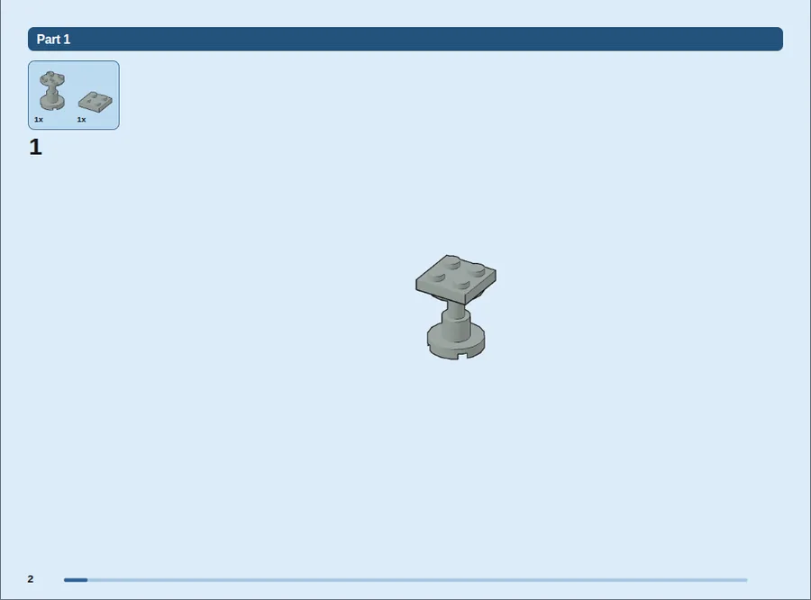
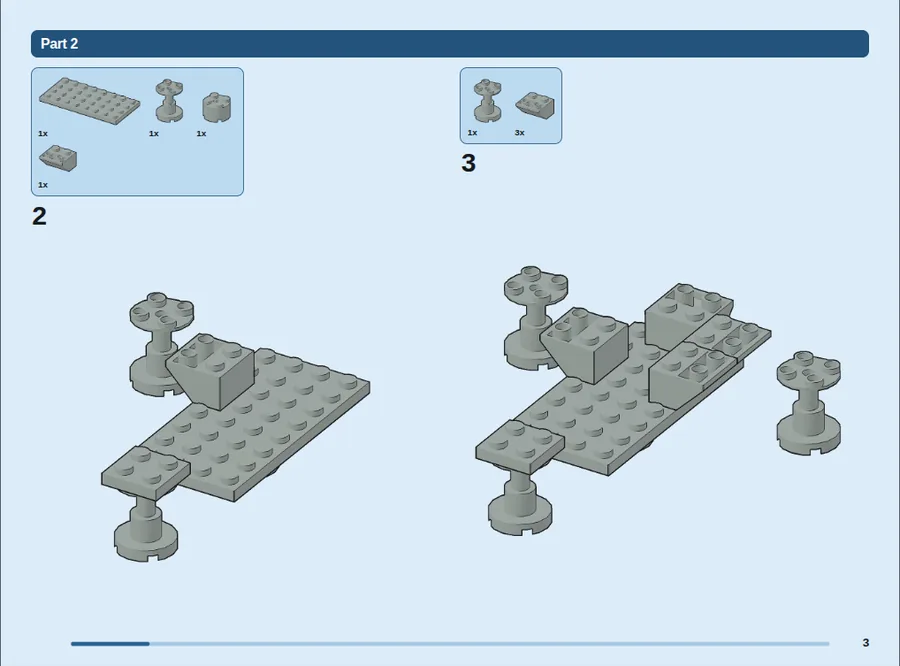

After: one build, four steps to the first page, 25 steps where there were 29.

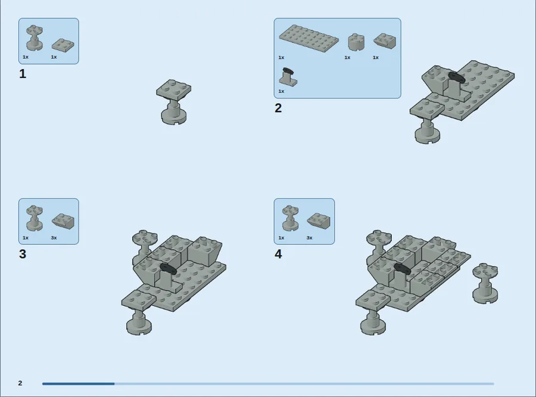

Callouts read as before: a figure built in its own box with an arrow to its
seat (918 step 5), and a long sub-assembly on framed pages of its own (6059
Knight's Stronghold's cart).

Then, reading the studs (2026-10-16), two more proof models, made the same
way on the desktop with main at 2789cd0 and with this change.

7636 Combine Harvester (372 parts), before: the harvester's first axle plate
is drawn in the air above the hay bales and the farmer of the sections before
it. Three of the 2 x 2 round plates its base stands on are steps of their
own, on the ground, and the base goes down at one end, then the other, then
across the middle.

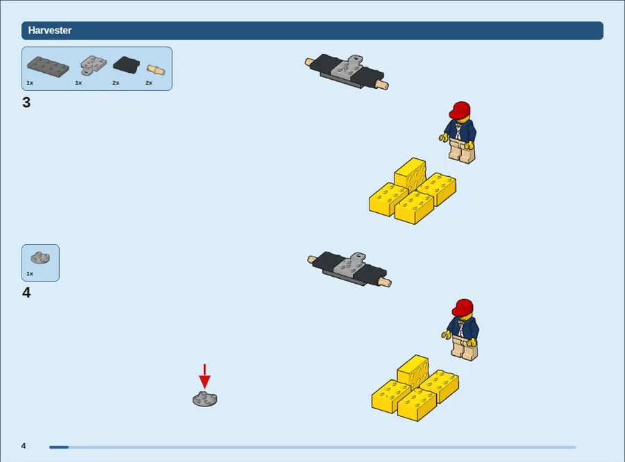
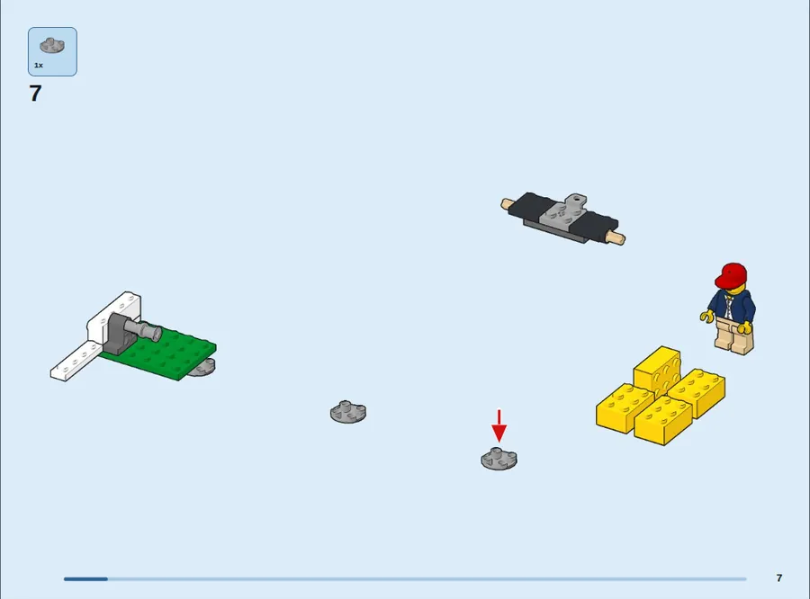

After: the harvester begins on a stage of its own. One round plate is still
a step of its own; the next goes in in the step of the plate pressed onto
it, and the base grows from one end. 101 steps where there were 109.


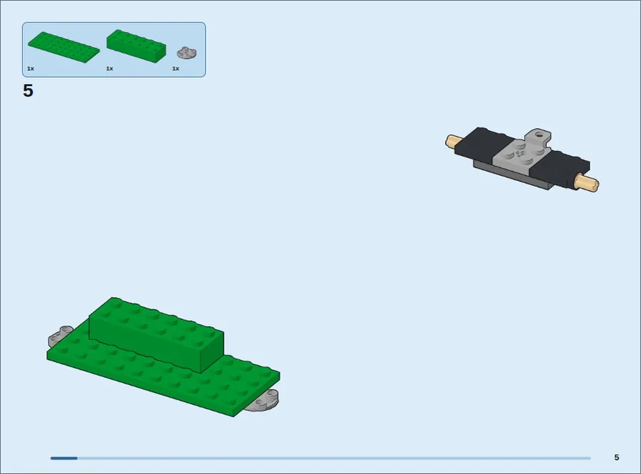

Each of its first 40 pages can be built as drawn. What still reads badly:
the axle plate of step 3 hangs in the air beside the base until step 18
joins them. By the measure 75 of its 100 steps float a thing (61% before),
because the harvester stands on its wheels, which go on last, and the
measure holds only the model's first parts, the hay bales, to the table.

6718 Raindance Ridge (80 parts), before: the warrior is built in place, a
torso and two legs in step 12 and the hips that join them a step later, in
between.

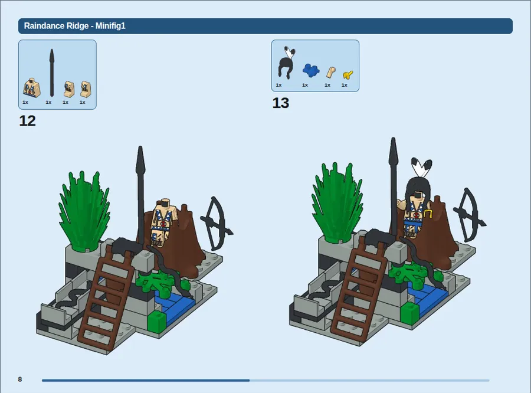

After: he is a callout, built whole and put on, and so are the rider and the
horse. 17 steps where there were 28. By the measure, on its shuffled copy,
steps with a floating thing 25.0% to 0.0% and things put in under 24.7% to
8.3%.

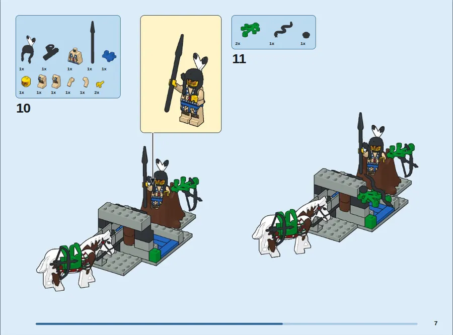

Then pins and axles (2026-10-16, later), two more models with their steps
taken out, made the same way on the desktop with main at 33da719 and with
this change, and read page by page.

7636 Combine Harvester (372 parts), before: as the 2026-10-16 "after"
above (page 4 there), its axle plate beside a round plate on the table, and
19 steps carry the booklet's note "Hold this in place: it rests on nothing
until the next step".

After: the harvester grows from its axle plate: a brick on it at step 4,
the long plate of its frame at 5, its body to step 19. Its cutter bar is
built beside it from step 20, from the round plates on the table, and the
two are joined at step 25. 81 steps where there were 101, and no step needs
the note. What reads badly: a wheel goes on at step 8, before most of
what it carries, and steps 5 to 8 are drawn from the side that hides the
axle plate they start from.

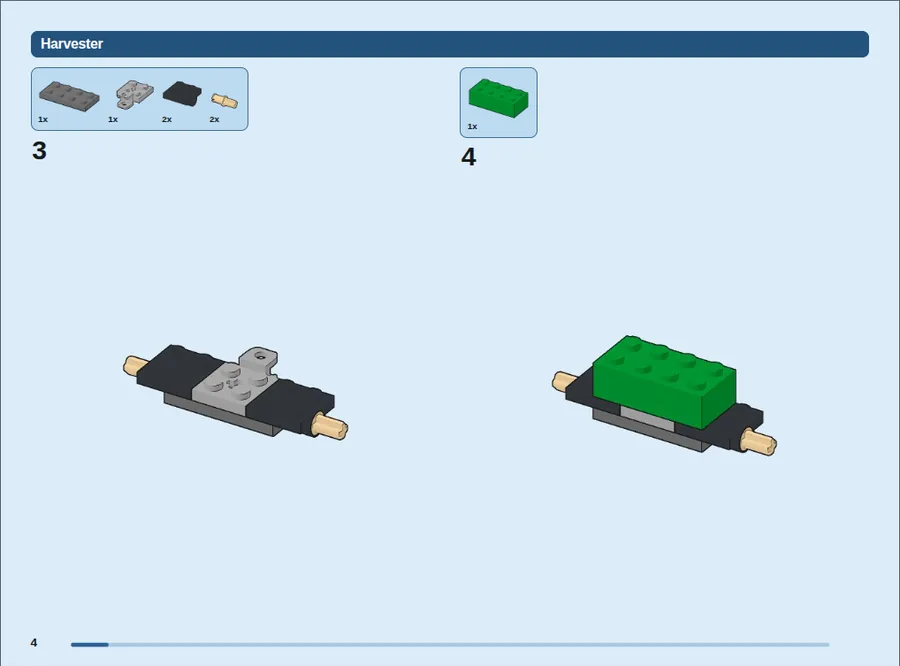
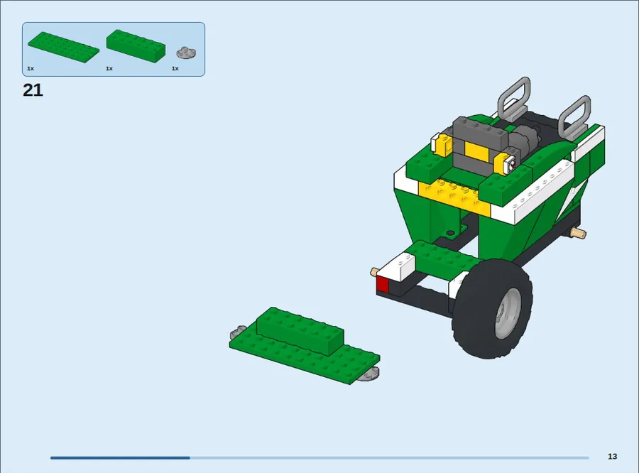

8022 Tow Truck (99 parts, Technic, tune), before: step 1 is a black beam
alone on the table. The steering, its two arms on their axle pins, is a
callout of its own put on at step 17, to a chassis built without it, and
six steps carry the booklet's own note "Hold this in place: it rests on
nothing until the next step".

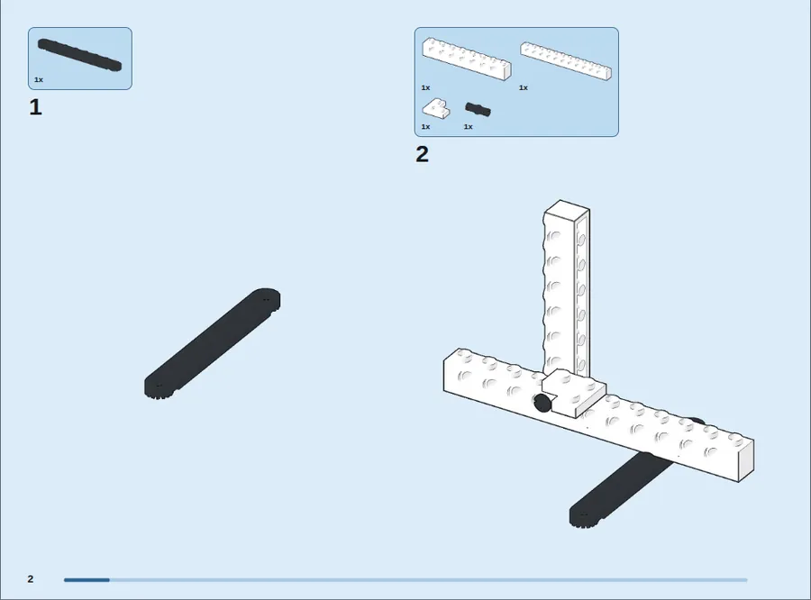
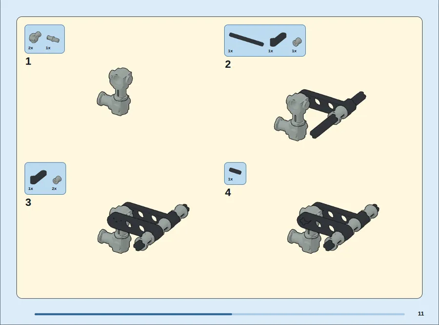

After: the steering is step 1, both arms pinned to the beam, the pins go
into them in steps 3 and 4, and the chassis is built on it, as a Technic
booklet builds a front axle. 25 steps where there were 30, and no step needs
that note. What reads badly: step 2 puts on the Technic brick its callout
fits with a pin and a bush, standing on its end beside the steering, three
steps before the 1 x 12 brick it is pinned to.

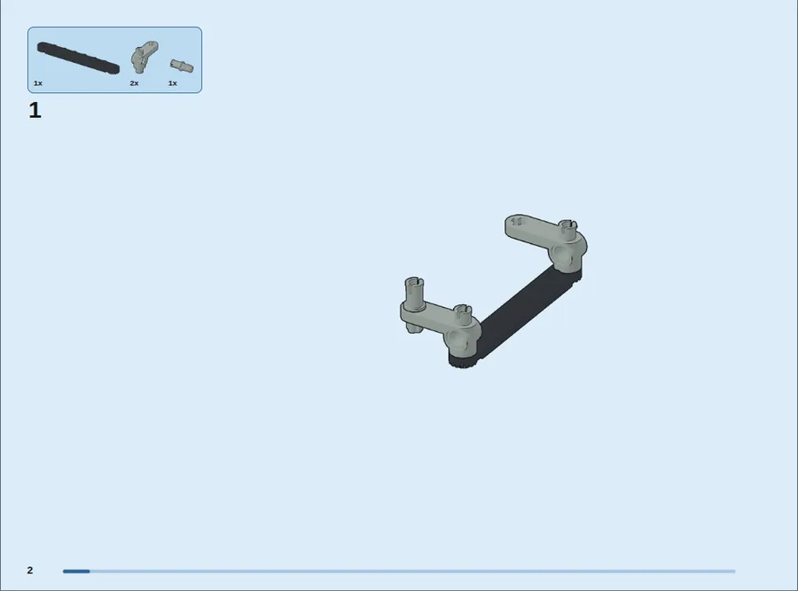
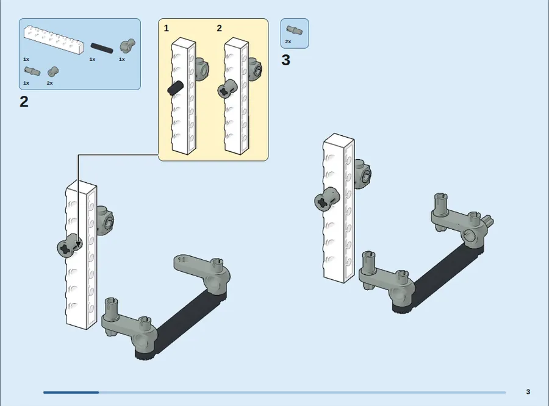

Then steps a builder can follow (2026-10-17): three tune models with their
steps taken out, a car, a building and a Technic set, made on the desktop on
the GPU with main at d24d4d6 and with this change, and read page by page.

75878 (197 parts, a Speed Champions car), before: step 4 lays two plates,
and step 5 begins a headlight block of six parts beside them, a piece of its
own; step 6 begins the other headlight the same way, and only step 7 joins
the three.

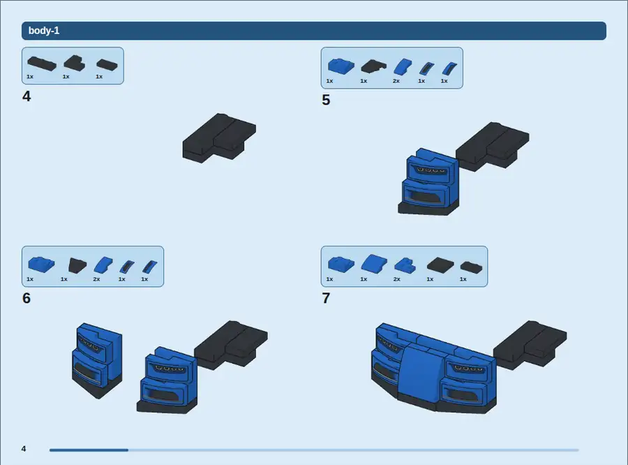

After: the car's two sides go down first, a curved panel on each, and the
round 1 x 1s of both sides go in one step; a headlight block comes at step 7.
44 steps where there were 47. What reads badly: step 5 leaves three pieces
side by side on the table, the middle plate not yet joined to either, for the
next steps to bridge, and the headlight block of step 7 is again a piece of
its own on the table.

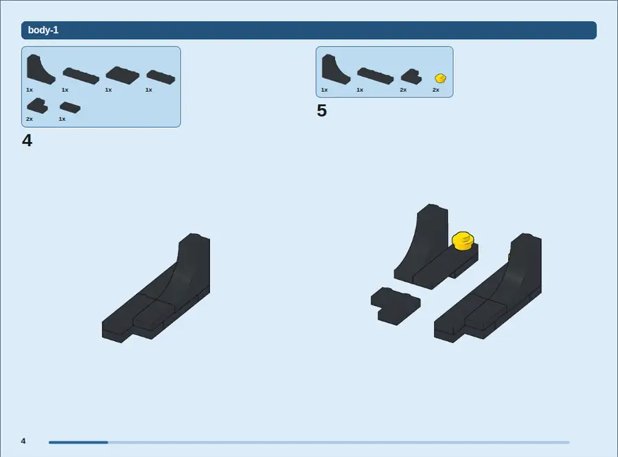

40199 (286 parts, a shop), before: step 3 lays a black base plate and, in
the same step, the yellow and white plates that lie on it, so the plate the
step adds is mostly under the others it adds; step 4 does the same with the
next base plate.

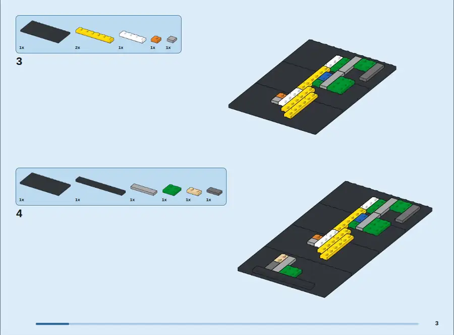

After: the black base goes down whole first, and the coloured plates of the
floor follow on it, each in sight. 40 steps where there were 46.

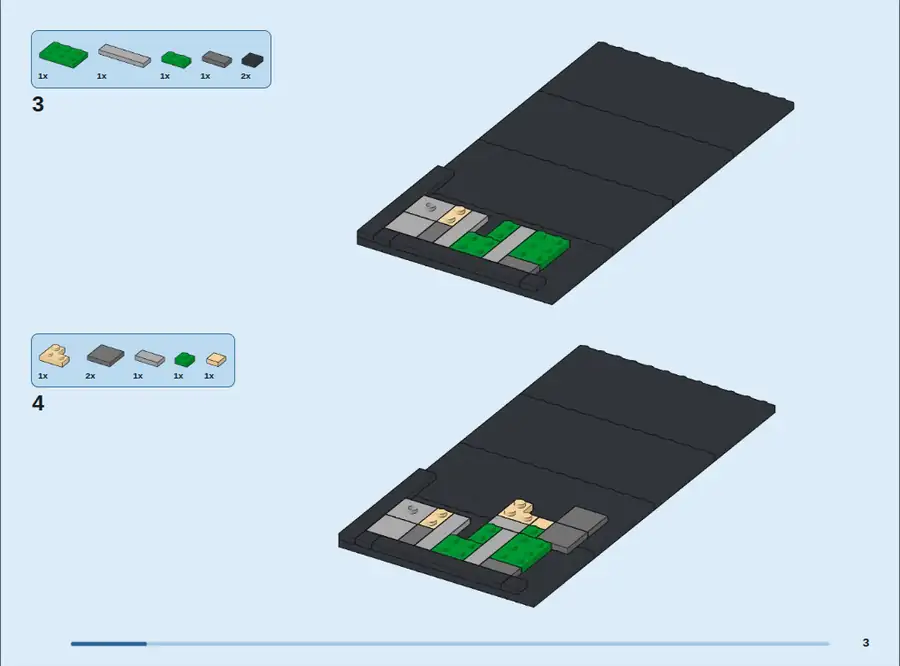

8032 Cabrio (186 parts, Technic), before: steps 1 and 2 each pin a pair of
beams at an angle, two pieces of the frame standing apart until a later step
joins them.

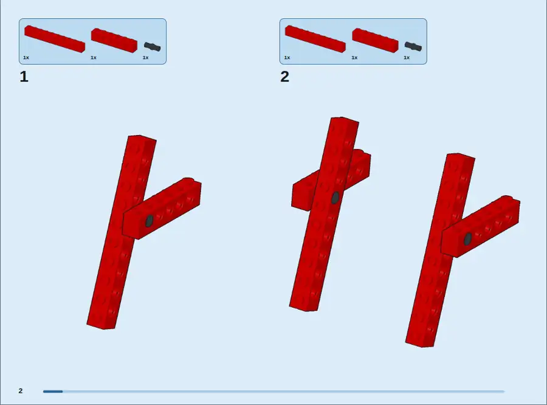

After: the steering knuckle is step 1, the red beam goes on it with its
pins and the steering rack at step 2, and the axle and the arms that hold it
at step 3, as a Technic booklet builds a front axle. 33 steps where there
were 47. What reads badly: the knuckle is a section of its own for one step
("Cabrio Sub 6a") under a banner, then "the rest"; and the order is further
from the author's than before (tau 0.49 to -0.06): the author builds the
frame first.

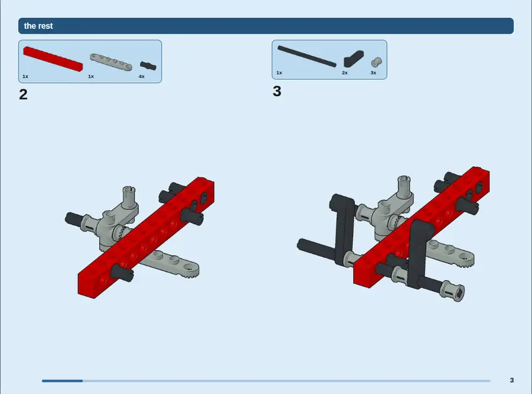

## What is left

- **Order.** Ours reads what the file's shape says and not what its author
  chose among equal options. The order the file lists its sub-models in is
  that choice (LPub builds a step-less file's sub-models in it), and a
  person's own model lists them in the order they made them. Following it
  would be reading, not planning, and on these files it reads the answer, so
  it was not done here; it is the obvious next step for files that carry it.
- **Order, again.** Reading what rests on what off the covers moved tau
  by up to 0.8 in a file, either way: on tune the gains and losses cancelled,
  on proof the losses won (0.30 to 0.26). The biggest losses on tune are
  files whose sub-assemblies lost their callouts to a loop the new supports
  made (the Cabrio's, 8032, 0.49 to -0.06; 4002020, 0.01 to -0.38), and the
  author's sub-assemblies built on the side fell a little (54.7% to 53.0% on
  tune). Giving a loop up before a callout, as `_ease` does for guesses, is
  the next thing to try for it.
- **Every step buildable.** On the held-out sample one step in twelve still
  floats something by the probe's graph (8.5%), against one in thirty for
  authors, and 5.5% of things go in under one already there, against 0.9%.
  Of what still floats on tune, a part on a side stud is one cause the
  planner cannot help: the probe's graph does not hold a stud from the side
  (`Stability.contacts` reads only what rests on what), where the build
  check does, so such a part floats by the measure until something rests on
  it or it on something. Teaching the measure side studs would be fair to
  every build alike; it was not done here, so as not to move the measure
  under this work.
  - **920's base**, most of whose parts stand square in its tilted launch
    pad's frame, is built in the hand now, and puts its hoses in a piece at a
    time: 330 LSynth pieces the file names after the model ("Rocket Launch
    Pad - LS23"), which the build check's flexible things (`Flex.strung`) do
    not know, so they are no bundle; 137 of them float at their step. 70 of
    its 209 steps float a thing, against 1 when it was built where it
    stands.
  - **The app's build check** calls 4% of the parts our sampled steps add
    floating (17% before), against 3% of the authors'.
- **The pictures and the covers cost time**: planning takes two to three
  times as long (76161 1.0 s to 2.2 s, back to back), most of it drawing
  each step as it is filled. Drawing only what is near the step is open.
- **Sub-assemblies.** Ours builds on the side sub-models of at most 60
  parts and under 30% of the model (`ASSEMBLY_MOST`), a sub-model put on
  at an angle up to half the model, and one the model places itself at any
  size: 51% of the authors' (from 40%). A callout is not built inside a
  callout, so a model on its stand built on the side builds its own
  sub-models in place (10283's shuttle, 76161's Batwing).
  The rest are built in place as sections. Authors build a floor of a modular
  building apart and stack it; the booklet can show a long callout on pages
  of its own, so lifting the limit for a sub-model that holds together and
  goes on whole is open.
- **The author's steps as the booklet draws them** still build a big
  sub-model where it stands, before what it stands on (9.6% of steps float
  something on the held-out sample, from 11.4%, against 3.4% for the author's
  own build), because only small sub-models become callouts.

## Sources

[agrawala]: https://graphics.stanford.edu/papers/assembly_instructions/assembly.pdf
[mepnet]: https://arxiv.org/html/2207.12572
[apexmr]: https://arxiv.org/html/2503.15836
[gt-asp]: https://arxiv.org/abs/2210.05236
[patent]: https://patents.google.com/patent/US7979251B2/en
[omr-spec]: https://www.ldraw.org/article/593.html
