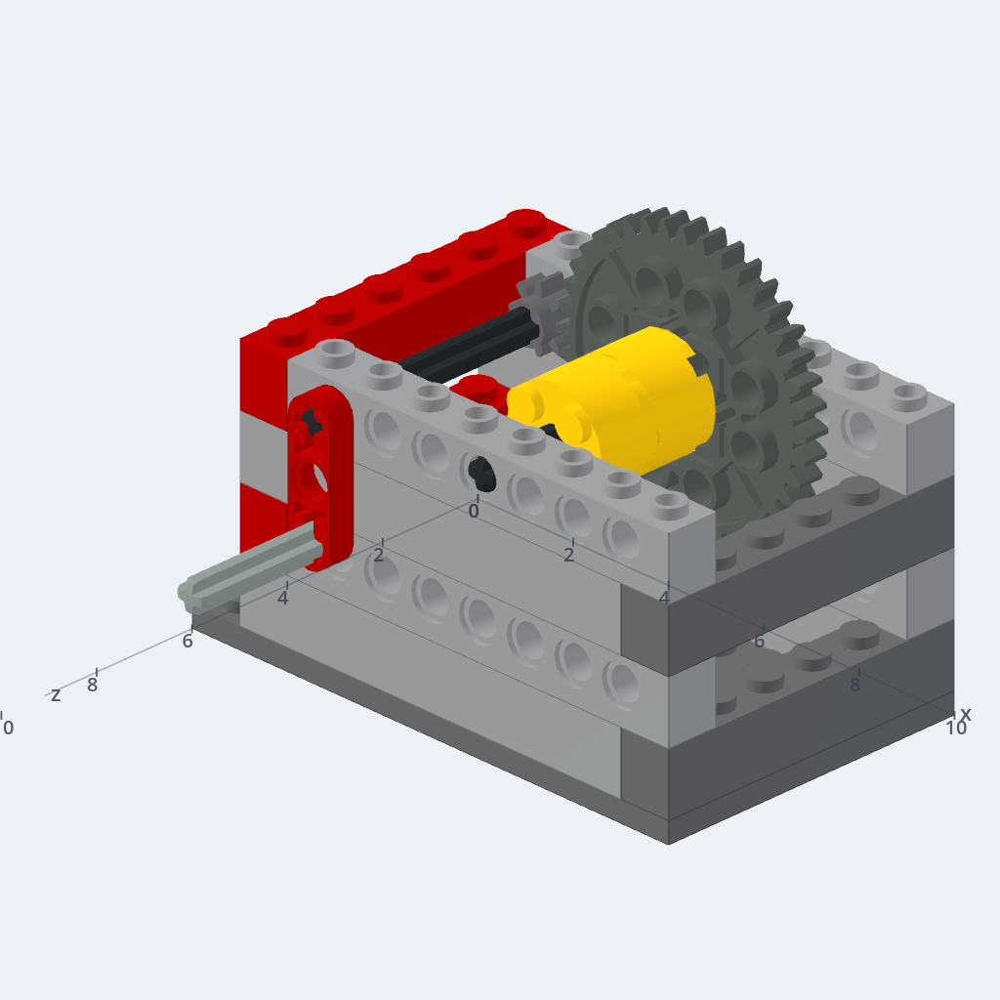

# Brickworks in Claude's Connectors Directory

Everything the submission at [claude.ai/directory/manage](https://claude.ai/directory/manage)
asks for, filled in, and the evidence that Brickworks meets each requirement.
Prepared 2026-11-03 (claudedir) after the owner said yes to listing it. The
owner submits; nothing here was sent.

## The owner's steps

1. Wait for the release that carries this commit, then check https://brickworks.diy/review shows "Sign in to review Brickworks".
2. At claude.ai/directory/manage choose **Submit new**, **MCP connector**, and paste `https://brickworks.diy/api/mcp`.
3. Fill each step from [The portal, step by step](#the-portal-step-by-step), uploading the icon (https://brickworks.diy/favicon-512.png) and the carousel from this folder.
4. In **Test & launch** paste [the reviewer's steps](#8-test--launch), with the password from `.env` (`grep BW_REVIEW_PASSWORD .env`).
5. Tick the seven acknowledgments, read **Review** for warnings, and submit.

## The requirements, checked against brickworks.diy

Each row was read from the live site on 2026-11-03 unless it says otherwise.
The commands and their full output are in the unit's evidence folder; the
lines that decide each row are quoted here.

| Requirement | Met | Evidence |
|---|---|---|
| A remote server over HTTPS | yes | `https://brickworks.diy/api/mcp`. Certificate from Let's Encrypt (YR2) for brickworks.diy, valid to 2026-12-18 and renewed by Vercel. |
| Streamable HTTP | yes | `initialize` by POST answers JSON with an `mcp-session-id`, protocol `2025-06-18`, capabilities `tools.listChanged`, `resources` and the MCP Apps extension `io.modelcontextprotocol/ui`. |
| OAuth 2.0, required | yes | A call with no token: `401`, `www-authenticate: Bearer resource_metadata="https://brickworks.diy/.well-known/oauth-protected-resource/api/mcp", scope="build"`. The protected-resource document names `https://brickworks.diy` as its authorization server, whose metadata has a `registration_endpoint` (DCR), `client_id_metadata_document_supported: true` (CIMD), PKCE `S256` only, token auth `none` among others, and scopes `build` and `offline_access`. claude.ai's own client signs in through it: `tools/web/oauth_flow.mjs` passes on every release. |
| Every tool has a title and `readOnlyHint` or `destructiveHint` | yes | 70 tools on the live list, none without. 30 say `readOnlyHint: true`, 12 `destructiveHint: true`, and the other 28 `readOnlyHint: false, destructiveHint: false` (they add or change without taking anything away). From this release each also carries its title on the tool itself (`Tool.title`, as Anthropic's quickstart sets it) as well as in its annotations, so a scan that reads either finds it (`tests/test_relay_hello.py`, `mcp_sync_probe`, `connector_probe`). |
| Tool names of 64 characters or fewer | yes | The longest is `how_real_sets_build_this`, 24. |
| Read and write in separate tools | yes | No tool takes a method; each does one thing (`look_at_model` reads, `edit_model` changes, `clear_model` clears). |
| No prompt injection in descriptions | yes | Descriptions say what each tool does and when to call it. Nothing fetches instructions from elsewhere: `read_guide` serves the server's own guide. |
| Frugal with tokens | yes, explained | See [How much a session hears](#how-much-a-session-hears). The instructions were cut from 31,405 tokens to 1,334; the tool list is a CAD's 70 tools and stays. |
| Every tool answers with valid input | yes | See [Every tool, called once](#every-tool-called-once). |
| Privacy policy | yes | https://brickworks.diy/privacy: what is collected (the address, last sign-in, the Claude apps connected, a day of network addresses), how it is used and stored (the relay deletes each message once answered; Claude's tokens are kept only as hashes), third parties, retention and deletion, and how to reach us. |
| Terms | yes | https://brickworks.diy/terms |
| Support contact | yes | https://brickworks.diy/feedback (a form, answered by email), and issues at https://github.com/Xaxis/brickworks-releases/issues. |
| Documentation | yes | https://brickworks.diy/docs/connector (connect, tabs, the 3D view in Claude) and https://brickworks.diy/docs/mcp-tools (every tool, with an example call). |
| No ads | yes | The site's content policy lets pages load from itself, its own analytics (overlook.technology, no cookies), Anthropic's API, Wikimedia, Rebrickable, Brickognize and Supabase, and images only from itself, `data:` and `blob:`. No ad network on any of seven pages. |
| Own first-party API | yes | Every call goes to Brickworks' relay and on to the person's own open Brickworks tab. |
| Not a money mover, not AI media generation | yes | A design tool. Its pictures are renders of the model, not generated by an AI model. |
| Conversation data | yes | Brickworks receives only the tool calls Claude makes and never reads chats, memory or files. |
| Nothing infringes | yes | LEGO® only as an adjective, with the Fair Play disclaimer on every page (docs/TRADEMARKS.md). In the live tool list and instructions the mark is never without its ®, apart from "the LEGO Group", and never plural or possessive. The icon is a cut cube, no brick and no studs (Decision 1). The listing below follows the same rules and names no price. |
| A test account with sample data | yes | See [The review account](#the-review-account). |
| Allowed link URIs | yes | One: `https://brickworks.diy`, which the card's Open in Brickworks opens (`ui/open-link`). |
| Carousel, 3 to 5 PNGs at least 1000 px wide | yes | See [Carousel](#carousel). |

## The portal, step by step

### 1. Connection

- **Server URL**: `https://brickworks.diy/api/mcp`
- **Users connect to different URLs**: leave unticked. One address serves everybody; each account's calls go to that account's own tab.

### 2. Tools

Nothing to enter: the 70 tools sync from the server, 30 read-only and 40
write. None should be flagged. If any is, stop and tell the lead: the fix is
on the server, not in the portal.

### 3. Listing

- **Name**: `Brickworks`
- **One-liner** (153 of 200 characters):

  > A CAD for LEGO® models. Claude designs with real parts in your Brickworks tab, checks that the model holds together, and makes its building instructions.

- **Description** (1,376 of 2,000 characters):

  > Brickworks is a CAD for LEGO® models, in your browser and on your desktop. Every part is a real part, in the colours it really comes in, placed on the stud grid and joined the way real bricks join.
  >
  > Connect it and ask Claude for a model. Claude builds it in your open Brickworks tab while you watch, then checks it as a builder would: does it hold together, which joint gives first if you pick it up, do the gears mesh and at what ratio. It draws on how thousands of real sets build each feature, so a roof, a window or a gear train is made the way the LEGO Group makes one.
  >
  > Claude can also:
  > - strengthen a weak joint without changing the look
  > - pose hinges and play a model's motions
  > - lay a picture as a mosaic, or a 3D file in bricks
  > - split a model into sections and make step-by-step building instructions with a parts list
  > - export to LDraw, BrickLink Studio, a BrickLink wanted list or a 3D file
  > - search the gallery of models people have shared
  >
  > The model shows in the chat in 3D: turn it, step through its instructions, check it, and open it in Brickworks. Every change is in your tab and one undo away, and you can take over by hand at any time.
  >
  > You need a free Brickworks account, signed in with a code sent to your email, and a Brickworks tab open at brickworks.diy/app with the assistant switched on. Brickworks sees only the calls Claude makes to it, never your chats.

- **Categories**: `Creative`, then `Education`. The directory's list is
  Commerce & shopping, Communication, Consumer health, Creative, Data &
  analytics, Developer tools, Education, Financial services, Health & life
  sciences, Legal, Media & entertainment, Nonprofit, Other, Productivity,
  Sales & marketing, Travel, Healthcare. Creative is where Canva, Figma and
  Framer are; Education for the engineering a model teaches (load, gears,
  ratios).
- **Documentation URL**: `https://brickworks.diy/docs/connector`
- **Privacy policy URL**: `https://brickworks.diy/privacy`
- **Support contact**: `https://brickworks.diy/feedback`
- **Icon**: https://brickworks.diy/favicon-512.png (`web/favicon-512.png`), 512 x 512: the cut cube in yellow, red and blue on a dark tile.
- **URL slug**: `brickworks`. Permanent once published.
- **Allowed link URIs**: `https://brickworks.diy`

### Carousel

Five PNGs in `carousel/`, each 1206 px wide and cropped to the app's answer:
Brickworks' 3D card, as an MCP Apps host shows it after `look_at_model`. Each
shows a model the example prompts built, opened in the review account's tab
on brickworks.diy on 2026-11-03 and shown in the reference host
(basic-host, from the MCP Apps SDK). Upload them in this order, each with
its prompt:

| Picture | Prompt to pair it with |
|---|---|
| `carousel/1_design.png`: the lighthouse, 312 parts | Design a lighthouse in Brickworks on a small rocky island: about 25 cm tall, a red and white striped tower, a gallery with a railing near the top, and a lamp room with clear windows. Make sure it holds together, then save it. |
| `carousel/2_check.png`: Check on, "It holds together" | In my Brickworks tab, which joints of the lighthouse would fail first if I picked it up by the top? Strengthen the weakest one without changing how it looks, and tell me what you changed. |
| `carousel/3_mechanism.png`: the winch, crank to drum at 1:5 | Start a new model in Brickworks (my lighthouse is saved): a hand-cranked winch, a crank that turns a drum through gears at about 1:5, on a sturdy stand. Simulate it turning, tell me the real ratio, and save it. |
| `carousel/4_steps.png`: Instructions, step 30 of 63, with its parts | Make building instructions for the model in my Brickworks tab: split it into steps a builder can follow, and give me the parts list with colours. |
| `carousel/5_parts.png`: Parts, 312 pieces in 50 lots, with a BrickLink wanted list | Make building instructions for the model in my Brickworks tab: split it into steps a builder can follow, and give me the parts list with colours. |

The fourth and fifth share a prompt, which asked for both: every prompt here
was run for real, and none was made up for a picture.

### 4. Use cases

- **Primary use cases**:
  1. Design a model from a description, with real parts and colours, built in the person's open Brickworks tab.
  2. Check a model as a builder would: what falls off, what gives first when it is lifted, whether gears mesh, and strengthen it.
  3. Mechanisms: gear trains at a ratio, cranks, hinges, poses and motions, simulated.
  4. Building instructions: sections, steps, the booklet and the parts list with colours.
  5. Change what the person built by hand: their selection, recoloured, moved, mirrored, split or merged.
- **What users need first**: a free Brickworks account (an email address; sign-in is by a code sent to it), and a Brickworks tab open at https://brickworks.diy/app, or the desktop app, with the assistant switched on (Tools, Settings, Assistant). The tab is where the model is built.
- **Reads or writes**: both. 30 tools only read; 40 change the model in the person's tab, each one undo away.

### 5. Company

- **Company name**: `Atypic` (the name Brickworks' terms give)
- **Website**: `https://brickworks.diy`
- **Primary contact**: your own address, the one you submit with.

### 6. Authentication

- **Authentication requirement**: required (every tool acts on the person's account and tab).
- **Authentication methods**: OAuth. Claude registers itself (its client metadata document, or dynamic registration); there is no client ID or secret for Anthropic to hold, so leave those empty.

### 7. Data handling

- **The underlying API**: our own.
- **Personal health data**: no.
- **Sponsored content**: no.

### 8. Test & launch

Paste this, with the password from `.env` where it says so:

```text
Brickworks builds in the person's own Brickworks tab, so the review needs that
tab open in your browser, signed in to the review account.

Address:  delivered+claude-review@resend.dev
Password: <the password>

1. Open https://brickworks.diy/review and sign in with the address and
   password above. Everyone else signs in with a code sent by email; this
   test address receives no mail, so the review account has a password
   instead, and this page is the only place it works.
2. Press "Open the app". Brickworks opens at brickworks.diy/app, signed in,
   with its assistant switched on. Keep that tab open: Claude builds there.
   File, Open lists the account's saved models, the examples below among them.
3. In Claude, connect Brickworks. It sends you to Brickworks to allow it;
   you are signed in already, so press Allow.
4. Ask, for example: "Open my lighthouse in Brickworks and tell me which
   joints would fail first if I picked it up by the top." Watch the
   Brickworks tab; the model also shows in 3D in the chat.

Every tool works on the model in the open tab. With two Brickworks tabs open,
Claude asks which one (tabs, select_tab). Files a tool makes (export_model,
render_model) download in that tab.
```

Then confirm you have run every tool: [Every tool, called once](#every-tool-called-once)
shows each called through the connector on 2026-11-03.

### 9. Compliance

All seven are true of Brickworks, each for the reason in the requirements table:

1. **Directory guidelines**: the table above.
2. **First-party API**: our own relay and the person's own tab.
3. **Financial transactions**: none. Nothing is bought or sold through the connector.
4. **AI media generation**: none. Pictures are renders of the model the person built.
5. **Prompt injection**: descriptions say what a tool does; nothing pulls instructions from elsewhere.
6. **Conversation data**: only the calls Claude makes, deleted by the relay once answered.
7. **Public documentation**: https://brickworks.diy/docs/connector and https://brickworks.diy/docs/mcp-tools.

### 10. Review and submit

Read the warnings it shows, if any, before submitting.

## The example prompts, run for real

Each was run on 2026-11-03 as a reviewer would meet it: Claude Code
(2.1.316, on a Claude subscription, no API key) connected to
`https://brickworks.diy/api/mcp` with the review account's OAuth token, its
only tools the connector's, and the review account's Brickworks tab open
and answering. The tab was this commit's app, run headless on the build
machine; a person's tab is a browser's. The prompts ran one after another
in the same tab, as one person's afternoon would, the winch last. Pictures are the tab's
own, taken after each run; the carousel shows the same models in Claude's
3D card.

### 1. Design a model

> Design a lighthouse in Brickworks on a small rocky island: about 25 cm tall, a red and white striped tower, a gallery with a railing near the top, and a lamp room with clear windows. Make sure it holds together, then save it.

6.5 minutes, 43 calls. A 312-part lighthouse, 82 plates (about 26 cm) tall, on
a grey rock island on a blue baseplate: a round tower 6 studs across in red
and white bands, a round gallery 8 studs across with a white spindled
railing, a trans-clear lamp room under a red cone roof, and a keeper with a
lantern at the foot. The app's check passed (it holds together, nothing
overloaded) and the session saved it as "lighthouse". It said what fell
short: each red band has a dark red ring (the round plates never came in
red), and the lamp room reads pale rather than lit.


### 2. Check and strengthen it

> In my Brickworks tab, which joints of the lighthouse would fail first if I picked it up by the top? Strengthen the weakest one without changing how it looks, and tell me what you changed.

3 minutes, 14 calls (`weakest_joints` four times). It found the tip of the
roof weakest when lifted by the top: the 2 x 2 cone on a 2 x 2 round plate on
the 4 x 4 cone, four studs each carrying about 1.55 N of the model's 632 g,
past a stud's working load of 1 N. It added one part, a red Technic axle
inside the cones, unseen from outside, and said plainly that the axle stops
the top rocking but does not clamp it, and how to lift the model instead.

### 3. A mechanism

> Start a new model in Brickworks (my lighthouse is saved): a hand-cranked winch, a crank that turns a drum through gears at about 1:5, on a sturdy stand. Simulate it turning, tell me the real ratio, and save it.

5 minutes, 27 calls (`simulate_mechanism` three times). A 21-part winch of
57 g on a 6 x 10 plate: a red crank arm with a grey handle on the front turns
an 8-tooth gear, which drives a 40-tooth gear on the drum's axle; the drum is
two yellow 2 x 2 round bricks, and both axles turn in Technic bricks in the
stand's two sides. It turned the crank five times in the simulation and gave
the real ratio as exactly 1:5 (a fifth of a drum turn for each turn of the
crank, the other way round, through one 8-to-40 mesh), with nothing hitting
anything in either direction and the model standing in every position. It
saved it as "hand-cranked-winch.ldr". It said what it left out: a cable it
wound on the drum ran down through the plate, so it took it off, and a video
of the turning needs a window.

The prompt's first wording ("Build a hand-cranked winch...") was met with a
question rather than a model: the tab held the lighthouse, and the session
would not clear it unasked. Saying the lighthouse is saved was enough.



### 4. Building instructions

> Make building instructions for the model in my Brickworks tab: split it into steps a builder can follow, and give me the parts list with colours.

3 minutes, 22 calls. The lighthouse in 58 steps from the bottom up (the
baseplates, the island's courses, the keeper, the tower's rings, the
gallery and the lantern, the roof), and its parts list: 313 pieces in 51
lots, 633 g, by part and colour. It wrote the steps as an LDraw `.mpd` and the
parts as a Rebrickable `.csv`. The printable booklet was refused, rightly:
the tab here had no window to draw its pictures in, which a browser tab
does (the every-tool pass below exports one). It also found a fault:
`edit_steps` moving parts "to step 1" put them elsewhere in the list, so it
undid its own three step edits and said so.


## Every tool, called once

<!-- TOOLS -->

## How much a session hears

Counted with Anthropic's token counter (`count_tokens`, claude-opus-5-5) on
what the connector served on 2026-11-03: before, from brickworks.diy as it
was; after, from the review account's tab of this commit, through the same
live relay.

| What a session is given | Before | After |
|---|---|---|
| The instructions, at `initialize` | 90,009 characters, 31,405 tokens | 3,827 characters, 1,334 tokens |
| The tool list, 70 tools | 73,589 tokens | 73,589 tokens |

**The instructions** were the whole design guide. Claude Code reads the first
4,096 characters of a server's instructions and no more (2.1.316, tested by
asking a session what it had been told), so 86,000 of them reached nobody
there, and every other client paid for all of them. Now they are the guide's
head (how a session works in a tab) and the rules' opening (what the app
does, and the LEGO® notice), in 3,827 characters. Everything else is still
one call away: `read_guide` serves the guide a section at a time, when a
design needs it, as it did before. `mcp_sync_probe` fails if what the
connector serves passes 4,096 characters; `designer_words_probe` and
`mcp_lean_probe` passed on the change.

**The tool list** stays. It is a CAD: 70 tools, 18,426 tokens of
descriptions and about 55,000 of input schemas. A third of it is two tools,
`submit_design` (13,455) and `check_design` (11,709), whose schema is the
design language a model is written in: parts, patterns, sections and
assemblies. That language is the API, tuned against real sets by the bench;
cutting it would cut what Claude can build, so it is neither cheap nor safe
to shrink. The titles added this release are not sent to the model.

**The answers** are short. Over the four example sessions' 106 calls, a
tool's answer was 1,125 characters at the median and 6,855 at the 90th
percentile. A session starts small: `tabs` answers in about 200
characters. The largest were the
guide's "shapes" section (15,904 characters, asked for by name when a
design needs it) and `look_at_model` of the 313-part lighthouse (14,816),
which gives a big model's parts a page at a time (`skip`) rather than all
at once. Pictures come only when a session asks for one (`view_model`).
A whole session heard 47,000 to 105,000 characters of answers: the
lighthouse's design the most, over 43 calls.

## The review account

The review needs a test account with sample data, and Brickworks' sign-in
is a code sent by email, which a reviewer could not receive for an account
of ours. So the review account is a Resend test address, which receives no
mail, with a password: the one kind of account a password signs in to
(`api/_auth.js`, `isTestAccount`). It is made the way the flows make theirs,
by `tools/web/relay_account.mjs review`, and it is nobody's own: not the
owner's, and not the shared account the probes sign in to.

- **Address**: `delivered+claude-review@resend.dev`
- **Password**: in `.env` as `BW_REVIEW_PASSWORD`, never in a document.
  `relay_account.mjs review` writes it there the first time, and after
  that puts it back on the account if the two ever differ.
- **Where it signs in**: https://brickworks.diy/review (`web/review.html`),
  which refuses every other address before asking for a password, and is
  linked from nowhere and not indexed. `tools/web/review_flow.mjs` proves
  it on every release whose change it touches.
- **What it holds**: the models the example prompts built and saved, and
  the every-tool pass's saves. Its models are never in a public list, as
  no test account's are.

Keep it while Brickworks is listed: reviewers come back for updates. To
make it again or put its password back:

```sh
node --env-file=.env tools/web/relay_account.mjs review
```
